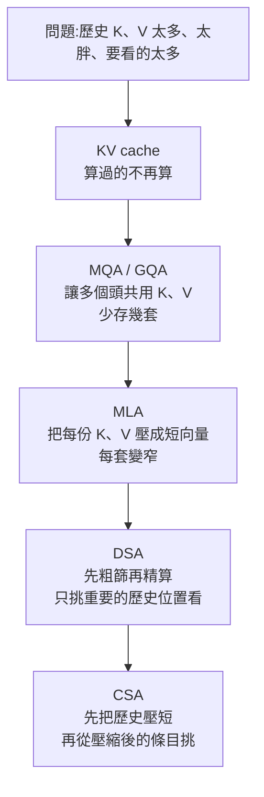

# 100 萬上下文為什麼貴、又為什麼會變笨?從 MHA、MQA、GQA 到 MLA、DSA、CSA

> 整理自 YouTube 頻道 **轩辕的编程宇宙**〈[100万上下文可能不是你想的那样？MHA、MQA、GQA、MLA、DSA、CSA这些都是啥？一个动画彻底搞懂](https://www.youtube.com/watch?v=HzvpACdLsms)〉(2026-10-26,約 17 分鐘,動畫講解)。
>
> 該片無字幕,**逐字稿以 CPU faster-whisper 轉錄、非官方字幕**。說明欄附作者的圖文教程網站,無業配或聯盟連結。
>
> ✅ 已對照 **DeepSeek-V2 論文**(arXiv 2405.04434,讀 PDF 全文)、**GQA 論文**(arXiv 2305.13245)、**MQA 原論文**(arXiv 1911.02150)與 **DeepSeek-V3.2** 的 DSA 描述。⭐ 對照後有一處影片說法偏保守:**MLA 在論文裡的成績不是「不比 MHA 差太多」,而是比 MHA 更好**,見第六節。

---

## 一句話總結

自注意力讓每個 token 都能直接看到所有 token,這是 Transformer 最大的優勢,但上下文拉到百萬級時,**它也成了最大的成本**:計算量隨長度**平方**成長,而且每個歷史 token 的 K、V 都要留在顯存裡。這些年的各種縮寫其實是**同一個問題上的不同刀法**:KV cache 不重算 → MQA / GQA **少存幾套** → MLA **每套壓窄** → DSA **只挑重要的看** → CSA **先把歷史壓短再挑**。每一刀都在拿一點資訊精度換效率,所以上下文越長、壓得越多,漏掉關鍵資訊的風險也越大。

---

## 一、先算一筆帳:為什麼長上下文會把 GPU 拖垮

**計算量**:每個 token 要和所有 token 比對一次。

| token 數 | 兩兩比對次數 |
|---|---:|
| 10 | 100 |
| 100 | 10,000 |
| 100 萬 | **1 兆**(10¹²) |

長度 ×10,計算量 ×100;而且這還只是**一層、一個頭**,模型有幾十層、每層幾十個頭。

### 兩個階段:讀題與寫答案

| 階段 | 做什麼 | 特性 |
|---|---|---|
| **Prefill(預填充)** | 整段提示詞一次衝進 Transformer,每層用自己的參數算出**這一層自己的** Q、K、V | 可以一口氣平行算完,計算量大 |
| **Decode(解碼)** | 一個 token 一個 token 往外生成,下一個字要等上一個字寫出來才知道 | 無法平行 |

**KV cache**:歷史 token 的 K、V 算一次就夠,prefill 時每層都存起來,decode 時只算新 token、直接查快取(本庫 [[kv-cache]] 有基礎版)。第一筆浪費省掉了,但新問題來了:

1. 快取隨 token 越長越大,**每一層都有一份、每層又有很多個頭**,百萬 token 時顯存放不下。
2. 更麻煩的是 decode 時**每寫一個 token 都要把歷史 K、V 從顯存讀一遍**。這時 GPU 往往不是算不過來,而是**大部分時間花在搬資料**(受顯存頻寬限制,而不是算力)。

---

## 二、六招總覽:每一招在省什麼

| 招 | 全名 | 動哪裡 | 一句話 |
|---|---|---|---|
| MHA | Multi-Head Attention | — | 每個頭一套自己的 Q、K、V(基準) |
| MQA | Multi-Query Attention | **K、V 的套數** | 所有頭共用**一套** K、V |
| GQA | Grouped-Query Attention | K、V 的套數 | 幾個頭一組,**每組**共用一套 |
| MLA | Multi-head Latent Attention | **每套的寬度** | 存壓縮後的短向量,用時再展開 |
| DSA | DeepSeek Sparse Attention | **要看的位置數** | 輕量檢索器先粗篩,再只對候選做精算 |
| CSA | Compressed Sparse Attention | **歷史的長度**(再加挑選) | 先把相鄰 token 合併,再挑重要的 |

---

## 三、各招細節

### 1. MHA:每個觀察員一整套資料庫

假設 32 個頭,每個頭有自己的一組 Q、K、V(32 個 Q、32 個 K、32 個 V)。多個提問角度很有價值(有的盯「虎皮鸚鵡」,有的盯「綠色與羽毛」),但問題是:**32 個提問角度,真的需要 32 套各自獨立的 K、V 嗎?**

### 2. MQA:全公司只留一個助理

32 個 Q 還在,**K、V 只保留一套**。快取一下縮小很多,decode 要讀的資料也少很多。

⚠️ 影片提醒:共用 K、V **不代表所有頭的結果一樣**,因為每個頭的 Q 不同,算出的注意力權重也不同。代價是共享太激進:原來每個頭可以用自己的方式組織資料,現在大家都得讀同一份,表達能力受影響。

### 3. GQA:按小組來,折衷

保留 8 套,**每 4 個頭共用一套**。介於「一頭一套」和「全部共用一套」之間。

### 4. MLA:不是少存幾套,而是每份存得更小

關鍵觀察:32 個頭的 K、V 都是從**同一個 token 向量**變出來的,看起來是幾十份獨立資料,其實**源頭只有一個**,彼此有大量重複(影片比喻:把一份原稿影印幾十份、只是換了排版,不必全存)。

做法:

1. 用一個**訓練出來的線性變換**,把 token 向量壓成很短的向量,叫 **latent(潛在表示)**,原本每個 token 的 K、V 加起來要存幾千甚至幾萬個數字,現在只存幾百個。
2. 用的時候,再用**每個頭專屬**的一組線性變換把 latent 展開回該頭需要的 K、V。

**和 MQA 完全不同**:MQA 是所有頭被迫讀同一份 K、V;MLA 是**存同一份精簡筆記,但每個頭有自己的讀法**,展開出的 K、V 各不相同。壓縮與展開的兩組變換是**跟模型一起訓練**出來的,模型從頭就知道快取只有這麼大,會自己學著把有用的資訊放進短向量。

### 5. DSA:不必每個字都重看

情境:上下文有幾十萬 token,最後問「軒轅小時候養的是什麼」。你不會把前面幾十萬字逐字重看,而是先快速掃過、找出相關的幾處再精讀。

DSA 的做法:用一個**便宜的 indexer(輕量檢索器)**給所有歷史位置快速打分,只取分數最高的 top-k,**昂貴的精確注意力只在這些候選裡算**。

為什麼 indexer 學得會?位置是隨機的(虎皮鸚鵡可能出現在第 3,821 個或第 80 萬個 token),但**什麼內容和當前問題相關**不是隨機的。普通注意力學的不是「永遠看前面第 5 個 token」,而是「什麼樣的 Q 和什麼樣的 K 比較配」;indexer 也一樣,學的是**相關性**,不是位置。

而且 indexer **不必預測得很精確**:真正重要的 token 只有幾十個,它撈回 2,000 個、混進一堆沒用的也沒關係,因為後面的精確注意力會在這 2,000 個裡重新計算。所以對 indexer **最重要的指標是召回率**:寧可多抓,不要漏掉關鍵的。

### 6. CSA:先壓短,再挑

DSA 的新問題:為了從 100 萬個 token 挑 top-k,indexer 自己面對的候選**還是 100 萬個**。粗篩雖然便宜,100 萬終究還是 100 萬。

解法:**先讓候選變少**。把連續幾個 token 合併成一個「壓縮條目」(影片用 4 合 1 示範):100 萬 token → 25 萬個條目,再讓 indexer 從 25 萬個條目裡挑重要的。等於砍兩刀:第一刀把歷史壓短,第二刀從壓縮後的歷史裡挑。

### MLA 和 CSA 都叫「壓縮」,方向完全不同

把歷史快取想成一張大表格:橫著看是**每個歷史位置要存多少資訊**,豎著看是**一共有多少個歷史位置**。

| | 壓哪個方向 | 效果 |
|---|---|---|
| **MLA** | **橫著壓** | 每個位置的 K、V 變窄(位置數不變) |
| **CSA** | **豎著壓** | 多個位置合併成一行,行數變少(每行寬度不變) |

### 壓縮必然有損:近的清楚、遠的摘要

4 個 token 壓成 1 個,資訊不可能和原來一樣。所以很自然的思路是:**離得遠的內容看壓縮後的摘要就好,離當前很近的仍保留更細的原始資訊**。像讀一本很厚的書:幾百頁前的只剩大概,剛讀過的幾頁細節還記得清清楚楚。影片總結長上下文的注意力優化「越來越像我們翻書找東西」:**先翻目錄再精讀;遠處只記摘要,近處再仔細看**。

---

## 四、為什麼宣稱支援 100 萬,用到五六十萬就開始降質

影片的答案:原因肯定不止一個。

1. 訓練資料裡**真正很長的文本本來就少**。
2. **這些省錢的辦法大多不是白省的**:壓縮會丟資訊,篩選可能把真正重要的資訊漏在外面;上下文越長,需要壓縮、需要篩選的越多,漏掉關鍵資訊的機率也越大。
3. 影片比喻:像公司降本增效,砍得越狠,業務出問題的風險越大。

收尾的反思:2017 年 Transformer 剛出來時,注意力的最大優勢是讓所有 token 直接建立聯繫、不用像 RNN 一個傳一個;當上下文漲到百萬級,「所有 token 都能看到所有 token」反過來變成最大的成本。這些年的優化一直在兩頭之間找平衡:**既要保住注意力強大的資訊檢索能力,又要把計算、顯存和頻寬成本壓下來**,而且這條路還遠沒走完。

---

## 五、示意計算:同一個模型,KV cache 差多少

> 假設配置(**示意,非任何特定模型**):32 層、32 個頭、每頭維度 d_h = 128、fp16(每個數 2 位元組)。

每個 token 的快取元素數(DeepSeek-V2 論文 Table 1 的公式):

| 方案 | 公式 | 元素數 / token | 每 token | **100 萬 token** |
|---|---|---:|---:|---:|
| MHA | 2·n_h·d_h·l | 262,144 | 512 KiB | 約 **524 GB** |
| GQA(8 組) | 2·n_g·d_h·l | 65,536 | 128 KiB | 約 131 GB |
| MQA | 2·d_h·l | 8,192 | 16 KiB | 約 16 GB |
| MLA(d_c = 4d_h,d_R = d_h/2) | (d_c + d_R)·l | 18,432 | 36 KiB | 約 **37 GB** |

⇒ 單看一個 100 萬 token 的對話,**MHA 光 KV 就要 500 多 GB**,遠超單張 GPU;MLA 能壓到不到 40 GB,而且**品質不降反升**(見下節)。這也是長上下文模型幾乎都不用純 MHA 的原因。

---

## 六、核實與補正

**✅ 與論文一致:**

- **MQA 出處**:Noam Shazeer,〈Fast Transformer Decoding: One Write-Head is All You Need〉(2019-11)。核心動機正是影片講的 **decode 受記憶體頻寬限制**:重複載入又大的 K、V 張量很慢,所有頭共用一套 K、V 後 decode 快很多,品質只有輕微損失。
- **GQA 出處**:Ainslie 等,〈GQA〉(Google,2023-05)。⭐ 影片沒講的重點:GQA 論文提出可以把**既有 MHA 檢查點只花約 5% 的原預訓練算力「升訓」(uptrain)**成 MQA / GQA,結論是 **GQA 品質接近 MHA、速度接近 MQA**。MQA 其實就是組數為 1 的 GQA。
- **MLA 的名字與機制**:DeepSeek-V2 論文(arXiv 2405.04434)的「低秩 K、V 聯合壓縮」:只快取壓縮後的潛在向量 c^KV(維度 d_c ≪ d_h·n_h),上投影矩陣負責展開。
- **DSA**:DeepSeek-V3.2 論文——由「**lightning indexer**」打分 + 「細粒度 token 選擇」取 top-k 的 K、V 條目。indexer 用 ReLU、可用 FP8、頭數很少,所以計算便宜。
- **CSA**:屬於 **DeepSeek V4**(次級來源描述:約 4 倍壓縮 + lightning indexer 挑 top-k)。本庫 [[deepseek-v4-engineering]] 有詳細拆解。

**⚠️ 影片說法偏保守或需補正:**

- **「MLA 並不比傳統 MHA 差太多」** ⇒ 論文原話是 MLA「**achieves superior performance compared with MHA**」,而且 KV cache 大幅更小。論文 Table 9 的對照(同規模 MoE 模型):大模型每 token 快取 **860.2K → 34.6K 個元素**,BBH 46.6 → 50.7、MMLU 57.5 → 59.0、C-Eval 57.9 → 59.2、CMMLU 60.7 → 62.5。⚠️ 這是**作者自己的 ablation**,不是獨立第三方復現。
- **影片說 MLA 存「幾百個數值」**:DeepSeek-V2 的設定是 **d_c = 4·d_h**,再加一條**解耦的 RoPE 鍵**(d_R = d_h/2),所以每 token 每層快取 (d_c + d_R) = **4.5 d_h** 個元素,相當於**組數只有 2.25 的 GQA**。以 d_h = 128 算是 576 個元素,和影片說的「幾百個」一致。
- **影片說「真實的 MLA 比較複雜」**,確實:
  - **RoPE 與低秩壓縮不相容**,所以 MLA 另外用一條共用的「解耦 RoPE 鍵」專門承載位置資訊。
  - ⭐ 推論時其實**不真的展開 K、V**:論文說 W^UK 可以**吸收進 W^Q**、W^UV 吸收進 W^O,所以不必顯式算出每個頭的 K、V。影片的「用時再展開」是教學上的簡化。
- **MQA 的名稱**:字幕聽成「多頭查詢注意力」,正式名稱是 **Multi-Query Attention(多查詢注意力)**。
- **DSA 的 top-k**:V3.2 的 Transformers 實作預設 `index_topk = 2048`,且 DSA 是**建立在 MLA 之上**(V3.2 論文)。⚠️ 本庫 [[deepseek-v4-engineering]] 一處寫 DSA「只讀 ~248 個 KV」,和 top-k = 2048 看起來口徑不同(可能是不同比較基準),本筆記未能判斷,以兩個來源並列。

**⭐ 影片沒講的 V4 的另一半:** 次級來源描述 V4 還有 **HCA(重度壓縮注意力,約 128 個 token 併成一個,密集注意力)** 和滑動視窗,與 CSA 交替使用。因為這些只有次級來源,細節請看本庫 [[deepseek-v4-engineering]]。

**⚠️ 未能核實:**

- 「有些模型宣稱百萬上下文,用到五六十萬就降質」:影片的一般性觀察,沒有具體模型與數字。
- 影片把 DSA 說成可以讓 indexer「撈回 2,000 個」:是教學舉例,實際 top-k 見上。
- CSA 的「4 合 1」是影片的**示範比例**,實際比例以 V4 技術報告為準(次級來源也寫約 4 倍)。

**字幕還原**(Whisper 對這支影片的誤聽,依上下文與論文名稱還原):「穿sformer」→ Transformer;「上香文 / 上向文 / 商量文」→ 上下文;「頭肯 / 頭坑 / 頭根」→ token;「Kivcash / KVcash」→ KV cache;「Prefial / Prefere」→ Prefill;「Deepsec / DeepSake」→ DeepSeek;「虎皮鷹鵡 / 銀五」→ 虎皮鸚鵡;「宣元 / 宣員 / 宣源 / 玄員」→ 軒轅(作者);「公司叫本正效」→ 降本增效;「經檢筆記」→ 精簡筆記;「雇用同一個源頭」→ 共用同一個源頭;「招回率」→ 召回率;「壓縮吸緝」→ 壓縮稀疏;「出塞 / 出塐 / 塞後選」→ **粗篩 / 粗篩候選**(**推定**:依前後文「先粗篩再精算」與 indexer 只負責篩候選,語意吻合,但字幕確實寫的是什麼無法確認)。

---

## 七、應用案例

### 案例 1:估算你要服務的長上下文模型要多少顯存

步驟:

1. 查模型設定:層數 l、頭數 n_h、每頭維度 d_h、KV 頭數 n_g(GQA)。
2. 套用上表公式,算 **每 token 快取 × 目標上下文長度 × 同時請求數**。
3. 加上模型權重本身的顯存。

例:一個 GQA 8 組、其餘如第五節的模型,服務 **128K 上下文、同時 8 個請求**:

- 每 token 128 KiB × 131,072 token ≈ **16 GiB / 請求**。
- × 8 個請求 ≈ **128 GiB** 光放快取。

⇒ 此時降低成本的選項是:減少同時請求數、用量化的 KV cache、改用 MLA 類模型(若可選)。這也解釋為什麼 API 供應商對長上下文有額外計價。

### 案例 2:判斷「這個模型的 100 萬上下文」可不可信

宣稱支援不等於用得好。自己測:

| 測試 | 做法 | 看什麼 |
|---|---|---|
| 找針 | 在 10 萬 / 30 萬 / 60 萬 / 100 萬 token 的文件不同位置藏一個事實,問它 | 命中率隨長度與位置怎麼掉 |
| 多針 | 同時藏 5 個互相相關的事實,要求整合回答 | 壓縮與篩選型架構最容易在這裡漏 |
| 真實任務 | 用你自己的長文件(合約、程式庫)做問答,對照人工答案 | 實際可用長度 |

結果通常是**可用長度遠小於宣稱長度**。影片的解釋就是:越長、壓縮與篩選越多、漏掉關鍵資訊的機率越高。

### 案例 3:長文件問答系統該先優化哪一段

| 你的服務 | 該先做什麼 |
|---|---|
| 輸入很長、輸出很短(摘要、檢索問答) | 瓶頸在 **prefill**(平方計算量):用支援稀疏注意力 / 快取前綴的服務;縮短輸入(先檢索再塞) |
| 輸入短、輸出很長(長篇生成) | 瓶頸在 **decode 的顯存頻寬**:選 GQA / MLA 模型、量化 KV cache |
| 多人共用同一份長文件 | **前綴快取**(同一份歷史 K、V 只算一次) |

### 案例 4:讀新模型技術報告時,用這張表快速歸類

遇到新縮寫時問三個問題:

1. 它省的是**套數**(MQA / GQA)、**寬度**(MLA)、**要看的位置數**(DSA)、還是**歷史長度**(CSA)?
2. 它的代價是什麼?(共享 → 表達力;壓縮 → 資訊損失;篩選 → 漏召回)
3. 論文有沒有在**長上下文的最後一段**(如接近上限)測品質,而不只測短上下文?

---

## 相關筆記

- [[kv-cache]]:KV cache 的基本原理與快取命中計價。
- [[multi-head-attention-explained]]:MHA 的 Q、K、V 直觀講法,是本篇的前置。
- [[deepseek-v4-engineering]]:V4 的 CSA / HCA / 滑動視窗與 KV 縮小倍數。
- [[nvidia-moat-memory-bandwidth-cuda-software]]:decode 為什麼受記憶體頻寬限制。
- [[local-ai-every-hardware-size]]:不同硬體規模能跑多長的上下文。

---

## 來源

- YouTube:轩辕的编程宇宙〈100万上下文可能不是你想的那样？MHA、MQA、GQA、MLA、DSA、CSA这些都是啥？一个动画彻底搞懂〉 https://www.youtube.com/watch?v=HzvpACdLsms (2026-10-26;無字幕,逐字稿以 CPU faster-whisper 轉錄、非官方字幕)
- 作者圖文教程: https://www.xuanyuancode.com/ai-llm
- Noam Shazeer,〈Fast Transformer Decoding: One Write-Head is All You Need〉(MQA,2019): https://arxiv.org/abs/1911.02150
- Ainslie 等,〈GQA: Training Generalized Multi-Query Transformer Models from Multi-Head Checkpoints〉(2023): https://arxiv.org/abs/2305.13245
- DeepSeek-AI,〈DeepSeek-V2: A Strong, Economical, and Efficient Mixture-of-Experts Language Model〉(MLA,2024;已讀全文): https://arxiv.org/abs/2405.04434
- DeepSeek-AI,〈DeepSeek-V3.2: Pushing the Frontier of Open Large Language Models〉(DSA): https://arxiv.org/abs/2512.02556
- Sebastian Raschka,CSA / HCA 架構圖鑑(次級來源): https://sebastianraschka.com/llm-architecture-gallery/csa-hca/
