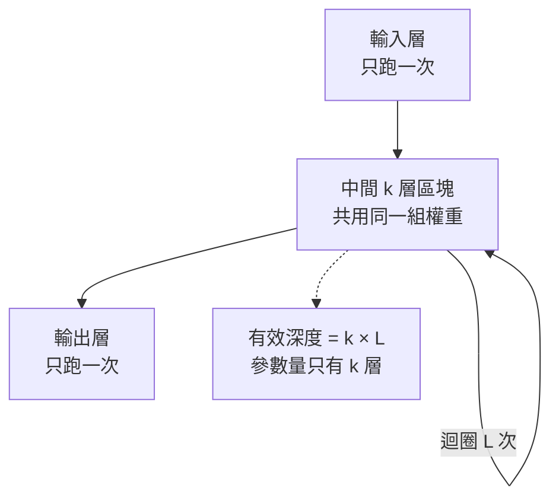

# Looped Transformer:把同一組層重複跑,真的省顯存也更會推理嗎?從 Universal Transformer 到中間層循環(Caleb Writes Code)

**主題分類:** 科技 / LLM 內部機制 — 架構(循環與深度)
**來源:** YouTube 頻道 **Caleb Writes Code**〈Looped models have better reasoning..?〉(2026-11-25,11 分 52 秒)https://youtu.be/Ane0wdhb4wo
**業配:** 片中 4:19–5:33 為 **Firecrawl** 贊助段(介紹其 Alexandria 功能與 MCP / Claude 連接器),與主題無關,本篇不收錄其細節。說明欄另有 Firecrawl 連結。
**字幕品質(重要):** 官方字幕沒有;中文版是機器翻譯的自動字幕,雜訊很大;英文自動字幕經過翻譯痕跡明顯(例如 loop 被寫成 scroll、attention 被寫成 attenuation、「Dori」原指 Dory)。本篇的**時間點取自英文自動字幕的 `[m:ss]`**,**技術內容一律以論文原文為準**,凡影片轉述與論文不符處都標出。
**整理日期:** 2026-11-26

> 一句話:**把一小段層(例如 4 層)重複套用 L 次,在相同 FLOP 下對「需要推理」的任務幾乎追平 kL 層的非循環模型,但在背誦式任務(困惑度、閉卷問答)上較差。** 這是 Google Research 的〈Reasoning with Latent Thoughts: On the Power of Looped Transformers〉(ICLR 2025)的核心;影片大致忠實,但有幾處說法與論文不同。

---

## TL;DR

| 重點 | 一句話 | 核實 |
|---|---|---|
| Universal Transformer(2018) | 在 Transformer 上加入遞迴,每個位置動態決定要循環幾次(ACT 停止機制) | ✅ arXiv 1807.03819:動態逐位置停止;LAMBADA 新最佳、WMT14 英德 +0.9 BLEU |
| 影片說「2019」 | 論文年份 | ⚠️ **需修正**:首次投稿 2018-07-10,ICLR **2019** 發表;影片說 2019 指的是會議年 |
| (k⊗L) 記號 | k 層區塊循環 L 次;iso-param 基準 (k⊗1)、iso-FLOP 基準 (kL⊗1) | ✅ 論文圖 1 |
| 1B、24 層的實驗 | 24 層 1B 模型為基準;k ∈ {4, 6, 8, 12};Pile 資料 250B token | ✅ 論文第 3 節 |
| 循環在推理上很強、在背誦上較差 | 困惑度與閉卷問答較差;推理原語(reasoning primitives)明顯較好 | ✅ 論文表 3 說明文字 |
| 中間層循環最划算 | 前後層獨立、只循環中間 | ⚠️ 論文說中間循環「困惑度較佳、進步較均勻(數學應用題除外)、**可能更實用**」,並說最佳策略「留待未來」,不是定論 |
| 「24 層微調的層仍保持推理能力」 | 影片轉述的正則化實驗 | ❌ **轉述有誤**:論文是加正則化項讓層與層權重更相似,結果是**繼承循環模型的推理偏置、同時不損傷困惑度**,不是「推理沒變」 |
| 「GLM-5.4、Inkling 2 Mini、NVIDIA Dory 1.0 4B 都用了循環」 | 現代模型採用 | ❌ **未能核實**:我搜尋沒找到這三個模型的任何循環資料 |

## 一、影片脈絡(附時間,取自英文自動字幕)

| 時間 | 內容 | 連結 |
|---|---|---|
| 0:00 | 開場:只留一個注意力區塊反覆跑,能省顯存嗎? | [前往](https://youtu.be/Ane0wdhb4wo?t=0) |
| 0:14 | Universal Transformer 與 ACT | [前往](https://youtu.be/Ane0wdhb4wo?t=4) |
| 2:12 | 缺點:推論引擎(vLLM)要處理每個 token 不同的計算量 | [前往](https://youtu.be/Ane0wdhb4wo?t=122) |
| 3:03 | 好處:演算法任務與困惑度 | [前往](https://youtu.be/Ane0wdhb4wo?t=173) |
| 3:59 | 兩個問題:最佳循環次數、為何變好 | [前往](https://youtu.be/Ane0wdhb4wo?t=229) |
| 4:19 | **Firecrawl 贊助段** | [前往](https://youtu.be/Ane0wdhb4wo?t=249) |
| 5:35 | 實驗設計:iso-FLOP 與 iso-param | [前往](https://youtu.be/Ane0wdhb4wo?t=325) |
| 7:00 | 24 層、各種 k 與 L 的組合比較 | [前往](https://youtu.be/Ane0wdhb4wo?t=410) |
| 7:43 | 中間循環最划算 | [前往](https://youtu.be/Ane0wdhb4wo?t=463) |
| 8:36 | 為何更會推理:潛在空間推理 vs token 空間 | [前往](https://youtu.be/Ane0wdhb4wo?t=506) |
| 10:33 | 正則化實驗 | [前往](https://youtu.be/Ane0wdhb4wo?t=623) |
| 11:11 | 結論:各架構有自己的歸納偏置 | [前往](https://youtu.be/Ane0wdhb4wo?t=661) |

## 二、論文實際講了什麼(我讀了全文 PDF)

**論文:** Nikunj Saunshi 等人(Google Research / TTIC),〈Reasoning with Latent Thoughts: On the Power of Looped Transformers〉,ICLR 2025,arXiv 2502.17416。

| 主張 | 論文內容 |
|---|---|
| Claim 1 | 許多推理問題**需要深度,但不一定需要很多參數**:k 層循環 L 次,在加法、p 跳歸納、i-GSM 等合成任務上幾乎追平 kL 層非循環模型,明顯優於 k 層模型 |
| Claim 2 | 語言模型上,循環模型困惑度與記憶(閉卷問答)較差,但**推理類任務**的「% Gap」(彌補 iso-param 與 iso-FLOP 之間差距的比例)高得多;在 reasoning primitives 上,所有 k 的循環模型都好過 24 層 1B 基準,儘管參數少 24/k 倍 |
| Claim 3 | 循環與非循環模型的表現皆隨「有效深度」縮放,與 chain-of-thought 的推論時縮放類似;並**證明**循環模型能隱含產生「潛在思考」,T 次循環可模擬 T 步 CoT |
| Claim 4 | 提出「循環啟發的正則化」:讓各個 k 層區塊的權重(以餘弦相似度)彼此靠近,繼承推理偏置而**不犧牲困惑度** |

**實驗設定(與影片相符處):** 24 層、1B 參數基準 (24⊗1);k ∈ {4, 6, 8, 12};iso-FLOP 循環模型 (k⊗24/k);Pile 資料集 250B token。

**中間循環:** 論文第 3 節,保留開頭與結尾的獨立層、只循環中間區塊。靈感來自作者先前的 gradual stacking 工作(首尾層角色特殊)。結果:相較 (12⊗2),中間循環「困惑度較佳、進步更均勻(數學應用題除外)」,論文稱它「可能是更實用的循環做法」,並明講**最佳循環策略留待未來**。

**正則化(影片轉述錯誤處):** 對每組參數(如 Attn-Q、FFN-W1),讓相鄰 k 層區塊的對應權重餘弦相似度變高,總損失 = 交叉熵 + λ·平均正則項(論文式 3、4)。表 4:k=4、λ=1 或 10 等設定下,**推理表現提升而困惑度不受影響**。影片說「24 層仍很相似,推理能力不變」與論文不符(影片字幕這句本身也翻譯得不通順)。

## 三、判讀

1. **「省顯存」是循環的好處,但論文要講的是「推理需要深度、不需要參數」。** 影片開頭用顯存當切入點,論文重點在 reasoning。兩者不同:循環省的是**參數量**(權重),計算量(FLOP)並不省;顯存省多少取決於實作,KV cache 依然隨有效深度增長,本篇沒查實測。
2. **背誦與推理的取捨是論文的核心:** 循環模型困惑度與閉卷問答較差,但推理類較好。影片 7:00 附近說「問答任務會下降」與此一致。
3. **影片的「潛在空間可以同時有多個思考」是詮釋,不是論文結論。** 論文證明的是 T 次循環可模擬 T 步 CoT;「並行多個想法」的說法我沒在論文找到對應。
4. **推論工程是真問題:** 影片 2:12 說逐 token 動態循環很難做 batching,屬合理工程判斷;論文本身沒討論 vLLM,本篇未另查。

## 四、延伸:近期相關工作(僅搜尋摘要,**未讀原文**)

| 工作 | 搜尋摘要所示重點 | 核實 |
|---|---|---|
| T2MLR(ICLR 2026) | 只循環中間層區塊(最少約 20% 的層)常勝過整個網路循環 | 未能核實(未讀原文) |
| Training-Free Looped Transformers(arXiv 2605.23872) | 在凍結檢查點上於推論時重複中間區塊,不需微調 | 未能核實(未讀原文) |
| Ouro(arXiv 2510.25741) | 權重共享的 Looped LM,以學習到的提前退出做自適應計算;摘要自述是否在實用規模達到前沿增益尚未證實 | 未能核實(未讀原文) |

## 五、應用案例

- **自己跑一個小實驗:** 用 PyTorch 寫一個 4 層 Transformer 區塊,實作 (4⊗L) 與 (4L⊗1)(L = 1、2、4、6),在加法或 p 跳歸納這類合成任務上比準確率,再各自量困惑度。可以重現論文 Claim 1 與 2 的方向(不要期待相同數字)。
- **判斷「新模型宣稱用了循環」是否可信:** 先問三件事:①是整個網路循環還是只循環中間層;②每個 token 的循環次數固定還是動態;③評測是否同時報告背誦類(困惑度、閉卷問答)與推理類。只報推理類的宣稱要打折。本篇影片提到的三個模型因查無資料,不能引用。
- **部署評估:** 若要在邊緣裝置放進更「深」的推理模型,可考慮循環以降低權重大小,但要同時評估延遲(有效深度未減)與 KV cache。

## 相關筆記

- [[rl-gains-concentrate-single-middle-layer]] — 同樣關注「中間層」角色的另一個研究
- [[chain-of-thought-history-and-mirage]] — token 空間推理(CoT)的歷史與限制,對照潛在空間推理
- [[pre-norm-vs-post-norm-transformer]] — Transformer 層結構與深度的相關背景
- [[weight-space-programming-llm-edits-weights]] — 同頻道的另一篇架構題材

## 來源

- [YouTube:Looped models have better reasoning..?(Caleb Writes Code,2026-11-25)](https://youtu.be/Ane0wdhb4wo)(無官方字幕,取自動字幕,含翻譯雜訊;非逐字稿)
- [Saunshi 等:Reasoning with Latent Thoughts: On the Power of Looped Transformers(ICLR 2025)](https://arxiv.org/abs/2502.17416)
- [Dehghani 等:Universal Transformers(ICLR 2019)](https://arxiv.org/abs/1807.03819)
- 僅搜尋摘要(未讀原文):[T2MLR](https://iclr.cc/virtual/2026/10016660)、[Training-Free Looped Transformers](https://arxiv.org/abs/2605.23872)、[Ouro](https://arxiv.org/abs/2510.25741)
