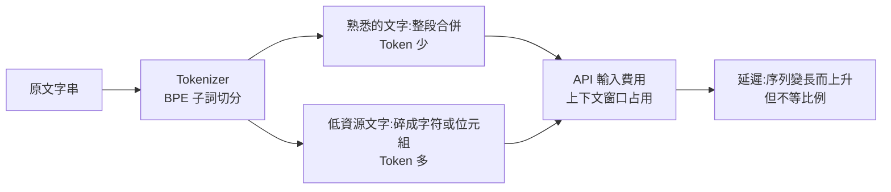

# 語言稅:中文問 AI 真的更貴嗎?Tokenizer、文字系統與多語言成本實測方法

> 整理自 YouTube「為什麼叫 QQ(Why QQ)」〈中文問 AI,真的更貴嗎?〉(2026-11-04 上傳,約 9.4 分鐘,影片 ID `B7I0HBXbty8`;官方簡中字幕)。
>
> **立場聲明:** 無業配;片尾僅一般的三連呼籲。說明欄主要引用 CLEAR、Token Bench、NeurIPS 2023 論文與 OpenAI 官方文件。
> ⚠️ **查核範圍有限:** CLEAR 的各模型數字我對照了二手整理(Magica)並指向 CLEAR 原文;Token Bench 的中文比值、Qwen 3.6 等細項**未能找到可直接比對的一手表**,標在「未能核實」。非投資、非採購建議。

---

## 一句話總結

> **「中文比較貴」是直覺,不是事實;真正決定 Token 數的是「文字系統 + Tokenizer 在訓練時見過多少同類文本」。** 簡體中文在正式新聞類平行語料上,Token 數和英文大致同量級;大幅膨脹發生在低資源語言與少見文字系統(例如傳統蒙古文)。

---

## 1. 模型看不到「一個字多少錢」

文字進模型前先被 Tokenizer 切成片段、對映成 ID;API 帳單與上下文窗口算的是 **ID 序列的長度**。常見子詞方案可用 BPE 理解:先從基礎符號開始,反覆合併常一起出現的片段,見得多的組合進詞表、一次編完;沒見過的組合退回更小片段,字節級方案還留有任何 Unicode 都能編的兜底,代價是稀有文字會被拆得很碎。

重點:**詞表大小只告訴你有幾個格子,沒告訴你格子分給了誰。** 影片舉例:Qwen 3.6 詞表更大,極端差距卻比 Qwen 3 更寬(13.1 對 10.5)——詞表擴容與換代不會自動讓多語言編碼更均衡。



## 2. 三組數字,各有各的口徑

| 數字 | 出處與口徑 | 不能怎麼用 |
|---|---|---|
| **15 倍** | NeurIPS 2023 論文(Petrov 等),FLORES-200 比較多種 Tokenizer,部分語言對編碼長度差到 15 倍;並測到序列變長時延遲上升 | 不能當成今天所有模型的固定倍數 |
| **17 倍 / 13.8 倍** | CLEAR,FLORES-200 平行語料、203 個語言與文字組合,指標是「最大語言 Token 數 ÷ 最小語言 Token 數」;Falcon 3 為 17.0、GPT-5 / gpt-oss 為 13.8 | 不是「某一句固定差 17 倍」;是整套語料彙總後最極端兩端的比值 |
| **6 倍(13 對 78)** | 開場單句:英文 13、阿姆哈拉語 78(GPT-5 的 `o200k` 編碼) | 純示範,不是平均 |

同一模型也要看兩個指標才不誤讀:GPT-5 極端值 13.8 倍(盯最受傷的語言),但同時有 **78% 的受測組合(158/203)落在最省語言的 2 倍以內**(看多數落在哪)。做大眾產品多看後者;做公共服務,尾部語言再小也不能忽略。NLLB-200 只有 2.7 倍,但它是翻譯模型、詞表目標不同,**不能拿來證明通用能力更強**。

## 3. 中文實際上怎樣?

影片引用 Token Bench:1012 句 FLORES+ 平行文本、221 種語言對英文。**簡體中文對英文的平均 Token 比值**:Qwen 2.5 為 1.00、Gemini 3 為 1.08、Claude 為 1.14、GPT `o200k` 為 1.25。換句話說在正式新聞文本上沒有出現數倍膨脹。

限制(影片自己也講):只測輸入,不含輸出成本與答案品質;不能推廣到程式碼混合、拼音、方言;單句示範(英 13、中 17)不能代替 1012 句平均。

**文字系統比語言更關鍵:** 同一批哈爾哈蒙古語句子,用西里爾字母時 `o200k` 的 Token 量是英文的 1.89 倍,換成傳統蒙古文變成 16.20 倍,兩者相除約 8.57 倍。語言與語義沒變,編碼成本隨文字系統重排。

## 4. 這些 Token 怎麼進帳單、窗口與延遲

- **費用:** 輸入成本 = 輸入 Token × 輸入單價,輸出另算。開場例句每百萬次呼叫,英文 1,300 萬、阿姆哈拉語 7,800 萬 Token,同單價下就是 6 倍輸入費。真專案還有系統提示、工具定義、檢索片段、歷史訊息,別照抄倍數。
- **別只靠翻成英文省錢:** 翻譯呼叫本身有成本,答案品質與語言體驗要重測。
- **上下文窗口:** 標稱 128K 裝的是 Token 序列,不是固定字數;同一份文件在另一種文字下需 6 倍 Token,可用窗口也近 6 倍縮水,RAG 能塞的片段數也變。
- **延遲:** 受序列長度影響,但 **6 倍 Token ≠ 6 倍回應時間**(prefill、解碼、快取、硬體都會改變)。分別記錄首 Token 延遲、總時延與輸入輸出 Token。

## 5. 自己動手:四步法與 tiktoken

選型四步:**取樣**(真實使用者輸入、系統提示、工具、預期輸出,別只用標準新聞)→ **計數**(用目標模型的官方方式,按語言與文本類型分組)→ **算帳**(單價、快取、窗口占用、延遲放同一張表)→ **驗質量**(正確性、格式穩定性、失敗案例;便宜一半卻答錯就沒省)。

```python
import tiktoken
enc = tiktoken.get_encoding("o200k_base")
n = len(enc.encode("People should benefit from AI, regardless of the language they speak."))
print(n)  # 本次實測為 13
```

- 換模型用 `encoding_for_model`,或用廠商自己的計數介面;開源模型要載入**完全一致**的 Tokenizer 並套用實際聊天模板。不要拿網頁計數器替所有模型估。
- 純文字計數與完整請求常對不上:角色、邊界標記、工具 Schema、圖片與檔案都會增加輸入。OpenAI 文件也提醒這點。做預算先本地相對實驗,再用官方輸入計數介面核對,請求後把回應的 `usage`(`input_tokens`、`output_tokens`)與總耗時寫進日誌。
- CLEAR 的建議:模型卡公開最大最小比值與「兩倍以內語言占比」,並按字元或語言做價格歸一化。

## 應用案例

> 你要做一個中日韓英四語客服機器人,預算以 API 輸入費為主。
> ①**取樣:** 各語言各抽 200 則真實客訴加上完整系統提示與工具定義。
> ②**計數:** 用候選模型的官方計數接口,按語言分組記錄 input/output Token,算出各語言對英文的中位數比值(不是平均單句)。
> ③**算帳:** 比值乘各模型單價,再加快取與 128K 窗口占用,發現日文某模型明顯偏高,另一模型便宜但格式穩定性差。
> ④**驗質量:** 抽 50 則人工檢查答對率與 JSON 格式失敗率,最後選「Token 略高但答對率高」的模型,並把 `usage` 寫進日誌每週監控。
> 結論用自己的資料決定,而不是看排行榜的單一字母評級。

---

## 核實紀錄(2026-11-05)

**已核實**
- 單句 `o200k_base` 編碼:英文句子(含句號)實測 **13 個 Token**,與影片及 CLEAR 例句一致。
- CLEAR 的口徑:FLORES-200、203 個語言與文字組合(排除一個已棄用代碼,部分語言有多種文字,故不是 203 種語言)、最大 ÷ 最小比值。
- 各模型最大最小比值(二手整理 Magica 引自 CLEAR):Falcon 3 = 17.0、GPT-5 / gpt-oss = 13.8、Qwen 3.6 = 13.1、Qwen 3 = 10.5、Gemini / Gemma 系列 = 5.1、NLLB-200 = 2.7;2 倍以內語言數:GPT-5 為 158/203(78%)。
- 英 13 / 馬拉雅拉姆 26 / 阿姆哈拉 78 的例句出自 CLEAR(GPT-5 Tokenizer),僅為輸入編碼量測。

**需修正 / 補充**
- 影片把 17 倍歸給 Falcon 3,我的二手來源表格一致,但**我另一筆搜尋沒能獨立證實這個歸屬**,請以 CLEAR 原文表格為準。
- CLEAR 比的是輸入編碼量,**不是價格,也不是任務品質**。
- 影片的 Gemini 描述與 CLEAR 的 5.1 屬於不同口徑(CLEAR 為極端比,Token Bench 為平均比),兩者不可互比。

**未能核實**
- Token Bench 的中文平均比值(1.00 / 1.08 / 1.14 / 1.25)與「221 種語言」:搜尋只找到名稱相近的 Tilde Tokenizer Bench 與 tokentax 資料集(用 FLORES-200 devtest 1012 句、以對英文的比值定義),**無法確認就是影片所引的那份**,數字僅轉述。
- 蒙古語西里爾 1.89 倍 / 傳統蒙古文 16.20 倍 / 約 8.57 倍:未找到一手表,僅轉述;注意 16.20 ÷ 1.89 ≈ 8.57 算術自洽。
- 單句中文 17 個 Token:我只實測英文句;中文譯句措辭不同會有差。

⚠️ 非投資、非採購建議;模型更新後數字會變,請用自己的文本重測。

## 來源

- 為什麼叫 QQ(Why QQ):〈中文問 AI,真的更貴嗎?〉 https://www.youtube.com/watch?v=B7I0HBXbty8 (官方簡中字幕)
- CLEAR:The Tokenizer Tax https://clear-languages.org/blog/the-tokenizer-tax
- CLEAR 公開倉庫 https://github.com/clear-coalition-ai/token-cost-equity
- 二手整理(Magica):https://magica.com/news/clear-study-language-token-cost-disparities
- Petrov 等〈Language Model Tokenizers Introduce Unfairness Between Languages〉(NeurIPS 2023)倉庫 https://github.com/AleksandarPetrov/tokenization-fairness
- 相近的 Token 比值資料集(未確認即影片所引) https://huggingface.co/datasets/shreyaskc/tokentax-results-v1

相關閱讀:[[claude-throttling-opus-4-7]](Token 與額度消耗的另一個面向)、[[claude-haiku-5-5-cheap-model-computer-use]](便宜模型不等於便宜任務)。
