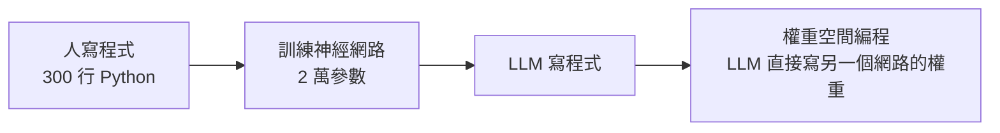

# 權重空間編程(Weight-Space Programming):讓 LLM 直接讀寫神經網路權重,它是什麼、不是什麼

> 整理自 YouTube 頻道 **Caleb Writes Code**〈Weight-Space Programming explained in 10min..〉(2026-11-04,約 10 分鐘),並對照原作者部落格的二手報導與一篇獨立批評。
>
> **立場揭露:** 影片含 DataImpulse(住宅代理服務)業配與講者自建 benchmark 的導流,業配段本文**不轉述**。
>
> **逐字稿說明:** 該片無官方字幕,逐字稿以 CPU 版 Whisper 轉錄,可能有同音字誤差。已還原:Astra → GPT-6 Astra;字幕 Waste Space Bench → 使用者 2026-11-07 聽原片確認為 Weight Space 系列名稱,精確 benchmark 名稱以使用者填答為準:Weight Space Programming(若實指 Weight Space Bench 亦可,兩者並列,無法分辨);Cloudcode → Claude Code。
>
> **整理日期:** 2026-11-06。**一手論文 / 部落格全文我沒有直接讀到**,下列細節來自 VentureBeat 報導與 Sean Goedecke 的批評文;標「未核實」者請以原作者文章為準。

---

## TL;DR

1. **想法:** 不跑梯度下降、不做訓練,讓一個強 LLM 直接「看」另一個網路的權重、推理它在做什麼,並**輸出一串數字改寫權重**。
2. **最亮眼的結果:** GPT-6 Astra 只改了 Qwen3.5-0.8B 約 **0.016%** 的權重,MATH-500 從 **7.9% 升到 48.1%**。
3. **但那不是「教會它數學」:** 報導指出增益主要來自**移除與重複輸出(repetition loop)相關的方向**,屬於修復,不是新增數學能力。
4. **講者自己也提醒:** 模型知道輸入 / 輸出層的結構,等於拿到了「考卷說明書」;拿掉輸入輸出層、換更大的模型,表現就明顯變弱。
5. **獨立批評:** 這些任務多半是「聰明的人類研究者也能做」的事,更像權重層級的 steering / abliteration,**是技巧,不是新典範**。

---

## 1. 想法本身

傳統流程:

講者的描述:與其寫 300 行演算法,或花算力訓練 2 萬參數的小網路玩遊戲,不如讓 Astra **憑直覺**一次輸出權重數字,跳過「大量模擬 + 梯度下降」。他說這概念在 1990 年代初就有人提過(**未核實**),新的是「LLM 已經強到有早期證據能做」。

更遠的想像(講者提出,皆未證實):LLM 讀別人的 safetensors、定點修補容易幻覺的權重、取代 LoRA 微調 —— 用直接寫權重取代梯度下降。

---

## 2. 實驗怎麼設計:怎麼讓 LLM「寫」權重

直接逐 token 輸出權重行不通:小到 2 萬參數、每個數字 4 位小數,也會撞上 API 的輸出長度上限(影片說 Astra 輸出上限約 12 萬 token)。作者的解法:

1. **先把整個網路的權重歸零。**
2. 讓模型用一種**區塊 / 象限更新格式**指定「改哪一個範圍、改成什麼值」;沒被指定的維持 0。
3. 範例任務:MinAtar 風格小遊戲(影片以 Asterix 為例:要閃躲紅色敵人、收集黃色獎勵)。Astra 不是隨機改,而是只改**偵測物體正在靠近或已經離開**的那一塊權重。

關於「有沒有工具」,影片說作者**禁用工具**以免作弊(查網路、旁邊做實驗)。報導的說法比較細:**遊戲辨識實驗**沒給工具,也沒給候選遊戲清單;**遊戲建構**時模型不能先試跑;但 **Qwen 修復等較大實驗**模型有 Python 與受控環境。所以「全程不用工具」不準確。

---

## 3. 結果:看起來很強的幾項

| 實驗 | 結果 |
|---|---|
| 修一個訓練後仍過不了某關卡的小遊戲網路 | Astra 改權重後輕鬆過關 |
| 只看權重猜網路是為哪個遊戲訓練 | 影片說全對、信心高;報導列出 Breakout、Pong、Pac-Man、Freeway 等 |
| 看擴散模型權重,預測會生成圓 / 三角 / 方 | 正確,但信心降到 70–80% |
| 拿掉輸入輸出層,只給隱藏層,7.2M 參數語言模型 | 猜得出是 Python 還是英文語料訓練的,信心較低 |
| 270M Gemma 3 微調成兩份,看誰更諂媚(sycophantic) | **失敗**;報導補充:研究者提供**注意力測量值**後才成功 |
| 讓 Gemma 3 的數學變強 | **失敗**(該模型沒有 Qwen 那種嚴重重複問題) |
| **Qwen3.5-0.8B 數學 7.9% → 48.1%** | 見下節 |

### Qwen 案例的真實內容

報導說明:
- 修改集中在第 **15、19 層**的元件,共約 **131,072 個權重(0.016%)**,內容是移除一個與**重複輸出**相關的數值方向。
- 同時 GSM8K 13.8% → 67.1%、IFEval 21.0% → 62.3%。
- 最強那次嘗試花了 **158 輪對話、80 次 Python 執行、20.3 小時**(含 4.7 小時等待故障)。
- 批評者補充:該模型並不是不會數學,而是**輸出超過約 32k token 後就迴圈**,所以長題失敗;32k 以下的題原本就答得出來。

---

## 4. 為什麼要「curb your enthusiasm」

講者自己列的:Astra 對輸入輸出語意看得見。以 10×10 格、6 個通道(共 600 輸入)的遊戲網路為例,模型**知道哪個通道代表什麼**,所以只要改「來自那個通道的第一層權重」,就能偵測方向。這比「完全盲看一個黑箱」容易得多。

獨立批評(Sean Goedecke)的論點,我整理為四點:

1. **遊戲辨識很容易:** 輸入通道對應 8×8 格並有標示,看第一層權重範數的熱圖就能認出遊戲(Breakout 底部水平線、Pac-Man 迷宮)。
2. **Qwen 修復是標準做法:** 比較「迴圈文本」與「正常文本」的殘差,找出貢獻差異最大的權重並裁掉 —— 和 Heretic 類 abliteration 方法同型。Astra 也是先寫出四組正常 / 迴圈文本對來定位。
3. **是技巧不是新典範:** 直接改權重像改編譯後的二進位檔,厲害但不是最佳工作方式;AI 對研究的主要幫助仍可能在改進訓練。
4. **「心算」不等於超人研究能力。**

報導也列出作者自承的限制:增益來自修復重複、未證明比傳統訓練快 / 便宜 / 有效、**沒有展示遞迴自我改進**、缺乏與專門編輯方法(如 steering)的比較、需獨立複現。

---

## 5. 核實狀態

### 已核實(依 VentureBeat 報導與批評文交叉)
- 作者為 MIT CSAIL 的 Rikiya Takehi、Jayden Teoh、Alex Zhang、Omar Khattab;文章 2026-11-02 發布。
- Qwen3.5-0.8B:MATH-500 7.9% → 48.1%,約 0.016% 權重。
- Gemma 3 270M 未能提升數學。

### 需修正
- 「禁用所有工具」→ 因實驗而異,Qwen 修復有 Python(§2)。
- 「Astra 發現一個已知 bug 並修復」→ 更準確是移除一個導致重複的方向(§3)。
- 影片說 Astra 無法判斷哪個模型較諂媚,報導補上「給了注意力測量就成功」。

### 未能核實
- 「1990 年代已有此概念」。
- 講者自建 benchmark(Weight Space Programming / Weight Space Bench)細節與其他前沿模型的成績(影片最後的圖表,逐字稿沒有數字)。
- 原作者部落格全文(本次未直接讀到)。

---

## 應用案例

### 案例 1|讀懂「AI 研究突破」新聞的三個提問

遇到類似「LLM 做到某某」的報導,問:**(1) 它拿到哪些先驗(層結構、輸入語意)?(2) 增益是新增能力還是修復缺陷?(3) 同樣任務一個懂行的人用傳統方法要多久?** 本案例的答案分別是:知道通道語意;修復重複;批評者說人也能做。

### 案例 2|把它當作「模型外科」工具而非訓練替代品

實務上更可行的版本:**用 LLM 做權重層級的診斷與小手術**,例如找出造成輸出迴圈的方向再抑制,配合傳統 steering 方法做驗證。重點是所有改動要用**固定評測集前後對照**(本例的 MATH-500 / GSM8K / IFEval),並檢查有沒有副作用 —— 這類手術的風險是「修了一處、壞了另一處」。

### 案例 3|為自己的模型做「迴圈偵測」

如果你的本地模型在長輸出時重複打轉:先量測迴圈開始的長度(本例約 32k)、再看是 sampling 設定(repetition penalty)、脈絡長度,還是模型本身。權重手術是**最後**才考慮的手段。

---

## 來源

- YouTube:[Weight-Space Programming explained in 10min.. — Caleb Writes Code](https://www.youtube.com/watch?v=77hHgDkbtLI)(2026-11-04)—— **該片無官方字幕,逐字稿以 CPU 版 Whisper 轉錄,可能有同音字誤差**;含 DataImpulse 業配,未納入。
- 核實用:
  - [Like gene editing for neural networks: MIT researchers used GPT-6 Astra to edit Qwen's open weights — VentureBeat](https://venturebeat.com/technology/like-gene-editing-for-neural-networks-mit-researchers-used-gpt-6-astra-to-edit-qwens-open-weights-directly-boosting-math-performance)
  - [LLMs are not superhuman at reading and writing neural network weights — Sean Goedecke](https://seangoedecke.com/llms-are-not-superhuman-at-reading-and-writing-neural-network-weights/)
- 本庫相關:[[gpt-6-astra-token-efficiency-and-harness]]、[[rl-gains-concentrate-single-middle-layer]]

> ⚠️ 本文基於影片與二手報導,**未直接讀原部落格 / 論文全文**;結論以原作者文章為準。
