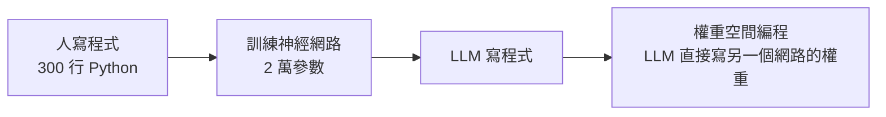

# 權重空間編程(Weight-Space Programming):讓 LLM 直接讀寫神經網路權重,它是什麼、不是什麼

> 整理自 YouTube 頻道 **Caleb Writes Code**〈Weight-Space Programming explained in 10min..〉(2026-11-04,約 10 分鐘),並對照原作者部落格的二手報導與一篇獨立批評。
>
> **立場揭露:** 影片含 DataImpulse(住宅代理服務)業配與講者自建 benchmark 的導流,業配段本文**不轉述**。
>
> **逐字稿說明:** 該片無官方字幕,逐字稿以 CPU 版 Whisper 轉錄,可能有同音字誤差。已還原:Astra → GPT-6 Astra;字幕 Waste Space Bench → 使用者 2026-11-07 聽原片確認為 Weight Space 系列名稱,精確 benchmark 名稱以使用者填答為準:Weight Space Programming(若實指 Weight Space Bench 亦可,兩者並列,無法分辨);Cloudcode → Claude Code。
>
> **整理日期:** 2026-11-06;**2026-11-07 核實增補**:已讀原作者官方部落格(經 WebFetch 擷取的摘要,非逐字全文)、官方 logs repo,以及 Simon Willison、Matthew Honnibal、Sean Goedecke 的回應文。原論文無 arXiv 連結。標「未能核實」者請以原作者文章為準。

---

## TL;DR

1. **想法:** 不跑梯度下降、不做訓練,讓一個強 LLM 直接「看」另一個網路的權重、推理它在做什麼,並**輸出一串數字改寫權重**。
2. **最亮眼的結果:** GPT-6 Astra 只改了 Qwen3.5-0.8B 約 **0.016%** 的權重,MATH-500 從 **7.9% 升到 48.1%**。
3. **但那不是「教會它數學」:** 報導指出增益主要來自**移除與重複輸出(repetition loop)相關的方向**,屬於修復,不是新增數學能力。
4. **講者自己也提醒:** 模型知道輸入 / 輸出層的結構,等於拿到了「考卷說明書」;拿掉輸入輸出層、換更大的模型,表現就明顯變弱。
5. **獨立批評:** 這些任務多半是「聰明的人類研究者也能做」的事,更像權重層級的 steering / abliteration,**是技巧,不是新典範**。

---

## 1. 想法本身

傳統流程:

講者的描述:與其寫 300 行演算法,或花算力訓練 2 萬參數的小網路玩遊戲,不如讓 Astra **憑直覺**一次輸出權重數字,跳過「大量模擬 + 梯度下降」。他說這概念在 1990 年代初就有人提過(**未核實**),新的是「LLM 已經強到有早期證據能做」。

更遠的想像(講者提出,皆未證實):LLM 讀別人的 safetensors、定點修補容易幻覺的權重、取代 LoRA 微調 —— 用直接寫權重取代梯度下降。

---

## 2. 實驗怎麼設計:怎麼讓 LLM「寫」權重

直接逐 token 輸出權重行不通:小到 2 萬參數、每個數字 4 位小數,也會撞上 API 的輸出長度上限(影片說 Astra 輸出上限約 12 萬 token)。作者的解法:

1. **先把整個網路的權重歸零。**
2. 讓模型用一種**區塊 / 象限更新格式**指定「改哪一個範圍、改成什麼值」;沒被指定的維持 0。實際輸出是切片範圍,例如推理截圖中的 `W1[61:120:6, 0:24:8] = ...`(影片 [3:16] 附近,畫面核對過)。
3. 範例任務:MinAtar 風格小遊戲(影片以 Asterix 為例:要閃躲紅色敵人、收集黃色獎勵)。Astra 不是隨機改,而是只改**偵測物體正在靠近或已經離開**的那一塊權重。

關於「有沒有工具」,影片說作者**禁用工具**以免作弊(查網路、旁邊做實驗)。報導的說法比較細:**遊戲辨識實驗**沒給工具,也沒給候選遊戲清單;**遊戲建構**時模型不能先試跑;但 **Qwen 修復等較大實驗**模型有 Python 與受控環境。所以「全程不用工具」不準確。

---

## 3. 結果:看起來很強的幾項

| 實驗 | 結果 |
|---|---|
| 修一個訓練後仍過不了某關卡的小遊戲網路 | Astra 改權重後輕鬆過關 |
| 只看權重猜網路是為哪個遊戲訓練 | 四款遊戲(Breakout、Pong、Pac-Man、Freeway)全部答對,Breakout 信心 99%;網路為 MLP 500→32→32→5、17,253 個權重 |
| 看擴散模型權重,預測會生成圓 / 三角 / 方 | 形狀判斷正確,信心 70–80%(影片說法);**需修正**:Astra 畫的是**輪廓**,模型實際生成的是**實心**形狀(見 §5) |
| 拿掉輸入輸出層,只給隱藏層,約 7.16M 參數字元級 Transformer | Python / romaji / English 三種語料全部答對,但信心僅約 0.48–0.62;並點出正確的注意力頭(如 2.1、3.1、3.5) |
| 270M Gemma 3 微調成兩份,看誰更諂媚(sycophantic) | 只看權重 **4 次嘗試皆失敗**;改給模型自寫文字上的**注意力模式**後,三組皆認出諂媚模型(頭 10.2:誠實模型 94.3% vs 0.75%;諂媚模型 3.5% vs 85.7%) |
| 讓 Gemma 3 的數學變強 | **失敗**:MATH-500 基準 6.8%,最好只到 7.7%(該模型僅 8.5% 答案撞上 token 上限,沒有 Qwen 那種嚴重迴圈) |
| **Qwen3.5-0.8B 數學 7.9% → 48.1%** | 見下節;**僅在 50 次前向傳遞時達到**,10 / 25 次僅 12.3% / 14.1% |

### Qwen 案例的真實內容

報導說明:
- 修改集中在第 **15、19 層**的元件,共約 **131,072 個權重(0.016%)**,內容是移除一個與**重複輸出**相關的數值方向。
- 同時 GSM8K 13.8% → 67.1%、IFEval 21.0% → 62.3%(以上皆為 **50 次前向傳遞**的結果;10 次時 IFEval 為 49.0%、25 次時為 39.9%)。
- 部落格表格顯示「輸出撞上 token 上限」比例從 93.0% 降到 33.1%,說明增益主要來自**壓制迴圈**。
- 使用 Python 沙箱與前向傳遞,**不是**「只讀權重」(見延伸段的 Honnibal 批評)。
- 報導說最強那次嘗試花了 158 輪對話、80 次 Python 執行、20.3 小時(含 4.7 小時等待故障)——**未能核實**:官方 logs repo 摘要與部落格摘要皆未找到這些數字,請視為待查。
- 批評者補充:該模型並不是不會數學,而是**輸出超過約 32k token 後就迴圈**,所以長題失敗;32k 以下的題原本就答得出來。

---

## 4. 為什麼要「curb your enthusiasm」

講者自己列的:Astra 對輸入輸出語意看得見。以 10×10 格、6 個通道(共 600 輸入)的遊戲網路為例,模型**知道哪個通道代表什麼**,所以只要改「來自那個通道的第一層權重」,就能偵測方向。這比「完全盲看一個黑箱」容易得多。

獨立批評(Sean Goedecke)的論點,我整理為四點:

1. **遊戲辨識很容易:** 輸入通道對應 8×8 格並有標示,看第一層權重範數的熱圖就能認出遊戲(Breakout 底部水平線、Pac-Man 迷宮)。
2. **Qwen 修復是標準做法:** 比較「迴圈文本」與「正常文本」的殘差,找出貢獻差異最大的權重並裁掉 —— 和 Heretic 類 abliteration 方法同型。Astra 也是先寫出四組正常 / 迴圈文本對來定位。
3. **是技巧不是新典範:** 直接改權重像改編譯後的二進位檔,厲害但不是最佳工作方式;AI 對研究的主要幫助仍可能在改進訓練。
4. **「心算」不等於超人研究能力。**

報導也列出作者自承的限制:增益來自修復重複、未證明比傳統訓練快 / 便宜 / 有效、**沒有展示遞迴自我改進**、缺乏與專門編輯方法(如 steering)的比較、需獨立複現。

---

## 5. 核實狀態

### 已核實(官方部落格摘要 + 報導 + 批評文交叉)
- 論文《Sparks of Weight-Space Programming: LLMs can natively read & write neural network weights》,作者 Rikiya Takehi、Jayden Teoh(共同第一作者)、Alex Zhang、Omar Khattab,皆為 MIT CSAIL,2026-11-02 發布於[官方部落格](https://rikiyat.github.io/blog/weight-space-programming/)。
- Qwen3.5-0.8B:MATH-500 7.9% → 48.1%(50 次前向傳遞),修改第 15、19 層 MLP 各 64 個輸出欄,共 131,072 個權重(0.016%)。
- Gemma 3 270M 未能提升數學(基準 6.8%,最好 7.7%)。
- 畫面核對(2026-11-07):[2:23] 附近的 120,000 token 上限、[3:16] 附近的 Asterix 推理截圖、[9:10] 附近螢幕字樣為 "Qwen 3.5 0.8B"(逐字稿的「Quen」已依畫面更正)。

### 需修正
- 「禁用所有工具」→ 因實驗而異,Qwen 修復有 Python 與前向傳遞(§2)。
- 「Astra 發現一個已知 bug 並修復」→ 更準確是移除一個導致重複的方向(§3)。
- 影片說 Astra 無法判斷哪個模型較諂媚,報導補上「給了注意力模式就成功」。
- 影片說「圓 / 三角 / 方 正確」→ 原文:Astra **畫出輪廓**,但擴散模型生成的是**實心**形狀;判斷對,細節不完整。
- 影片暗示 Qwen 的 48.1% 是「一次修改」→ 原文需 50 次前向傳遞的迭代(一次單純修改的結果 10 / 25 次時僅 12.3% / 14.1%)。
- 影片說「只看權重」→ Honnibal 指出只有三個實驗真的只讀原始權重(皆為 17K–172K 權重的小網路),其餘都涉及 Python 或執行模型。

### 未能核實
- 「1990 年代已有此概念」。
- 「158 輪對話、80 次 Python 執行、20.3 小時」:官方 logs repo 與部落格摘要皆找不到。
- 作者自建 benchmark 的成績:影片 [10:01] 之後的圖表截圖(見延伸段)數字可讀,但 benchmark 目前「仍在建置」、無公開連結,數字**未獨立驗證**。
- 影片與部落格提的未來願景(審計後門、unlearning、架構合併、降低成本)皆屬「we believe」,**未被展示**。
- Tildes 網友轉述「把網格圖從 prompt 拿掉後,模型說不出權重代表什麼」:來源為二手轉述,未讀原帖。

## 延伸閱讀與深度補充(2026-11-07 核實增補)

### 原論文 / 官方 repo 讀到的內容(比影片多出的部分)
- **寫權重、從零開始(Exp 5,無資料、無梯度、無工具,權重初始為 0)**:MinAtar 三款遊戲的分數(對照 PPO 500M 步):Breakout 517.4(25.3)、Seaquest 53.1(88.9)、Asterix 53.2(55.2)。**影片舉例的 Asterix 一次寫出的成績與 PPO 500M 步幾乎持平,並非全面勝出**。
- **Go 9×9(Exp 6)**:1,480,274 個權重的網路。0 次前向傳遞時對兩個較小的 PPO 網路「贏超過一半」;50 次前向傳遞後勝過以 2,000 萬局訓練的同尺寸 PPO。這類結果依賴前向傳遞,不屬於純讀寫權重。
- **作者自我定位**:結果「very early」,目前能力受「context length 與 harness 效率」限制;Exp 2 的圓 / 三角 / 方是輪廓而非實心;Exp 7 只看權重不夠,必須看注意力。
- **Logs repo**([RikiyaT/lm_understand-logs](https://github.com/RikiyaT/lm_understand-logs),CC BY 4.0 / MIT)含每個實驗的 prompt、回覆與評測腳本。repo 說明稱 1,125 輪「全部無工具」,但 exp3 / 6 / 7 / 8 的資料夾說明標示使用 Python sandbox——兩者**互相矛盾,未能釐清**,以論文原文為準。

### 圖表(影片截圖,標題 "Writing networks from scratch · weight-space-bench")
截圖時間 605 秒(10:05),縱軸為「% of PPO, 500M steps」:GPT-6.1 Sol 86.5、Claude Opus 5.5 48.5、Claude Sonnet 5.5 23.2、Kimi K3.1 Pro 16.2、Muse Wonder 2.6、DeepSeek V4.1 Flash 0.7、GPT-6 Astra(論文)96.3、PPO 100M 步 46.3(PPO 500M 步 = 100.0)。**這是講者自建 benchmark 的成績,未獨立驗證**;逐字稿於 [10:01] 才提到「here's how other frontier models did」。

### 獨立再現與批評
- **Matthew Honnibal**([honnibal.dev](https://honnibal.dev/blog/astra-read-write-misleading)):摘要把三種技術混為一談——只讀原始權重、寫權重、寫 Python 分析權重、執行模型。Qwen 結果屬後三者,「不是單一技術」;但他承認 Qwen 結果仍有意義,能完成人類 ML 工程師會寫程式去做的事。他反對的是框架與把實驗並列在同一篇論文。
- **Simon Willison**([2026-11-03 文章](https://simonwillison.net/2026/Nov/3/qwen-can-interpret-model-weights/)):用本地 Qwen 3.8 27B(Q4_K_M,LM Studio)重現遊戲辨識:Pac-Man、Pong、Breakout 答對(信心 72–88%,耗時約 46–65 分鐘),Freeway 失敗;Kimi K3.1 Pro 答對 Breakout(耗時約 10 分鐘)。說明方法能在論文外重現,但成本與耗時遠高於影片給人的感覺。
- **Sean Goedecke**([文章](https://seangoedecke.com/llms-are-not-superhuman-at-reading-and-writing-neural-network-weights/)):第一層權重的 L2 範數熱圖就能看出 Breakout 底部橫線與 Pac-Man 迷宮,「smart human ML researcher could perform all of these tasks」;Qwen 修復等同 abliteration 手法;結論是 LLM 對研究的幫助主要在**改進訓練**,而非直接改權重。

### 對本文主張的修正
- 「LLM 能讀寫權重」更精確的說法:**在小網路、且給了輸入通道語意時能讀權重;寫權重的成功集中在小網路;語言模型的修復仰賴 Python 與前向傳遞**。
- 「研究員未來不用訓練」尚無證據;批評者的共識是「技巧,不是新典範」。

---

## 應用案例

### 案例 1|讀懂「AI 研究突破」新聞的三個提問

遇到類似「LLM 做到某某」的報導,問:**(1) 它拿到哪些先驗(層結構、輸入語意)?(2) 增益是新增能力還是修復缺陷?(3) 同樣任務一個懂行的人用傳統方法要多久?** 本案例的答案分別是:知道通道語意;修復重複;批評者說人也能做。

### 案例 2|把它當作「模型外科」工具而非訓練替代品

實務上更可行的版本:**用 LLM 做權重層級的診斷與小手術**,例如找出造成輸出迴圈的方向再抑制,配合傳統 steering 方法做驗證。重點是所有改動要用**固定評測集前後對照**(本例的 MATH-500 / GSM8K / IFEval),並檢查有沒有副作用 —— 這類手術的風險是「修了一處、壞了另一處」。

### 案例 3|為自己的模型做「迴圈偵測」

如果你的本地模型在長輸出時重複打轉:先量測迴圈開始的長度(本例約 32k)、再看是 sampling 設定(repetition penalty)、脈絡長度,還是模型本身。權重手術是**最後**才考慮的手段。

---

## 來源

- YouTube:[Weight-Space Programming explained in 10min.. — Caleb Writes Code](https://www.youtube.com/watch?v=77hHgDkbtLI)(2026-11-04)—— **該片無官方字幕,逐字稿以 CPU 版 Whisper 轉錄,可能有同音字誤差**;含 DataImpulse 業配,未納入。
- 核實用:
  - [Sparks of Weight-Space Programming — 原作者官方部落格(Takehi, Teoh, Zhang, Khattab)](https://rikiyat.github.io/blog/weight-space-programming/)
  - [RikiyaT/lm_understand-logs — 官方實驗 logs 與腳本](https://github.com/RikiyaT/lm_understand-logs)
  - [Like gene editing for neural networks: MIT researchers used GPT-6 Astra to edit Qwen's open weights — VentureBeat](https://venturebeat.com/technology/like-gene-editing-for-neural-networks-mit-researchers-used-gpt-6-astra-to-edit-qwens-open-weights-directly-boosting-math-performance)
  - [LLMs are not superhuman at reading and writing neural network weights — Sean Goedecke](https://seangoedecke.com/llms-are-not-superhuman-at-reading-and-writing-neural-network-weights/)
  - [Qwen 3.8 27B on my laptop can interpret model weights, too — Simon Willison(2026-11-03)](https://simonwillison.net/2026/Nov/3/qwen-can-interpret-model-weights/)
  - [Matthew Honnibal 對該論文框架的批評文](https://honnibal.dev/blog/astra-read-write-misleading)
- 本庫相關:[[gpt-6-astra-token-efficiency-and-harness]]、[[rl-gains-concentrate-single-middle-layer]]

> ⚠️ 本文基於影片與二手報導,**未直接讀原部落格 / 論文全文**;結論以原作者文章為準。
