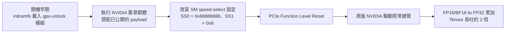

# 4090 算力翻倍?gpu-unlock-ada 解開 Tensor「半速鎖」:指令翻倍,但你的專案未必快

> 整理自 YouTube 頻道 **Why QQ(為什麼叫 QQ)**〈[4090显卡算力翻倍？代码解开算力锁](https://www.youtube.com/watch?v=b9fvVzHgMbw)〉(2026-10-26,約 10 分鐘,官方簡中字幕)。
>
> ✅ **已 `git clone --depth 1` 讀 [JustAResearcher/gpu-unlock-ada](https://github.com/JustAResearcher/gpu-unlock-ada) 的 README、技術報告與 evidence 目錄核對**(GitHub API:GPL-2.0、2026-10-23 建立、約 3,829 星、C 語言)。⭐ 讀 repo 補出影片沒講的兩件事:**解鎖後功耗會升高**,以及**改裝 48GB 4090 的量化 MoE 工作負載完全沒變快**。見第八節。
>
> ⚠️ 本專案會在 Linux 開機早期以韌體權限修改 GPU 內部設定,**只應在可恢復的測試機上驗證**;本文不是安裝教學,也不構成使用建議。

---

## 一句話總結

部分 GeForce 卡的 **「FP16 / BF16 輸入、FP32 累加」Tensor 指令**被配置在**半速**。開源 Linux 核心模組 `gpu-unlock-ada` 在 NVIDIA 原版驅動接管前改掉這項設定,RTX 4090 的這類指令吞吐從 **165.6 → 331.6 TF/s**。但指令翻倍不等於程式翻倍:**長提示詞的 prefill、批量請求值得測;日常聊天的 decode 幾乎不變;遊戲沒有證據;顯存一點都不會多。**

---

## 一、它改了什麼

| 有改的 | 沒改的 |
|---|---|
| SM 的 speed-select 覆寫(一項內部速度設定) | **OTP 熔絲**:報告顯示 FMLA32 等熔絲讀數仍為 `1`,是「功能覆寫」不是改寫熔絲 |
| 只影響部分 Tensor 指令路徑 | 不重刷 vBIOS、不修改 NVIDIA 驅動、不需 UEFI 程式 |
| — | 不增加物理核心;**INT8、dp4a、標量 FP32 維持原速** |

影片的比喻:它比較像**替硬體切換運行檔位**,而不是一般的 CUDA 參數優化。

**來源鏈**(repo README 註明):AD102 的 payload 與 debug-booter 分析來自 **TOTORONG/AD103_win_unlocker**;這個 fork 把它整合進 **Zagitta/gpu-unlock** 的 Linux 模組、韌體生成與開機打包。

---

## 二、實測數字

### RTX 4090(`10de:2684`,AD102)

| 量測 | 解鎖前 | 解鎖後 | 性質 |
|---|---:|---:|---|
| FP16 → FP32 累加指令吞吐 | 165.6 TF/s | **331.6 TF/s** | 原始測試 |
| BF16 → FP32 累加指令吞吐 | 165.5 TF/s | **330.6 TF/s** | 原始測試 |
| 獨立機主復測 FP16 / BF16 指令 | 160.4 / 159.7 | 320.4 / 320.2 | 同 450 W 上限、同驅動 |
| **真實 cuBLAS GEMM(FP16)** | — | **+12% 到 +34%**(依矩陣形狀) | 同一組配對測試 |
| **真實 cuBLAS GEMM(BF16)** | — | 兩種形狀 +16–20%,**4096³ 幾乎不變** | 同上 |

⇒ **指令層 2 倍,到了真實矩陣乘法只剩 12–34%**,而且這只是一組配對測試、桌面環境開著,不是整個應用的加速,也不是長時間穩定性測試。

### 其他卡(都標為實驗性,每個 PCI ID 要各自 opt-in)

repo 列出 RTX 4090 D、4080 / 4080 SUPER、4070 Ti / Ti SUPER、4070 / SUPER、4060 Ti、4060、筆電 4090 / 4060 / 4050 等。**多數只有一張或幾張卡的結果**;例如:

- RTX 4070 Ti SUPER(AD103):FP16/FP32 指令 95.0 → 189.9 TF/s,同 240 W 上限。
- RTX 4090 筆電(AD103M):Clevo **解鎖成功但吞吐沒變**;Lenovo 兩次冷開機都是 2 倍。⇒ **同一型號不同筆電結果不同**。
- 30 系(GA102/GA104 等):沿用上游清單,上游報告 RTX 3090 成功,**這個分支沒有逐一重新驗證**。

---

## 三、為什麼指令翻倍、程式只快一點

影片的工廠比喻:計算單元加工變快了,但倉庫送貨、工序交接、包裝出貨沒變,總交付時間就不會減半。

**Amdahl 定律的例子**(影片):100 毫秒的任務裡只有 70 毫秒能加速,那部分快兩倍變 35 毫秒,剩下 30 毫秒照跑 ⇒ 總耗時 **65 毫秒**,不是 50。

### LLM:先讀題、再寫答案

| 階段 | 做什麼 | 瓶頸 | 解鎖收益 |
|---|---|---|---|
| **Prefill(讀題)** | 一次處理整段提示詞 | 大量矩陣計算 | ⭐ 可能明顯 |
| **Decode(寫答案)** | 一個 token 一個 token 生成 | 小批量時反覆讀權重,**卡在顯存頻寬** | 幾乎不變 |

影片引用的上游與社群報告(⚠️ 未能核實,見第八節):

- RTX 3090、27B BF16 模型:prefill 吞吐約 **+33%**、首 token 等待約 **−24%**、decode 只 **+1.2%**。
- RTX 3090、量化 MoE、16K 輸入:prefill **+14.4%**;拉長到約 32K,專家權重從記憶體搬運成為主要耗時,**提升消失**。
- RTX 3060 跑 nanochat 訓練約 **+6%**;四張 3090 推論個案約 **+7–8%**。

⭐ **repo 自己的證據**:改裝 48GB RTX 4090 指令層一樣翻倍(164.9 → 328.9 TF/s),但**量化 MoE 服務工作負載完全沒變快**(8K prefill 0.983×)。repo 的解釋:**量化矩陣乘法不走「FP32 累加」那條 Tensor 路徑**。

> 所以 INT8 / INT4 量化模型可能根本吃不到這次加速;量化能省顯存,但不保證命中加速路徑。這兩個優化目標要分開看。

### 生圖、影片、遊戲

| 場景 | 影片結論 | 依據 |
|---|---|---|
| **本地生圖** | 有受益空間,但別承諾減半 | 上游 3090 個案 FlashAttention 2 核心約 +53–54%;但一張圖還有提示詞編碼、VAE 解碼、存檔等環節不會加速 |
| **AI 影片** | 理論上更值得關注,但缺完整對照 | 計算更重,但幀數增加也放大顯存讀寫、VAE 與編碼成本;40 系 repo 沒有公開影片生成前後對照 |
| **遊戲** | 先觀望 | 畫面涉及 CUDA core、光追單元、顯存、CPU、驅動調度;解鎖集中在部分 Tensor 指令,**標量 FP32 沒提速**,也沒有同卡同驅動的重複幀率測試 |
| **顯存不夠** | 幫不上忙 | 不會增加顯存、多卡互聯或影片編碼能力 |

---

## 四、NVIDIA 為什麼這樣配置?分清事實與推測

| | 內容 |
|---|---|
| **事實** | 部分消費卡的特定 AI 計算路徑配置在半速;程式碼可以把速度選擇改回去 |
| ⭐ **公開規格**(影片沒講) | NVIDIA 的官方規格本來就把 GeForce 的「FP32 累加」和「FP16 累加」分開標。repo README 引用:RTX 4090 的 FP8 在 FP32 累加下官方標 **330.3 TF/s**、FP16 累加下標 **660.6 TF/s**。也就是說,**半速是寫在規格表上的,不是暗藏的** |
| **未知** | NVIDIA **沒有公開說明這樣配置的動機** |
| **合理推測** | 消費級與專業級的產品分層(商業區隔);功耗、驗證範圍與可靠性要求也可能是原因 |

影片的態度:沒有官方材料,就不能把某一種推測寫成廠商承認的答案。社群炸開的原因是它同時碰到了**免費性能、產品分層和使用者控制權**。

---

## 五、社群在吵什麼

**好評:**

- 終於不用跟著驅動版本維護補丁(原版驅動照常用),多卡環境也好管理。
- 支持消費卡做研究的人認為很有價值;5090 用戶在催更新。

**質疑:**

- 收益集中在 prefill,decode 與真實服務可能只有個位數提升。
- 功耗、散熱與長期穩定性。
- 訓練到底受計算還是顯存限制。

**影片認為的好現象**:repo 保留了沒提速的案例(例如 Clevo 筆電、48GB 卡的量化 MoE),社群也會追問量化、batch 和上下文。討論正在從「能解鎖」變成「**在哪些專案裡值得解鎖**」。

⚠️ 作者提醒:50 系 Blackwell 換了開機流程與安全層,**不能簡單移植**。(本筆記在 repo 中未找到這句,為影片轉述)

---

## 六、使用門檻與風險

- **只在 Linux**:模組要進入 initramfs,才能在 NVIDIA 驅動綁定顯卡前執行;Debian / Arch / RPM 系都有打包目標,需要 kernel headers 與 DKMS。
- **預設不啟用**,要在核心命令列明確 opt-in,例如 `gpu_unlock.targets=0000:03:00.0`(用 `lspci -D` 看完整 PCI 位址);實驗性卡還要各自的旗標,而且 `targets=all` 不會選到它們。
- **第一次一定要冷開機**(完全斷電再開)。冷開機前不要先跑 `nvidia-smi`、CUDA、NVML。
- 建置時會在你自己的機器上下載固定版本的 NVIDIA 檔案並驗證 SHA-256 雜湊,**repo 不散布韌體**。
- 恢復:移除套件或撤掉開機參數,再斷電重開。不重刷 vBIOS,但**開機失敗與相容性問題要自己處理**。

**誰不適合當第一批試驗者**:線上生產機、唯一的工作機、只想即裝即用的人。

---

## 七、應用案例:自己判斷值不值得解鎖

### 案例 1:先看耗時分布,再決定要不要折騰

情境:你用一張 4090 跑本地 RAG 問答服務。

1. 用推論框架的統計(或 `nsys` 等工具)看一個請求裡 **prefill 和 decode 各佔多少時間**。
2. 判讀:

| 你的服務 | 是否值得試 |
|---|---|
| 平均輸入 8K token、輸出 300 token,prefill 佔 60% | ✅ 值得測 |
| 輸入 200 token 的短聊天,輸出 800 token,decode 佔 90% | ❌ 收益很小,先試量化、縮上下文、優化 KV cache |
| 跑 INT4 量化的 MoE 模型 | ⚠️ 可能完全不走加速路徑(48GB 4090 實例 0.983×) |
| 模型放不進顯存、一直在搬權重 | ❌ 先解決容量問題 |

### 案例 2:做一份能比較的對照測試

| 項目 | 做法 |
|---|---|
| 固定 | 同一模型版本、同一提示詞、同一驅動、**同一功耗上限**、同一隨機種子與採樣步數 |
| 量測 | 首 token 時間、prefill 吞吐、decode 吞吐、整輪耗時、峰值功耗與溫度 |
| 次數 | 解鎖前後各跑多輪,**保留全部結果**,不要只挑最快的一次 |
| 驗收 | 輸出結果正確 + 長時間穩定 + 實際耗時下降,三項都要過 |

⭐ 一定要記錄功耗:repo 的一組 4090 證據顯示,解鎖後峰值功耗從約 **313 W 升到 346 W**,而且 MMA 與 GEMM 兩段測試都觸發了軟體功耗上限降頻。**在固定功耗上限下,應用層收益會被功耗牆吃掉一部分。**

### 案例 3:算一筆「每天省多少時間」

情境:每天批量跑 2,000 份長文件摘要,每份 prefill 3 秒、decode 2 秒。

- 若 prefill 真的快 30%:每份省 0.9 秒 ⇒ 每天省約 **30 分鐘**。
- 若你的模型是量化的、或 prefill 只快 5%:每天省約 5 分鐘。
- 再對照你要付出的成本:改開機鏈、冷開機驗證、每次核心或驅動升級後重新確認。

影片的結論:**真正的判斷標準只有你自己的模型、輸入,和每天節省的時間。** 不建議只憑這些個案去買卡。

---

## 八、核實與補正

**✅ 已讀 repo 核實:**

- RTX 4090 FP16/FP32 165.6 → 331.6 TF/s、BF16/FP32 165.5 → 330.6 TF/s。
- 獨立機主配對復測:cuBLAS FP16 依形狀 +12–34%、BF16 一組 4096³ 幾乎不變(影片「12% 到 34.4%」與 repo 一致)。
- INT8、dp4a、標量 FP32 維持原速;OTP 熔絲讀數不變;不改 vBIOS、不改驅動;經 FLR 後由原版驅動接管。
- 需進 initramfs、首次冷開機、實驗性卡需各自 opt-in。

**⭐ 補充(影片沒講):**

- **功耗會升高**:一組 4090 證據中峰值 313 W → 346 W,並觸發軟體功耗上限。影片說「沒有提高功耗上限」是對的(上限沒改),但**實際耗電會增加**。
- **改裝 48GB 4090 的量化 MoE 服務 0.983×**:量化矩陣乘法不走 FP32 累加路徑。
- **半速本來就寫在 NVIDIA 公開規格上**(FP32 累加與 FP16 累加分開標),不是隱藏規格;只是動機沒有官方說明。
- 筆電同型號不同廠牌結果不同(Clevo 不變、Lenovo 2 倍)。

**⚠️ 與影片說法不一致:**

- 影片說「改裝 48GB 4090 的用戶報告一次工作任務牆鐘時間減少約 30%」。repo 對改裝 48GB 4090 記錄的是**量化 MoE 沒有加速**。兩者可能是不同使用者或不同工作負載(影片的 30% 可能來自社群討論),本筆記無法判斷,兩者並列。

**⚠️ 未能核實:**

- RTX 3090 的 prefill +33% / 首 token −24% / decode +1.2%、量化 MoE 16K +14.4%、FlashAttention 2 +53–54%、Z-Image Turbo 每張 4.89 秒:影片說來自上游報告,本筆記沒有讀到上游 repo 原文。
- RTX 3060 nanochat +6%、四張 3090 +7–8%:社群個案。
- 「Blackwell 換了開機流程與安全層,不能簡單移植」:repo 中未找到,為影片轉述。

---

## 相關筆記

- [[inference-engines-llamacpp-vllm-sglang-tensorrt]]:prefill / decode 在不同推論引擎裡的處理方式。
- [[kv-cache]]:decode 階段為什麼卡在顯存頻寬,以及 KV cache 怎麼優化。
- [[local-ai-every-hardware-size]]:不同硬體規模能跑什麼本地模型。

---

## 來源

- YouTube:Why QQ〈4090显卡算力翻倍？代码解开算力锁〉 https://www.youtube.com/watch?v=b9fvVzHgMbw (2026-10-26,官方簡中字幕)
- JustAResearcher/gpu-unlock-ada(已 clone 讀 README、`rtx4090-register-report.md` 與 `docs/evidence/`): https://github.com/JustAResearcher/gpu-unlock-ada
- 上游 Linux 模組:Zagitta/gpu-unlock https://github.com/Zagitta/gpu-unlock
- AD102 payload 來源:TOTORONG/AD103_win_unlocker https://huggingface.co/TOTORONG/AD103_win_unlocker
