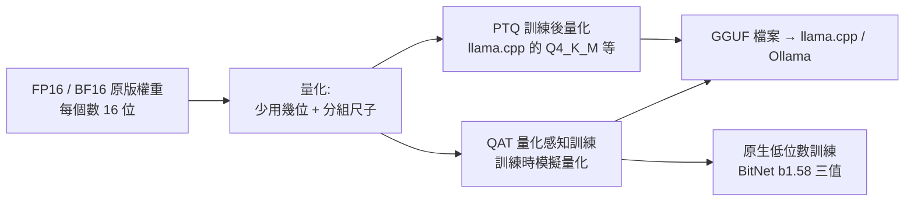
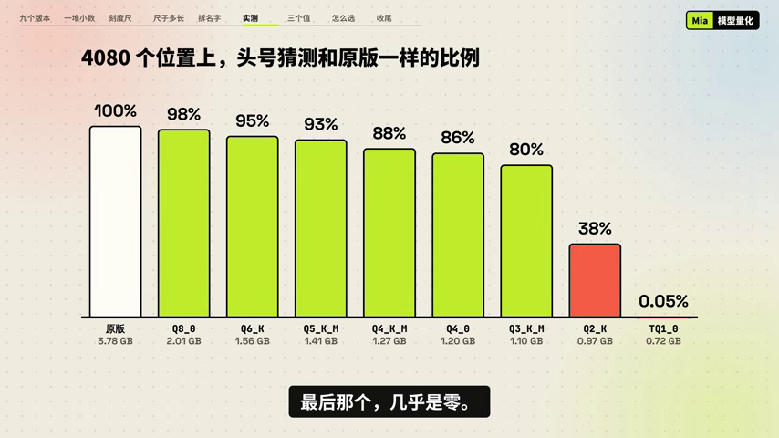

# 模型名裡的 Q4、Q8 是什麼?量化(PTQ / QAT / GGUF / 三值)完整地圖

> **來源影片:** [模型名里的 Q4、Q8 是什么?我把同一个 AI 压成了 9 个版本(Mia 码上 AI,2026-11-05,9:35)](https://www.youtube.com/watch?v=GvlftOu2uNA)。頻道偏科普入門。
> **本篇的做法(使用者 2026-11-08 要求):** 影片只講到入口,本篇把它提到的每個點(Gemma 的量化感知訓練、離群值、K-quants、三值模型……)延伸到一手來源,日後可以直接查。**標記:** ✅ 已核實(讀到一手來源內文)、⚠️ 需修正、❓ 未能核實(沒讀到或只看到摘要)。
> **逐字稿:** 該片無字幕,以 `whisper_transcribe.py`(faster-whisper `large-v3-turbo` int8,256 段)轉錄,**非官方字幕**;影片中的數字我另外對畫面截圖核對(見 §2.2)。
> **揭露:** 說明欄無業配;作者沒有推廣自家產品。
> **關聯筆記:** [[local-ai-every-hardware-size]](硬體與模型大小)、[[llmfit-local-model-hardware-fit]]、[[inference-engines-llamacpp-vllm-sglang-tensorrt]]、[[kv-cache]]、[[moe-mixture-of-experts-from-ffn]](影片提到的 MoE 塞進手機)、[[qwen38-27b-local-economics-and-august-checkpoint-wave]]。

## 一、影片在講什麼(一頁)

| 主題 | 影片說法 | 從哪裡聽 |
|---|---|---|
| 量化是什麼 | 每個權重少用幾位記;16 位 → 8 位體積減半,→ 4 位剩四分之一 | [從 0:29 開始](https://www.youtube.com/watch?v=GvlftOu2uNA&t=29s) |
| 尺子比喻 | 位數決定刻度數:16 位 65,536 格、8 位 256、4 位 16、2 位 4;量化 = 把數字挪到最近的刻度,挪的距離就是誤差 | [從 1:40 開始](https://www.youtube.com/watch?v=GvlftOu2uNA&t=100s) |
| 尺子多長 | 整張表一把尺會被少數大數拉長(真實張量 1,200 多萬個數、最大 0.21,16 格每格 0.03,92% 變成 0);解法是每 32 個一組各配一把尺,代價是平均多約半位 | [從 2:52 開始](https://www.youtube.com/watch?v=GvlftOu2uNA&t=172s) |
| 離群值最要緊 | 有研究發現把某個特別大的數改成 0,整個模型就胡說八道 | [從 3:43 開始](https://www.youtube.com/watch?v=GvlftOu2uNA&t=223s) |
| 拆 Q4_K_M | Q4=主體 4 位;K=llama.cpp 的分組法(256 個一大組、8 小組各一把尺,連尺長也壓縮);M=中檔,敏感的部分給 6 位,平均約 4.9 位;S/L=更省/更多;i 開頭=極限壓縮,配重要性矩陣 | [從 3:58 開始](https://www.youtube.com/watch?v=GvlftOu2uNA&t=238s) |
| 新格式 | FP8、NVFP4 不是整數格子而是很短的小數格式,主要給新顯卡 | [從 4:59 開始](https://www.youtube.com/watch?v=GvlftOu2uNA&t=299s) |
| 實測 | 用 Qwen3.5-2B 壓成 8 檔,數 4,080 個位置「頭號猜測與原版一致」的比例 | [從 5:49 開始](https://www.youtube.com/watch?v=GvlftOu2uNA&t=349s) |
| 三值模型 | Bonsai 2:由 Qwen3.8-27B 改出,每個數只剩 −1、0、+1,54 GB → 不到 6 GB,官方稱保留 98% | [從 7:20 開始](https://www.youtube.com/watch?v=GvlftOu2uNA&t=440s) |
| QAT | 從訓練起就讓模型習慣低位數,叫量化感知訓練;Gemma 4 官方四位版本就是這樣做的(**影片只有這一句**,本篇 §四展開) | [從 7:53 開始](https://www.youtube.com/watch?v=GvlftOu2uNA&t=473s) |
| 怎麼選 | 大小 ≈ 參數量 B × 位數 ÷ 8,再留 1–2 GB 給對話;拿不準選 Q4_K_M;記憶體夠往 Q5/Q6;同樣記憶體,「大模型的 4 位」優於「小模型的原版」 | [從 8:07 開始](https://www.youtube.com/watch?v=GvlftOu2uNA&t=487s) |

## 二、核實影片說法

### 2.1 算術與格式(✅ 對照 llama.cpp 原始碼與官方 README)

| 影片說法 | 結果 | 依據 |
|---|---|---|
| 19 億個數 × 2 位元組 = 3.8 GB | ✅ 算術正確(1.9×10⁹ × 2 B = 3.8 GB) | 畫面標原版 3.78 GB |
| 16 位 65,536 格、8 位 256、4 位 16 | ✅ 2^16、2^8、2^4 | 算術 |
| 分組後每個數多約半位 | ✅ fp16 的尺(2 位元組=16 位)攤在 32 個數上 = 0.5 位 | `ggml-common.h`:Q4_0 每 32 個數 = 2 B 尺 + 16 B 資料 = 18 B → **4.5 bpw**;Q8_0 = 34 B/32 → **8.5 bpw** |
| K-quants:256 個一大組、8 小組、尺長也壓縮 | ✅ | `ggml-common.h`:`#define QK_K 256`;Q4_K 註解「8 blocks of 32 elements each… Effectively 4.5 bits per weight」,`scales[12]` 為 6 位元的小組尺與最小值,`d`、`dmin` 為超級塊的尺(對尺再量化) |
| Q4_K_M 平均約 4.9 位 | ✅ 4.8944 bpw | llama.cpp `tools/quantize/README.md` 量測表(Llama-3.1-8B):Q4_K_M 4.8944、Q4_K_S 4.6672、Q5_K_M 5.7036、Q6_K 6.5633、Q8_0 8.5008、F16 16.0005 |
| Q4_K_M:敏感的部分給 6 位 | ✅ 並且更具體:`llama-quant.cpp` 中 Q4_K_M 對 `attn_v` 與 `ffn_down`,在「前 1/8 層、後 1/8 層、其間每隔 3 層」這些層改用 **Q6_K**(`use_more_bits`);其他仍是 Q4_K | `src/llama-quant.cpp`(讀到相關函式,**其餘張量規則未逐行讀完**) |
| 重要性矩陣(imatrix)讓常用的數記得更細 | ✅ 概念正確 | README:「This can be minimized by using a suitable imatrix file」;選項 `--imatrix`;來源 PR #4861。實際機制(以校正文字統計每個權重對輸出的貢獻再調整量化)❓ 我沒讀 PR 內文 |
| 「9B Q4_K_M 約 5.6 GB」 | ✅ 與公式吻合:9×4.89/8 ≈ 5.5 GB | 算術 |

**各格式實際每權重位數(由結構體大小算出)**

| 格式 | 區塊結構 | 位元組/區塊 | bpw |
|---|---|---|---|
| Q4_0 | 32 個數,fp16 尺 | 18 | 4.5 |
| Q8_0 | 32 個數,fp16 尺 | 34 | 8.5 |
| Q2_K | 256 個數 | 84 | 2.625 |
| Q3_K | 256 個數 | 110 | 3.4375 |
| Q4_K | 256 個數,8 小組 | 144 | 4.5 |
| Q5_K | 256 個數 | 176 | 5.5 |
| Q6_K | 256 個數 | 210 | 6.5625 |

(出處:`ggml-common.h` 的 `static_assert(sizeof(block_*))`;混合型如 Q4_K_M 因為部分張量用 Q6_K,實測 4.89 bpw。)

### 2.2 實測圖表(我對畫面截圖讀出的數字)

*圖:截自影片 6:22 的畫面([從 6:12 開始](https://www.youtube.com/watch?v=GvlftOu2uNA&t=372s)),作者實測 Qwen3.5-2B 原版與 8 檔 llama.cpp 量化。語音轉錄把數字聽成「9 乘 5、9 乘 3、8 乘 8」,以畫面為準。*

| 版本 | 大小 | 頭號猜測與原版一致(4,080 個位置) |
|---|---|---|
| 原版 | 3.78 GB | 100% |
| Q8_0 | 2.01 GB | 98% |
| Q6_K | 1.56 GB | 95% |
| Q5_K_M | 1.41 GB | 93% |
| Q4_K_M | 1.27 GB | 88% |
| Q4_0 | 1.20 GB | 86% |
| Q3_K_M | 1.10 GB | 80% |
| Q2_K | 0.97 GB | **38%** |
| TQ1_0(三值) | 0.72 GB | **0.05%** |

**怎麼讀:** 從 Q8 到 Q3 是穩定緩降,Q2 開始跳崖,三值直接崩壞(影片:「不是一點一點變笨,先穩穩往下走,然後在某個地方突然跳崖」)。
- ⚠️ **「頭號猜測一致率」不等於「能力保留率」:** 它衡量下一個字的最高機率選項有沒有變,是個嚴格但粗的指標。專業做法是比對**整個機率分布**的 KL 散度(KLD)與困惑度(perplexity)——llama.cpp 的量化 README 用的就是這兩個。
- **只有一個 2B 模型、一段維基文章、單次測試、影片沒說明 imatrix 是否使用**,結論只示範「趨勢」,不能當定量結論。
- 蘋果題(5−2)是**單題軼事**,兩個尺寸都在 Q4_K_M 答錯(9B 的 8 位版答對):方向和下面 §五 的「長鏈推理先出問題」一致,但單題不能證明什麼。

### 2.3 研究與產品說法

| 影片說法 | 結果 | 依據 |
|---|---|---|
| 「有研究發現把某個特別大的數改成 0,整個模型就胡說八道」 | ✅ 指的是 **Super Weight** 論文(Apple + Notre Dame,[arXiv:2411.07191](https://arxiv.org/abs/2411.07191)):在 Llama-7B 剪掉**單一個**純量權重,模型就無法生成文字、零樣本任務準確率掉到近零;該權重在早期層的 `mlp.down_proj`;保護這種「超級離群值」能讓四捨五入量化好很多 | 搜尋摘要 + 論文頁摘要;**論文全文我沒逐段讀**(❓ 細節) |
| 「Gemma 4 官方出的四位版本用 QAT 做出來」 | ✅ [Google Gemma 4 QAT 官方部落格(2026-06-05)](https://blog.google/innovation-and-ai/technology/developers-tools/quantization-aware-training-gemma-4/) 全文已讀 | §四 |
| Bonsai 2 由 Qwen3.8-27B 改出、三值、54 GB → 不到 6 GB、保留 98% | ✅ 模型卡([prism-ml/Ternary-Bonsai-2-27B-gguf](https://huggingface.co/prism-ml/Ternary-Bonsai-2-27B-gguf))全部吻合:基座 Qwen3.8-27B、三值 {−1,0,+1} 搭 FP16 分組尺(每 128 個一組)、理想 5.8 GB(實際封裝 5.95 GB / 7.21 GB / 7.63 GB)、14 項思考模式基準平均 84.78(FP16 為 86.32,即 98.2%) | ⚠️ **全是廠商(PrismML)自報**,模型卡寫評測用 EvalScope + vLLM;白皮書我沒讀 |
| 「不是直接四捨五入,是專門處理過,比如先把每張表轉一轉」 | ✅ 模型卡:「權重存在旋轉後的基底:每個矩陣先經分塊 Hadamard 旋轉(區塊 1024、固定 ±1 符號)再做三值指派,執行時對啟動值做對應轉換」 | 模型卡 |
| Bonsai 是「訓練時就低位數」還是「事後量化」? | ❓ 模型卡只說「derived from Qwen3.8-27B」,**沒說明是 PTQ、QAT 或蒸餾**(白皮書未讀)。影片也沒講 | — |

## 三、為什麼離群值是量化的核心難題(影片只點到)

影片的「刺頭」其實是一整個研究領域。**離群值有三種層次,對策不同:**

| 層次 | 現象 | 代表工作 | 對策 |
|---|---|---|---|
| **權重離群值** | 少數權重特別大(影片的 0.21 對 0.01);其中有「超級權重」 | [Super Weight(arXiv:2411.07191)](https://arxiv.org/abs/2411.07191) | 分組量化縮小影響範圍;保護離群值;旋轉 |
| **啟動值離群值(特徵維度)** | 約 6.7B 參數以上的模型,隱藏狀態有幾個維度的值系統性地特別大,主導注意力與預測 | [LLM.int8()(arXiv:2208.07339)](https://arxiv.org/abs/2208.07339):把離群特徵維度抽出來用 16 位乘,其餘 99.9% 用 8 位 | 混合精度分解 |
| **巨大啟動值(massive activations)** | 極少數啟動值比其他大 10 萬倍,值幾乎不隨輸入改變,功能像隱含的偏置項,讓注意力集中到特定 token | [Massive Activations(arXiv:2402.17762)](https://arxiv.org/abs/2402.17762) | 設計量化方案時不能把它們截斷 |

(以上為各論文**摘要層級**的讀取,摘要之外的細節❓。)

**對策家族(都是「在量化之前,先讓數字分布變好看」):**

| 方法 | 做法 | 一句話 |
|---|---|---|
| **分組(group-wise)** | 每 32 / 64 / 128 個一把尺(影片的核心解法) | 把離群值的傷害限制在一組內 |
| **GPTQ**([arXiv:2210.17323](https://arxiv.org/abs/2210.17323)) | 用近似二階資訊,一個一個量化並**補償**剩餘權重的誤差;175B 模型約 4 GPU 小時,3–4 位幾乎無損 | 「量化這個數造成的誤差,讓還沒量化的數去彌補」 |
| **AWQ**([arXiv:2306.00978](https://arxiv.org/abs/2306.00978)) | 只保護約 1% 的**顯著通道**(看**啟動值**分布而不是權重分布),用等價縮放把它們放大再量化 | 重要的不是大的權重,是常被大啟動值乘到的權重 |
| **SmoothQuant**([arXiv:2211.10438](https://arxiv.org/abs/2211.10438)) | 啟動值難量化、權重容易:離線把量化難度由啟動值「搬」到權重,數學等價 | W8A8 的做法 |
| **旋轉(QuaRot / SpinQuant)** | 對權重與啟動值做正交旋轉(Hadamard 或學出來的),輸出不變但離群值被「攤平」;[QuaRot(arXiv:2404.00456)](https://arxiv.org/abs/2404.00456) 4 位 LLaMA2-70B 困惑度損失最多 0.47;[SpinQuant(arXiv:2405.16406)](https://arxiv.org/abs/2405.16406) 指出不同隨機旋轉差距最多 13 分,改用學出來的旋轉 | 影片說 Bonsai「先把每張表轉一轉」就是這一族(模型卡的 Hadamard 旋轉) |
| **imatrix / 重要性矩陣** | 用一段文字跑一遍,統計哪些權重對輸出貢獻大,讓它們量化得更準 | llama.cpp 的 IQ、低位數檔必備 |

## 四、量化感知訓練(QAT):影片沒細講的部分

### 4.1 PTQ 與 QAT 的差別

| | **PTQ(訓練後量化)** | **QAT(量化感知訓練)** |
|---|---|---|
| 時機 | 模型訓練完,直接把權重換成低位數 | 訓練(或最後一段訓練)時就**模擬**量化 |
| 成本 | 低:幾分鐘到幾小時、不用訓練 | 高:要繼續訓練,Gemma 3 約 5,000 步、PyTorch 示範用 6–8 張 A100 微調 5,000 步 |
| 品質 | 4 位以上通常夠用;2–3 位容易崩 | 同位數下品質較好,低位數差距最明顯 |
| 影片的 Q4_K_M | 屬於這類 | Gemma 官方版是這類 |

### 4.2 QAT 怎麼運作(機制)

核心三件事:

1. **假量化(fake quantization):** 前向傳播時,權重先被「量化再還原」(`dequant(quant(w))`),模型看到的是**帶量化誤差**的權重;但實際儲存與更新的仍是浮點權重。
2. **直通估計器(STE):** 「四捨五入」不可微,反向傳播時直接假裝它是恆等函數,把梯度原封不動傳給浮點權重(Bengio 等人 2013 的 straight-through estimator,[arXiv:1308.3432](https://arxiv.org/abs/1308.3432))。
3. **訓練完才真正量化(convert):** 把假量化換成真正的低位數儲存。PyTorch torchao 的 API 就是 `prepare`(插入假量化)與 `convert`(轉成真量化)兩步。

早期完整方案是 Google 的 [Jacob 等人 2017(arXiv:1712.05877)](https://arxiv.org/abs/1712.05877):提出整數算術推論 + **配套的訓練流程**以保住端到端準確率。

**直覺:** 權重在訓練中會自己往量化格點「靠攏」,並找到對四捨五入誤差比較不敏感的位置(損失曲面較平坦的地方)。這是我對機制的解讀,文獻用「模型適應量化噪音」描述。

### 4.3 Google 的 Gemma QAT(影片提到但沒細講的那件事)

**Gemma 3(2025-04-18,✅ 官方部落格全文已讀):**
- 做法:「QAT 約 5,000 步,**以未量化檢查點的機率分布當作訓練目標**」(= 自我蒸餾:拿原版模型的輸出分布教量化版)。
- 效果:以 llama.cpp 困惑度評測,量化到 **Q4_0 時的困惑度退化降低 54%**。
- 大小(只算權重):27B 由 54 GB(BF16)→ **14.1 GB**(int4);12B 24 → 6.6;4B 8 → 2.6;1B 2 → 0.5 GB。27B 可放進單張 RTX 3090(24 GB),12B 可放進 8 GB 筆電顯卡。
- 釋出格式:int4 與 Q4_0 的未量化 QAT 檢查點(Hugging Face、Kaggle),並支援 Ollama、LM Studio、MLX、gemma.cpp、llama.cpp。
- 重點:**QAT 針對的是特定格式(Q4_0)**——模型學的就是這個格式的格點與分組方式,所以官方直接發 Q4_0 檔,而不是讓使用者自己量化。(此段為我由「為 Q4_0 做 QAT」推得,部落格沒有這樣明說。)
- 官方也說社群的 PTQ 量化(Bartowski、Unsloth、GGML)是不同取捨的替代品。

**Gemma 4(2026-06-05,✅ 官方部落格全文已讀,其中 VRAM 對照表在圖片中、我沒讀到):**
- 發布「Gemma 4 發布兩個月後」;本次提供 **Q4_0 格式的 QAT 檢查點**,以及**為手機特別設計的新量化格式**;E2B 記憶體降到 **1 GB**;E2B 純文字版(不含逐層嵌入)小於 1 GB。
- 部落格寫:標準 PTQ 常造成效能退化,**QAT 的整體品質比標準 PTQ 基線更高**(沒給具體數字)。
- **行動版量化方案(部落格列的四項):**
  1. **靜態啟動值(static activations):** 訓練時就預先算好縮放設定,不在裝置上即時算,降低行動晶片負擔。
  2. **通道式量化(channel-wise):** 資料結構配合行動加速器設計,可原生執行。
  3. **針對性 2 位量化:** 把「產生 token 的部分」壓到 2 位,核心推理層保持較高精度。
  4. **嵌入與 KV cache 優化:** 壓縮詞表與短期記憶,降低活躍記憶體,長對話不爆。
- 釋出形式:Q4_0 與行動版權重(Hugging Face);GGUF 給 llama.cpp、compressed tensors 給 vLLM、未量化 QAT 檢查點可自行轉換;支援 llama.cpp、Ollama、LM Studio、LiteRT-LM、Transformers.js、SGLang、vLLM、MLX;連多 token 預測(MTP)也有 QAT 檢查點,量化後仍保留加速。
- ❓ 部落格沒說的:QAT 訓練步數、資料、蒸餾損失、實際困惑度或基準數字;**要查需看 Gemma 技術報告或 Hugging Face 模型卡,本篇未讀**。第三方文章聲稱「記憶體減少約 72%」等數字,我只在搜尋摘要看到,**未能核實**,未採用。

### 4.4 為什麼「訓練時習慣低位數」值得做?(研究面)

- **PTQ 對訓練越久的模型越傷。** [《Scaling Laws for Precision》(arXiv:2411.04330)](https://arxiv.org/abs/2411.04330):訓練後量化造成的退化隨訓練 token 數增加而變大,「最終多餘的預訓練資料反而有害」;低精度訓練等於降低「有效參數量」。(摘要層級,擬合 465 次預訓練、至多 1.7B 參數、26B token,**外推到今天的大模型需小心**。)意思是:被訓練得很飽的現代模型,事後四捨五入會更痛,所以官方想在**出廠前**用 QAT 補一輪。
- **PyTorch 官方示範(✅ 部落格全文已讀):** Llama3-8B 以 int8 動態啟動值 + int4 分組權重(8da4w),QAT 相較 PTQ **復原了 96% 的 hellaswag 退化**與 68% 的 wikitext 困惑度退化;Llama2-7B 復原 62% 與 58%;細節:5,000 步、學習率 2e-5、**前 1,000 步關閉假量化讓權重先穩定**。
- **資料不足也能做:** [LLM-QAT(arXiv:2305.17888)](https://arxiv.org/abs/2305.17888) 用原模型**自己生成的文字**做無資料蒸餾,並同時量化 KV cache,在 4 位大幅勝過免訓練方法;[EfficientQAT(arXiv:2407.11062)](https://arxiv.org/abs/2407.11062) 用「分塊訓練」讓 Llama-2-70B 的 2 位 QAT 在單張 A100-80GB 上約 41 小時完成,精度損失小於 3 分。

### 4.5 光譜:事後量化 → QAT → 原生低位數訓練

| 路線 | 代表 | 說明 |
|---|---|---|
| 事後量化 | llama.cpp K-quants、GPTQ、AWQ | 不訓練 |
| QAT(補訓練) | Gemma 3 / 4 QAT、torchao | 在已訓練好的模型上補一段「量化感知」訓練 |
| **原生低位數訓練** | [BitNet(arXiv:2310.11453)](https://arxiv.org/abs/2310.11453)、[BitNet b1.58(arXiv:2402.17764)](https://arxiv.org/abs/2402.17764) | **從頭訓練**用 `BitLinear` 取代 `nn.Linear`,權重就是 {−1,0,+1};論文主張在相同大小與 token 數下可持平 FP16 的困惑度與任務表現 |
| 事後「三值化」 | Bonsai 2(Hadamard 旋轉 + 三值 g128;訓練方式❓) | 在現成大模型上做,廠商自報保留 98% |

注意影片自己的「直接四捨五入到三值 → 亂碼」與 Bonsai「專門處理過」的對比,就是 §五 玩具實驗在小尺度重現的現象。

## 五、我做的玩具實驗:尺子、離群值、PTQ 與 QAT

程式與結果:[`research/quantization-toy/`](../../../../research/quantization-toy/q.py)(只用 numpy)。**玩具資料,只示範機制,不能外推到 LLM。**

**實驗 1:尺子與離群值。** 120 萬個權重(拉普拉斯分布、標準差約 0.01),另加一個 0.21 的離群值,量化成 4 位:

| 方式 | 均方誤差 | 結果 |
|---|---|---|
| 整張表一把尺 | 3.69×10⁻⁵ | 量化後只剩 12 種不同的值,**最常見的單一值佔 66%** |
| 每 32 個一組 | 8.48×10⁻⁷(約 **43 倍**更小) | 7 萬多種不同值,沒有任何一個值佔大宗 |

影片真實張量說「92% 變成 0」;我的合成分布得到 66%,**趨勢一致、數字不同**(真實張量更尖)。

**實驗 2:PTQ vs QAT(STE)。** 10 類高斯混合資料、3 層 MLP(64-256-256-10),先訓練浮點版,再 PTQ(直接分組量化)或 QAT(以量化權重做前向、STE 反傳,繼續訓練 8 輪);5 個隨機種子平均,測試準確率:

| 位數 | PTQ | QAT |
|---|---|---|
| 浮點基準 | 0.913 ± 0.007 | — |
| 4 位 | 0.908 | 0.913 |
| 3 位 | 0.885 | 0.907 |
| 2 位 | **0.582** | **0.855** |
| 三值 | **0.725** | **0.899** |

**怎麼讀:** 4 位時 PTQ 就夠好(與影片「Q4 大部分時候看不出差別」一致);**位數越低,QAT 的補救越大**(2 位 +27 點、三值 +17 點),跳崖點被往後推。這是 Gemma、Bonsai 這類官方版本在極低位數仍能用的機制性解釋,但**這只是 3 層 MLP**,LLM 的離群值問題更嚴重、需要旋轉等額外手段。

## 六、格式地圖(查檔名用)

| 名稱 | 是什麼 | 備註 |
|---|---|---|
| **Q4_0 / Q8_0** | llama.cpp 早期格式:32 個一組、fp16 尺 | Gemma QAT 針對 Q4_0 |
| **Q2_K~Q6_K(K-quants)** | 256 一大組、小組尺 6 位壓縮;後綴 S/M/L 為混合策略(部分張量用更多位) | Q4_K_M 是預設推薦 |
| **IQ1~IQ4(i-quants)** | 為極低位數設計,常配 imatrix | 2–3 位用 |
| **GPTQ / AWQ** | GPU 上常用的 4 位權重格式(vLLM 等) | 見 §三 |
| **NF4**(QLoRA) | 對常態分布最佳的 4 位資料型別 + 雙重量化,用於低成本微調(QLoRA,[arXiv:2305.14314](https://arxiv.org/abs/2305.14314)) | 微調用,不是部署格式 |
| **FP8**(E4M3 / E5M2) | 8 位浮點 | 新 GPU |
| **MXFP4** | 4 位浮點 E2M1 + 每 32 個一個「2 的次方」共享尺([Microscaling 論文 arXiv:2310.10537](https://arxiv.org/abs/2310.10537)) | OCP 微縮放標準 |
| **NVFP4** | 4 位浮點 E2M1 + **每 16 個一個 FP8(E4M3)尺** + 每張量一個 FP32 尺(兩層縮放);NVIDIA 稱對 DeepSeek-R1-0528 比 FP8 退化 ≤1%、記憶體約為 FP16 的 1/3.5([NVIDIA 技術部落格](https://developer.nvidia.com/blog/introducing-nvfp4-for-efficient-and-accurate-low-precision-inference/),✅ 全文已讀;廠商自報) | Blackwell 顯卡 |
| **三值 / 1.58 位** | {−1,0,+1},理論資訊量 log₂3 ≈ 1.585 位 | BitNet b1.58、Bonsai |

## 七、怎麼選模型檔(把影片建議補成可操作)

1. **先估大小:** `大小(GB)≈ 參數量(B)× 每權重位數 ÷ 8`;再加上 **KV cache**(與上下文長度成正比,見 [[kv-cache]])與一兩 GB 執行開銷。
2. **預設選 Q4_K_M**(約 4.9 位);記憶體夠、要做數學與寫程式這類「較真的活」往 Q5_K_M / Q6_K / Q8_0 走。
3. **記憶體不夠時,先降位數(到 Q4)再考慮換小模型。** 影片的實測:9B 的 Q4_K_M(5.6 GB)比 2B 的原版猜得準得多。(單一家族、單一測試,請在自己的任務上驗證。)
4. **Q3 以下只在塞不下時用;模型越小越經不起壓。**
5. **不要只用「問幾題」或 MMLU 這類知識題測量化:** PrismML 模型卡的自家資料顯示,Qwen3.8-27B 的 IQ2_XXS 在 MMLU-Redux 仍有 88.93,但 AIME26 掉到 57.5、LiveCodeBench 掉到 56.4(FP16 平均 86.32 對 IQ2_XXS 72.59);即**長鏈推理的任務比知識題更早崩**。(⚠️ 廠商自報,且是為了凸顯自家產品;但與影片蘋果題的方向一致。)
6. **多模態專案:** llama.cpp README 建議視覺 / 音訊編碼器(mmproj)保持 bf16 或 q8,因為它們的品質直接影響 LLM 的輸入,縮小檔案對速度與記憶體影響也很小。
7. **別重複量化:** README 警告 `--allow-requantize`(對已量化模型再量化)會嚴重降低品質;應從 16 位 GGUF 一次量化。
8. **評估量化好壞用 perplexity + KLD**,不要只看「回答了沒」。

## 八、應用案例

### 案例 1:RTX 3090(24 GB)要跑 27B 級模型

- 公式:27B × 4.5 bpw(Q4_0/Q4_K)÷ 8 ≈ **15.2 GB**,加上 KV cache 與開銷,24 GB 夠用。對照 Google 公布 Gemma 3 27B int4 **14.1 GB**(官方 QAT 版)。
- 選擇:想要穩定品質 → 優先選**官方 QAT 的 Q4_0 版**;想要彈性 → 社群 Q4_K_M / Q5_K_M;三值 27B(Bonsai 2,5.95 GB)可放進更小的卡,但**依賴廠商 fork 的 llama.cpp 核心**(或 b11556 以後的主線 `Q2_0` 檔,舊版載入會「無警告地產生亂碼」,模型卡警告),部署前要驗版本。

### 案例 2:16 GB 筆電選模型

用 [[local-ai-every-hardware-size]] 的粗估(約 12 GB 可用、4 位量化約 20B)→ 實際候選:9B 級 Q5_K_M(約 6.5 GB)或 12B 級 Q4_K_M(約 7.3 GB,Gemma 3 12B int4 為 6.6 GB);**同記憶體下大模型的 4 位優於小模型的 8 位**,並預留 KV cache。

### 案例 3:公司 Team KB 的本地抽取模型(接 [REPORT-2](../../../../research/team-kb-architecture/REPORT-2.md) 的機敏分流)

機敏會議要走自架模型時,量化檔選擇的順序建議:先用 **Q5_K_M / Q8_0 在 30 題「抽 claim 與判斷取代」任務**上建基準 → 再降到 Q4_K_M 比較 → 若品質掉在「判斷取代與否定句」這類**長鏈推理**,保留較高位數。(依 §七.5 的推論;**本倉庫沒有實測自架模型的抽取品質**,屬待驗證。)

## 九、未能核實與待追

- ❓ Gemma 3 / 4 QAT 的訓練細節(資料、損失、步數)只有部落格層級;技術報告與 HF 模型卡未讀。
- ❓ Gemma 4 部落格的 VRAM 對照表在圖片中,未讀到;第三方「72%」等數字未採用。
- ❓ PrismML Bonsai 2 白皮書(GitHub `Bonsai-demo/bonsai-2-27b-whitepaper.pdf`)未讀;PTQ / QAT / 蒸餾哪種?未知。其基準全為廠商自報。
- ❓ Super Weight、Massive Activations、LLM.int8()、AWQ、GPTQ 等論文只讀摘要。
- ❓ imatrix 的實作細節(PR #4861)與 `llama-quant.cpp` 其餘張量規則未逐行讀。
- ❓ 影片的 Qwen3.5-2B 模型卡與 imatrix 是否使用未查。
- ⚠️ 影片的 4,080 位置一致率為單一小模型的單次測量,不是能力評測。

## 來源

- 影片:[模型名里的 Q4、Q8 是什么?我把同一个 AI 压成了 9 个版本(Mia 码上 AI)](https://www.youtube.com/watch?v=GvlftOu2uNA),2026-11-05。**該片無字幕,逐字稿以 CPU 版 Whisper(faster-whisper `large-v3-turbo` int8)轉錄,非官方字幕**;圖表數字取自畫面截圖。
- [Gemma 3 QAT Models: Bringing state-of-the-Art AI to consumer GPUs(Google Developers Blog,2025-04-18)](https://developers.googleblog.com/en/gemma-3-quantized-aware-trained-state-of-the-art-ai-to-consumer-gpus/)
- [Gemma 4 QAT models: Optimizing model compression for mobile and laptop efficiency(Google,2026-06-05)](https://blog.google/innovation-and-ai/technology/developers-tools/quantization-aware-training-gemma-4/)
- [Quantization-Aware Training for Large Language Models with PyTorch(PyTorch 官方部落格)](https://pytorch.org/blog/quantization-aware-training/)
- llama.cpp:[ggml-common.h](https://github.com/ggml-org/llama.cpp/blob/master/ggml/src/ggml-common.h)、[llama-quant.cpp](https://github.com/ggml-org/llama.cpp/blob/master/src/llama-quant.cpp)、[quantize README](https://github.com/ggml-org/llama.cpp/blob/master/tools/quantize/README.md)、[k-quants PR #1684](https://github.com/ggml-org/llama.cpp/pull/1684)、[imatrix PR #4861](https://github.com/ggml-org/llama.cpp/pull/4861)
- [Ternary Bonsai 2 27B GGUF 模型卡(PrismML)](https://huggingface.co/prism-ml/Ternary-Bonsai-2-27B-gguf)
- [NVIDIA:Introducing NVFP4 for Efficient and Accurate Low-Precision Inference](https://developer.nvidia.com/blog/introducing-nvfp4-for-efficient-and-accurate-low-precision-inference/)
- 論文(arXiv):[1308.3432 STE](https://arxiv.org/abs/1308.3432)、[1712.05877 整數量化與訓練](https://arxiv.org/abs/1712.05877)、[2208.07339 LLM.int8()](https://arxiv.org/abs/2208.07339)、[2210.17323 GPTQ](https://arxiv.org/abs/2210.17323)、[2211.10438 SmoothQuant](https://arxiv.org/abs/2211.10438)、[2306.00978 AWQ](https://arxiv.org/abs/2306.00978)、[2305.14314 QLoRA](https://arxiv.org/abs/2305.14314)、[2305.17888 LLM-QAT](https://arxiv.org/abs/2305.17888)、[2407.11062 EfficientQAT](https://arxiv.org/abs/2407.11062)、[2310.11453 BitNet](https://arxiv.org/abs/2310.11453)、[2402.17764 BitNet b1.58](https://arxiv.org/abs/2402.17764)、[2404.00456 QuaRot](https://arxiv.org/abs/2404.00456)、[2405.16406 SpinQuant](https://arxiv.org/abs/2405.16406)、[2411.07191 Super Weight](https://arxiv.org/abs/2411.07191)、[2402.17762 Massive Activations](https://arxiv.org/abs/2402.17762)、[2411.04330 Scaling Laws for Precision](https://arxiv.org/abs/2411.04330)、[2310.10537 Microscaling 格式](https://arxiv.org/abs/2310.10537)
- 玩具實驗:本倉庫 [`research/quantization-toy/`](../../../../research/quantization-toy/q.py)
