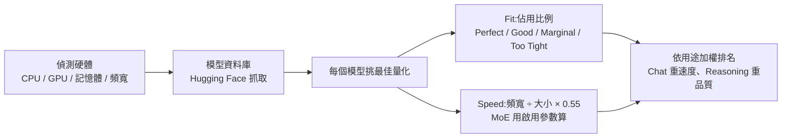

# llmfit:下載前先算——你的電腦跑得動哪個本地大模型、跑多快

> 整理自 YouTube 頻道 **YAHA學堂**〈[别再乱下载 AI 模型了!一个命令,找出你的电脑最适合跑哪个大模型。](https://www.youtube.com/watch?v=6d9s_hmXQX0)〉(2026-10-18,約 5 分鐘)。
>
> ⚠️ 該片無官方字幕(只有被誤標為英文的自動字幕),逐字稿以 CPU 版 faster-whisper 轉錄,非官方字幕;指令以說明欄與 repo 原文為準。
>
> ⭐ 已 `git clone --depth 1` [AlexsJones/llmfit](https://github.com/AlexsJones/llmfit) 讀過文件與原始碼(v1.1.17,Rust,MIT,約 38k star,2026-10-19 GitHub API)。補正見第五節。
>
> 立場:說明欄只有 YouTube Hype 請求,沒有業配或聯盟連結。

---

## 一句話總結

> ⭐⭐⭐ **本地跑模型,先算再下。** llmfit 讀你的 CPU、GPU、記憶體,替資料庫裡的模型逐一打分(推薦量化、預估 tok/s、記憶體佔用)。影片在 M4 Pro / 24GB Mac 上實測:Qwen3-30B-A3B 預估 39.7、實測 39.5 tok/s;名字和大小差不多的 Qwen3-32B 卻只有 **0.12 tok/s**,三句話寫了 41 分鐘,因為記憶體放不下、部分運算被擠到 CPU。

---

## 一、表格只看四樣

| 欄位 | 意思 | 判讀 |
|---|---|---|
| **Best Quant** | 推薦量化。16 位元壓到 4 位元,體積約剩 1/4,品質略降 | Q4 / Q8、4bit / 8bit:數字越小壓越狠越省記憶體 |
| **tok/s** | 每秒生成幾個 token | 影片經驗:低於 10 就會感覺在等 |
| **estimate basis** | 估算依據 | 會告訴你用了多少頻寬、乘了多少效率係數,可自行驗算 |
| **Fit Analysis** | 記憶體佔用比例 | 見下方門檻表 |

### Fit 門檻(`docs/how-it-works.md`)

| 佔可用記憶體 | 判定 |
|---|---|
| 60% 以下 | **Perfect** |
| 85% 以下 | **Good** |
| 98% 以下 | **Marginal** |
| 超過 98% | **Too Tight**(排最後) |

影片那個模型佔 15.6GB / 24GB ≈ 65%,所以顯示黃色的 Good。另外 MoE offload、CPU+GPU、純 CPU 模式最高只給到 Good,因為 Perfect 的定義是「有餘裕**而且**跑在 GPU 上」。

---

## 二、速度怎麼估

解碼是**記憶體頻寬瓶頸**:每產生一個 token 都要把模型權重從記憶體讀一遍。

```text
tok/s ≈ (GPU 記憶體頻寬 GB/s ÷ 模型大小 GB) × 效率係數 0.55
```

- M4 Pro 頻寬 **273 GB/s**(與 Apple 官方規格一致),效率係數預設 **0.55**(可在 TUI 按 `A` 調整),用來吸收 kernel 開銷、KV cache 讀取等損耗。
- 頻寬查表涵蓋約 80 款 GPU;查不到就用各後端的常數。
- 影片說誤差約 ±30%(文件沒有寫明這個數字)。
- 預填(prefill / TTFT)是**運算瓶頸**,和頻寬無關;只有知道 GPU 的 fp16 算力時才會估,否則回傳 `null`(刻意不給 0,避免被讀成「極慢」)。



---

## 三、MoE:名字差不多,速度差很多

| 模型 | 架構 | 預估 tok/s | llmfit 品質分 |
|---|---|---|---|
| Qwen3-30B-A3B | MoE:128 個專家,每 token 啟用 8 個(約 3B 啟用參數) | 41.8 | 64 |
| Qwen3-32B | Dense:每 token 全部參數都算 | 9.2 | 93 |

- MoE 好比公司有 128 個專家,每個問題只叫其中 8 個來開會,所以速度用**啟用參數**估,不是總參數。
- 代價是品質分較低。要快還是要聰明,自己取捨。

---

## 四、真機實測流程(影片)

```bash
# 安裝(macOS,說明欄原文)
brew install AlexsJones/llmfit/llmfit
brew install ollama
brew services start ollama          # 讓 Ollama 常駐背景

llmfit                              # 開 TUI,按 / 搜 Qwen3,按 f 切換篩選
llmfit plan "<模型>" --context 8192  # 反過來問:跑這個模型最少要多少硬體
ollama pull <模型:標籤>
ollama run <模型:標籤> --verbose     # 跑完印出 eval rate(生成速度)
ollama ps                           # PROCESSOR 欄:100% GPU 才是全上顯示卡
```

1. llmfit 在 Mac 上預設按 Apple **MLX** 格式估算,但 Ollama 用 **GGUF**,所以先用 `plan` 按 Ollama 格式重算:30B-A3B 最少 19GB、預估 39.7 tok/s;32B 最少 21.5GB。
2. 兩個模型下載合計將近 40GB(18GB + 20GB)。這就是「先算再下」的理由。
3. 30B-A3B 實測 **39.5 tok/s**,和預估差不到 1%。
4. 32B 實測 **0.12 tok/s**;`ollama ps` 顯示約 15% 運算被擠到 CPU。看起來像當機,其實只是極慢。

---

## 五、補正與批判

- ⚠️ **「最少 21.5GB」放在 24GB Mac 上為什麼還是爆?** llmfit 文件寫明 Apple Silicon 的「VRAM = 系統 RAM」,把整個 24GB 統一記憶體當成 GPU 可用。但 macOS 預設不會讓 GPU 用掉全部統一記憶體,還要扣掉系統和其他程式。一般經驗是 GPU 可用量明顯低於總量,可用 `sysctl iogpu.wired_limit_mb` 調整(本文未在本機驗證)。**實務上 Mac 的 Fit 要多留餘裕**:佔用超過 80% 的模型就要有被擠到 CPU 的心理準備。
- ✅ Fit 門檻、0.55 效率係數、`plan` 指令、MoE 用啟用參數估速,都已用 repo 文件與原始碼核對(`llmfit-core/src/claim.rs` 測試也寫著 `default_efficiency = 0.55`)。
- 影片只示範 macOS。Windows 可用 `scoop install llmfit`,也可以 `uvx llmfit` 免安裝直接跑。
- 新版支援 benchmark:在 TUI 裡實測 tok/s 並回傳給專案;合併後,相同硬體的人會直接看到實測值(標 `✓`),不再只是估算。
- 單一機器、單一 context 長度(8192)的實測,只能說明「這台機器上估得準」。換成長 context,KV cache 佔用會上升,Fit 會變差。
- 相關:[[local-ai-every-hardware-size]](各級硬體能跑什麼)、[[inference-engines-llamacpp-vllm-sglang-tensorrt]](推論引擎比較)、[[kv-cache]](長 context 的記憶體來源)。

---

## 六、應用案例

### 案例 1:買機器前先模擬

`llmfit --profile <硬體設定檔> plan <模型>` 可以模擬你沒有的硬體(文件範例:`llmfit --profile m5ultra512 plan --quant Q4_K_M openai/gpt-oss-120b`)。先確認目標模型在那台機器上的 Fit 與 tok/s,再決定要不要買 64GB 還是 128GB 版本。

### 案例 2:團隊共用的模型選型

llmfit 有 REST API(`/api/v1/system`、`/api/v1/models`)。可以接進內部部署腳本:新機器開機先打一次 API,自動挑 Fit 為 Perfect 或 Good、而且 tok/s 大於 20 的最高品質模型,再交給 Ollama 拉取。

### 案例 3:用公式自己驗算

24GB 的 RTX 4090 頻寬約 1008 GB/s,跑 18GB 的 Q4 dense 32B:1008 ÷ 18 × 0.55 ≈ 31 tok/s。如果實測只有個位數,先查 `ollama ps` 是不是有部分層被卸到 CPU。

---

## 來源

- YAHA學堂〈别再乱下载 AI 模型了!一个命令,找出你的电脑最适合跑哪个大模型。〉:https://www.youtube.com/watch?v=6d9s_hmXQX0(該片無官方字幕,逐字稿以 CPU 版 faster-whisper 轉錄取得,非官方字幕)
- AlexsJones/llmfit:https://github.com/AlexsJones/llmfit(clone v1.1.17,2026-10-19)
- llmfit How it works:https://github.com/AlexsJones/llmfit/blob/main/docs/how-it-works.md
- llmfit CLI 文件:https://github.com/AlexsJones/llmfit/blob/main/docs/cli.md
- Ollama:https://ollama.com
- Whisper 專有名詞還原:LLFIT / LLMFIT→llmfit、Olema / 歐拉瑪→Ollama、POO→pull、Avoret→eval rate、Verbos→--verbose、千問三→Qwen3
