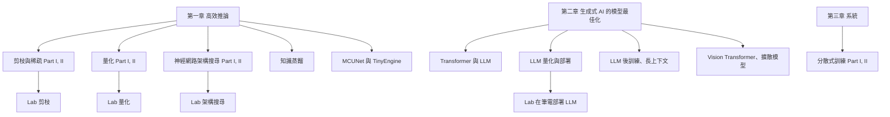

# TinyML 與高效 AI 運算:MIT 6.5940 課程地圖與核心技術

> 來源是 MIT Han Lab 的 2026 秋季課程頁,再用論文與官方 repo 補查。互動實驗頁(Artifact):https://claude.ai/artifact/8NMZ3NSP1Tk4QJuVbq4z77 (私人連結,需有存取權)。
> 本筆記沒有看課程影片本身,課程內容以課程頁的課表為準;論文數字以 arXiv 摘要為準,標在核實表。

## 一、TinyML 是什麼

TinyML 指把機器學習模型縮小到能在**微控制器(MCU)**上推論,甚至微調。MCU 是手環、感測器、門鈴裡那種幾十元的晶片。它的限制很硬:

| 資源 | 典型量級 | 放什麼 |
|---|---|---|
| SRAM | 幾十到幾百 KB(Arduino Nano 33 BLE 為 256KB) | 執行時的中間結果(特徵圖) |
| Flash | 約 1 到 2 MB | 模型權重、程式碼 |
| 對照:A100 顯卡 | 約 80GB 顯示記憶體 | 差十萬倍以上 |

⭐ 關鍵區分:**權重放 Flash、中間結果放 SRAM**,所以「模型太大」和「執行時記憶體爆掉」是兩個不同的問題,要用不同招式解。

## 二、課程概況(2026 秋,MIT 6.5940)

課名 **TinyML and Efficient AI Computing**,教師 Song Han 與 Shang Yang。每週二、四 16:00–17:30。先修 6.191 與 6.390,不開放豁免。沒有考試,只有 5 個 Lab 與期末專案;至少要交 5 份作業中的 4 份才能通過。課程範圍從模型壓縮延伸到 LLM 與擴散模型的加速。

課表重點(依課程頁):

| 日期 | 主題 | 備註 |
|---|---|---|
| 9/17、9/22 | 剪枝與稀疏 I、II | 9/22 發 Lab 1 |
| 9/24、9/29 | 量化 I、II | |
| 10/1、10/6 | 架構搜尋 I、II | |
| 10/8 | 知識蒸餾 | |
| 10/15 | MCUNet:微控制器上的 TinyML | |
| 10/20 | TinyEngine 與平行處理 | |
| 10/22、10/27、10/29 | Transformer 與 LLM、LLM 量化與部署、LLM 後訓練 | |
| 11/3、11/5 | 長上下文 LLM、Vision Transformer | |
| 11/10、11/12 | 擴散模型 I、II | |
| 11/17、12/1 | 分散式訓練 I、II | 尚未公開 |
| 12/3–12/10 | 期末專案發表 | 報告 12/13 截止 |

五個 Lab:GPU 基礎、剪枝、架構搜尋、量化、在筆電上部署 LLM。課程頁自己註明課表的 Lab 編號與清單不完全一致,以官方作業包為準。影片在 Han Lab 的 YouTube 頻道與 live.efficientml.ai。

## 三、五個核心招式

### 1. 剪枝(Pruning)
把不重要的權重設成零。常見做法是依**絕對值大小**剪,剪完再微調。⭐ Deep Compression 把剪枝、量化、霍夫曼編碼串起來:連結數少約 9 到 13 倍,再降到約 5 位元,AlexNet 從 240MB 壓到 6.9MB,VGG-16 從 552MB 壓到 11.3MB,論文稱準確度無損。

⚠️ 剪出來的稀疏矩陣要有硬體或函式庫支援才會真的變快,否則只省儲存。

### 2. 量化(Quantization)
用更少的位元存數字。FP32 轉 INT8,體積降到四分之一。Jacob 等人的方法讓推論全程用整數運算,並配合訓練流程維持準確度。
- 範圍由最大絕對值決定,**離群值會撐大範圍,讓多數權重的解析度變差**,這也是 LLM 量化要特別處理離群值的原因。
- 互動實驗頁的實驗一可以親手看到這件事。

### 3. 知識蒸餾(Knowledge Distillation)
讓小模型(學生)學大模型(老師)的輸出分佈,而不只學標準答案。本筆記沒有讀到課程這一講的細節,只記重點概念。

### 4. 神經網路架構搜尋(NAS)與 TinyNAS
讓演算法自動找網路形狀。MCUNet 的 TinyNAS 分兩階段:先依硬體限制最佳化搜尋空間,再在其中找出最合適的架構。

### 5. 推論引擎與分塊推論
- **TinyEngine**:依整張網路的拓撲安排記憶體,不是逐層各自配置。repo 列出的手法有 in-place 深度卷積(用輸出蓋掉輸入)、運算子融合、程式碼產生(把網路編成 C/C++)、SIMD、迴圈重排與展開。
- **分塊推論(patch-based inference)**:一次只算特徵圖的一小塊。CNN 前幾層特徵圖最大,是 SRAM 的瓶頸;MCUNetV2 報告峰值記憶體降 4 到 8 倍。代價是重疊區要重算,所以再用架構搜尋重新分配感受野與運算量來壓低重算。

## 四、核實表

| 說法 | 結果 |
|---|---|
| MCUNet 的 TinyEngine 記憶體少 4.8 倍、推論快 1.7–3.3 倍(相對 TF-Lite Micro 與 CMSIS-NN) | ✅ arXiv 2007.10319 摘要 |
| MCUNet 是首個在商用 MCU 上 ImageNet top-1 超過 70% | ✅ 同上摘要,屬論文自述 |
| MCUNetV2 分塊推論峰值記憶體少 4–8 倍、VWW 在 32kB SRAM 內超過 90% | ✅ arXiv 2110.15352 摘要 |
| Deep Compression:AlexNet 240MB→6.9MB、VGG-16 552MB→11.3MB | ✅ arXiv 1510.00149 摘要 |
| TinyEngine repo 的速度 1.1–18.6 倍、記憶體 1.3–3.6 倍 | ✅ 讀 README,比較對象為 TF-Lite Micro、CMSIS-NN、X-CUBE-AI;與論文摘要的數字範圍不同,因為版本與基準不同 |
| TinyEngine 基準板 STM32H743(512KB 峰值記憶體、2MB 儲存) | ✅ 讀 README |
| Arduino Nano 33 BLE 的 256KB SRAM / 1MB Flash | 未能核實(憑常識,未讀官方頁) |
| 互動頁中三種模型的參數量與峰值中間結果 | ⚠️ 示意值,不是實測 |
| 蒸餾、LLM 量化等課程細節 | 未能核實(未看影片與投影片) |

⚠️ 以上效能數字都是論文或專案方自己報告的,不是第三方獨立複現。

## 五、應用案例

1. **喚醒詞偵測**:智慧喇叭常駐監聽「嘿 XX」,用小型 CNN 加 INT8 量化,模型只有幾十 KB,在 MCU 上就能持續跑,不必把音訊傳雲端。
2. **門口人物偵測**:攝影機模組(例如 OpenMV)用 MCUNet 類的小模型判斷有沒有人,有人才喚醒主系統。TinyEngine repo 有 visual wake words 的部署教學。
3. **工廠設備異常偵測**:振動感測器旁的 MCU 本地跑小模型,只在異常時回報,省電也省頻寬。
4. **在筆電跑 LLM(課程 Lab 5)**:同樣的量化概念放大到 LLM,4 位元權重讓幾十億參數模型塞進筆電記憶體,詳見 [[inference-engines-llamacpp-vllm-sglang-tensorrt|llama.cpp 等推論引擎]]。
5. **估算練習**:想知道一個模型放不放得進 256KB SRAM,先算 峰值中間結果 乘以 每個數字的位元數除以 8,再看是否需要分塊推論。互動頁的實驗三就是這個估算。

## 六、延伸學習順序

1. 先玩互動頁的三個實驗,建立量化、剪枝、記憶體預算的手感。
2. 看課程前半的剪枝、量化、MCUNet 影片。
3. 讀 MCUNet 與 MCUNetV2 兩篇論文,再 clone TinyEngine 跑 tutorial。
4. 之後接 LLM 量化與部署,對照 [[cs336-training-cost-napkin-math|訓練成本估算]] 的粗估思路。

## 相關筆記

- [[local-ai-every-hardware-size]] — 從 32KB Arduino 到多卡伺服器的硬體對照,TinyML 是最小那一端
- [[llm-quantization-q4-q8-gguf-qat-explained-mia]] — 量化完整地圖,可接實驗一
- [[inference-engines-llamacpp-vllm-sglang-tensorrt]] — 同樣在解記憶體階層問題,但針對 LLM 伺服器與桌機
- [[cs336-training-cost-napkin-math]] — 用數字粗估成本的方法,可類比 SRAM 預算估算
- [[karpathy-intro-to-llm-pretrain-sft-rlhf-gary-chen]] — LLM 基礎概念,銜接課程後半
- [[whisper-cpp-vs-faster-whisper-benchmark]] — 量化與 CPU 推論的實測案例
- [[qwen38-27b-local-economics-and-august-checkpoint-wave]] — 本地跑大模型的經濟學

## 來源

- MIT 6.5940 課程頁:https://hanlab.mit.edu/courses/2026-fall-65940 (使用者提供的連結,2026-11-15 讀取課表)
- MCUNet:https://arxiv.org/abs/2007.10319
- MCUNetV2:https://arxiv.org/abs/2110.15352
- Deep Compression:https://arxiv.org/abs/1510.00149
- Jacob 等人整數運算量化:https://arxiv.org/abs/1712.05877
- TinyEngine:https://github.com/mit-han-lab/tinyengine (只讀 README,未 clone 讀原始碼)
