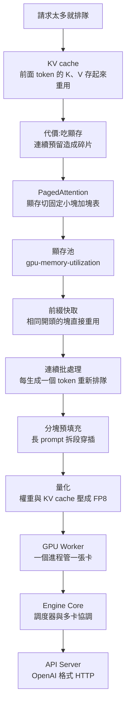

# vLLM 為什麼能讓同一張 GPU 多扛幾倍請求:KV cache、PagedAttention、連續批處理與常用參數(小白debug)

> 來源影片:小白debug〈Vibe 知識大賞|大模型推理引擎 vLLM 是什麼?為什麼同一張 GPU 可以承載數倍請求?What Is vLLM? How It Boosts GPU Throughput For LLMs〉,2026-10-21 上傳,長度 29:37。
> 影片連結:https://youtu.be/4Gv6GDK7Lf0
> 字幕:這支影片的自動字幕軌 `zh` 內容其實是英文(機器翻譯版,「PagedAttention」被譯成 "What is the attention of the configuration"),不是真實語音;所以**改用 Whisper `large-v3-turbo` 轉錄**(947 段,輸出為簡體),整理時轉成繁體,並用畫面截圖校正術語(見第 9 節)。
> ⚠️ **影片是三段拼接**(「Vibe 知識大賞」系列):①vLLM(0:00–12:58)、②PostgreSQL 架構(12:58–24:03)、③用 Trae SOLO 模式做「隱藏閱讀」摸魚軟體(24:05–結尾)。標題只寫第一段。
> ⚠️ **推廣與自我宣傳**:第三段是 Trae(字節跳動的 AI IDE)操作示範,作者說「我用它也有一年多了」、「我用 Trae 寫的」,並推薦豆包 Seed-Code 模型;影片與說明欄都沒有寫明是否業配,**無法確認**。結尾與段落間反覆要求點讚、關注、轉發,並說參數表放在留言區。作者自述「前位元組跳動 AI 算法工程師」。
> 核實:clone `vllm-project/vllm`(`main` 的 `865cf8c`,2026-11-14)讀引擎參數預設值與 `docs/configuration/optimization.md`;讀 PagedAttention 論文(arXiv 2309.06180);PostgreSQL 讀官方文件與 `nbtree` README、`configure.ac`。結果寫在第 7 節。

## 一句話結論

vLLM 的主要工作是**把 KV cache 管好**:用分塊(PagedAttention)消除顯存碎片、用前綴快取省重複計算、用連續批處理把 GPU 塞滿,再用量化與多卡並行放得下大模型。調參的順序是**先看 metrics(KV cache 使用率、排隊數、搶占次數),再決定調池子大小、請求長度上限、還是 KV cache 量化**。

## 1. 影片三段結構

| 段落 | 時間 | 內容 |
|---|---|---|
| ① vLLM | [0:00](https://youtu.be/4Gv6GDK7Lf0?t=0)–[12:58](https://youtu.be/4Gv6GDK7Lf0?t=768) | 從「用 Transformers 直接包 HTTP」的排隊問題,一路加元件講到完整請求流程 |
| ② PostgreSQL | [12:58](https://youtu.be/4Gv6GDK7Lf0?t=768)–[24:03](https://youtu.be/4Gv6GDK7Lf0?t=1433) | 同一套「每次遇到問題就加一層」的講法,講 PG 的資料頁、索引、行程、WAL |
| ③ Trae SOLO | [24:05](https://youtu.be/4Gv6GDK7Lf0?t=1435)–結尾 | 多智能體(subagent)做出隱藏閱讀軟體的示範 |

## 2. 問題起點:為什麼不能直接用 Transformers 包 HTTP

用 Hugging Face Transformers 載入模型、對外開 HTTP,每個請求呼叫一次模型。能跑,但請求一多,後面只能排隊([0:13](https://youtu.be/4Gv6GDK7Lf0?t=3))。vLLM 被比喻成「模型和顯卡之間的中間層」,一行 `vllm serve` 就起一個和 OpenAI 介面相同的服務([0:44](https://youtu.be/4Gv6GDK7Lf0?t=34))。

## 3. 原理主線(影片的講法)

### 3.1 KV cache([1:16](https://youtu.be/4Gv6GDK7Lf0?t=66))

模型每個 token 算出一組 K 和 V;新 token 要「查」前面所有 token 的 KV。前面的 KV 算一次就定了,存起來重用,每步只算新 token 的部分([1:59](https://youtu.be/4Gv6GDK7Lf0?t=109)–[2:03](https://youtu.be/4Gv6GDK7Lf0?t=113))。代價是顯存:影片舉 LLaMA 13B、2048 個 token 的請求,光 KV cache 就要 1.6 GB([2:12](https://youtu.be/4Gv6GDK7Lf0?t=122))。完整的 KV cache 概念另見 [[kv-cache]]。

### 3.2 碎片問題與 PagedAttention([2:24](https://youtu.be/4Gv6GDK7Lf0?t=134)、[3:01](https://youtu.be/4Gv6GDK7Lf0?t=171))

- 輸出長度事先不知道,有些框架(畫面寫「比如 Orca」,[2:27](https://youtu.be/4Gv6GDK7Lf0?t=137))一次預留 2048 個 token 的連續顯存;只寫 200 個,剩下 1800 多個位置空著又用不上,導致實際只有二到四成被真正使用。
- 借作業系統**虛擬記憶體 + 頁表**的想法:把顯存切成固定大小的塊,每塊放幾個 token 的 KV(影片例:每塊四個、七個 token 的 prompt 占兩塊);邏輯位置與實際顯存位置的對應記在**塊表**([3:46](https://youtu.be/4Gv6GDK7Lf0?t=216)),算注意力時靠塊表把散落的塊讀出來。
- 好處:每個請求最多浪費最後一塊沒寫滿的格子,塊大小一致就沒有「空洞對不上」。
- 塊會被集中成**顯存池**,用完歸還([4:19](https://youtu.be/4Gv6GDK7Lf0?t=249))。

### 3.3 池子大小與搶占([4:29](https://youtu.be/4Gv6GDK7Lf0?t=259)–[5:12](https://youtu.be/4Gv6GDK7Lf0?t=302))

- `--gpu-memory-utilization` 設池子占顯存的比例;影片說預設 0.92(見第 7 節的修正)。
- 設太小,高並發時塊被分光,正在生成的請求要新塊時,只能先踢出一個請求、把它的塊讓給別人,這叫**搶占**;日誌頻繁出現搶占訊息就代表池子太小。
- `--max-model-len` 設每個請求輸入輸出的最大長度;業務用不到那麼長就調小,同時能裝的請求更多。

### 3.4 前綴快取([5:14](https://youtu.be/4Gv6GDK7Lf0?t=304))

每個寫滿的塊用「它前面全部內容 + 自己的 token」算一個指紋;新請求先查指紋,有相同的塊就直接重用,連計算都省了。影片重點:**寫提示詞時把固定內容放前面、變動內容放後面**,命中率才高([5:52](https://youtu.be/4Gv6GDK7Lf0?t=342))。

### 3.5 連續批處理與分塊預填充([6:01](https://youtu.be/4Gv6GDK7Lf0?t=351)、[7:23](https://youtu.be/4Gv6GDK7Lf0?t=433))

- **靜態批處理**:湊一批一起跑,短的跑完也占位,新請求要等整批結束([6:31](https://youtu.be/4Gv6GDK7Lf0?t=381))。
- **連續批處理**:批的單位縮到「一個 token」,每生成一個 token,跑完的請求立刻離場、歸還塊,新請求下一步補進來;每步決定誰進誰出的元件叫**調度器**([6:56](https://youtu.be/4Gv6GDK7Lf0?t=406))。
- **分塊預填充**:超長 prompt 會長時間占住 GPU,使其他使用者看到回答卡在一半。把長 prompt 拆成小段(chunk)分幾輪處理,調度器在中間穿插其他請求([7:23](https://youtu.be/4Gv6GDK7Lf0?t=433))。
- 相關參數:`max_num_batched_tokens`(長 prompt 拆段時每輪最多讀多少 token;小一點輸出更流暢、大一點首字更快、吞吐更高)與 `max_num_seqs`(同時最多算多少個請求)。

### 3.6 量化([8:02](https://youtu.be/4Gv6GDK7Lf0?t=472))

權重是模型的大量數字;降低精度讓每個數字少占空間:FP16 是兩位元組、FP8 是一位元組,顯存減半、計算位數少而更快,代價是損失一些精度([8:22](https://youtu.be/4Gv6GDK7Lf0?t=492)–[8:34](https://youtu.be/4Gv6GDK7Lf0?t=504))。影片對應參數:

- `--quantization`:已量化的模型通常自動識別;只有原版模型想壓成 FP8,可傳 `fp8_per_tensor` 啟動時現場轉(畫面確認,[8:54](https://youtu.be/4Gv6GDK7Lf0?t=524));其他可選值有 AWQ、GPTQ 等。
- `--kv-cache-dtype fp8`:把 KV cache 也壓成一位元組,池子能放的 token 數翻倍([9:03](https://youtu.be/4Gv6GDK7Lf0?t=533))。
- 作者說「按我多年調優的經驗,它是所有優化手段裡提升最明顯的,沒有之一」([8:43](https://youtu.be/4Gv6GDK7Lf0?t=513))——這是個人經驗,未能核實。量化的細節另見 [[llm-quantization-q4-q8-gguf-qat-explained-mia]]。

### 3.7 GPU Worker、Engine Core、API Server([9:11](https://youtu.be/4Gv6GDK7Lf0?t=541)–[11:18](https://youtu.be/4Gv6GDK7Lf0?t=668))

- **GPU Worker**:把上面這些能力封裝成進程,負責載入權重、做計算,預設一個 Worker 管一張卡。
- 單卡放不下(影片舉滿血版 DeepSeek)時:
  - `--cpu-offload-gb 20` 是借 20 GB 主機記憶體放權重,用到哪塊搬哪塊;影片說自己玩還行、正式對外服務扛不住([9:48](https://youtu.be/4Gv6GDK7Lf0?t=578))。
  - 主流做法是把模型拆到多卡:**張量並行**(切每層的計算,`--tensor-parallel-size`,卡間每層都要通訊,最好有 NVLink,[10:06](https://youtu.be/4Gv6GDK7Lf0?t=596))、**流水線並行**(按層切,`--pipeline-parallel-size`,通訊少但請求要依序走過所有卡、延遲高,[10:27](https://youtu.be/4Gv6GDK7Lf0?t=617))。
- 多卡就有多個 Worker,所以把調度與管理(請求分配、長 prompt 分段、塊的分配與搶占)抽出來集中到 **Engine Core** 進程([10:41](https://youtu.be/4Gv6GDK7Lf0?t=631))。
- 前面再加 **API Server**,對外是 OpenAI 格式的 HTTP 介面,合起來就是 vLLM([10:58](https://youtu.be/4Gv6GDK7Lf0?t=648))。

### 3.8 一個完整請求的旅程([11:19](https://youtu.be/4Gv6GDK7Lf0?t=669))

### 3.9 看 metrics 調參([12:06](https://youtu.be/4Gv6GDK7Lf0?t=716))

| 觀察到的現象 | 影片建議的調整 |
|---|---|
| KV cache 使用率接近 1、排隊請求一直不為 0、搶占次數持續上漲 | 池子不夠:調大 `gpu-memory-utilization`,或調小 `max-model-len` 限制請求長度,同樣的池子裝更多請求 |
| 仍然不夠 | 開 `kv-cache-dtype fp8`,每塊存更多 token |
| 前綴快取命中率低 | 檢查提示詞順序(固定內容在前) |

影片結尾留的題目:多台機器部署時快取怎麼共享?沒有給答案。

## 4. 第二段:PostgreSQL 的「一層一層加」([12:58](https://youtu.be/4Gv6GDK7Lf0?t=768)–[24:03](https://youtu.be/4Gv6GDK7Lf0?t=1433))

作者從「MySQL + Redis + Elasticsearch + MongoDB 的複雜架構」引出 PostgreSQL([13:09](https://youtu.be/4Gv6GDK7Lf0?t=779)),再拆它的實作:

| 元件 | 影片說法 | 時間 |
|---|---|---|
| 資料頁 | 表存成以數字命名、沒有副檔名的堆表檔;超過 1 GB 自動分檔;拆成每頁 8 KB 的資料頁 | [14:57](https://youtu.be/4Gv6GDK7Lf0?t=887) |
| B-Link 樹 | 在 B+ 樹基礎上,每個節點多一個指向右兄弟的指標;MySQL 二級索引用的是 B+ 樹 | [16:36](https://youtu.be/4Gv6GDK7Lf0?t=986) |
| 後端進程 | 每個連線一個獨立進程,500 個連線就 500 個進程;有插件可以緩解(留作業) | [16:55](https://youtu.be/4Gv6GDK7Lf0?t=1005) |
| postmaster | 主控進程,監聽連線、fork 後端進程、監控健康 | [17:40](https://youtu.be/4Gv6GDK7Lf0?t=1050) |
| 共享記憶體與共享緩衝區 | 所有後端進程共用一塊快取資料頁 | [18:02](https://youtu.be/4Gv6GDK7Lf0?t=1072) |
| WAL | 先寫日誌再寫資料頁;順序寫比隨機寫快 | [18:33](https://youtu.be/4Gv6GDK7Lf0?t=1103) |
| 後台進程 | checkpointer、background writer、WAL writer | [19:34](https://youtu.be/4Gv6GDK7Lf0?t=1164) |
| 存取層 | Buffer Manager(接共享記憶體)、Storage Manager(接磁碟),合稱 Access Methods | [20:22](https://youtu.be/4Gv6GDK7Lf0?t=1212) |
| SQL 流程 | 解析器、優化器、執行器 | [21:07](https://youtu.be/4Gv6GDK7Lf0?t=1257) |
| 擴展 | 優化器、執行器、Access Methods 開放介面,用擴展支援向量搜尋、圖資料庫等 | [21:47](https://youtu.be/4Gv6GDK7Lf0?t=1297) |
| 查詢與更新流程 | SELECT 先查共享緩衝區;UPDATE 先寫 WAL 緩衝區再改資料頁,髒頁由 background writer 或 checkpointer 非同步刷盤 | [23:00](https://youtu.be/4Gv6GDK7Lf0?t=1370) |

這段影片的圖示與台詞和第一段同構:每遇到一個問題就加一個元件。

## 5. 第三段:Trae SOLO 與多智能體([24:56](https://youtu.be/4Gv6GDK7Lf0?t=1486)–結尾)

作者用 Trae 的 SOLO 模式做「隱藏閱讀」(把電子書放進 IDE 視窗角落假裝在 debug)。流程:

1. 先建 AI 團隊:自訂產品、UI 設計、開發三個智能體,並勾選「可被其他智能體調用」([25:56](https://youtu.be/4Gv6GDK7Lf0?t=1546));每個智能體有各自獨立的上下文,SOLO coder 當主智能體拆任務並調度([25:35](https://youtu.be/4Gv6GDK7Lf0?t=1525)–[25:48](https://youtu.be/4Gv6GDK7Lf0?t=1538))。
2. 用一句話需求派活:產品專家產出 PRD(含 1.0 MVP 與 1.1、1.2 迭代規劃)、UI 設計產出可互動的 HTML 頁面([26:36](https://youtu.be/4Gv6GDK7Lf0?t=1586)–[27:19](https://youtu.be/4Gv6GDK7Lf0?t=1629))。
3. 讓開發依文件寫程式前,先打開輸入框的 plan 按鈕,把要做的事列出來,確認 AI 與你理解一致再執行([27:20](https://youtu.be/4Gv6GDK7Lf0?t=1630))。
4. 修改很多時,用「新任務」拆成多個子任務並行([27:47](https://youtu.be/4Gv6GDK7Lf0?t=1657));MVP 完成後也用多任務並行同時迭代 V1.1 和 V1.2([28:22](https://youtu.be/4Gv6GDK7Lf0?t=1692))。

這段與 vLLM 無關;產品功能與「中國版免費」等說法我沒有查,標未能核實。

## 6. 應用案例

1. **客服機器人固定系統提示詞**:一千位使用者都以「你是一位專業客服,公司政策如下…」開頭。照影片的做法,把政策文本放最前面、每位使用者的問題放最後,前綴快取才命得中;把使用者姓名或時間戳放在開頭,每個請求的指紋都不同,快取就失效。
2. **用 metrics 判斷該調什麼**:壓測時看到 KV cache 使用率 0.98、排隊請求長期 30 以上、搶占次數一路上升,依第 3.9 節表:先把 `max-model-len` 從 32K 降到業務真正需要的 8K,同樣的池子就能裝更多請求;還不夠再開 `kv-cache-dtype fp8`。
3. **小顯存卡跑大模型**:只有一張 24 GB 的卡,又想跑 13B 以上的模型,用已量化的 AWQ/GPTQ 版本(vLLM 通常自動識別),或對原版加 `--quantization fp8_per_tensor` 現場轉換;權重少一半,剩下的顯存才有空間給 KV cache。
4. **PostgreSQL 連線數過多**:應用有 500 個連線,PG 就要 500 個後端進程。影片留作業問是哪個插件,**常見做法是在前面放連線池(例如 PgBouncer)**;這是我的延伸,影片沒有給答案。

## 7. 核實結果

### 7.1 vLLM

| 影片說法 | 結果 | 依據 |
|---|---|---|
| 現有系統只有二到四成顯存存著真正的 token | **已核實** | 論文 Figure 2:Orca(Max)20.4%、Orca(Pow2)26.8%、Orca(Oracle)38.2%,vLLM 96.3%;摘要寫 20.4%–38.2% |
| vLLM 讓吞吐翻上幾倍 | **已核實** | 論文摘要:相同延遲下吞吐比 FasterTransformer 與 Orca 高 2–4 倍 |
| LLaMA 13B、2048 token 的 KV cache 約 1.6 GB | **已核實(自行推算)** | 依 LLaMA-13B 結構(40 層、隱藏維度 5120)每 token 的 K 與 V 共 2×40×5120×2 位元組 = 800 KiB,乘 2048 ≈ 1.56 GiB;論文本身未見這個數字 |
| 預設 `gpu-memory-utilization` 為 0.92 | **需修正** | 現行主線 `vllm/config/cache.py` 註解:**未指定時,使用「可延伸 KV cache」(CUDA、ROCm 預設)則為 1.0,否則為 0.92**;「可延伸 KV cache」依實際量測的記憶體決定大小,並建議除非有其他程序共用 GPU 才設定此值。影片拍於 2026-10,可能對應較早版本 |
| 要加 `--enable-prefix-caching` 才開前綴快取 | **需修正** | 現行 `cache.py` 中 `enable_prefix_caching` 預設為 `True`,引擎參數預設值依模型是否支援前綴快取決定 |
| 分塊預填充「模型支援就預設開」 | **已核實** | `scheduler.py`:`enable_chunked_prefill: bool = True` |
| 官方建議追求吞吐時 `max_num_batched_tokens` 設到 8192 以上 | **已核實** | 官方文件 `optimization.md`:`max_num_batched_tokens > 8192`;較小值 ITL 較好、較大值首字時間較好 |
| `max_num_seqs` A100/4090 預設 256、H100/H200 預設 1024 | **已核實(補充)** | `arg_utils.py` 的 `get_batch_defaults`:顯存 ≥70 GB 且非 A100 的卡(如 H100、H200)為 1024,≥160 GB(如 B200)也是 1024,其餘 256。同一函式還給 `max_num_batched_tokens`:API 伺服器在一般卡為 2048、H100/H200 類為 8192、≥160 GB 為 16384——影片沒提 |
| 池子太小時請求被踢出(搶占),日誌出現搶占訊息 | **已核實** | 官方文件「Preemption」一節:被搶占的請求會在有足夠 KV cache 空間時**重算**;文件範例日誌 `Sequence group … is preempted by PreemptionMode.RECOMPUTE … Increase gpu_memory_utilization or tensor_parallel_size`;可用 Prometheus 指標或 `disable_log_stats=False` 觀察。我在現行主線 grep 不到該日誌字串,範例日誌是較早版本的格式 |
| 塊大小「例如每塊 4 個 token」 | **示意** | 影片為教學簡化;論文用 16 個 token 一塊,現行 `cache.py` 的 `DEFAULT_BLOCK_SIZE` 常數為 64(可能依後端調整) |
| 引擎由 API Server、Engine Core、GPU Worker 組成 | **已核實** | 存在 `entrypoints/openai/api_server.py`、`v1/engine/core.py`、`v1/worker/gpu_worker.py` |
| 選項 `--quantization fp8_per_tensor`、`--kv-cache-dtype fp8`、`--cpu-offload-gb`、`--tensor-parallel-size`、`--pipeline-parallel-size` | **已核實** | 原始碼中皆有;`cpu_offload_gb` 預設 0,兩個並行大小預設 1 |
| 量化「提升最明顯,沒有之一」「精度損失一般影響不大」 | **未能核實** | 作者個人經驗;損失多少依模型與任務而定 |

### 7.2 PostgreSQL

| 影片說法 | 結果 | 依據 |
|---|---|---|
| 每個連線一個後端進程;postmaster 監聽並 fork | **已核實** | 官方文件:PostgreSQL 採「process per user」模型,postmaster 為監督進程 |
| 資料頁 8 KB、堆表檔超過 1 GB 分檔 | **已核實** | `configure.ac`:`--with-blocksize` 預設 8(kB)、`--with-segsize` 預設 1(GB) |
| B-Link 樹:加右指標,葉分裂時直接跳到右節點 | **已核實(補充)** | `nbtree` README:Lehman & Yao 在每頁加指向右兄弟的 right-link,並加 high key,搜尋時若鍵大於 high key 就往右移,用來處理並發分裂。這是**每一層**的頁面(影片說法偏向「非葉節點」);影片也說「它本質上是變種 B+ 樹」,正確 |
| 順序寫比隨機寫「快幾十倍」 | **未能核實** | 倍數依儲存裝置而異,我沒有找到一手數字 |
| 「500 連線 = 500 個進程」可由插件緩解 | **已核實(延伸)** | 官方文件確認是一連線一進程;連線池屬於常見外部元件,影片沒有點名 |
| 「每行資料有主鍵、依主鍵排序、拿每頁最小主鍵放入索引頁」 | **簡化** | PG 的堆表本身不依主鍵排序,索引頁存的是索引鍵與指向堆表位置的指標;影片後面也補了「底層索引記錄行資料的地址」 |

## 8. 與本庫其他筆記的關係

- 引擎的整體比較(llama.cpp、vLLM、SGLang、TensorRT-LLM)見 [[inference-engines-llamacpp-vllm-sglang-tensorrt]];本篇補上 vLLM 的**逐項參數與調參判斷**。
- KV cache 的基本原理見 [[kv-cache]];量化見 [[llm-quantization-q4-q8-gguf-qat-explained-mia]]。
- 同一位作者的另一支影片(microVM 與快照)見 [[agent-sandbox-microvm-snapshot-iaa]]。

## 9. 字幕還原(Whisper 簡體 → 繁體,畫面或原始碼確認者標「確認」)

| Whisper 寫法 | 採用寫法 | 依據 |
|---|---|---|
| VLM、VLAM | vLLM | 畫面與上下文 |
| Page the Tension、Page Detention | PagedAttention | 上下文與論文 |
| OKA | Orca | 畫面截圖([2:27](https://youtu.be/4Gv6GDK7Lf0?t=137))確認 |
| LAMA13B | LLaMA 13B | 上下文 |
| A140G | A100 40G | 推定(與論文 Figure 1 的 A100 一致) |
| 快表、快 | 塊表、塊(block table) | 推定:vLLM 的術語是 block table,語意是顯存塊 |
| GPU Memory Utilization、Reinable Prefix Caching、MaxModel Lens、Memory Mode LAN | `gpu-memory-utilization`、`enable-prefix-caching`、`max-model-len` | 原始碼參數名 |
| InableChunk 的 Preview、MaxNum Sequence | `enable_chunked_prefill`、`max_num_seqs` | 原始碼參數名 |
| FP8 Potensor | `fp8_per_tensor` | 畫面截圖([8:54](https://youtu.be/4Gv6GDK7Lf0?t=524))確認 |
| KVCache D-Type F18 | `kv-cache-dtype fp8` | 原始碼參數名 |
| Engine Call | Engine Core | 上下文 |
| Tensor Paralyze Size、Pipeline Paralyze Size | `tensor-parallel-size`、`pipeline-parallel-size` | 原始碼參數名 |
| Poster Grasico、PostgreSQL 的各種拼寫 | PostgreSQL | 上下文 |
| PosterGraphs、Poster Master | postgres、postmaster | 官方文件 |
| Writer Head Login | write-ahead logging | 上下文 |
| MangoDB、InflexDB、Jason | MongoDB、InfluxDB、JSON | 上下文 |
| Tray、Tree | Trae | 上下文 |
| Player 按鈕 | plan 按鈕 | 上下文:列出待辦後再執行 |
| 長壽的內存碎片 | (俗稱的)內存碎片 | 推定 |
| 引毒 | 隱讀(「隱藏閱讀」簡稱) | 推定,影片口述 |

另有幾處我判斷為 Whisper 聽寫的雜訊而沒有採用(例如 [24:11](https://youtu.be/4Gv6GDK7Lf0?t=1441) 附近「必非語啊」疑為某個語音名稱,[24:38](https://youtu.be/4Gv6GDK7Lf0?t=1468) 的「受人以魚不如受人以漁」諺語),不影響內容。

## 來源

- 影片:小白debug〈Vibe 知識大賞|大模型推理引擎 vLLM 是什麼?…〉 https://youtu.be/4Gv6GDK7Lf0
- 該片無可用真實語音字幕(自動字幕軌 `zh` 內容為英文機器翻譯),逐字稿以 Whisper `large-v3-turbo`(`scripts/media/whisper_transcribe.py`)轉錄取得,非官方字幕,可能有少量聽寫誤差,術語已用畫面與原始碼校正。
- Kwon et al.〈Efficient Memory Management for Large Language Model Serving with PagedAttention〉(SOSP 2023):https://arxiv.org/abs/2309.06180
- vLLM 原始碼:https://github.com/vllm-project/vllm(讀 `main` `865cf8c`:`vllm/config/cache.py`、`vllm/config/scheduler.py`、`vllm/engine/arg_utils.py`、`vllm/config/offload.py`、`docs/configuration/optimization.md`)
- PostgreSQL 官方文件〈Connections, process per user〉:https://www.postgresql.org/docs/current/connect-estab.html
- PostgreSQL 原始碼:https://github.com/postgres/postgres (`src/backend/access/nbtree/README`、`configure.ac`)
- Lehman & Yao, 〈Efficient Locking for Concurrent Operations on B-Trees〉(B-Link 樹來源,經 `nbtree` README 引用)
