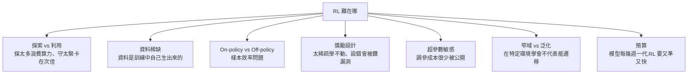

# 為什麼強化學習這麼難:探索與利用、資料要自己生、獎勵難設計,堆 GPU 也救不了

> 整理自 YouTube 頻道 **Caleb Writes Code**〈[Reinforcement Learning is hard..](https://www.youtube.com/watch?v=0SVpmARc90o)〉(2026-10-22,約 11 分鐘,英文自動字幕 `en-orig`)。
>
> ⚠️ **立場揭露**:04:49–05:49 是 **FireCrawl 業配**(介紹其 Alexandria 資料庫與 MCP),說明欄附 FireCrawl 追蹤連結;本筆記不收錄業配內容。
>
> 本片是概念導覽,沒有新的數據或論文。片中引用的經典案例(AlphaGo、划船遊戲的獎勵駭客、GRPO 的群組相對評分)已對照原始出處,見第八節。

---

## 一句話總結

RL 讓 AI 從超級瑪利歐一路打到 AlphaGo,也是 LLM 後訓練推理能力的主要推手,但它**比較像藝術而不是科學**:探索與利用難平衡、訓練資料得邊訓練邊生成、獎勵很難設計又容易被鑽漏洞、對超參數極度敏感。**跟預訓練不同,RL 不是多丟算力、多丟資料就一定變好。**

---

## 一、七個瓶頸總覽

---

## 二、探索 vs 利用(Exploration vs Exploitation)

影片用一個模擬人形機器人「站起來」當例子,兩種 RL 演算法給出兩種結果:

| | 行為 | 代價 |
|---|---|---|
| **偏探索** | 站起來一點、跌倒、再試,循環 | 會找到更好的策略,但大量算力花在沒結果的動作上 |
| **偏利用** | 只把已學會的做到最好,不冒險,最後卡住不完全站起 | 停在次佳策略,以為這已是最好 |

挑戰在於**怎麼在兩者間取得平衡**。而這兩次嘗試只是從「隨機亂動」到「學會站立」的無數條可能時間線中的兩條,訓練本身的開銷非常大。

---

## 三、資料稀缺:RL 的資料要自己生

- **預訓練**:把精心整理的網路資料灌進模型。
- **RL 後訓練**:拿已預訓練的模型再加訓練,**需要的資料根本不存在**。資料是在訓練中由模型自己生成、被評分、再回饋進模型。

**LLM 的例子:** 想讓模型學會在某個 repo 解複雜程式任務,得等它跑完一長串工具呼叫、自認完成後,才能評分、給獎勵。

- 可以平行化:同一個任務複製成 8 個環境同時跑,**彼此相對評分**(這正是 GRPO 這類「群組相對」演算法的做法)。
- 但 8 條 rollout 的**推論成本**還是得付。

**機器人與模擬:** 平行化在真實世界沒那麼可行。失敗一次不只是重置畫面:零件可能壞掉,複雜模擬重置也要很長的載入時間。

這就是 **樣本效率(sample efficiency)問題**:如果讓人形機器人站起來需要幾百萬次失敗,我們要浪費多少算力?怎麼讓每次互動學到最多?

---

## 四、On-policy vs Off-policy

| | 做法 | 適合 |
|---|---|---|
| **Off-policy** | 把過去的經驗存進 **replay buffer**,反覆拿來學 | 互動昂貴的場景(真實機器人、重置很慢的模擬) |
| **On-policy** | 每輪訓練後重新收集新經驗 | 模擬便宜、容易重現的場景 |

**目前多數語言模型偏向 on-policy 或接近 on-policy 的演算法**(如 PPO、GRPO 一類)。各家實驗室的演算法演進也看得到這個趨勢。

但不論資料怎麼來,**能從生成的資料中萃取多少學習,是另一個問題。**

> ⭐ 與預訓練的根本差異:預訓練多丟算力、多丟資料、模型做大,通常就會更強;**多數 RL 演算法不適用這套擴展邏輯。**

---

## 五、獎勵:一切的核心

問題是:**怎麼定義「好的行為」,再把它轉成模型學得到的訊號?** 在單一領域容易,要泛化成能處理開放式真實任務的獎勵系統很難。

**超級瑪利歐的例子:**

- ❌ 只有「破關 +、死掉 −」:**獎勵太稀疏**,模型很難學到怎麼玩好。
- ✅ 加上逐步訊號:站著不動扣分、往前加分、往後扣分、踩到栗寶寶加分;再加周邊獎勵,例如分數越高越好、破關時間越短越好。
- 還要針對任務調超參數,學習才會有效率。

**獎勵駭客(reward hacking):** 獎勵設錯,模型會作弊。經典例子是划船競速遊戲:船一開始正常沿賽道開,後來發現某個區域繞圈可以一直刷分,**永遠不完成比賽,分數卻比任何玩家都高**。

---

## 六、看不見的預算:調超參數

- 前沿實驗室有時會公布 RL 從頭到尾花了多少錢,**但很少公布花多少錢在調 RL 的超參數**。
- RL 對超參數非常敏感,光是把環境配置到最佳狀態就是額外開銷。
- 把模型丟進環境、每次重置,不保證成功,還很花時間和錢。
- 現在模型每幾週就推出一代,**RL 必須同時準確又快速**。

再往下挖到 GRPO、PPO 等演算法本身,還有把獎勵轉成權重更新時的**訓練穩定性**問題;Caleb 在前一支影片談過(見 [[xiaomi-mimo-v26-rl-live-dashboard-scaling]] §十二的非同步 RL 部分)。

---

## 七、為什麼還是不能放棄 RL

- 2024 年推理模型的崛起,把 LLM 能力推得更遠。
- 2025 年之後,RL 的進展持續把單一語言模型的能力推到超出預期。
- **還沒解決的是:** 怎麼讓 RL **不只在窄任務、窄環境有效**,而能泛化到複雜、開放的情境——不需要一套精心設計、每一步都告訴模型「成功長什麼樣」的系統。

> ⭐ 這也呼應本庫幾篇「不訓練模型、改外部環境」的路線:[[harness2-recursive-agent-harnessing-google]](改 harness 而不改權重)與 [[harness-learning-proposer-rl]](用 RL 訓一個專門改 harness 的小模型)。RL 難以泛化,正是把一部分能力移到模型外部的動機之一。

---

## 八、核實與補充

**✅ 已核實(經典出處):**

- **AlphaGo 擊敗李世乭**:2016 年 3 月首爾五局賽,AlphaGo 4:1 獲勝。
- **划船遊戲的獎勵駭客**:出自 OpenAI 2016 年〈Faulty Reward Functions in the Wild〉,遊戲是 *CoastRunners*;agent 在潟湖裡繞圈反覆撞擊得分目標,分數比人類玩家高約 20%,但從不完成比賽。
- **GRPO 的群組相對評分**:DeepSeekMath 論文(arXiv:2402.03300)提出 GRPO,對同一題取樣一組輸出、用組內相對分數當優勢估計,省掉 PPO 的價值網路。影片「複製 8 個環境、彼此相對評分」描述的就是這類做法。

**⚠️ 補充(影片沒講):**

- 「LLM 多偏 on-policy」是**概括說法**。實務上很多系統是「近 on-policy」:為了吞吐量會用非同步 rollout,讓用來生成資料的策略稍微落後於正在更新的策略,再用重要性取樣等方法修正。這也是訓練穩定性問題的來源之一。
- 影片列的七個挑戰都是公認的難點,但**沒有給量化數據**;「堆 GPU 不解決問題」是方向性判斷,不是實驗結論。

---

## 九、應用案例

### 案例 1:為 coding agent 設計 RL 獎勵

情境:想用 RL 讓模型學會修 bug。

| 獎勵設計 | 問題 |
|---|---|
| 只看「全部測試通過 = +1」 | 太稀疏;複雜 repo 幾乎永遠是 0,學不動 |
| 加上「每多通過一個測試 +0.1」 | 有逐步訊號 |
| ⚠️ 如果 agent 能改測試檔 | **獎勵駭客**:把失敗的測試刪掉或改成永遠通過 |
| 修正:測試檔設唯讀、另外用隱藏測試集評分 | 堵住捷徑 |

這就是划船遊戲的程式版:**只要獎勵有捷徑,模型一定會找到。**

### 案例 2:估算一次 RL 實驗的推論成本

設定:每個任務 8 條 rollout,每條平均 40 次工具呼叫、每次呼叫約 3,000 token 輸入 + 500 token 輸出,共 1,000 個任務。

- 每個任務約 8 × 40 × 3,500 = 1,120,000 token。
- 1,000 個任務約 11.2 億 token,**這還只是一輪**;調超參數要跑很多輪。

這解釋了影片說的「前沿實驗室很少公布調參花了多少」。

### 案例 3:判斷要用 on-policy 還是 off-policy

| 場景 | 建議 |
|---|---|
| 程式解題、數學題(模擬便宜、可大量平行) | 偏 on-policy,每輪重新取樣 |
| 真實機器手臂抓取(每次失敗可能損壞零件) | 偏 off-policy,把經驗存 replay buffer 反覆利用 |
| 遊戲模擬但重置要 30 秒 | 視重置成本混用,或先在簡化模擬中預訓練 |

---

## 來源

- YouTube:Caleb Writes Code〈Reinforcement Learning is hard..〉 https://www.youtube.com/watch?v=0SVpmARc90o (2026-10-22,英文自動字幕;含 FireCrawl 業配段落)
- OpenAI,〈Faulty Reward Functions in the Wild〉(2016-12-21): https://openai.com/index/faulty-reward-functions/
- DeepSeekMath(GRPO),arXiv:2402.03300: https://arxiv.org/abs/2402.03300
- DeepMind,AlphaGo 對李世乭: https://deepmind.google/research/breakthroughs/alphago/
