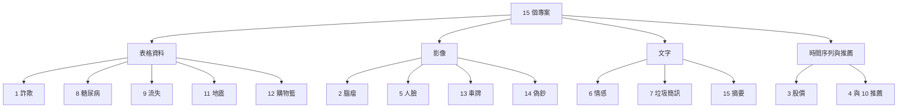
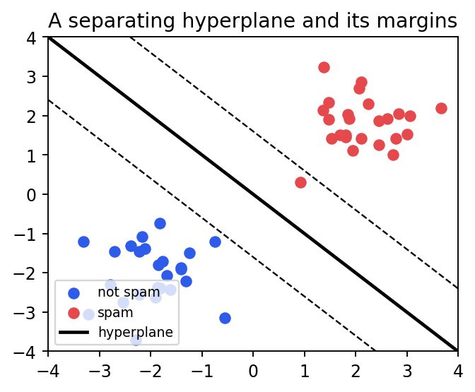

# 機器學習 15 個實戰專案整理(含信用卡詐欺偵測深入版與程式碼問題檢討)

> 資料型態:使用者提供的 PDF 兩份,文字層完整(非輪播圖)。
> ⚠️ **作者自我宣傳揭露**:素材來自社群引流型帳號 Anjana「AI & Tech」(@aiwithanju),每頁帶浮水印,文中大量「Download the dataset / source code」外部連結(本次**未下載、未驗證**那些連結的內容)。這份 PDF 並非原創教學:文中殘留 `DataFlair` 範例字串(例如摘要專案用 “DataFlair is the best source for machine learning projects.” 當範例句),**推測**是改寫自 DataFlair 的專案教學系列(推測,未逐篇比對)。本筆記只做自己的結構化整理、程式碼審查與官方資料查證,不轉述導購內容。
> 檔案:`15_Machine_Learning_Projects_Along_With_Source_Code.pdf`(84 頁)與 `Credit_Card_Fraud_Detection_Python_ML.pdf`(6 頁)。後者就是前者第 1 個專案(第 2–7 頁)的單獨版,內容幾乎逐段相同,下面合併為專案 1。
> 補充:PDF 內的圖表都標明是「示意、非實際執行輸出」(合成資料),所以本筆記只嵌 1 張概念圖,不嵌假結果圖。

## 一眼看完:15 個專案對照表

| # | 專案 | 任務類型 | 資料 | 方法 | PDF 宣稱結果 |
|---|---|---|---|---|---|
| 1 | 信用卡詐欺偵測 | 二元分類(極度不平衡) | 284,807 筆、492 筆詐欺;28 個 PCA 特徵 + Time + Amount | Decision Tree / Random Forest + SMOTE | 準確率超過 99% |
| 2 | 腦瘤 MRI 分類 | 影像二元分類 | 253 張(155 yes、98 no) | VGG16 遷移學習(凍結)+ 小 head | 約 96.5% / 96.15% |
| 3 | 股價預測 | 時間序列迴歸 | NSE TATA GLOBAL;另有多股 CSV | 2 層 LSTM(50 單位)+ Plotly Dash 儀表板 | 「幾乎與實際相同」(無數字) |
| 4 | YouTube 風格推薦 | 協同過濾(評分預測) | MovieLens 100k(943 用戶、1,682 電影) | PyTorch 嵌入 + 全連接 | 約 23 epoch 早停(無最終 RMSE) |
| 5 | 即時人臉偵測 | 電腦視覺 | 網路攝影機 | OpenCV Haar Cascade | 畫綠框 |
| 6 | 情感分析 | NLP 二元分類 | IMDb 50,000 則(25k/25k) | 雙向 2 層 LSTM + GloVe 100d | 測試 85.83% |
| 7 | 垃圾簡訊偵測 | 文字二元分類 | spam.csv | TF-IDF + SVM + GridSearch | 未列數字 |
| 8 | 糖尿病預測 | 表格二元分類 | Pima Indians Diabetes | RF / GB / SVC | RF 約 89%、GB 約 88%、SVC 約 66% |
| 9 | 客戶流失 | 表格二元分類 | Churn_Modelling(銀行客戶) | XGBoost / Random Forest | XGB 86.36% |
| 10 | 電影推薦 | 內容式推薦 | TMDB credits + movies | CountVectorizer + 餘弦相似度 | 輸出前 10 部相似電影 |
| 11 | 地震預測 | 分類 | dataset.csv(來源不明) | RF / GB / SVC | 未列數字 |
| 12 | 購物籃分析 | 關聯規則 | 德國線上零售交易 | Apriori(mlxtend) | 列出規則 |
| 13 | 車牌辨識 | 偵測 + OCR | 單張圖片 | Haar Cascade + EasyOCR | 範例輸出 `KL54 A.2670` |
| 14 | 偽鈔偵測 | 影像處理 | 一張真鈔、一張假鈔 | 灰階、HSV、相關係數、連通元件 | 規則式判定 |
| 15 | 文字摘要 | NLP seq2seq | Amazon Fine Food Reviews 前 10 萬列 | 3 層 LSTM 編碼器 + 解碼器 + Attention | 準確率 87.82% |



## 專案 1:信用卡詐欺偵測(深入)

### 目標與資料
- 目標:判斷一筆交易是否為詐欺(二元分類)。
- 資料(PDF):31 欄,28 個為 PCA 轉換後的匿名特徵,僅 `Time`、`Amount` 保持原樣;284,807 筆,僅 492 筆詐欺,詐欺比例 0.1727%(正常 284,315)。
- 查證:OpenML 頁面載明 284,807 筆、兩天(2013 年 9 月)、492 筆詐欺、特徵經 PCA、**建議評估指標為 AUPRC(精確率—召回率曲線下面積)**。Kaggle 原頁(mlg-ulb/creditcardfraud)本次抓取只拿到大綱,**未能由 Kaggle 頁核實**;資料由哪個單位提供也**未能由讀到的頁面核實**。

### 流程與關鍵程式碼

1. EDA:`Class.value_counts()` 畫長條圖,看出極度不平衡。
2. 前處理:對 `Amount` 做 `StandardScaler`,丟掉 `Time`;`train_test_split(test_size=0.3, random_state=42)`,得到 train 199,364 筆、test 85,443 筆。
3. 兩個模型:`DecisionTreeClassifier()` 與 `RandomForestClassifier(n_estimators=100)`,比較 accuracy、precision、recall、F1 與混淆矩陣。
4. 處理不平衡:`SMOTE().fit_resample(X, Y)` 之後**再**切 70/30,對 Random Forest 重訓,宣稱「明顯變好」「準確率超過 99%」。

```python
# PDF 的做法(有問題,見下)
X_resampled, Y_resampled = SMOTE().fit_resample(X, Y)
train_X, test_X, train_Y, test_Y = train_test_split(
    X_resampled, Y_resampled, test_size=0.3, random_state=42)
```

### 這份程式碼的問題(重點)

| 問題 | 為什麼是問題 | 正確做法 |
|---|---|---|
| **先 SMOTE 再切分**(資料洩漏) | 合成樣本由鄰近的真實少數類樣本內插產生,等於測試集的資訊混進訓練;測試集也被重採樣成約 50:50,不再代表真實世界(約 0.17% 詐欺) | 先切分(建議 `stratify=y`),**只對訓練集**過採樣,或用 `imblearn.pipeline.Pipeline` 讓重採樣只發生在每個訓練折內 |
| **用 accuracy 當主要指標** | 全部猜「正常」就有約 99.83% 準確率,「>99%」毫無資訊量 | 看 PR-AUC(`average_precision_score`)、recall、precision、F-β,並在真實比例的測試集上評估 |
| `StandardScaler` 在全資料上 fit | 輕微洩漏(測試集統計量被用到) | 縮放放進 Pipeline,只在訓練集 fit |
| 未做機率校準與閾值選擇 | 詐欺偵測的核心是成本權衡(漏抓 vs 誤攔) | 取 `predict_proba`,依成本選閾值 |
| 丟掉 `Time` 沒檢驗 | 說「不相關」沒有證據;時間分佈可能有資訊 | 做特徵重要度或消融比較 |
| 隨機切分 | 交易有時間先後,隨機切分會讓未來資訊進訓練 | 依時間切分 |

查證依據:
- imbalanced-learn「Common pitfalls」頁(已讀):明確指出在切分前對整個資料集重採樣會造成資料洩漏;模型「應在自然不平衡的資料上測試」;正確作法是用 `Pipeline` 讓重採樣在每個訓練折內進行。該頁範例中,錯誤做法的交叉驗證分數約 0.724 但留出資料只有約 0.698(過度樂觀),用 Pipeline 後兩者約 0.732 與 0.727。
- imbalanced-learn `SMOTE` 文件(已讀):以最近鄰內插產生少數類合成樣本;`k_neighbors` 預設 5;`sampling_strategy` 預設 `'auto'`(等同 `'not majority'`)。該頁沒有討論 Pipeline 與交叉驗證的細節。
- scikit-learn `average_precision_score`(已讀):AP 為「各門檻精確率以召回率增量加權」的總和,**未做內插**;文件指出用梯形法計算 PR 曲線面積「可能過於樂觀」。

### 應用案例:一個改良版的最小範本

```python
from imblearn.pipeline import Pipeline
from imblearn.over_sampling import SMOTE
from sklearn.ensemble import RandomForestClassifier
from sklearn.model_selection import train_test_split, StratifiedKFold, cross_val_score

X_tr, X_te, y_tr, y_te = train_test_split(X, y, test_size=0.3,
                                          stratify=y, random_state=42)
pipe = Pipeline([("smote", SMOTE(random_state=42)),
                 ("rf", RandomForestClassifier(n_estimators=200, random_state=42))])
cv = StratifiedKFold(5, shuffle=True, random_state=42)
print(cross_val_score(pipe, X_tr, y_tr, scoring="average_precision", cv=cv).mean())
pipe.fit(X_tr, y_tr)                       # 只重採樣訓練資料
# 最後在「原始比例」的 X_te 上報告 PR-AUC / recall / precision
```

這也等於把原稿的練習升級成可以放進履歷、而不被面試官抓到洩漏的版本。

## 專案 2:腦瘤 MRI 分類

- 做法:資料夾 yes/no 讀成 224×224,除以 255,one-hot;切 90/10(`stratify=labels`);`ImageDataGenerator(fill_mode='nearest', rotation_range=15)` 增強;`VGG16(weights='imagenet', include_top=False)` 全部凍結,接 `AveragePooling2D(4×4) → Flatten → Dense(64) → Dropout(0.5) → Dense(2, softmax)`;Adam 1e-3、batch 8、10 epoch。
- 檢討:
  - 測試集只有約 25–26 張(253 的 10%),一張判錯準確率就差約 4 個百分點,「96.5%」的信賴區間很寬;另外同一批 `test_X` 同時當驗證與最終測試,沒有獨立測試集。
  - 文中同時出現約 96.5%(訓練輸出)與 96.15%(混淆矩陣計算),本來就對應 25–26 張的離散值差異,正好說明樣本太小。
  - 醫療影像應以敏感度(漏診率)為主,不能只看準確率;並且同一病人的多張切片不能同時出現在訓練與測試(PDF 沒說明資料如何分病人,**未能核實**)。
  - 2 類 softmax 搭 `binary_crossentropy` 能跑,但慣用寫法是 2 類 softmax 配 `categorical_crossentropy`,或單一 sigmoid 配 binary。

## 專案 3:股價預測(LSTM)與 Dash 儀表板

- 做法:取 `Close`,`MinMaxScaler`,前 987 筆訓練、其後驗證;窗口 60 日預測下一日;`LSTM(50, return_sequences=True) → LSTM(50) → Dense(1)`,MSE、Adam、**epochs=1、batch_size=1**;存成 `saved_model.h5`。
- 檢討(重要):
  - `scaler.fit_transform(final_dataset)` 對**含驗證期的全部資料** fit,測試期的最大/最小值洩漏到訓練。
  - 預測的是「下一日」,輸入窗口用的是真實前 60 日;股價有強持續性,拿昨天價格當預測就會「看起來幾乎一樣」。圖上貼合不等於可交易,必須和「明天 = 今天」這個天真基準比較(PDF 沒有)。
  - 只訓練 1 個 epoch;沒有 RMSE/MAE、方向正確率等數字。結論「LSTM 預測幾乎與實際相同」沒有量化支持。
  - Dash 程式裡 `go.Scatter(x=train.index, y=valid["Close"])` 的 x、y 長度來自不同切片,是明顯 bug;Facebook 代號 `FB` 已改為 `META`。
  - 依賴 `dash_core_components`、`dash_html_components` 與 `dash.dependencies`:Dash 2.0 之後已併入 `from dash import dcc, html`(Dash 官方頁僅看到 `from dash import dcc` 的寫法,**未能由該頁核實舊套件的棄用聲明**)。
  - 本專案是教學演示,不構成任何交易建議。

## 專案 4:YouTube 風格影片推薦(其實是 MovieLens 評分預測)

- 背景(PDF):內容式 vs 協同過濾;記憶式 vs 模型式;Google 論文把推薦視為極端多分類,分兩個網路——**候選生成**(從數十億縮到數百)與**排序**。
- 查證:Google Research 頁面(已讀)—— “Deep Neural Networks for YouTube Recommendations”,Covington、Adams、Sargin,RecSys 2016(頁面標 to appear),確為「深度候選生成 + 深度排序」兩階段。**已核實**。
- 實作:MovieLens 100k 的 u1.base/u1.test(80,000/20,000);`ConcatNet`:使用者與物品各 50 維嵌入 → 串接 → 全連接(100→512→256,dropout 0.7/0.35)→ sigmoid 縮放到 0.8–5.2 評分範圍;MSE(sum)、Adam(lr 1e-2、**weight_decay 0.5**)、ReduceLROnPlateau、早停(約 23 epoch)。
- 檢討:
  - 這是**評分迴歸**(NCF 式),不是論文的候選生成/排序架構;PDF 說「follow the architecture」是過度宣稱。
  - `weight_decay=0.5` 對 Adam 極大,易讓嵌入被壓縮;`DataLoader(num_workers=4)` 搭配已放到 GPU 的張量,在多程序下常出錯。
  - 結尾談 precision@K、MAP、冷啟動,但程式沒有算任何排序指標,也沒給最終驗證 RMSE。

## 專案 5、13、14:傳統電腦視覺三連發

| 專案 | 核心 | 可學到 | 要注意 |
|---|---|---|---|
| 5 人臉 | `CascadeClassifier(haarcascade_frontalface_default.xml).detectMultiScale(scaleFactor=1.1, minNeighbors=5, minSize=(30,30))` | Haar 特徵、級聯分類器、網路攝影機迴圈 | 標題叫 recognition(辨識),實際只是**偵測**(找到有臉),不會辨認是誰;側臉、逆光易失敗 |
| 13 車牌 | Haar 偵測車牌(`scaleFactor=1.05, minNeighbors=7`)→ 裁切 → `easyocr.Reader(['en']).readtext` | 偵測 + OCR 兩段式 | 範例輸出 `KL54 A.2670` 含不該有的點,正是 OCR 誤判示範;車牌屬個資,實務要注意隱私與法規 |
| 14 偽鈔 | 灰階 → 裁出肖像與細條 → 相關係數 + 細條連通元件數量比對 | 影像裁切、形態學、連通元件 | 見下方嚴重問題 |

專案 14 程式碼審查(已逐行讀):
- 這**不是機器學習**,是規則式比對,且 PDF 只用 1 張真鈔、1 張假鈔,沒有任何統計意義。
- HSV 門檻 `satThresh=0.3, valThresh=0.9` 是 MATLAB(0–1)的刻度,OpenCV 的 uint8 HSV 是 0–255,條件幾乎恆真或恆假;而且算出來的 `BWImageReal/BWImageFake` 後面完全沒被使用(後面改用灰階 Otsu 二值化的結果)。
- `corr2` 是逐列去均值後做矩陣乘積,回傳的是 870×870 矩陣而不是單一相關係數;之後取 `co.max() >= 0.5`,幾乎一定成立,判定形同虛設。
- 裁切座標寫死、兩張圖要手動調到同形狀。結論:當作影像處理的「語法練習」可以,**不可當真用於辨偽**。

## 專案 6:情感分析(雙向 LSTM,PyTorch)

- 做法:IMDb 50,000 則;spaCy 分詞;詞表 25,000;`glove.6B.100d`;雙向 2 層 LSTM(隱藏 256、dropout 0.5);`pack_padded_sequence`;BCEWithLogits;5 epoch,存最佳驗證損失的模型。
- PDF 的訓練紀錄:第 4 epoch 驗證 86.56%(損失最低 0.329,被存檔),第 5 epoch 驗證 81.71%;載回最佳檢查點後測試 85.83%。
- 檢討:
  - `torchtext.legacy`(`Field`/`BucketIterator`)已淘汰。PyTorch/text 官方 repo(已讀)寫明:「TorchText development is stopped, 0.18 release (April 2024) will be the last stable release」,且 repo 已於 2025-09-10 封存為唯讀。該頁**沒提 `torchtext.legacy` 何時移除,未能核實**。要重現請改用 Hugging Face `datasets` + `transformers`,或自建 `DataLoader`。
  - PDF 自己補了一個註記:必須先 `model.embedding.weight.data.copy_(pretrained_embeddings)`,否則預訓練向量根本沒載入。
  - `print_sent` 把 `x<0.3` 印成 positive;但模型輸出是 sigmoid 機率,標準 IMDb 慣例正向為 1,極可能對應反了(**疑點,未用該版本實跑驗證**)。另外二元模型硬切三類(含 neutral)沒有訓練依據。

## 專案 7:垃圾簡訊(TF-IDF + SVM)

- 流程:小寫 → `word_tokenize` → 只留字母數字 → 去停用詞 → Porter 詞幹 → `TfidfVectorizer` → `GridSearchCV(SVC, {kernel: linear/rbf, gamma: 1e-3/1e-4, C: 1–1000})`;`pickle` 存模型;Tkinter GUI。
- 檢討:標籤不平衡時只看 accuracy 不夠(垃圾簡訊通常是少數);vectorizer 要連同模型一起存(PDF 自己註明);GUI 需載入同一份 `tfidf`。Pickle 載入來路不明的檔案有安全風險。
- 圖解(PDF 示意,合成資料):



出處:`15_Machine_Learning_Projects_Along_With_Source_Code.pdf` 第 40 頁(PDF 標明為合成示意圖,非實測)。重點:實線是超平面,虛線是邊界,離超平面最近的點就是支援向量;最大化邊界是 SVM 的目標。

## 專案 8、9、11:表格資料三兄弟

**專案 8 糖尿病(Pima)**
- 切分 67/33;RF 約 0.89、GradientBoosting 約 0.88、`SVC(gamma='auto')` 約 0.66。
- 檢討:Pima 資料中 Glucose、BloodPressure、SkinThickness、Insulin、BMI 常以 0 代表缺失,「沒有空值」不代表沒有缺失;SVC 沒做特徵縮放,約 66% 很接近多數類基準(依我對 Pima 的既有知識,768 筆中約 65% 為陰性,**本次未讀 UCI 頁面核實**);RF 約 89% 也高於多數公開結果(一般約 75–80%,同樣是既有知識,**未核實**),應懷疑資料版本或切分差異。還有,文中引用的四位研究者(Kumar、Nnamoko、Joshi、Shetty)與 WHO 的 4.22 億、2030 年 4.9 億數字,本次**皆未查證**。

**專案 9 客戶流失**
- 資料:`Churn_Modelling.csv`(PDF 註明載入函式是為配合該檔「寫成」的,欄位如 `Geography`、`Exited`);`LabelEncoder` 編碼國家與性別;75/25;`XGBClassifier(gamma=1.0, learning_rate=0.15, max_depth=7, n_estimators=100)` 約 86.36%;另跑 RF。
- 檢討:`Geography` 用 LabelEncoder 會給三個國家人為的大小順序,對線性模型不好,樹模型尚可,最好 one-hot;流失率約兩成(依該資料集既有知識,**未核實**),所以多數類基準約 80%,86% 並不驚人,應看 recall、PR-AUC 並依挽留成本設閾值;RF 並不需要 `StandardScaler`。

**專案 11 地震預測**
- 做法:`dataset.csv` 轉 NumPy,`x_set.astype('int')`,80/20,RF/GB/SVC,PDF **沒有給出任何準確率數字**。
- 檢討:
  - 把特徵全部 `astype('int')` 會截掉小數(震級、經緯度、深度的小數都被丟掉),是明確的資料破壞。
  - 查證:USGS 官方 FAQ(已讀)明言「Neither the USGS nor any other scientists have ever predicted a major earthquake」,「We do not know how, and we do not expect to know how any time in the foreseeable future」;他們提供的是特定區域一段期間內的機率估計(危害地圖)。所以這個專案只能當分類練習,**不能宣稱「預測地震」**。PDF 的「以震級、深度、時間、位置預測風險」目標定義也不清楚(標籤是什麼?未說明)。
  - 文中 Aristotle、1993 年 Maharashtra 地震、約 90% 的地震屬自然構造活動等背景敘述,本次**未查證**。

## 專案 10:電影推薦(內容式)

- 流程:`tmdb_credits` 與 `tmdb_movies` 以 id 合併 → `literal_eval` 解析字串化 JSON → 取導演、前 3 位演員/關鍵字/類型 → 小寫去空白 → 組成「soup」→ `CountVectorizer(stop_words="english")` → `cosine_similarity` → 取最相似前 10 部(排除自己)。
- 可學到:內容式推薦(demographic / content-based / collaborative 三分法)的最小實作。
- 檢討:相似度矩陣是 N×N 稠密陣列(約 4,800 部電影尚可,幾十萬部會爆記憶體,需近似最近鄰);`indices` 需 `drop_duplicates`(PDF 已處理);沒有任何離線評估;「去空白」讓 “Johnny Depp” 變 `johnnydepp` 是刻意的,避免姓氏撞名。
- 圖(PDF 附的餘弦相似度示意圖是合成向量,未嵌入)。

## 專案 12:購物籃分析(Apriori)

- 流程:德國線上零售資料 → 去 POSTAGE 與重複列 → 以 `InvoiceNo × Description` 轉成 0/1 矩陣 → `apriori(min_support=0.04)` → `association_rules(metric="lift", min_threshold=1)` → 再篩 `lift>=0.5 & confidence>=0.3` → 以 support–confidence 散佈圖(點大小為 lift)。
- 查證:mlxtend 文件(已讀)—— lift 在 A 與 C 獨立時**恰為 1**,大於 1 才表示共同出現多於隨機預期。
- 檢討:`lift>=0.5` 這個篩選門檻幾乎沒篩掉東西(lift 介於 0.5 與 1 其實是負相關)。應用 `lift>1`;`DataFrame.applymap` 在較新 pandas 已被 `DataFrame.map` 取代;mlxtend 新版偏好布林矩陣。
- 應用案例:超市把高 lift 的商品對(例如麵包與奶油)放近、做組合促銷。

## 專案 15:文字摘要(Seq2Seq + Attention)

- 概念(PDF 講得不錯):抽取式 vs 生成式;編碼器/解碼器;解碼器輸入為 `<start>` 開頭、目標往前移一格(teacher forcing);全域 vs 局部注意力。
- 實作:Amazon Fine Food Reviews 前 10 萬列;`Text` 當輸入、`Summary` 當目標;清理(去 HTML、只留 ≥3 字母單字、展開縮寫、去停用詞、輸入端 Lancaster 詞幹);3 層堆疊 LSTM(潛在維度 500)+ 單層解碼 LSTM + `Attention()` + Dense softmax;RMSprop、batch 512、10 epoch;推論時另拆出 encoder/decoder 模型逐字解碼;模型總參數 45,325,158(PDF 的 `model.summary()`)。
- 檢討:
  - 「準確率 87.82%」是**逐詞 teacher-forcing 準確率**(每步猜下一詞,輸入是正確前文),不是摘要品質;應報 ROUGE 與人工抽查。
  - `max_in_len = mode([len(i) for i in input_texts])` 的 `len(i)` 是**字元數**而非詞數,卻被用作序列長度,語意上有誤。
  - 損失沒有遮蔽 padding(0);輸入有詞幹化而輸出沒有,摘要讀起來會怪。
  - 2026 年做生成式摘要通常直接用預訓練 seq2seq 或大型語言模型;這份屬於「理解 Attention 機制」的教學價值。

## 查證總表

| 主張 | 結果 | 依據 |
|---|---|---|
| 信用卡資料:284,807 筆、492 筆詐欺、兩天、PCA | **已核實** | OpenML 資料頁 |
| 該資料建議用 AUPRC 而非 accuracy | **已核實** | OpenML 資料頁 |
| Kaggle 原頁細節、提供單位 | **未能核實** | Kaggle 頁僅取得大綱 |
| SMOTE 預設 `k_neighbors=5`、內插產生合成樣本 | **已核實** | imbalanced-learn 文件 |
| 先 SMOTE 再切分會洩漏 | **PDF 做法需修正** | imbalanced-learn「Common pitfalls」 |
| accuracy 超過 99% 代表模型好 | **需修正** | 基準為全猜正常約 99.83%(由 0.1727% 詐欺率推算) |
| YouTube 兩階段推薦論文 | **已核實** | Google Research 論文頁(RecSys 2016) |
| 專案 4 實作等同該論文架構 | **需修正** | 實作是評分迴歸,非候選生成/排序 |
| 地震可由 ML 預測 | **需修正** | USGS FAQ |
| lift 門檻應大於 1 | **已核實** | mlxtend 文件 |
| torchtext 已停止開發 | **已核實** | PyTorch/text repo 頁 |
| `dash_core_components` 舊套件棄用 | **未能核實** | 讀到的 Dash 頁未提及 |
| WHO 糖尿病人數、各研究者的論文、Pima/Churn 的類別比例 | **未能核實** | 本次未讀來源 |
| PDF 提供的 source code / dataset 連結內容 | **未能核實** | 未下載外部連結 |

## 可帶走的通則

1. **評估前先想基準**:全猜多數類、昨天價格、全部判正常,都是你的模型必須先贏過的底線。
2. **任何重採樣、縮放、特徵選擇都只能 fit 在訓練資料**(用 Pipeline 保證)。
3. **指標要配合問題**:不平衡看 PR-AUC/recall;醫療看敏感度;推薦看排序指標;摘要看 ROUGE。
4. 教學專案跑得出來不等於結論可靠,複現時請順手修掉上表的洩漏與錯誤。

## 來源

- 使用者提供的本機素材批次 `new/ai-guide/`(2026-11-07 收件),檔案:`15_Machine_Learning_Projects_Along_With_Source_Code.pdf`、`Credit_Card_Fraud_Detection_Python_ML.pdf`(作者 Anjana「AI & Tech」@aiwithanju 的社群引流型素材)
- OpenML 信用卡詐欺資料集:https://www.openml.org/search?type=data&id=1597
- Kaggle 資料集頁(僅取得大綱,未能核實細節):https://www.kaggle.com/datasets/mlg-ulb/creditcardfraud
- imbalanced-learn SMOTE:https://imbalanced-learn.org/stable/references/generated/imblearn.over_sampling.SMOTE.html
- imbalanced-learn Common pitfalls:https://imbalanced-learn.org/stable/common_pitfalls.html
- scikit-learn average_precision_score:https://scikit-learn.org/stable/modules/generated/sklearn.metrics.average_precision_score.html
- Google Research,Deep Neural Networks for YouTube Recommendations:https://research.google/pubs/deep-neural-networks-for-youtube-recommendations/
- USGS,Can you predict earthquakes?:https://www.usgs.gov/faqs/can-you-predict-earthquakes
- mlxtend association_rules:https://rasbt.github.io/mlxtend/user_guide/frequent_patterns/association_rules/
- PyTorch/text(torchtext)repo:https://github.com/pytorch/text
- Dash 官方文件:https://dash.plotly.com/dash-core-components
