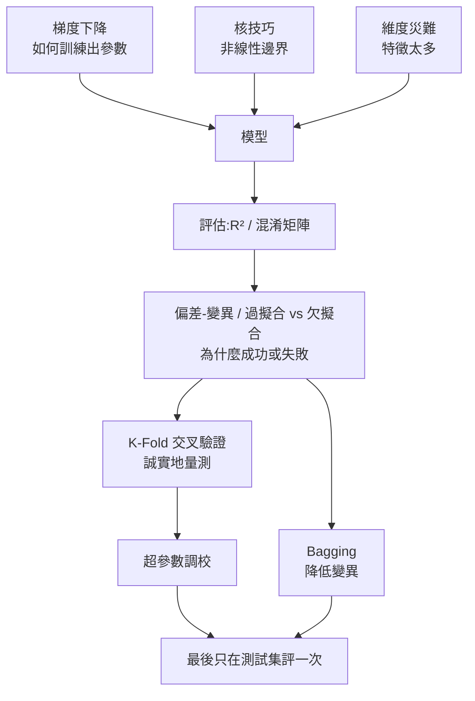
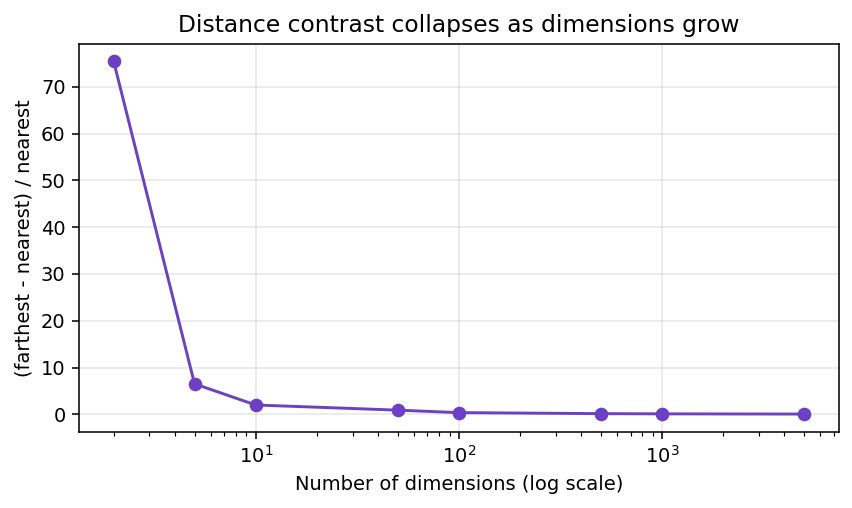
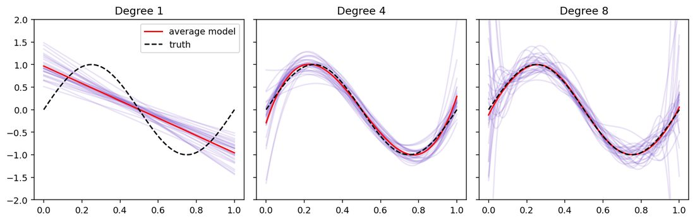
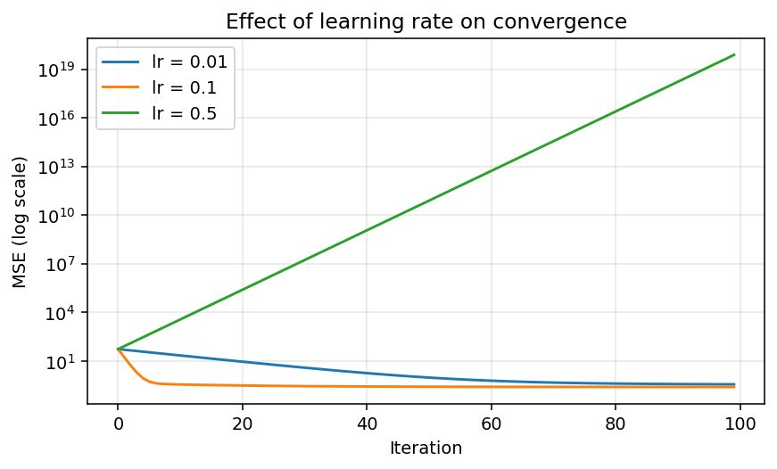
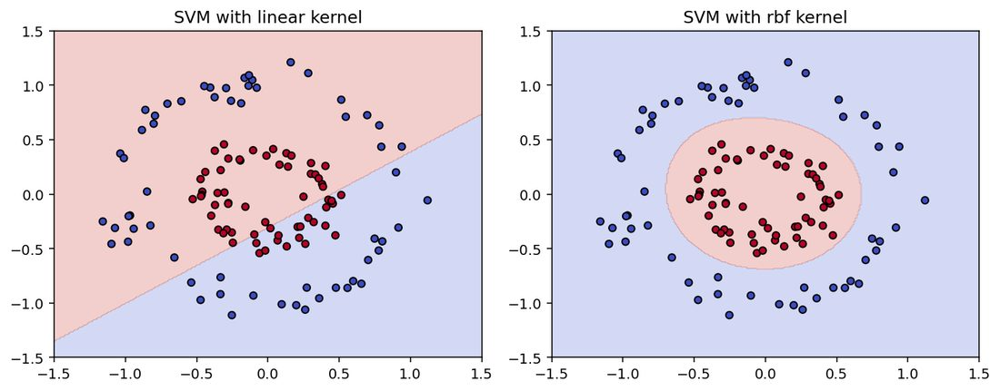
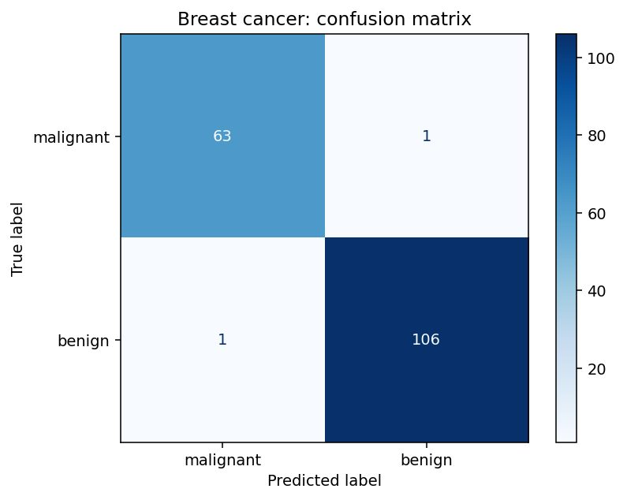
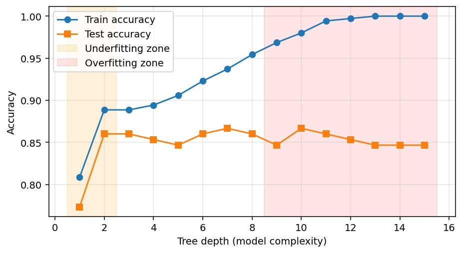
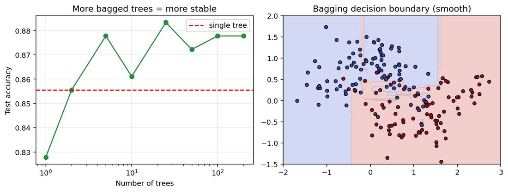

# 機器學習十大核心概念:維度災難、R²、偏差變異、梯度下降、核技巧、混淆矩陣、過擬合、交叉驗證、調參、Bagging

> **素材性質揭露**:本篇合併整理自社群引流型 PDF 兩份,作者皆為 Anjana「AI & Tech」@aiwithanju(每頁帶作者帳號浮水印,末頁導向其 Instagram):
> - 《ML_AI_Core_Concepts_Guide.pdf》(40 頁,**長版**:每章含概念、步驟、可跑程式、實際輸出、圖表、常見錯誤、學習資源);
> - 《Machine Learning & AI Concepts Guide.pdf》(25 頁,**短版**:同樣十個概念,另有環境設定、端到端清單與詞彙表,更強調資料洩漏與流程紀律)。
>
> 兩份**主題幾乎完全重疊**(同樣十個概念、同樣順序),所以合併成一篇:以長版的實驗數據與圖為主,短版的「流程紀律」補在各節與末尾清單。**本篇不轉述作者的導購/引流內容**,只整理知識;程式與數字我**全部在本機重新跑過**(見「延伸閱讀與深度補充」)。

## 概念地圖

## 建模紀律(短版 PDF 的主軸,我認為是兩份中最值錢的部分)

| 步驟 | 做法 | 為什麼 |
|---|---|---|
| 1 | 先定義目標與成功指標 | 避免優化錯目標 |
| 2 | **先切出最終測試集** | 保留較無偏的最終估計 |
| 3 | 前處理放進 `Pipeline` | 避免 fold 間資料洩漏 |
| 4 | 只用訓練資料做驗證與調參 | 不偷看測試資料 |
| 5 | 在測試集上**只評一次** | 估計對新資料的泛化 |
| 6 | 檢視錯誤與限制 | 指標無法解釋所有失敗 |

洩漏警告:**不要在切分前用全資料去 fit scaler、imputer、特徵選擇或 PCA**;只用訓練資料 fit,通常透過 `Pipeline`。

## 1. 維度災難(Curse of Dimensionality)

- **是什麼**:特徵數很多時,資料變稀疏、距離失去區辨力、模型需要的樣本數暴增。術語由 Richard Bellman 於 1961 年提出(長版 PDF 的說法,**我未另查出處**)。
- 機制:①空間體積隨維度指數成長,固定樣本覆蓋比例越來越低;②**距離集中**:最近與最遠鄰居的距離差趨近於零;③估計困難、過擬合風險上升。
- 直覺:單位線段 10 個點夠密;同密度的正方形要 100 個、立方體 1,000 個,d 維要 10^d 個點。
- **相對對比**:`(Dmax − Dmin)/Dmin → 0`(當 d → ∞)。

圖:《ML_AI_Core_Concepts_Guide.pdf》p5。2 維時最遠點比最近點遠約 75 倍;5000 維時只遠 5%(對比 0.05)——「最近鄰」幾乎失去意義。

**實驗結果(我重跑確認)**:

| 實驗 | 結果 |
|---|---|
| 長版 Demo B:5 個有用特徵 + 雜訊欄位,k-NN 準確率 | 5 欄 0.983 → 55 欄 0.878 → 505 欄 0.706(PDF 數字);下降約 28 個百分點 |
| 短版:固定 5 個資訊特徵、加雜訊欄,k-NN(k=7)測試準確率(PDF 只給「<test accuracy>」佔位,未給值,**我實跑補上**) | 5 → 0.923;20 → 0.777;50 → 0.687;100 → 0.587 |

對策:特徵選擇、PCA/UMAP、L1/L2 正則化、更多資料、改用樹模型或正則化線性模型。**注意 PCA 必須在交叉驗證 fold 內做**,且 PCA 保留的是高變異方向,不一定是對目標有預測力的方向(短版強調)。

## 2. 決定係數 R²

- 定義:`R² = 1 − SS_res / SS_tot`;1 為完美、0 等同「永遠預測平均值」、**負數表示比預測平均值還差**。
- 調整後 R²:`1 − (1−R²)(n−1)/(n−p−1)`,懲罰無用特徵。
- **正確詮釋(兩份 PDF 的說法不同,以短版較嚴謹)**:長版開頭寫「R²=0.84 → 模型解釋了約 84% 的變異」,短版則提醒「不要說 R² 是預測正確的百分比;它是相對於平均值基準的平方誤差減少」。兩種說法並不矛盾,但**不是正確率**。
- 實驗:長版 Demo 在 `y=3x+5+噪音` 上手算與 sklearn 都得 0.8415,調整後 0.8398,故意壞的模型(平均值+10)得 −1.05。短版另有迴歸範例:R²=0.958、RMSE=16.58(我重跑一致)。
- 使用守則:只報訓練 R² 沒意義;搭配 MAE/RMSE(目標單位);時間序列按時間切分;非線性關係下 R² 低可能是模型錯配。常數 y 時分母為 0,sklearn 預設以有限值慣例處理(見查證)。

## 3. 偏差–變異權衡(Bias–Variance)

- `期望誤差 = 偏差² + 變異 + 不可約雜訊`(平方損失下;其他損失有類似但不完全相同的分解)。
- 飛鏢比喻:低偏差低變異=集中在靶心;高偏差=集中但偏離;高變異=散落四周。

| 型態 | 訓練誤差 | 驗證/測試誤差 | 對策 |
|---|---|---|---|
| 高偏差 | 高 | 高 | 更豐富的特徵/模型、減少過度正則化 |
| 高變異 | 低 | 高 | 加資料、簡化、正則化、Bagging |
| 合理 | 低/中 | 低且接近訓練 | 檢查穩健性與資料品質 |

圖:長版 p12。淡紫線是 200 份不同訓練集各擬合一次的模型,紅線是平均、黑虛線是真值 sin(2πx)。

**重跑結果(與 PDF 完全一致)**:

| 多項式次數 | 偏差² | 變異 | 合計 |
|---|---|---|---|
| 1 | 0.2036 | 0.0226 | 0.2262 |
| 4 | 0.0061 | 0.0317 | **0.0378** |
| 8 | 0.0007 | 1.0649 | 1.0656 |

次數 8 的總誤差約為次數 4 的 28 倍,而且是變異主導。進階注意:現代過參數化深度網路會出現「雙下降」(長版提及,**我未讀一手論文核實**)。

## 4. 梯度下降(Gradient Descent)

- 更新式:`θ ← θ − η∇J(θ)`。變體:Batch(全部樣本,穩但慢)、SGD(單筆,快但抖)、Mini-batch(實務預設);Momentum/RMSProp/Adam 用梯度歷史調整步長。
- 線性迴歸 + MSE:`dL/dw = (2/n)Σ(ŷ−y)x`、`dL/db = (2/n)Σ(ŷ−y)`。
- 先**標準化特徵**,損失曲面更圓、收斂更快。

圖:長版 p16。學習率 0.1 在 100 步內收斂到 w=3.041、b=3.922(閉式解 w=3.005、b=3.965);0.01 太慢(w=3.504);0.5 發散(損失約 10¹⁹)。

學習率失效診斷(短版表):損失幾乎不動=學習率太小/梯度問題/特徵尺度;損失震盪或爆炸=學習率太大;訓練變好驗證變差=過擬合;某特徵主導更新=要標準化。

## 5. 核技巧(Kernel Trick)

- 概念:資料在原空間線性不可分,映射到高維可分;核函數 `K(x,z)=φ(x)·φ(z)` 讓演算法**不用真的算出 φ**。
- 恆等式驗證:`K(x,z)=(x·z)²` 對應 `φ(x)=(x₁²,x₂²,√2·x₁x₂)`;取 x=(1,2)、z=(3,4),顯式映射與核函數都得 **121**(我重跑一致)。
- 常見核:線性、多項式 `(γx·z+r)^d`、RBF `exp(−γ‖x−z‖²)`、sigmoid。γ 大→邊界彎曲易過擬合;C 控制誤分類懲罰。**使用前必須標準化**。

圖:長版 p20。線性核測試準確率 0.525(接近丟硬幣),RBF 核 1.000(我重跑一致)。短版另有 two-moons 的 RBF SVM(C=2):測試準確率 0.944(我重跑一致)。

## 6. 混淆矩陣(Confusion Matrix)

| 指標 | 公式 | 回答的問題 |
|---|---|---|
| Accuracy | (TP+TN)/總數 | 全部猜對幾成 |
| Precision | TP/(TP+FP) | 預測為正的有幾成真的是正 |
| Recall | TP/(TP+FN) | 真正的正例找到幾成 |
| Specificity | TN/(TN+FP) | 真正的負例排除幾成 |
| F1 | 2PR/(P+R) | 精準與召回的調和平均 |

- sklearn 排版:**列=真實、欄=預測**,二元為 `[[TN, FP],[FN, TP]]`;務必確認哪個類別當正類(用 `labels=` 明確指定)。
- 不平衡資料:「全部猜不是詐欺」在 1% 詐欺資料上準確率 99% 卻無用;改看 precision/recall/F1、PR-AUC、MCC。**閾值要在驗證集上依錯誤成本決定,不要在最終測試集上調**(短版)。

圖:長版 p23。測試 171 筆:TN=63、FP=1、FN=1、TP=106;accuracy 0.988、precision 0.991、recall 0.991、specificity 0.984、F1 0.991(我重跑矩陣一致)。注意本例**良性(benign)=正類**。

## 7. 過擬合與欠擬合

| | 欠擬合 | 過擬合 |
|---|---|---|
| 訓練表現 | 差 | 很強,有時「好得可疑」 |
| 驗證表現 | 差 | 比訓練差、不穩 |
| 對策 | 增加有用複雜度、改進特徵 | 正則化、簡化、加資料、early stopping |
| 例 | 線性模型配彎曲資料 | 極深樹背下小資料集 |

圖:長版 p27。深度 15:train=1.000、test=0.847、落差 0.153;最佳測試準確率 0.867(深度 7 與 10 同分);深度 15 加 `min_samples_leaf=15` 後 train=0.877、test=0.867。**測試集只有 150 點,1–2 個百分點的差距是雜訊**——所以要用交叉驗證。

提醒:train–test 落差只是線索,不是診斷;資料洩漏、分佈偏移、小樣本、標籤雜訊都會造成類似症狀(短版)。

## 8. K-Fold 交叉驗證

- 把資料切 K 份,輪流當驗證集,取平均與標準差。變體:Stratified(分類、不平衡)、Repeated、Leave-One-Out(K=n)、GroupKFold(同人/同裝置重複量測)、**TimeSeriesSplit(時序)**、巢狀 CV(同時調參與估計)。
- 長版實驗:5 次不同亂數種子的單次切分 0.693、0.667、0.680、0.680、0.667;5-fold 各 fold 0.733、0.667、0.633、0.717、0.717,平均 0.693、標準差 0.037。單一 fold 差距可達 10 點。
- 短版 diabetes 資料集 Ridge 5-fold R²:`[0.454 0.572 0.392 0.583 0.394]`,平均 0.479(我重跑一致)。
- 報告時要寫:平均與離散度、評分指標、切分策略、分組/時間限制。常見錯誤:在 CV 之前對全資料標準化/特徵選擇(洩漏)、不平衡資料用普通 KFold、K=2(偏差大)。

## 9. 超參數調校

- 參數(學出來)vs 超參數(事先設,如樹深、SVM 的 C/gamma、k、正則化強度)。
- 方法:網格搜尋(窮舉)、**隨機搜尋**(只有少數維度重要時更有效率)、貝氏/序列最佳化(Optuna 等)、Successive Halving/Hyperband。C、gamma、學習率要在**對數尺度**取樣。
- 長版結果:SVM 4×4 網格×5-fold,最佳 C=100、gamma=0.001,CV 0.988、測試 0.958;隨機森林隨機搜尋 10 組,最佳 CV 0.958、測試 0.937(兩者測試分數都略低於 CV,因為從多組候選挑最大值本身略偏樂觀)。
- 短版範例:`GridSearchCV` + `Pipeline` 在乳癌資料集,最佳 `C=0.1、kernel=linear、gamma=scale`,CV 0.976、測試 0.982(我重跑一致)。
- 最佳實務:先決定評分指標、搜尋範圍由粗到細、**絕不用測試集選超參數/特徵/閾值**、紀錄搜尋空間與亂數種子。

## 10. Bagging(Bootstrap Aggregating)

- 作法:對 N 筆訓練資料**有放回**抽 N 筆成一個 bootstrap 樣本,訓練一個基學習器,重複 B 次;迴歸取平均、分類投票。主要**降低變異**,對低偏差高變異的學習器(深決策樹)最有用;**不會救欠擬合的模型**。
- 為何有效:B 個獨立模型平均,變異降為 σ²/B;樹彼此不獨立,所以增益較小但仍大。
- OOB:每個 bootstrap 樣本約含 **63.2%** 不重複列,其餘約 37% 是 out-of-bag,可免費估計泛化(**我驗證:1−(1−1/n)ⁿ 在 n=1000 為 0.632**)。
- 與其他方法:Random Forest = Bagging 決策樹 + 每次分裂隨機特徵子集(去相關);Boosting = 序列式修正前一輪錯誤(可降偏差也可降變異,對雜訊與調參較敏感)。

圖:長版 p38。我重跑長版 Demo 的結果:單棵樹 0.856、BaggingClassifier(100 棵)0.878 且 OOB=0.867,與 PDF 一致。短版範例(20 特徵、單次切分)單棵樹 0.777 vs Bagging 0.867(我重跑一致)。**但看左圖:樹很少時(1 棵)反而低於單棵樹基準、且曲線非單調,代表測試集小時結果有雜訊**,不能把「更多樹一定單調變好」當定律。

## 應用案例

**案例:預測客戶是否會流失(二元分類,流失 8%)。**
1. **切分**:先切 20% 最終測試集;因同一客戶有多筆紀錄,用 `GroupKFold`,不要用普通 KFold(否則同客戶同時出現在訓練與驗證)。
2. **指標**:8% 流失屬不平衡,不看 accuracy;看 recall(漏掉流失客戶成本高)與 PR-AUC,並用 **混淆矩陣** 看 FN 數。
3. **基準**:先做「永遠預測不流失」(準確率 92%)當 baseline,確認模型真的有加值。
4. **診斷**:訓練 AUC 0.99、驗證 0.78 → **高變異/過擬合**;對策:限制樹深、改用 **Bagging/隨機森林**、加 `min_samples_leaf`。
5. **調參**:`RandomizedSearchCV` 在 `Pipeline` 內搜尋(標準化放 Pipeline,避免洩漏),評分用 PR-AUC。
6. **閾值**:在驗證集上依「挽留成本 vs 流失損失」選閾值,最後在測試集**評一次**並報告。
7. **上線後**:監控資料分佈,因為商業成本與分佈會變。

## 延伸閱讀與深度補充(一手資料查證 + 本機重跑)

| 項目 | 結論 | 我實際做的事 |
|---|---|---|
| 長版與短版所有 Demo 數字 | **已核實(本機重跑)** | 重寫並執行兩份 PDF 的程式:梯度下降三個學習率(3.504/3.287、3.041/3.922、發散)、核恆等式 121、線性/RBF 核 0.525/1.000、乳癌混淆矩陣 `[[63,1],[1,106]]`、Bagging 0.856/0.878/OOB 0.867、R² 0.8415、偏差變異三組數字、短版 R² 0.958/RMSE 16.58、two-moons 0.944、單樹 0.777 vs Bagging 0.867、GridSearchCV 最佳參數與 0.976/0.982、diabetes 5-fold,**全部與 PDF 一致**(亂數種子與版本相同才會一致,長版自己也聲明這點) |
| R² 常數 y 的處理 | **已核實** | 讀 scikit-learn `r2_score` 文件:y_true 為常數時分母為 0;預設 `force_finite=True`,完美預測回 **1.0**、否則回 **0.0**(`force_finite=False` 則為 NaN/-Inf);R² 可為負;少於 2 筆樣本回 NaN。短版「用有限值慣例」說法正確 |
| R² 負值意義 | **已核實** | 同上:0.0 對應永遠預測平均值的常數模型,負數表示比它更差 |
| RBF SVM 擴展性「超過約 10 萬筆就不行」(長版 p18) | **需修正(過度精確)** | 讀 scikit-learn SVM 文件:libsvm 版 `SVC` 的 QP 求解時間介於 O(n_features×n_samples²) 與 O(n_features×n_samples³)(視快取效率),**文件並未給固定樣本數上限**;大資料建議用 `LinearSVC`(liblinear,可近線性擴展到百萬級)或 `SGDClassifier`。「約 100,000」只是經驗門檻 |
| 核函數公式、C 與 gamma 的意義 | **已核實** | 同一份文件:linear、polynomial `(γ⟨x,x'⟩+r)^d`、rbf `exp(−γ‖x−x'‖²)`(γ>0)、sigmoid `tanh(γ⟨x,x'⟩+r)`;C 低→決策面平滑、高→盡量全分對,C 是逆正則化參數;gamma 越大,影響範圍越小。與 PDF 一致 |
| `BaggingClassifier(estimator=...)` | **已核實** | 讀 sklearn 文件:`base_estimator` 於 1.2 版更名為 `estimator`,PDF 兩份都用新名,正確;`oob_score` 需 `bootstrap=True`,小的 `n_estimators` 時 OOB 決策函數可能含 NaN;`max_samples=None` 抽 X.shape[0] 筆 |
| 隨機搜尋常優於網格搜尋 | **已核實** | 讀 Bergstra & Bengio, JMLR 13 摘要:隨機選取的試驗比網格試驗更有效率,**經驗與理論皆支持**;只有少數超參數對特定資料集重要,且不同資料集重要的不同;網格搜尋對新資料集不是好選擇。長版的說法正確 |
| **混淆矩陣範例中的閾值建議(長版 p23)** | **需修正** | 長版寫「單一 FP 是惡性腫瘤被預測成良性,最危險 … 你可能調**低**決策閾值」。本例良性為正類,FP 指把惡性判成良性;要減少這種錯誤(少放過惡性),應**提高**「判為良性」的機率閾值(更嚴格才說是良性),等同降低惡性的判定門檻。「降低閾值」在正類=良性的設定下方向相反。這是易混淆處,**我依定義推導,未另找一手來源** |
| 「R² = 解釋 84% 變異」 vs 短版警語 | **需補充** | 長版的白話在樣本內 OLS 成立;對一般模型/測試集應理解為「相對平均值基準的平方誤差縮減」,不是正確率(見第 2 節) |
| 偏差²+變異+雜訊分解 | **概念已知,未讀教科書原文** | 兩份 PDF 都註明是平方損失下的結果;我只重跑了數值實驗,未另讀 ESL 或論文 |
| 維度災難「Bellman 1961」、雙下降、Johnson-Lindenstrauss、Mercer 定理 | **未能核實** | 未讀一手來源,僅依 PDF 與通行知識陳述 |
| 長版各章「學習資源」連結 | **未逐一點開** | 這些連結(Wikipedia、scikit-learn 文件、StatQuest、3Blue1brown 等)多為通用教材;其中 sklearn 文件與 Bergstra 論文頁我有讀;影片連結未點開驗證 |

## 來源

- 使用者提供的本機素材批次 `new/ai-guide/`(2026-11-07 收件),檔案:`ML_AI_Core_Concepts_Guide.pdf`、`Machine Learning & AI Concepts Guide.pdf`(作者 Anjana「AI & Tech」@aiwithanju;社群引流型素材;兩份內容高度重疊,已合併)。
- scikit-learn,SVM:https://scikit-learn.org/stable/modules/svm.html
- scikit-learn,r2_score:https://scikit-learn.org/stable/modules/generated/sklearn.metrics.r2_score.html
- scikit-learn,BaggingClassifier:https://scikit-learn.org/stable/modules/generated/sklearn.ensemble.BaggingClassifier.html
- Bergstra & Bengio,Random Search for Hyper-Parameter Optimization(JMLR 13):https://jmlr.org/papers/v13/bergstra12a.html
