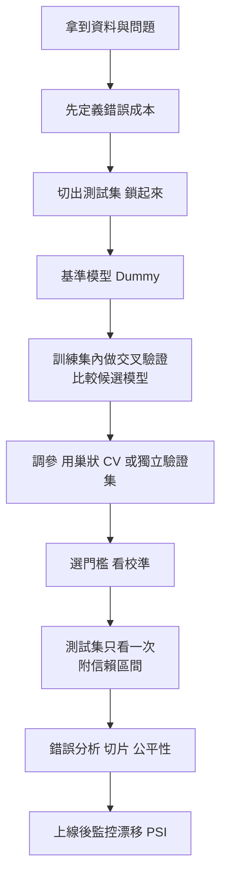
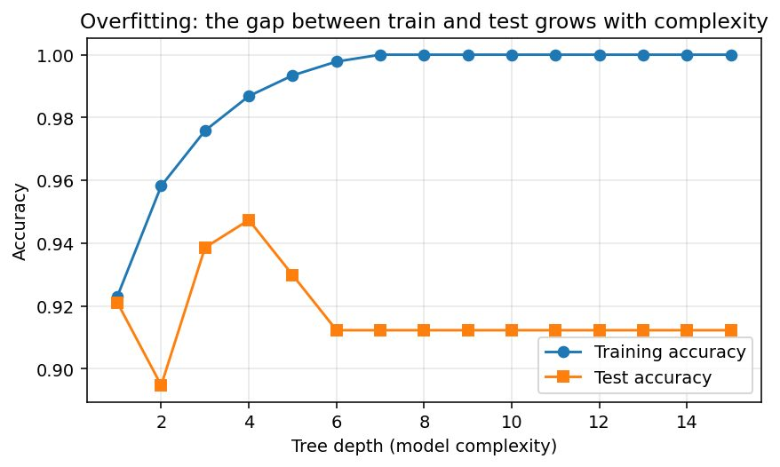
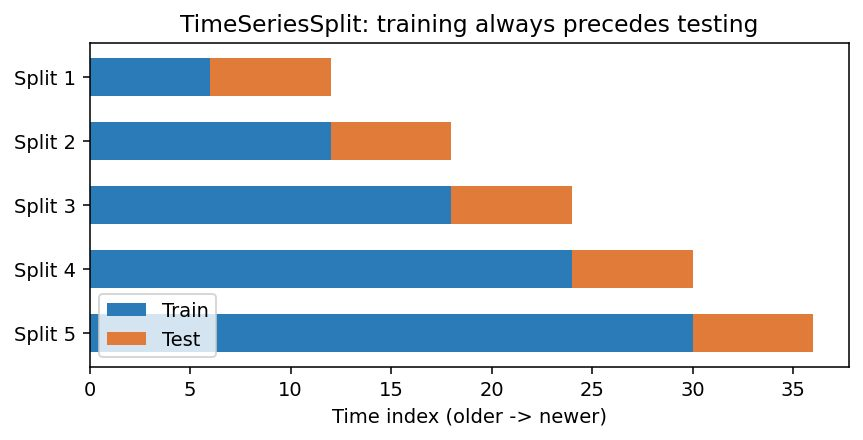
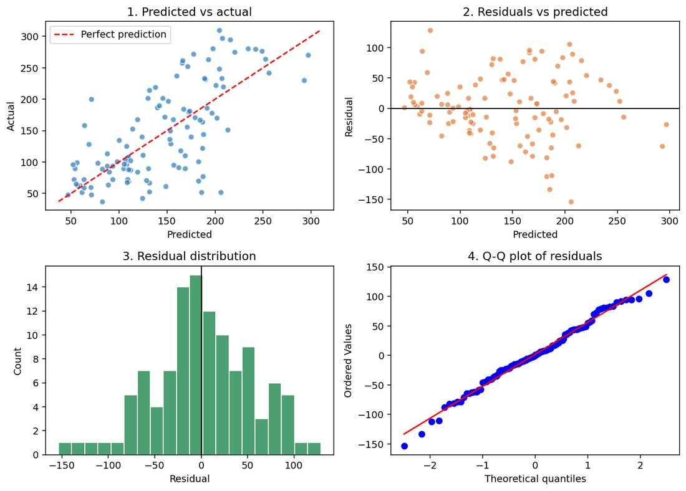
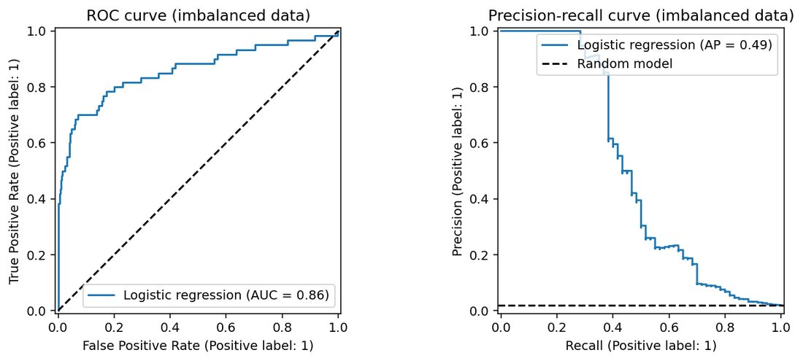
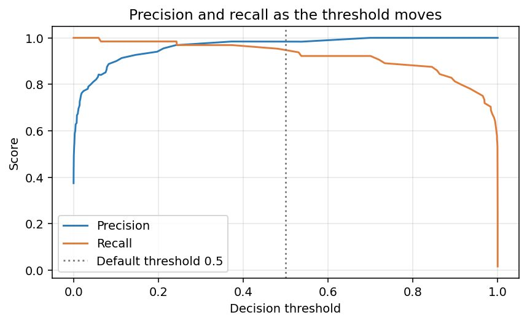
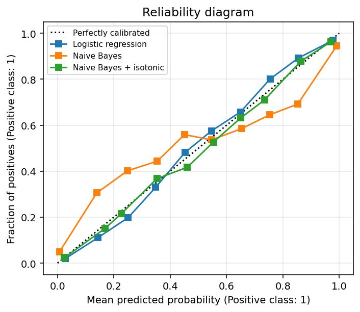
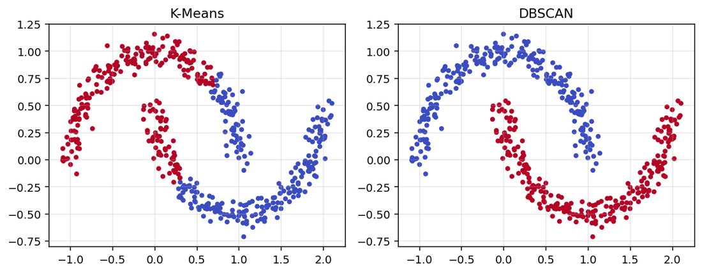
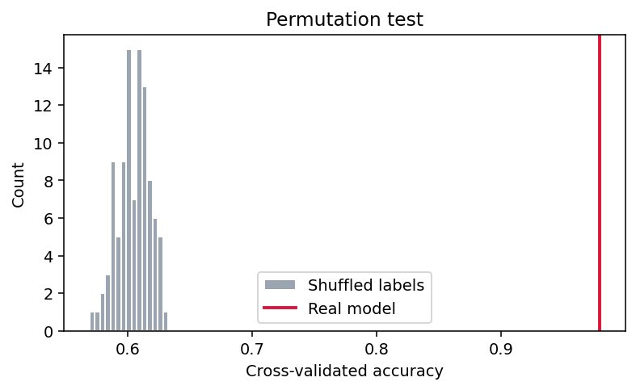

# 機器學習模型評估完整指南:驗證策略、迴歸/分類/分群/排序/時間序列指標、統計嚴謹性與上線監控(Anjana「AI & Tech」)

**主題分類:** 科技 / 機器學習 — 模型評估
**整理日期:** 2026-11-08
**來源:** 使用者提供的本機素材批次 `new/ai-guide/`(2026-11-07 收件),檔案:`Model_Evaluation_Techniques_in_Machine_Learning.pdf`(71 頁長版)、`Model Evaluation 8 Techniques in Machine Learning.pdf`(8 頁輪播摘要卡,無文字層,逐頁看圖轉寫)

> ⚠️ **作者自我宣傳揭露:** 這批 PDF 是社群引流型素材。作者 Anjana(@aiwithanju)在每頁帶浮水印與帳號;8 張輪播卡是「8 個指標」的引流摘要,長版是其完整版。本篇只整理教學內容,不轉述導購。
> ⚠️ 第三方著作:以下為整理者重述與驗算;圖取自原稿程式輸出圖。數字皆為作者在 scikit-learn 內建小資料集或合成資料上的單次結果。

---

## TL;DR

- 長版把評估拆成 10 章:**基礎 → 驗證策略 → 迴歸 → 分類 → 分群 → 排序/推薦 → 時間序列 → 統計嚴謹性 → 進階主題(含 LLM 評估)→ 總整理**。核心訊息一句話:**評估是「用哪份資料算」(驗證策略)加「用什麼尺算」(指標)加「差距是不是真的」(統計)**。
- 最常被忽略的五件事:**基準模型、資料洩漏、不平衡資料別用準確率、門檻要依成本選、報告要附信賴區間**。
- 輪播短版只講 8 個基礎指標:Accuracy、Precision、Recall、F1(分類)與 MAE、MSE、RMSE、R²(迴歸),每張卡配一個小算例,整理者逐一驗算(全部算對),但發現 **R² 卡寫「範圍 0 到 1」不正確**(見第 11 節)。
- 查證:驗證策略與指標的行為與 scikit-learn 官方文件吻合;`mean_squared_error` 的 `squared` 參數**確已移除**;PDF 文字對「過擬合峰值在深度 3」與自己的圖(峰值在深度 4)略有出入。

---

## 1. 基礎(長版第 1 章)

- **資料切分:** 訓練集(60–80%,擬合參數)、驗證集(10–20%,比較模型與調參)、測試集(10–20%,**只在最後碰一次**)。黃金守則:**測試集不得影響任何決策**;看了測試分數、改動、再看,測試集就悄悄變成訓練的一部分,最終數字會偏樂觀。
- **`stratify=y`** 保持各切分的類別比例(乳癌資料 569 筆,良性占 0.627,切分後訓練 0.626、測試 0.632)。
- **過擬合/欠擬合診斷表:**

| 症狀 | 診斷 | 試試看 |
|---|---|---|
| 訓練低、測試低 | 欠擬合(高偏差) | 更多特徵、更複雜模型、減少正則化 |
| 訓練高、測試低 | 過擬合(高變異) | 更多資料、簡化、正則化、早停 |
| 訓練高、測試高 | 良好 | 用交叉驗證確認再上線 |

*圖:`Model_Evaluation_Techniques_in_Machine_Learning.pdf` p.8。深度增加使訓練準確率升到 100%,測試準確率先升後降,兩線落差擴大就是過擬合的簽名。注意:圖上測試峰值其實在**深度 4(約 0.947)**,而 PDF 內文寫「約深度 3(93.9%)」,以圖為準。*

- **資料洩漏(1.5):** 在切分前就對全資料 fit 縮放器/補值器/特徵選擇,測試資料就影響了訓練流程。作者用**純雜訊**特徵(100 筆 × 2,000 個無意義特徵、隨機標籤)示範:**先全資料挑特徵再交叉驗證得 0.810(假的高分),把選擇放進 Pipeline 得 0.430(接近隨機)**。口訣:「分數好得不像話,先懷疑洩漏。」
- **基準模型(1.6):** `DummyClassifier`(預測多數類)/`DummyRegressor`(預測平均)。乳癌資料多數類基準 0.632,隨機森林 0.956——若某模型只有 65%,等於沒用。

**應用案例:** 新人把整份客戶資料做 `StandardScaler().fit_transform` 後才切訓練/測試,離線準確率 0.93、上線只有 0.86。改成 `make_pipeline(StandardScaler(), model)` 並在 CV 內 fit 後,離線數字降到 0.87,與上線一致——這才是誠實的估計。

---

## 2. 驗證策略(第 2 章)

| 策略 | 做法 | 作者實驗結果 | 何時用 |
|---|---|---|---|
| Hold-out | 切一次 | 同模型 10 個不同種子的準確率 0.965–1.000(均值 0.982、std 0.010) | 資料極大或模型極貴 |
| k-fold | 切 k 份輪流當測試 | 5 折 0.977(±0.009) | 中小資料表格 |
| Stratified k-fold | 每折維持類別比例 | Iris(依類別排序)普通 KFold(不 shuffle)= **0.0**,Stratified = 0.973 | 分類預設、不平衡 |
| `cross_validate` 多指標 | 一次回傳多指標與訓練分數 | 測試 acc 0.979 vs 訓練 0.989,AUC 0.995 vs 0.998 | 診斷過擬合 |
| Repeated k-fold | 重複多次洗牌 | 5 折 × 10 次 = 50 個分數,均值 0.9757、std 0.0170 | 小資料、要穩定估計 |
| LOOCV | k = n | 50 筆資料 0.96 | 極小資料(<100)、但變異高 |
| TimeSeriesSplit | 訓練永遠在測試之前 | 5 個切分,訓練窗逐步變大 | 時序資料 |
| GroupKFold | 同組(病人/客戶/裝置)不跨訓練與測試 | 40 位病人 × 10 筆、標籤隨機:隨機 KFold **0.980**(洩漏身分),GroupKFold **0.627**(誠實) | 多列屬於同一實體 |
| 巢狀 CV | 內圈調參、外圈評整個「調參+擬合」流程 | 非巢狀 0.9771(樂觀)、巢狀 0.9737 ± 0.0229 | 要報告含調參的效能 |

*圖:`Model_Evaluation_Techniques_in_Machine_Learning.pdf` p.14。5 個切分的訓練窗(藍)逐次擴大、測試窗(橘)緊接其後,絕不用未來預測過去。*

- **學習曲線(2.10):** 訓練與驗證分數隨訓練集增大——收斂在高分:更多資料無益;持續有落差:過擬合,更多資料/更簡單模型有望;收斂在低分:模型太簡單。作者的例子收斂於訓練/驗證 0.989/0.981。
- **驗證曲線(2.11):** 固定其他參數、畫某超參數範圍的訓練/驗證分數;作者的例子最佳 `max_depth` = 2(0.928)。

**策略速選:** 巨量資料/慢模型 → hold-out(三切);小中型表格 → 分層 5/10 折;很小且雜訊大 → repeated stratified;不到 100 列 → LOO;時序 → TimeSeriesSplit/walk-forward;多列同實體 → GroupKFold;調參並報告 → 巢狀 CV 或獨立測試集。

**應用案例:** 診所有 40 位病人、每人 10 次量測,若用一般 `KFold`,模型會「認人」而非學病徵,離線 0.98、新病人上線約 0.6;改用 `GroupKFold(groups=patient_id)` 才看得到真實水準。

---

## 3. 迴歸指標(第 3 章 + 輪播 p5–p8)

資料:Diabetes(442 人、10 特徵,標籤均值 152.1)。**殘差 = 實際 − 預測**(正:低估;負:高估)。

| 指標 | 公式 | 作者結果(線性/森林/基準) | 特性 |
|---|---|---|---|
| MAE | `(1/n)Σ|y−ŷ|` | 41.55 / 42.11 / 65.53 | 與目標同單位,最好向外行解釋;對離群較穩健 |
| MSE | `(1/n)Σ(y−ŷ)²` | 2848 / 2820 / 5607 | 平方懲罰大誤差;單位為平方,多當訓練目標 |
| RMSE | `√MSE` | 53.37 / 53.11 / 74.88 | 單位回到目標;恆 ≥ MAE,差距大代表被少數大錯主導 |
| R² | `1 − Σ(y−ŷ)²/Σ(y−ȳ)²` | 0.485 / 0.490 / −0.014 | 解釋變異比例;**可為負**(比永遠猜平均還差) |
| 調整後 R² | `1−(1−R²)(n−1)/(n−p−1)` | 10 特徵 0.433;加 30 欄雜訊 R² 0.450 但調整後僅 **0.136** | 比較特徵數不同的線性模型 |
| MedAE / MaxError | 中位數誤差 / 最大單點誤差 | 35.21、153.66 | 極穩健 / 安全關鍵情境 |
| MAPE / SMAPE | 百分比誤差 | 37.3% / 30.5% | **目標接近 0 時失效**(作者示範可飆到 4955%) |
| RMSLE | 對 log(1+y) 的 RMSE | 0.418 | 看比例、對低估懲罰更重,目標需非負 |
| Pinball(分位數)損失 | 評估分位數預測 | q=0.1:8.55、q=0.9:10.40,80% 區間實際覆蓋 80.2% | 預測區間 |

**MAE vs RMSE 的離群實驗:** 5 個誤差 = 1 時 MAE 1.00、RMSE 1.00;加一個大誤差後 MAE 13.00、RMSE 27.29。**單一大錯被 RMSE 放大**,大錯代價高(如缺貨)用 RMSE,每單位誤差同價用 MAE。

**殘差診斷四圖:** ① 預測 vs 實際貼對角線;② 殘差 vs 預測應為無形雲團(喇叭形 = 異質變異);③ 殘差直方圖近鐘形置中;④ Q-Q 圖近直線。作者的線性模型平均殘差 1.86、標準差 53.34、Shapiro-Wilk p=0.644(殘差看似常態)。

*圖:`Model_Evaluation_Techniques_in_Machine_Learning.pdf` p.24。左上預測 vs 實際、右上殘差 vs 預測、左下殘差分佈、右下 Q-Q 圖;右上略呈散開趨勢,值得注意異質變異。*

**CV 比較(同一組折):** 基準 MAE 65.79/RMSE 76.93/R² −0.001;線性 44.29/54.53/0.489(std 0.090);森林 46.40/57.44/0.434。兩者接近時要看折間標準差再宣稱誰贏。

**輪播卡 p5–p8 驗算(全部正確):**
- MAE:5 棟房子的絕對誤差 20/10/30/30/20 → MAE = 22(千美元,即 $22,000)。
- MSE:誤差平方 400/400/400/900/400,和 2500,÷5 = 500。
- RMSE:4 筆訂單平方誤差 1/4/0/4 = 9,`√(9/4)=1.5` 天。
- R²:例子 R² = 0.82,「82% 變異由讀書時數解釋」。**卡片說明「ranges from 0 to 1」不嚴謹:R² 在樣本外可為負**(長版 3.5 節自己示範爛模型 R² = −4.31)。

**迴歸指標怎麼選:** 要解釋給外行 → MAE;大錯很貴 → RMSE;與基準比 → R²;特徵數不同 → 調整後 R²;離群多 → MedAE;安全關鍵 → MaxError;目標跨數量級 → RMSLE;要區間 → Pinball。

**應用案例:** 倉儲預測每日出貨量:缺貨損失遠大於多備,選 RMSE 當驗收指標並看殘差圖是否隨出貨量變大而散開;若出貨量常為 0,就**不要用 MAPE**,改用 MAE 或 MASE。

---

## 4. 分類指標(第 4 章 + 輪播 p1–p4)

乳癌資料(翻轉標籤:1 = 惡性為正類),測試 171 人、惡性 64。

**混淆矩陣**(scikit-learn 排列為 `[[TN, FP],[FN, TP]]`,使用前務必確認哪個標籤是正類):`TN=106 FP=1 FN=4 TP=60`。

| 指標 | 公式 | 結果 |
|---|---|---|
| Accuracy | `(TP+TN)/全部` | 0.9708 |
| Precision | `TP/(TP+FP)` | 0.9836(60/61)——假警報貴時重視 |
| Recall(敏感度) | `TP/(TP+FN)` | 0.9375(60/64)——漏掉貴時重視 |
| Specificity | `TN/(TN+FP)` | 0.9907 |
| FPR | `FP/(FP+TN)` = 1 − 特異度 | 0.0093(ROC 的 x 軸) |
| F1 | `2PR/(P+R)`(調和平均) | 0.96;F2 0.9464;F0.5 0.974 |

- **F-beta:** beta>1 更重視召回(醫療篩檢常用 F2),beta<1 更重視精確。
- **準確率會說謊(4.7):** 詐欺 2%(3,000 筆中 60 筆):**永不預測詐欺**的模型準確率 0.980、召回 0、F1 0、MCC 0;邏輯迴歸準確率 0.984、召回 0.2、精確 1.0、F1 0.333、Balanced acc 0.6、MCC 0.444、Kappa 0.329。
- **ROC-AUC vs PR:** ROC-AUC = 隨機抽一個正例分數高於隨機一個負例的機率,與門檻無關,0.5 為隨機。正例稀少時 ROC 因 FPR 以大量負例為分母而顯得好看:同一個模型 **ROC-AUC 0.859、Average Precision 0.495**,PR 隨機基準 = 正例比例 0.02(不是 0.5)。經驗法則:類別平衡/兩類同等重要用 ROC-AUC,正例稀少且在意找出正例用 PR-AUC。

*圖:`Model_Evaluation_Techniques_in_Machine_Learning.pdf` p.32。同一模型同一資料:左 ROC(AUC 0.86)看似舒適,右 PR 曲線(AP 0.49)在召回超過 0.4 後精確度快速掉落,虛線是隨機模型的基準 0.02。*

- **選門檻(4.10):** 預設 0.5 很少最佳。作者要求召回 ≥ 98%,選出門檻 0.243,召回 0.984、精確 0.969,混淆矩陣 `[[105,2],[1,63]]`(對比 0.5 時 FN=4)。

*圖:`Model_Evaluation_Techniques_in_Machine_Learning.pdf` p.33。門檻往左(降低)召回上升、精確下降,虛線為預設 0.5。*

- **成本敏感評估(4.11):** 若漏掉一個惡性(FN)是誤報(FP)的 **50 倍**成本:門檻 0.05 時 FP=14、FN=0,總成本 14;門檻 0.5 時 FP=1、FN=4,總成本 **201**。**門檻要在驗證集或 CV 上選,不能在測試集上選**,否則成本估計偏樂觀。(作者表中 0.10 的成本 57 = 7 + 1×50,與整理者驗算一致。)
- **機率品質(4.12):** Log loss(交叉熵)重罰「很有把握卻錯」:預測 P=0.6/0.9/0.99/0.999 而真相為負時損失 0.92/2.30/4.61/6.91;Brier = 預測機率與 0/1 結果的均方差(越低越好)。邏輯迴歸 log loss 0.0675、Brier 0.0187;隨機森林 0.1040、0.0290。
- **校準(4.13):** 排名好(高 AUC)不代表機率可信。邏輯迴歸 Brier 0.0643/AUC 0.9683;單純貝氏 0.0774/0.9625(過度自信);貝氏 + isotonic 0.0721/0.9626。校準改的是機率的意義,不是排序。

*圖:`Model_Evaluation_Techniques_in_Machine_Learning.pdf` p.36。黑虛線為完美校準;橘線(單純貝氏)在低機率區偏高、高機率區偏低,綠線(加 isotonic)被拉回對角線附近。*

- **多類別(4.14):** 平均方式:**macro**(各類平均,罕見類同等重要)、**weighted**(依樣本數加權)、**micro**(合併所有 TP/FP/FN,單標籤多類時 micro-P/R/F1 都等於 accuracy)。作者的手算例:準確率 0.92、micro-F1 0.92、weighted-F1 0.894、**macro-F1 0.452**(暴露弱勢類別)。Wine 真實資料:OvR macro ROC-AUC 0.9995、Top-2 accuracy 1.0。
- **多標籤(4.15):** 精確匹配(subset accuracy)最嚴(0.333),另用 Hamming loss(0.221)、Jaccard(0.542)、樣本平均 F1(0.625)。
- **類別權重(4.16):** `class_weight='balanced'` 讓召回由 0.2 升到 0.8、但精確由 1.000 降到 0.065、F1 0.333 → 0.120、AP 0.495 → 0.224;「權重不是免費午餐」,常常先移動門檻更好。

**分類指標怎麼選:**

| 情境 | 主要指標 |
|---|---|
| 平衡、錯誤成本相同 | Accuracy、F1 |
| 漏掉正例代價大(疾病、詐欺) | Recall、F2、PR 曲線 |
| 假警報代價大(垃圾信、法務行動) | Precision、F0.5 |
| 嚴重不平衡 | PR-AUC、MCC、Balanced accuracy、F1 |
| 需要與門檻無關的排序品質 | ROC-AUC(平衡)/ Average Precision(稀有正例) |
| 直接使用機率 | Log loss、Brier、校準曲線 |
| 多類別且罕見類重要 | macro-F1、逐類報告 |
| 多標籤 | Hamming loss、樣本 F1、Jaccard |
| 已知各類錯誤的價格 | 在選定門檻的期望成本 |

**輪播卡 p1–p4 驗算(全部正確):** 垃圾信混淆矩陣 TP=90、FN=10、FP=5、TN=895:Accuracy = 985/1000 = 98.5%;Precision = 90/95 = 0.95;Recall = 90/100 = 0.90;F1 = 2×0.95×0.90/1.85 ≈ 0.92。Recall 卡以「癌症預測」為例(TP=90、FN=10 → 0.90)。**備註:** F1 卡寫「評估模型辨識垃圾與非垃圾」並不精確——F1 只針對**正類**(垃圾信)的精確與召回,不含 TN;要兼顧兩類請看 macro-F1 或 MCC。

**應用案例:** 風控團隊的詐欺率 0.5%:報告上不能出現「準確率 99.5%」,而要同時給「召回 70% 時精確 35%」與 PR-AUC;再用「一筆漏網損失 = 200 筆誤擋人工審核」的成本比決定門檻。

---

## 5. 分群評估(第 5 章)

分群沒有標準答案:**內部指標**(只看資料與指派)與**外部指標**(對照真實標籤)。資料:600 點、4 群有重疊。

- **Inertia:** 4 群時 5775.4;只能在同演算法內比較,看肘部。
- **輪廓係數:** `s=(b−a)/max(a,b)`,a=與同群其他點的平均距離、b=與最近另一群的平均距離;4 群時 0.572,600 點中 0 個為負。
- **Davies-Bouldin**(0.597,低好)、**Calinski-Harabasz**(1502.7,高好,很快,適合大資料)。
- **選 K 的衝突(5.5):** 輪廓係數與 DB 偏好 K=3(0.615),肘部與 CH 指向真實的 K=4(CH 峰值 1502.7);因為兩個真群互相接觸、合併看起來較「整齊」。**多指標一致才有信心,並要看圖。**
- **外部指標:** ARI 0.932、NMI 0.919、Homogeneity 0.919、Completeness 0.919、V-measure 0.919、Fowlkes-Mallows 0.949;對群編號重命名不變。
- **警告(5.7):** 輪廓係數偏好圓形群。彎月資料:K-Means 輪廓 0.487 但 ARI 0.245;DBSCAN 輪廓 0.328 但 ARI 1.000。**不要只用內部指標選演算法。**

*圖:`Model_Evaluation_Techniques_in_Machine_Learning.pdf` p.46。左:K-Means 把兩個彎月橫切(輪廓係數較高、其實是錯的);右:DBSCAN 依密度連續性還原兩個彎月(輪廓係數較低、其實是對的)。*

分群演算法本身的做法見 [[unsupervised-ml-algorithms-guide]]。

---

## 6. 排序與推薦評估(第 6 章)

(也適用於 RAG 的檢索階段。)四個查詢,各回傳 10 個排序後項目,1 = 相關。

| 指標 | 作者結果 | 重點 |
|---|---|---|
| Precision@5 / Recall@5 / Hit@5 | 平均 0.4 / 0.667 / 1.0 | P@k = 看得到的前 k 個有多少相關;R@k = 全部相關中被前 k 個撈到多少;Hit = 前 k 是否至少一個相關 |
| MRR | 1.0、0.5、0.25、1.0 → **0.6875** | 只看第一個相關的倒數排名,適合只需一個好答案(QA) |
| AP / MAP | 0.542、0.300、0.125、1.000 → **MAP 0.4917** | 對排序順序敏感:同樣 3 個相關在第 1-2-3 位 AP 1.0,在 4-5-6 位僅 0.383 |
| DCG / NDCG | DCG 6.535、IDCG 7.141、**NDCG 0.9151**;NDCG@3 = 0.7232 | 分級相關性;位置越前折扣越小;除以理想排序得 0–1 |
| 覆蓋率/多樣性/新穎度 | 50 項商品中只推 8 項,覆蓋率 16% | 排序指標好看仍可能只推熱門品(流行度偏誤);另看線上 CTR/轉換與 A/B 測試 |

**NDCG 備註:** scikit-learn 的增益是 `rel/log2(rank+1)`;有些函式庫用 `(2^rel−1)/log2(rank+1)`,更強調高相關。**比較不同來源的 NDCG 前務必確認用哪一種。**

**應用案例:** 公司內部 RAG 知識庫:用 100 題黃金問答集,評檢索階段的 Recall@5(答案所需段落有沒有被撈進前 5)與 MRR(第一個有用段落多前面),先確認檢索好,再去調生成。

---

## 7. 時間序列評估(第 7 章)

預測打破兩個假設:列不獨立、未來不可用於預測過去。

- **MASE:** 用訓練期的季節性 naive 誤差來縮放,**無單位**;MASE < 1 = 贏過 naive,> 1 = 輸給「直接重複上季」。
- **作者的合成月資料(10 年,趨勢 + 年季節 + 雜訊):** Naive(上一個值)MAE 16.08、MASE 1.66;季節性 naive MAE 8.67、MASE 0.89;「趨勢 + 正弦/餘弦」迴歸 MAE 3.34、MAPE 1.8%、MASE 0.35。
- **Walk-forward(滾動起點):** 在 5 個預測起點重複「訓練到起點 → 預測下一段 → 記誤差」,迴歸 MASE 平均 0.29(std 0.08)、季節 naive 0.95、naive 1.41;多窗口一致的優勢比單一窗口有力。
- **五大陷阱:** 前瞻洩漏(置中移動平均、全序列 fit 的縮放器)、預測範圍錯置(上線預測 30 天就要評估 30 天,單步分數太樂觀)、永遠要對照基準、平均會掩蓋結構(看各地平線/季節/假日的誤差)、非平穩(上線後仍要持續評估)。

**應用案例:** 連鎖餐飲預測下週各店客流:評估時固定「提前 7 天」的預測並用 walk-forward 跑近 52 週,以 MASE 對照「去年同週」基準;若 MASE 不到 1 才算有加值。時間序列模型本身見 [[supervised-ml-algorithms-guide]] 第 2.9 節。

---

## 8. 統計嚴謹性:差距是不是真的?(第 8 章)

例:邏輯迴歸 A 準確率 0.9708 vs 小決策樹 B 0.9181(測試 171 筆)。

- **信賴區間:** 準確率用 **Wilson 區間**(小樣本、極端比例也穩):166/171 = 0.9708,95% [0.9334, 0.9874];任意指標(F1、AUC、MAE…)用 **bootstrap**(重抽測試集數千次取 2.5/97.5 百分位):F1 = 0.9600,區間 [0.9194, 0.9916]。
- **區間比想像寬:** 觀察準確率 0.90 時,測試集大小 50 → [0.786, 0.957](±0.085);200 → [0.851, 0.934](±0.042);1000 → [0.880, 0.917](±0.019);5000 → [0.891, 0.908](±0.008)。200 筆測試集上差 1–2 個百分點通常都在雜訊內。
- **McNemar 檢定:** 同一測試集比兩分類器只看**不一致**的樣本(b:A 對 B 錯,c:反之)。例:A 對 B 錯 10、B 對 A 錯 1,精確二項檢定 p = 0.0117(5% 水準顯著)。p > 0.05 並不證明相等,只是測試集太小分不出。
- **修正的配對 t 檢定(Nadeau-Bengio):** 在重複 CV 上,普通配對 t 檢定因訓練集高度重疊、分數不獨立而過度自信(作者例:t=11.56、p=1.32e−15),修正版 t=4.55、p=3.57e−05。修正後不顯著就說「統計上無法區分」,改依簡單、速度、可解釋、成本選擇。
- **置換檢定:** 打亂標籤重跑整個 CV,建立「運氣」分數分佈;真實 CV 準確率 0.9789,打亂後平均 0.6049、最大 0.6327,p ≈ 0.0099(100 次置換的 p 值下限 1/101)。

*圖:`Model_Evaluation_Techniques_in_Machine_Learning.pdf` p.60。灰色為打亂標籤後的 CV 準確率分佈(集中在約 0.60),紅線為真實模型(約 0.98)。注意「隨機」基準在這裡是 0.6 而非 0.5——因為乳癌資料的多數類占 0.627。*

- **實用守則:** 所有主要指標都附區間或標準差;比較模型用配對方法;小資料上小差異就是雜訊;不要跑一堆比較只報最好的(多重比較問題);統計顯著不等於實務顯著(百萬筆上 0.2 個百分點的顯著提升未必值得更複雜的模型)。

**應用案例:** 兩個詐欺模型離線 F1 差 0.8 個百分點,測試集僅 400 筆:用 bootstrap 畫出兩者 F1 區間大量重疊、McNemar p = 0.3,結論是「現階段無法區分」,於是選推論較快且好維護的那個,而不是追著小數點跑。

---

## 9. 進階主題(第 9 章)

- **錯誤分析:** 乳癌 171 筆錯 4 筆(都是真惡性被判良性,P(惡性) 0.173–0.443);**把錯誤依模型信心排序**:有把握的錯誤常揭露標籤雜訊、缺特徵或資料品質;不確定的錯誤多半是邊界案例。維護「錯誤日誌」,最常見成因決定先修什麼。
- **切片評估:** 把測試集依意義切片(客群、地區、裝置、特徵區間)算指標。作者以 mean texture 切成三段:準確率 0.982/1.000/0.947;低紋理段惡性僅 7 例,召回 0.857 其實只憑極少樣本——切片樣本少時要配信賴區間。
- **置換特徵重要性:** 在測試集上一次打亂一個特徵看分數掉多少,不依賴模型類型;不像樹的內建不純度重要性可能偏愛高基數特徵;**相關特徵會互相分攤**,各自看起來沒那麼重要,必要時分組或用 SHAP。
- **公平性:** 例:30% 屬 group 1 且其特徵訊號更弱更雜,模型從未看到群組標籤,但 group 0 準確率 0.82/TPR 0.789/FPR 0.151,group 1 為 0.74/0.732/0.252;人口統計平等差 0.048、機會平等差 0.057。**移除敏感屬性不等於公平**,只有逐群量測結果才看得到落差;公平指標彼此、也與準確率可能衝突,不能當成通過/不通過的證書。
- **上線後監控:PSI(Population Stability Index):** 經驗法則 < 0.1 穩定、0.1–0.25 中度偏移、> 0.25 重大偏移;作者示範:同分佈 PSI 0.002、均值偏移 0.3 → 0.113、偏移 1.0 → 0.993。
- **LLM / 生成式 AI 評估(9.6):**

| 技術 | 衡量什麼 | 典型用途 |
|---|---|---|
| Exact match / token F1 | 與參考答案的重疊 | 抽取式問答 |
| BLEU、ROUGE、METEOR | n-gram 重疊 | 翻譯 / 摘要 |
| BERTScore、嵌入相似度 | 語意相似 | 容許改寫的比較 |
| Perplexity | 對保留文字的預測 | 語言模型訓練與比較 |
| pass@k | k 次嘗試內解出的比例 | 程式碼生成(有單元測試) |
| 基準測試(MMLU 類) | 固定題庫上的能力 | 比較基礎模型 |
| LLM-as-judge(附評分標準) | 由另一個模型評分 | 開放式回答規模化評估 |
| 人類評估 / 成對偏好 | 真實使用者判斷 | 最終品質門檻、校準 judge |
| RAG 指標:context precision/recall、faithfulness、answer relevance | 檢索品質與有據性 | RAG |
| 安全與穩健:幻覺率、毒性、越獄成功率 | 有害或錯誤輸出 | 發布前紅隊 |
| 延遲、成本、吞吐 | 營運品質 | 上線就緒 |

  作者的小算例:QA「Paris」EM=1;「The Eiffel Tower is in Paris, France」EM=0、token-F1 0.286;ROUGE-1 P/R/F1 皆 0.750;**pass@k** 用不偏估計 `1 − C(n−c, k)/C(n, k)`(n=20 次生成、c=5 次通過):pass@1 = 0.250、pass@5 = 0.806、pass@10 = 0.984。LLM-as-judge 的已知偏誤:偏好較長答案、偏好先出現的答案、偏好自己風格——用明確評分標準、隨機化順序、定期用人工標籤校驗 judge。

**應用案例:** 內部 Copilot 要上線:先建 50 題「黃金集」,用 exact match 加 LLM-as-judge 評分,並抽 20 題人工打分來檢查 judge 是否偏袒長答案;上線後用 PSI 監控使用者提問分佈有沒有漂移。

---

## 10. 總整理(第 10 章)

**常見評估錯誤(長版 10.2):** 不平衡資料只報準確率;在切分前做前處理/特徵選擇;反覆在測試集上調整;沒有基準;時序或分組資料用隨機切分;單次運氣好的 hold-out;忽略錯誤成本;盲信未校準機率;只看平均不看切片/錯誤/公平;評估一次就忘、不監控漂移。

**端到端檢查表:**

| 階段 | 要回答的問題 |
|---|---|
| 問題框定 | 模型支援什麼決策?各類錯誤的成本? |
| 資料切分 | 切法是否適當(分層/時序/分組)?測試集是否鎖好? |
| 洩漏稽核 | 所有轉換都只在訓練資料 fit(用 Pipeline)? |
| 基準 | 同一切分上,傻瓜模型得幾分? |
| 指標 | 指標是否符合問題類型與錯誤成本? |
| 模型比較 | 是否交叉驗證並附平均與標準差? |
| 調參 | 調參與最終分數是否分開(巢狀 CV 或獨立測試集)? |
| 門檻與校準 | 門檻是否刻意選擇?機率可信嗎? |
| 不確定性 | 頭條數字是否附信賴區間?差距是否顯著? |
| 錯誤與切片 | 在哪裡、對誰失敗? |
| 上線 | 有沒有監控漂移與再評估計畫? |

**作者的 capstone(乳癌資料):** 先鎖測試集,在訓練部分以重複分層 CV 比較:基準 AUC 0.500;邏輯迴歸 AUC 0.993/F1 0.973/召回 0.962;隨機森林 0.992/0.942/0.935;梯度提升 0.985/0.928/0.922;選邏輯迴歸。測試集只看一次:AUC 0.996、召回 0.962(惡性 53 例漏 2)、精確 1.000、F1 0.981(95% bootstrap [0.951, 1.000]),混淆矩陣 `[[90,0],[2,51]]`。因頂尖模型 CV 分數接近,選較簡單模型也完全合理。

**練習建議(長版 10.4):** 在 Diabetes 比較線性與森林的 MAE/RMSE/R²;手算混淆矩陣指標再用 scikit-learn 驗證;在不平衡詐欺資料找召回 70% 的門檻並報精確;把巢狀 CV 換成隨機森林;對自己的時序做 walk-forward 報 MASE;對兩個 CV 差一個點的分類器做修正 t 檢定與 McNemar;為 LLM 應用建 50 題黃金集並檢查 judge;對新舊批次資料算 PSI。

---

## 11. 延伸閱讀與深度補充(已查證 scikit-learn 1.9.1 官方文件)

| 項目 | 結論 | 說明 |
|---|---|---|
| `cv=整數` 對分類器預設分層 | 已核實 | 官方:`cross_val_score` 用 `KFold` 或 `StratifiedKFold`,**分類器(`ClassifierMixin`)用後者**。因此 Iris 示範的「普通 KFold 得 0.0」需要**明確傳 `KFold(shuffle=False)`** 才會發生,直接傳整數反而不會。 |
| 前處理須在訓練集學 | 已核實 | 官方:標準化、特徵選擇等前處理「應從訓練集學得再套用到保留資料」,Pipeline 在 CV 中提供此行為;調參時也警告測試集知識會「洩漏」進模型。 |
| LOOCV 高變異;5/10 折優先 | 已核實 | 官方:LOO 作為測試誤差估計量「常有高變異」,「大多數作者與經驗證據建議優先用 5 或 10 折」;但學習曲線陡時 5/10 折可能高估泛化誤差。與長版一致(長版寫「<100 筆才用 LOO」)。 |
| TimeSeriesSplit / GroupKFold | 已核實 | 官方描述與長版一致:後續訓練集是先前的超集;GroupKFold 確保同組不同時出現在訓練與測試。 |
| 巢狀 CV | 部分核實 | 官方 CV 頁面只把「巢狀 vs 非巢狀」列為範例,**沒有寫成明確建議**;「巢狀 CV 是黃金標準」是作者(與文獻)觀點,方向合理但官方頁未直接背書。 |
| Nadeau-Bengio 修正 t 檢定 | 已核實 | 官方範例:各模型在同樣的重複 CV 分割上評估,分數會共變、若假設獨立會**低估變異、增加偽陽性**;修正公式在分母加入 `n_test/n_train` 項(`σ̂²(1/(k·r) + n_test/n_train)`);官方範例中未修正 p=0.005 vs 修正後 0.227,同樣顯示未修正過度樂觀。多模型比較還需**多重比較校正**(官方用 Bonferroni)。 |
| `mean_squared_error(squared=False)` 已移除 | 已核實 | 1.9.1 官方簽名為 `mean_squared_error(y_true, y_pred, *, sample_weight=None, multioutput='uniform_average')`,**沒有 `squared`**;RMSE 改用獨立函式 `root_mean_squared_error`。長版注解說「新版已移除」正確。 |
| MCC「最可靠」 | 需修正(措辭) | 官方只說 MCC「普遍被視為**平衡的指標**,即使類別大小懸殊也可使用」;並指出**多類別時 MCC 範圍不再是 −1~+1**(最小值介於 −1 與 0 之間,最大值恆為 +1)。長版「最可靠的單一數字」是偏強的說法。 |
| Balanced accuracy、F-beta、micro/macro、Dummy | 已核實 | 官方:balanced accuracy「避免不平衡資料集上的膨脹估計」,範圍 0–1(`adjusted=True` 時隨機為 0);F-beta 公式 `(1+β²)tp/((1+β²)tp+fp+β²fn)`;macro F 是「各類 F 的算術平均,不是精確與召回平均的調和平均」;**單標籤多類的 micro P/R/F 都等於 accuracy**;Dummy 估計器用來取得基準值。 |
| Brier、log loss | 已核實 | 官方:Brier 是分類中獨熱目標下的「平方誤差」;log loss 為交叉熵、非負。 |
| PR 曲線首點與基準 | 已核實(間接) | `precision_recall_curve` 文件:第一個點 precision = 類別比例、recall = 1.0(對應永遠預測正類);**隨機模型的 PR 基準 = 正例比例**,與長版 0.02 一致。官方 `model_evaluation` 頁在本次抓取中被截斷,**未讀到 ROC vs PR 在不平衡資料上的官方比較段落**。 |
| NDCG 增益公式 | **未能核實(頁面未寫)** | `ndcg_score` 頁面只說「對真實分數套對數折扣後除以理想 DCG」,**沒有寫增益是 `rel` 還是 `2^rel−1`、也沒寫 log 底數**;長版「scikit-learn 用線性增益 `rel/log2(rank+1)`」符合整理者對原始碼的記憶,但本次未讀原始碼驗證。另:該頁指出有並列分數時預設會平均並列;`ignore_ties=True` 僅在確定無並列時使用(否則結果錯誤)。 |
| `r2_score` 可為負 | 通說,官方頁未重讀 | 數學上 `1 − SSres/SStot`,模型比平均還差即為負;長版自己示範 −4.31。輪播卡寫範圍 0~1 即為簡化錯誤。 |
| pass@k 不偏估計式 | **未能核實(頁面未顯示公式)** | 查了 Chen et al.(2021)〈Evaluating Large Language Models Trained on Code〉arXiv:2107.03374 的摘要頁,標題與 pass@k 作為指標可確認,但頁面未顯示 `1 − C(n−c,k)/C(n,k)` 公式,未讀完整 PDF。數字 0.250/0.806/0.984 與該式相符(整理者以式驗算:k=1 得 5/20 = 0.25)。 |
| PSI 門檻 0.1 / 0.25、McNemar、Wilson 區間公式 | **未能核實** | 本次沒有讀一手來源;0.1/0.25 是信用評分業界的經驗門檻,不是統計定理,請依自己的領域校準。 |

**PDF 內部不一致與值得注意處:**
- **過擬合圖與內文不一致:** 內文寫測試準確率「約深度 3 達最高(93.9%)」,但同頁圖的峰值在深度 4(約 0.947);深度 2 還有明顯凹陷(約 0.895)。小測試集上的曲線高度隨機,別追單一最佳深度。
- **「隨機基準」不一定是 0.5:** 置換檢定打亂標籤後準確率約 0.60(多數類 0.627),洩漏示範中 0.430 的「接近 0.5」是平衡雜訊資料的結果,兩者的基準不同——評估時要用**自己資料的多數類比例**當比較點。
- **輪播短版僅為 8 個基礎指標**(Accuracy/Precision/Recall/F1/MAE/MSE/RMSE/R²),沒有校準、PR-AUC、成本、統計檢定等長版內容;卡片中的圖示為 AI 風格示意圖,算例已逐一驗算。

---

## 來源

- 使用者提供的本機素材批次 `new/ai-guide/`(2026-11-07 收件),檔案:`Model_Evaluation_Techniques_in_Machine_Learning.pdf`、`Model Evaluation 8 Techniques in Machine Learning.pdf`
- scikit-learn 交叉驗證使用者指南:https://scikit-learn.org/stable/modules/cross_validation.html
- scikit-learn 模型評估(指標與評分)使用者指南:https://scikit-learn.org/stable/modules/model_evaluation.html
- scikit-learn mean_squared_error:https://scikit-learn.org/stable/modules/generated/sklearn.metrics.mean_squared_error.html
- scikit-learn ndcg_score:https://scikit-learn.org/stable/modules/generated/sklearn.metrics.ndcg_score.html
- scikit-learn precision_recall_curve:https://scikit-learn.org/stable/modules/generated/sklearn.metrics.precision_recall_curve.html
- scikit-learn 比較模型的統計檢定範例(Nadeau-Bengio):https://scikit-learn.org/stable/auto_examples/model_selection/plot_grid_search_stats.html
- Chen et al., Evaluating Large Language Models Trained on Code:https://arxiv.org/abs/2107.03374
