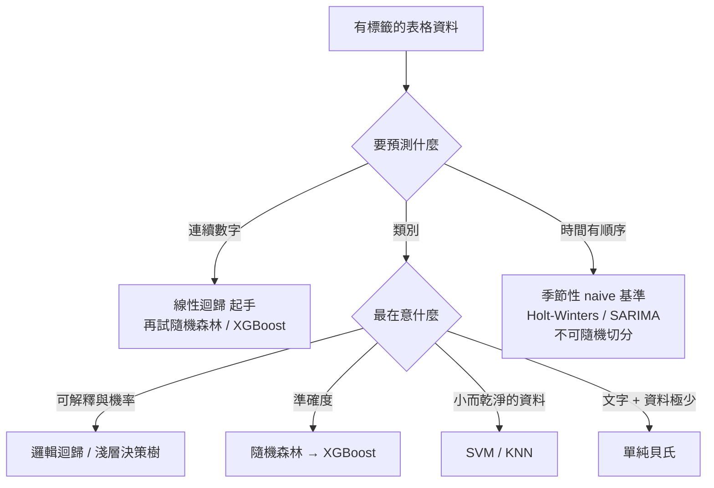
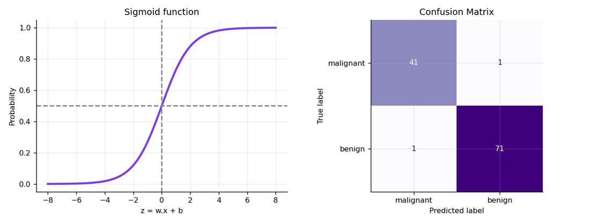
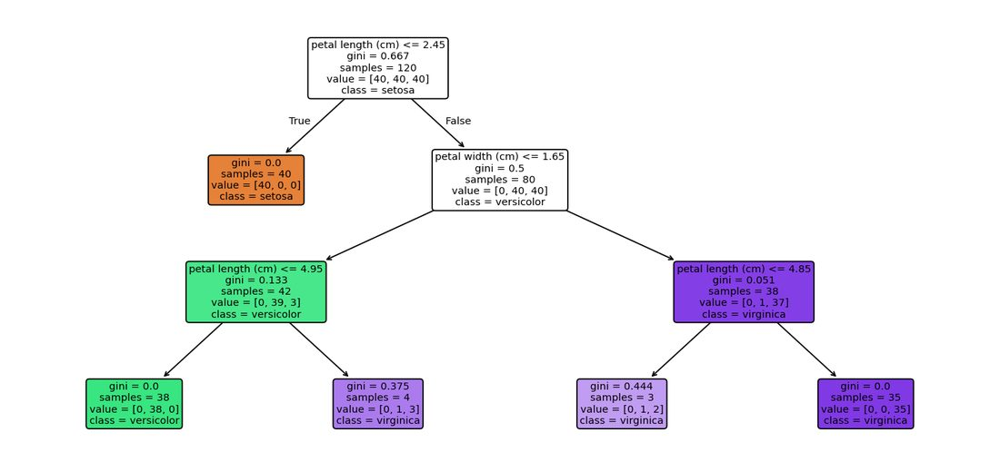
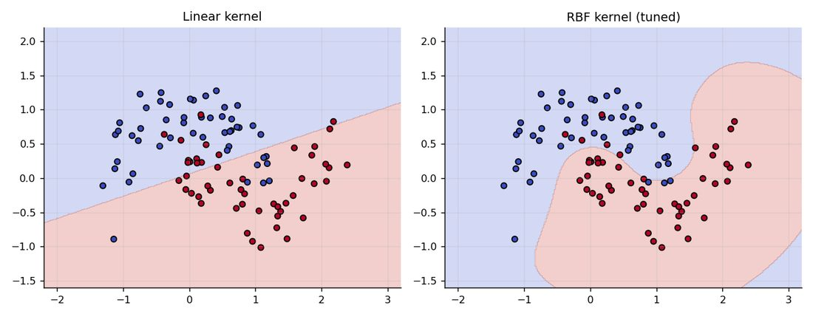
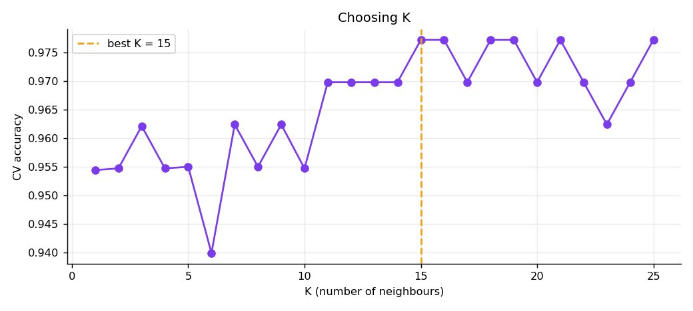
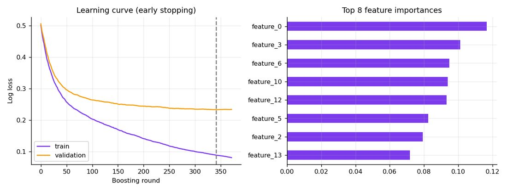
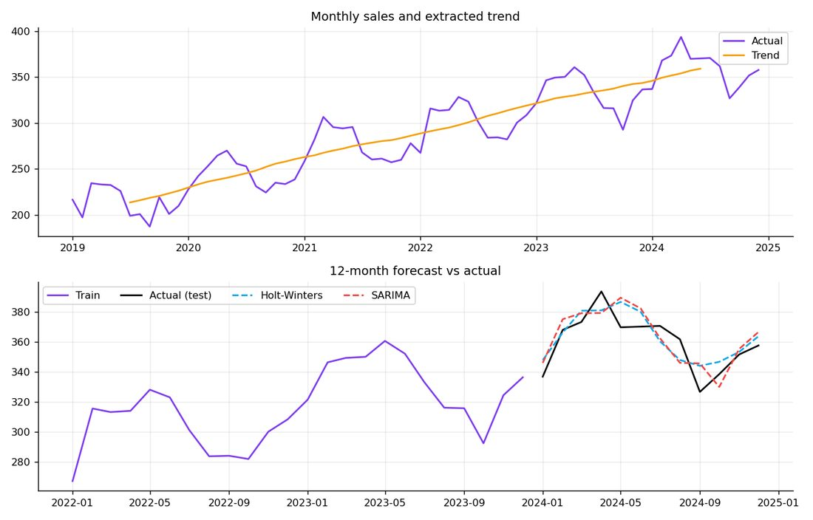

# 監督式機器學習演算法速查與實作指南:線性/邏輯迴歸、樹、森林、SVM、KNN、貝氏、XGBoost、時間序列(Anjana「AI & Tech」)

**主題分類:** 科技 / 機器學習 — 監督式學習演算法
**整理日期:** 2026-11-08
**來源:** 使用者提供的本機素材批次 `new/ai-guide/`(2026-11-07 收件),檔案:`ML_Algorithms_Beginner_to_Advanced.pdf`(35 頁長版)、`8 Supervised Machine Learning Algorithms.pdf`(11 頁輪播摘要卡,無文字層,逐頁看圖轉寫)

> ⚠️ **作者自我宣傳揭露:** 這批 PDF 是社群引流型素材。作者 Anjana(Instagram/頻道 @aiwithanju)在每頁帶浮水印與帳號,長版結尾要讀者追蹤;輪播短版是典型「Comment AI to get full PDF」式引流卡片(長版即是其「完整版」)。本篇只整理教學內容,不轉述任何導購。
> ⚠️ 第三方著作:以下為整理者自己的結構化重述與驗算,圖表取自原稿的程式輸出圖(非整頁投影片)。長版的數字都是作者在自己機器上跑出的結果(Python 3.12.3、scikit-learn 1.8.0、XGBoost 3.4.1),不同版本會有小差異。

---

## TL;DR

- 長版把 **10 個演算法**(線性迴歸、邏輯迴歸、決策樹、隨機森林、SVM、KNN、單純貝氏、XGBoost、K-Means、時間序列)用同一個模板講:**是什麼 → 真實例子 → 原理與公式 → 步驟 → 可跑程式 → 實際輸出 → 讀圖 → 超參數 → 優缺點**。K-Means 屬非監督,歸 [[unsupervised-ml-algorithms-guide]]。
- 短版輪播的 **8 個演算法**:線性迴歸、邏輯迴歸、KNN、SVM、決策樹、隨機森林、Boosting、神經網路,每張卡只有「圖 + 一條公式 + 一個產業例子」,適合當速查。
- 全篇反覆強調的紀律:**先做基準模型、先切分再前處理(用 Pipeline)、不要只看準確率、用交叉驗證、距離類模型一定要縮放**。這些紀律的深入版見 [[model-evaluation-techniques-guide]]。
- 查證結果:公式與超參數絕大多數正確;幾個**簡化或過時**處見文末(隨機森林其實是機率平均、SVM 的「無機率輸出」說法過粗、決策樹「能處理類別資料」在 scikit-learn 不成立、K-Means 的 `n_init` 預設已變)。

---

## 1. 地圖:哪個演算法什麼時候用

長版結尾的總表(整理者重排並補上查證後的備註):

| 演算法 | 任務 | 適合 | 要縮放? | 可解釋性 |
|---|---|---|---|---|
| 線性迴歸 | 迴歸 | 關係大致線性、當基準 | 正則化時要 | 很高 |
| 邏輯迴歸 | 分類 | 可解釋的二元基準、要機率 | 要 | 高 |
| 決策樹 | 兩者 | 要對外解釋的規則 | 不用 | 很高 |
| 隨機森林 | 兩者 | 少調參的強通用模型 | 不用 | 中 |
| SVM | 兩者 | 中小資料、邊界清楚、核技巧 | 要 | 低 |
| KNN | 兩者 | 小資料、相似度問題 | 要 | 中 |
| 單純貝氏 | 分類 | 文字、極少資料、快速基準 | 不用 | 高 |
| XGBoost | 兩者 | 表格資料追求最高準確度 | 不用 | 低到中 |
| 時間序列模型 | 預測 | 有趨勢/季節性的有序資料 | 視模型 | 中到高 |

---

## 2. 逐個演算法(長版重點 + 輸出 + 速查卡)

### 2.1 線性迴歸(Linear Regression)

- **概念:** 目標 = 特徵的加權和 + 誤差,用**普通最小平方法(OLS)**最小化殘差平方和。`y = b0 + b1·x1 + … + error`,`Loss = Σ(實際 − 預測)²`。scikit-learn 直接用線性代數解,沒有迭代調參。
- **作者的實驗:** 模擬 200 筆房價(面積、房數),真實係數 0.12 與 15,學到 0.118 與 15.36,測試集 **R² = 0.923、RMSE = 22.86**(接近所加雜訊 25,代表訊號都學到了)。
- **進階:** 假設線性、誤差獨立、等變異、殘差近常態、特徵間共線性不強;**Ridge(L2)**縮小係數、**Lasso(L1)**可把係數壓到 0(自動選特徵)、**ElasticNet** 混合;多項式特徵能擬合曲線(仍對係數線性)。
- **短版卡:** 用「廣告花費 → 銷售」散點加最佳擬合線,工作流程 5 步:收集 → 切分(70–80% / 20–30%)→ 訓練 → 預測 → 用 MAE / MSE / R² 評估;另一張以房價公式 `y = mx + b` 帶入面積 1,500 得 150,050。(卡片上圖軸單位寫「千美元」,算出的 150,050 單位又寫「美元」,單位交代不一致,僅供示意。)

**應用案例:** 超商要預估新店月營收:用商圈人口、店面坪數、競爭店數做線性迴歸,先得到「每多 1 坪平均多多少營收」的可解釋基準;之後換隨機森林,若提升不大就不必犧牲可解釋性。

### 2.2 邏輯迴歸(Logistic Regression)

- **概念:** 雖叫迴歸卻是**分類**。先算 `z = b0 + b1x1 + …`,再過 sigmoid `P(y=1)=1/(1+e^(−z))` 壓進 0–1;用 **log loss(交叉熵)**訓練;決策邊界是直線/超平面;scikit-learn **預設 L2 正則化**,所以要先標準化。
- **作者的實驗(乳癌資料):** `StandardScaler + LogisticRegression` 放進 Pipeline;**ROC-AUC 0.9954、準確率約 98%**,114 位測試者約錯 2 位。
- **作者的判讀要點:** 醫療情境漏掉惡性腫瘤(FN)比誤報貴很多,所以通常**調低門檻**拉高召回率;類別不平衡時用 `class_weight='balanced'` 並看 PR 曲線而非準確率;`exp(係數)` 是勝算比(odds ratio)。

*圖:`ML_Algorithms_Beginner_to_Advanced.pdf` p.8。左:sigmoid 在 z=0 時恰為 0.5;右:114 位測試者的混淆矩陣(惡性 41 對 1 錯、良性 71 對 1 錯,合計 2 個錯誤)。*

- **短版卡:** 兩張(p3、p6)——sigmoid 與決策邊界、以「客戶流失」為例(`−2.5 + 0.8x` 代入得 P(churn)=0.76 ≥ 0.5 判為高風險),以及 4 步流程(輸入 → 最大概似訓練 → sigmoid 預測 → 用 accuracy/precision/recall/F1 評估)。兩張內容重疊,已合併。

**應用案例:** 電信客服要找「下個月可能解約」的客戶:用邏輯迴歸輸出機率,客服只打機率最高的前 10%;若漏掉流失客戶的代價遠高於多打一通電話,就把門檻從 0.5 降到 0.3(見評估篇的門檻與成本章節)。

### 2.3 決策樹(Decision Tree)

- **概念:** 一連串是非題;每個節點試遍所有特徵與切分點,選讓子節點**最純**的切法,以 **Gini = 1 − Σpᵢ²**(或熵 `−Σpᵢ log₂ pᵢ`)衡量;資訊增益 = 父不純度 − 加權子不純度。預測時從根走到葉:分類取多數類、迴歸取平均。
- **作者的實驗(Iris):** `max_depth=3` 訓練 0.983、測試 0.967;深度對照:1 層 0.667/0.667(欠擬合)、2 層 0.967/0.933、3 層 0.983/0.967、5 層與不限深度訓練 1.000 但測試 0.933(過擬合)。測試集只有 30 筆,錯一個就差 3.3 個百分點。
- **進階:** 以 `ccp_alpha` 做**成本複雜度剪枝**;樹**不穩定**(資料小改動整棵樹就變),所以才有集成;不需縮放,但邊界與座標軸平行,斜線邊界要很多次切分。

*圖:`ML_Algorithms_Beginner_to_Advanced.pdf` p.11。根節點 `petal length ≤ 2.45` 一刀就把 40 朵 setosa 完全分出(gini=0);每個框顯示 gini、樣本數、各類計數、多數類。*

- **短版卡(p8):** 「信用卡貸款違約風險」決策樹——收入 > 5 萬?→ 信用分數 > 700?/就業穩定?→ 核准/拒絕/人工覆核,附資訊增益公式 `IG(S,A)=H(S) − Σ(|Sv|/|S|)·H(Sv)`。

**應用案例:** 銀行要向主管與稽核說明「為何拒絕這筆貸款」:用深度 3–4 的決策樹輸出規則文字(`export_text`),每條規則都能追溯,比黑箱更容易過合規。

### 2.4 隨機森林(Random Forest)

- **概念:** 很多棵樹各自預測再合併。兩層隨機:**bagging**(每棵樹用 bootstrap 抽樣,約 63% 不重複樣本)+ **每次切分只考慮隨機特徵子集**(分類預設取總數平方根)。沒被抽到的約 37% 是 **OOB(out-of-bag)樣本**,可當免費驗證。
- **作者的實驗(乳癌):** 單棵樹測試 0.9123、200 棵森林 0.9561;OOB 0.9604;5 折 CV 平均 0.9578(範圍 0.921–0.982),三個估計互相吻合,代表不是切分運氣好。重要特徵是 worst perimeter、worst area、worst concave points。
- **作者的提醒(值得記):** 不純度重要性(impurity-based importance)偏愛連續特徵、會在相關特徵間分攤,要可靠排序請用**置換重要性(permutation importance)**或 SHAP;迴歸型森林**無法外推**超出訓練目標範圍。
- **短版卡(p9):** 流程圖「訓練資料 → 多棵樹各自預測(詐欺/正常)→ 多數決/平均 → 最終預測」,例子是金融詐欺偵測。

**應用案例:** 支付公司用交易金額、地點、時間、裝置做詐欺偵測:隨機森林幾乎不需調參就能達到不錯的基準,並用置換重要性向風控團隊說明「哪些欄位最關鍵」。

### 2.5 支援向量機(SVM)

- **概念:** 找**間隔(margin)最大**的超平面,只有最靠近邊界的**支援向量**決定模型。軟間隔以 **C** 控制取捨(C 大:窄間隔、易過擬合;C 小:寬間隔、較平滑);**核技巧**讓資料像被映射到高維而不必真的計算;RBF 核 `K(x,x')=exp(−γ‖x−x'‖²)`,**gamma** 大則邊界彎彎曲曲、影響範圍短。對尺度敏感,**一定要縮放**。
- **作者的實驗(two-moons):** 線性核 0.80、RBF 0.91、`GridSearchCV` 調出 C=1、gamma=1 → 測試 0.92(CV 0.937);300 個訓練點只有 83 個(41+42)成為支援向量。

*圖:`ML_Algorithms_Beginner_to_Advanced.pdf` p.17。左:直線切不開兩個彎月;右:調參後的 RBF 核畫出曲線邊界。*

- **短版卡(p5):** 標出決策邊界、間隔、兩類支援向量,公式 `f(x)=sign(wᵀx+b)`,例子為健康/癌細胞分離。

**應用案例:** 一家小實驗室只有幾百筆蛋白質表現資料、特徵幾十維:SVM(RBF)+ 交叉驗證調 C 與 gamma,通常在小而乾淨資料上很有競爭力;若資料變成百萬筆就改用 `LinearSVC` 或 SGD。

### 2.6 K 近鄰(KNN)

- **概念:** 「看鄰居就知道你是誰」。**惰性學習**(無訓練階段、只存資料)。新點找最近 K 個訓練點:分類多數決、迴歸取平均;K 小易過擬合雜訊、K 大邊界平滑但可能欠擬合;**必須縮放**;高維度距離失去意義(維度詛咒)。
- **作者的實驗(Wine):** CV 選出 **K=15(CV 0.977)**;**縮放後測試 1.000、不縮放僅 0.778**(proline 數值大,主宰距離)。作者自己提醒:測試集僅 45 筆,1.000 不要當真,CV 的 0.977 才是比較誠實的估計。

*圖:`ML_Algorithms_Beginner_to_Advanced.pdf` p.20。K 小時準確率抖動大(K=6 掉到約 0.94),K≥11 後穩定在 0.97 以上,虛線標最佳 K=15。*

- **短版卡:** 兩張(p4、p7)——內圈 k=3/外圈 k=5 的鄰居圈圖、歐氏距離公式、「電影推薦」(找相似用戶 A/B/C,相似度 0.92/0.87/0.80);p7 另列 5 步流程與「雙類別取奇數 K 避免平手」。已合併。
- **進階:** KD-tree / Ball-tree 加速;大規模用 FAISS、Annoy 做近似最近鄰;`weights='distance'` 讓近的鄰居權重大;高維先降維。

**應用案例:** 串流平台冷啟動:新用戶只看了 3 部片,用 KNN 找口味最像的幾位老用戶,推薦他們看過的片;資料量大了就換成近似最近鄰索引。

### 2.7 單純貝氏(Naïve Bayes)

- **概念:** 基於貝氏定理,「**單純**」在於假設給定類別後各特徵彼此獨立(很少成立,卻常有效,尤其文字)。學 **先驗**與 **各詞在各類別的概似**,預測時把先驗乘上各詞概似(實務上加對數避免數值過小)取後驗最大者;**拉普拉斯平滑**(alpha=1)避免沒見過的詞讓機率變 0。變體:`MultinomialNB`(詞頻)、`GaussianNB`(連續)、`BernoulliNB`(是否出現)、`ComplementNB`(不平衡文字)。
- **作者的實驗:** 只有 30 封訓練訊息的玩具垃圾郵件資料,測試準確率 0.778(9 封錯 2 封,都是漏掉的垃圾信)。三個新句:「free cash prize waiting for you」垃圾機率 0.854、「claim your free gift now」0.986、「can we meet for lunch tomorrow」0.030。作者明講真實使用要用數千封(如 SMS Spam Collection)。
- **進階:** 機率**過度自信**,需要時用 `CalibratedClassifierCV` 校準;TF-IDF 與 n-gram 常更好;`partial_fit` 可串流學習。

**應用案例:** 公司內部客服信箱要先做一個「是否為廣告信」的 24 小時內可上線的基準:TF-IDF + `MultinomialNB` 幾分鐘訓練完,先擋掉八成,再逐步換更強的模型。

### 2.8 梯度提升 / XGBoost(Boosting)

- **概念:** 樹**依序**建立,每棵新樹去修正前面模型的錯誤:`F_m(x) = F_{m−1}(x) + learning_rate · h_m(x)`,`h_m` 擬合前一輪損失的**梯度**。XGBoost 在此之上加了二階導數、葉權重的 L1/L2 正則、行/列抽樣、原生缺失值處理、平行切分搜尋;**early stopping** 看驗證集,不再進步就停。與隨機森林對比:森林是獨立、深的樹並行,提升是淺樹依序。
- **作者的實驗(模擬流失,4,000 客戶、流失率 21%):** early stopping 在 500 棵上限中停在 **341 棵**;測試 **ROC-AUC 0.9386、準確率 0.9225**。作者提醒:流失率 21% 時「永遠預測不流失」就有約 79% 準確率,所以應看 AUC/precision/recall。

*圖:`ML_Algorithms_Beginner_to_Advanced.pdf` p.26。左:訓練損失一路下降、驗證損失在約 340 輪後走平,虛線為早停點,兩線的間距擴大就是過擬合;右:前 8 名特徵重要性(模擬資料,特徵名匿名)。*

- **關鍵超參數:** `learning_rate`(小一點配多棵樹)、`max_depth`(3–8)、`subsample`/`colsample_bytree`(0.6–1.0)、`reg_lambda`/`reg_alpha`、`scale_pos_weight`(不平衡)。LightGBM、CatBoost 是同類替代。
- **短版卡(p10,標題「Boosting」):** 「弱學習器 1 → 2 → 3,聚焦誤分類樣本、提高難樣本權重」,公式 `F(x)=Σ α_m h_m(x)`,例子為 Uber ETA 預測。**整理者備註:**「提高難樣本權重」是 AdaBoost 的機制;XGBoost/梯度提升是擬合殘差(梯度)而非調樣本權重,卡片把兩者混為一談,長版的敘述才是 XGBoost 的正確描述。

**應用案例:** 電商要預測「這位會員 30 天內會不會流失」:先用邏輯迴歸做可解釋基準,再用 XGBoost 並以 PR-AUC 比較;上線前用驗證集早停,避免靠訓練分數自我感覺良好。

### 2.9 時間序列預測(Time Series Forecasting)

- **概念:** 資料有時間順序、相鄰點相關,所以**不能隨機切分**。序列拆成趨勢 + 季節性 + 殘差。經典模型:**季節性 naive**(重複去年)、**Holt-Winters**(指數平滑)、**ARIMA(p,d,q)**(自迴歸 + 差分使平穩 + 移動平均)、**SARIMA** 加季節項 `(P,D,Q,m)`;ML 類有 XGBoost(lag 特徵)、LSTM、Prophet。黃金守則:**永遠不要 shuffle,拿最近一段當測試**。
- **作者的實驗(6 年月銷售,預測最後 12 個月):** 季節性 naive MAE 26.62(MAPE 7.37%)、Holt-Winters MAE 9.76(2.73%)、SARIMA(1,1,1)(0,1,1,12) MAE 11.01(3.07%)。作者坦承 Holt-Winters 贏是因為**資料本來就是加性趨勢 + 季節性**,沒有任何模型到處最強,務必對照基準;預測也要附**預測區間**。

*圖:`ML_Algorithms_Beginner_to_Advanced.pdf` p.32。上:月銷售與抽出的趨勢線;下:Holt-Winters(藍虛線)與 SARIMA(紅虛線)對最後 12 個月實際值(黑線)的預測。*

- **診斷:** ADF 檢定看平穩性、ACF/PACF 選 p、q;驗證用 `TimeSeriesSplit` 或滾動起點;不要把未來資訊當特徵。

**應用案例:** 零售商要規劃下季庫存:先用「去年同月」當基準(季節性 naive),再看 Holt-Winters 是否明顯更好;若連基準都贏不了就不值得上線複雜模型。

### 2.10 神經網路(只出現在短版卡 p11)

輸入層 → 多個隱藏層 → 輸出層,每個神經元算 `y = σ(w·x + b)`(σ 為 ReLU、Sigmoid 等激活函數),例子是 Face ID 解鎖(擷取臉 → 特徵向量 → 與模板比對 → 解鎖)。長版沒有對應章節;原理延伸請見 [[pytorch-from-zero-transformer-series]]。

---

## 3. 最佳實踐清單(長版結尾,整理者逐條補查證)

1. **先切分、再前處理**:縮放器、編碼器、特徵選擇只在訓練集 `fit`,用 Pipeline 自動做到(避免資料洩漏)。
2. **用對指標**:不平衡資料別只看準確率;迴歸用 RMSE/MAE/R²。
3. **交叉驗證**取代一次運氣好的切分(小資料尤其)。
4. **看訓練/測試落差**:大落差就是過擬合警訊;解法是簡化模型、正則化、更多資料、早停。
5. **只調 2–3 個最重要的超參數**(`GridSearchCV`/`RandomizedSearchCV`),設 `random_state`、記錄版本、用 `joblib` 存 Pipeline。

---

## 4. 延伸閱讀與深度補充(已查證 scikit-learn 1.9.1 官方文件)

查證時官方文件顯示的最新版是 **scikit-learn 1.9.1**(PDF 用 1.8.0),PyPI 上 XGBoost 最新為 **3.4.1**(與 PDF 一致)。

| 項目 | 結論 | 說明 |
|---|---|---|
| 隨機森林「多數決」 | **需修正(簡化)** | 官方 `RandomForestClassifier` 文件寫:預測類別是「各樹以機率估計加權的投票」,即**各樹機率的平均中最高者**;`predict_proba` 為各樹機率平均。迴歸才是平均。長版與短版的「majority vote」只是直覺說法。 |
| 隨機森林預設值 | 已核實 | `n_estimators=100`、`max_features="sqrt"`、`bootstrap=True`、`oob_score=False`(OOB 要自己開,且需 bootstrap=True)。長版範例明確設 `oob_score=True`。 |
| 不純度重要性偏誤 | 部分核實 | 該 API 頁面沒寫偏誤,只連結到「Permutation Importance vs Random Forest Feature Importance (MDI)」範例;作者「改用置換重要性」的建議方向合理,但偏誤說法在這頁未直接證實。 |
| SVM「無直接機率輸出」 | **需修正(過粗)** | 官方文件:SVM 本身不直接給機率,但 `probability=True` 時以 **Platt scaling + 額外 5 折交叉驗證**得到 `predict_proba`;該過程對大資料很貴,且機率可能與 `predict` 不一致(某樣本可被 predict 判為正類但 `predict_proba` 小於 0.5);若只需要信心分數,官方建議用 `decision_function`。 |
| SVM 縮放、one-vs-one、可擴展性 | 已核實 | 官方:「強烈建議縮放」;`SVC` 內部用 one-vs-one;libsvm 的訓練時間約在 `n_features × n_samples²` 到 `n_samples³` 之間(長版寫「增長很快」,略保守);線性情況用 `LinearSVC`(liblinear)可近線性擴展,大規模線性分類也建議 `SGDClassifier`。 |
| 決策樹「處理類別型資料」 | **需修正** | 官方文件明寫 scikit-learn 實作「**目前不支援類別變數**」(要先 one-hot/ordinal 編碼);另有內建**缺失值**支援(`splitter='best'`)。長版優點欄寫「Handles numeric and categorical-style data」容易誤導。 |
| 決策樹缺點 | 已核實 | 官方列了過擬合、不穩定、分段常數不擅外推、貪婪演算法無全域最佳保證、類別失衡會偏;與長版一致。Gini `Σ p(1−p)`(等於 `1−Σp²`)與熵公式、`ccp_alpha` 剪枝亦吻合。 |
| K-Means `n_init` | **需修正(版本變動)** | 官方:自 1.4 起預設 `n_init='auto'`,搭配預設 `k-means++` 只跑 **1 次**(`random` 初始化才是 10 次)。長版程式碼明確寫 `n_init=10`,所以結果可重現,但「預設會重啟十次」的印象是舊版。 |
| 交叉驗證分層 | 已核實 | `cross_val_score` 的 `cv=整數` 對分類器(`ClassifierMixin`)預設用 `StratifiedKFold`。 |
| Pipeline 防洩漏 | 已核實 | 官方交叉驗證文件:前處理應「從訓練集學得再套到保留資料」,用 Pipeline 可在 CV 內自動做到。 |
| 梯度提升的 scikit-learn 替代 | 補充 | `HistGradientBoostingClassifier`(受 LightGBM 啟發的直方圖提升)原生支援缺失值與類別特徵(`categorical_features='from_dtype'`),樣本數 > 10,000 預設啟用早停。 |
| XGBoost 參數細節(`early_stopping_rounds` 放建構子或 fit、`scale_pos_weight` 預設等) | **未能核實** | 官方 sklearn API 頁面在本次抓取中只讀到範例把 `early_stopping_rounds` 傳給 `XGBClassifier(...)` 建構子,未取得參數表,故不下結論;長版範例寫法請以自己安裝的 XGBoost 版本實測。 |
| 時間序列模型(Holt-Winters / SARIMA / ADF)細節 | **未能核實** | 本次沒有去讀 statsmodels 官方文件逐項對照,僅整理長版敘述;MAE/MAPE 數字為作者在合成資料上的結果,不可直接推論真實資料。 |

**PDF 內部不一致與值得注意處:**
- 短版輪播有**重複卡**(線性迴歸 p1/p2、邏輯迴歸 p3/p6、KNN p4/p7)與少量版面口誤(如單位),已合併;卡片圖像為 AI 風格示意圖,不是實測資料。
- 長版與短版都只是**入門級**示範:資料多為 scikit-learn 內建小資料集或程式自己生成,測試集只有幾十筆,數字(如 KNN 1.000)不代表實戰表現。

---

## 5. 一頁決策 + 避雷

- 想不到用什麼?**縮放 → 基準(線性/邏輯)→ 隨機森林 → XGBoost,用同一組交叉驗證比。**
- 距離/邊界類(SVM、KNN、邏輯、帶正則的線性)一律縮放;樹類不需要。
- 模型輸出機率又要用機率做決策時,記得**校準**(貝氏與 SVM 特別需要);詳見 [[model-evaluation-techniques-guide]]。
- 表格資料的另一條新路線(預訓練表格基礎模型)可參考 [[limix-tabular-foundation-model]]。

---

## 來源

- 使用者提供的本機素材批次 `new/ai-guide/`(2026-11-07 收件),檔案:`ML_Algorithms_Beginner_to_Advanced.pdf`、`8 Supervised Machine Learning Algorithms.pdf`
- scikit-learn RandomForestClassifier:https://scikit-learn.org/stable/modules/generated/sklearn.ensemble.RandomForestClassifier.html
- scikit-learn SVM 使用者指南:https://scikit-learn.org/stable/modules/svm.html
- scikit-learn 決策樹使用者指南:https://scikit-learn.org/stable/modules/tree.html
- scikit-learn KMeans:https://scikit-learn.org/stable/modules/generated/sklearn.cluster.KMeans.html
- scikit-learn 交叉驗證使用者指南:https://scikit-learn.org/stable/modules/cross_validation.html
- scikit-learn HistGradientBoostingClassifier:https://scikit-learn.org/stable/modules/generated/sklearn.ensemble.HistGradientBoostingClassifier.html
- XGBoost PyPI:https://pypi.org/pypi/xgboost/json
- XGBoost scikit-learn 介面:https://xgboost.readthedocs.io/en/stable/python/sklearn_estimator.html
