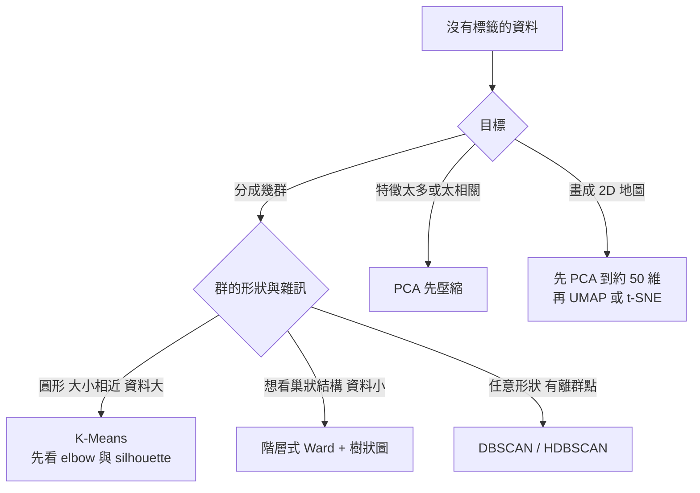
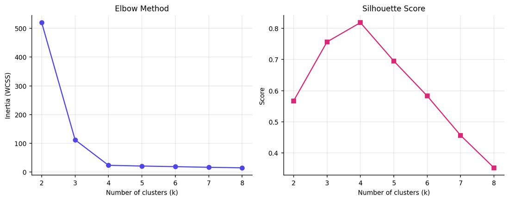
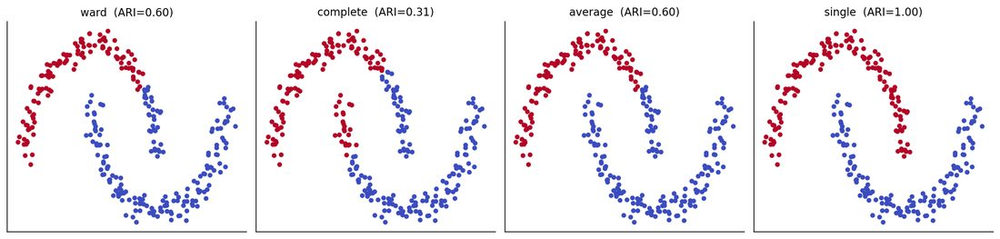
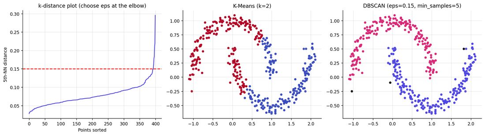
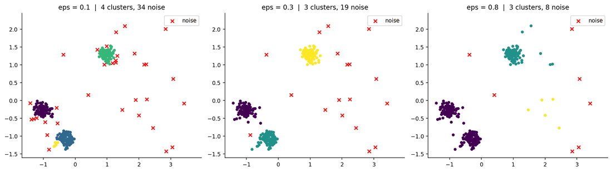
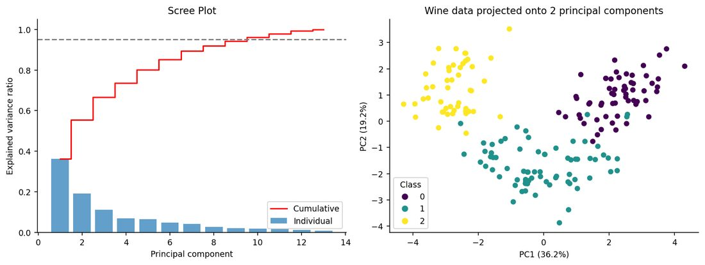
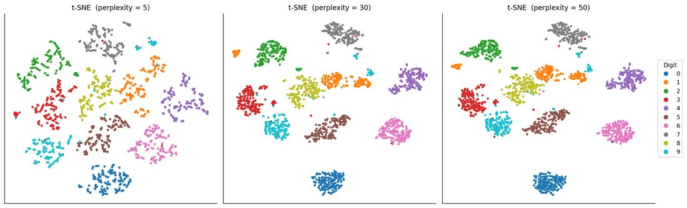
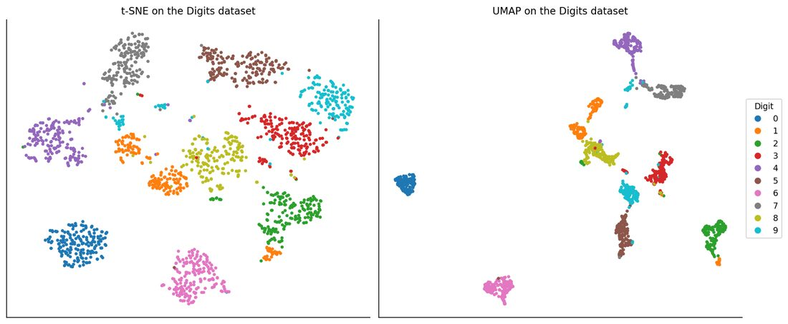

# 非監督式機器學習演算法完整指南:K-Means、階層式、DBSCAN、PCA、t-SNE/UMAP 與聚類評估(Anjana「AI & Tech」)

**主題分類:** 科技 / 機器學習 — 非監督式學習(分群與降維)
**整理日期:** 2026-11-08
**來源:** 使用者提供的本機素材批次 `new/ai-guide/`(2026-11-07 收件),檔案:`Unsupervised_ML_Algorithms_Complete_Guide.pdf`(37 頁長版)、`5 Unsupervised Machine Learning Algorithms.pdf`(5 頁輪播摘要卡,無文字層,逐頁看圖轉寫)

> ⚠️ **作者自我宣傳揭露:** 這批 PDF 是社群引流型素材。作者 Anjana(@aiwithanju)在每頁帶浮水印,長版末頁邀請追蹤其 Instagram;5 張輪播卡是引流用的摘要(長版即為其完整版)。本篇只整理教學內容,不轉述導購。
> ⚠️ 第三方著作:以下為整理者的重述與驗算;圖取自原稿程式輸出圖。長版的數字是作者機器上的結果,資料都是合成或 scikit-learn 內建小資料集。

---

## TL;DR

- 非監督式學習**沒有標籤**,只從特徵找結構:**分群**(K-Means、階層式、DBSCAN)、**降維**(PCA、t-SNE、UMAP)、(異常偵測是 DBSCAN 的副產品)。
- 標準流程:清資料 → **標準化**(幾乎都是距離/變異數導向)→ 依資料形狀選演算法 → 用診斷而非猜測調參 → 內部指標 + 外部標籤(若有)+ **領域判斷**評估。
- 最值得記的三個教訓(作者實驗皆有數字佐證):
  1. K-Means 在彎月形資料上 ARI 只有 0.238,DBSCAN 有 0.985。
  2. DBSCAN 的 `eps` 敏感:0.1 太嚴(34 個雜訊)、0.3 剛好(抓到約 20 個注入離群點)、0.8 太鬆(離群點被吞)。
  3. **內部指標會騙人**:DBSCAN 的輪廓係數 0.738 最高,ARI 卻最差 0.571。
- 延伸查證:輪廓係數「>0.5 代表清楚結構」等經驗門檻、t-SNE 的 KL 散度比較、UMAP 能 `transform` 新資料等,以官方文件核實,見第 7 節。

---

## 1. 監督 vs 非監督,與標準流程

| | 監督式 | 非監督式 |
|---|---|---|
| 訓練資料 | 特徵 + 標籤 | 只有特徵 |
| 目標 | 預測已知目標 | 發現隱藏結構 |
| 典型任務 | 分類、迴歸 | 分群、降維、異常偵測 |
| 評估 | 準確率、RMSE、F1(對照真值) | 輪廓係數、解釋變異、領域判斷 |

長版舉的例子:零售商有 200 萬顧客沒有分群標籤——K-Means 依消費行為分群、PCA 把 40 個行為特徵壓成 8 個、UMAP 畫成 2D 地圖給行銷團隊探索。

學習路徑:入門(K-Means、elbow/silhouette、PCA 與 scree plot)→ 中階(階層式 linkage、DBSCAN 與雜訊、PCA 數學、PCA + 分群流程)→ 進階(K-Means 手刻、參數敏感度、t-SNE 困惑度、UMAP 與 trustworthiness、評估陷阱)。

---

## 2. K-Means(長版第 1 章,輪播 p1)

**原理(Lloyd 演算法):** ① 選 K ② 初始化 K 個質心(隨機或 **k-means++** 讓初始點散開)③ 每點分給最近質心(歐氏距離)④ 質心移到所屬點的平均 ⑤ 重複 ③④ 直到指派不再變。目標是最小化 **inertia(WCSS)**:`J = Σ_j Σ_{x∈cluster j} ‖x − μ_j‖²`。

**選 K:** *Elbow*(inertia 對 K 作圖,找彎折處;inertia 隨 K 增加必然下降)與 *Silhouette*(−1 到 1,越高越好)。

**作者實驗 1(500 點、4 群合成資料,標準化後試 K=2–8):** inertia 由 520.12 → 112.08 → 23.47(K=4)後幾乎不降(K=5 為 20.88);輪廓係數在 K=4 達 **0.819** 最高,兩種診斷一致選 4。

*圖:`Unsupervised_ML_Algorithms_Complete_Guide.pdf` p.7。左:inertia 在 K=4 急彎後走平;右:輪廓係數在 K=4 峰值 0.819。*

**作者實驗 2(手刻 vs scikit-learn):** 隨機初始化重跑 10 次,8 次達最佳 inertia 23.5,但 2 次卡在約 109.5(局部最小);最佳手刻結果 = scikit-learn 的 23.47。教訓:單次隨機起點有風險,要多次重啟(`n_init`)與 k-means++。

**作者實驗 3(Iris 不看標籤分 3 群):** 輪廓係數 0.46、**ARI 0.62**;setosa 50 朵完全分開,versicolor 與 virginica 重疊(11 與 14 朵被分到「別的群」)。

**常見錯誤:** 忘記縮放(薪水以千計會壓過年齡)、只憑直覺選 K、用在非球形群、只報告單次隨機初始化。**進階:** `MiniBatchKMeans` 處理超大資料;K-Means 是高斯混合模型(GMM)的硬指派特例。

**輪播卡 p1:** 4 步流程圖(選 K → 指派 → 更新質心 → 重複)+ `J = ΣΣ‖x−μᵢ‖²` + 「Amazon 顧客分群」(橫軸年消費、縱軸購買頻率,分成 預算型/一般型/VIP 三群)——卡片為示意圖。

**應用案例:** 會員制電商用「近 90 天消費額、購買次數、最近一次購買距今天數」做 K-Means(先標準化),找出 4 群後逐群看平均特徵並命名(如「沉睡高價值」),再對每群設計不同優惠。

---

## 3. 階層式分群(長版第 2 章,輪播 p2)

- **凝聚式(agglomerative, 由下而上)**:每點各成一群 → 反覆合併最近兩群 → 記錄每次合併與距離 = **樹狀圖(dendrogram)** → 在某高度「切」得到平面分群。**分裂式(top-down)**很少用。scikit-learn 與 SciPy 實作的是凝聚式。
- 優點:不必事先指定 K;結果確定性(同資料同樹);可選多種距離與 linkage。缺點:時間與記憶體約隨 n² 成長,數萬點就吃力;合併是貪婪且不可回頭;對 linkage、縮放、離群點敏感。

| Linkage | 群間距離 | 行為 |
|---|---|---|
| Single | 任兩點的最小距離 | 可沿鏈條抓細長形,但對雜訊敏感(chaining) |
| Complete | 任兩點的最大距離 | 緊實、大小相近的群 |
| Average | 所有點對平均距離 | 折衷 |
| Ward | 合併後總群內變異增加最小 | 最常用預設,類似 K-Means,**僅限歐氏距離** |

**怎麼讀樹狀圖:** 縱軸是合併時的距離;長長的垂直線代表那兩群合併前相距很遠,在長線下方切出的群最「自然」。

**作者實驗 1(40 點、3 中心):** 以 cophenetic correlation 比較 linkage:single 0.868、complete 0.857、average 0.874、ward 0.870(差不多),選 Ward;linkage 矩陣為 39×4(n−1 次合併);切 3 群得 13/8/19。

**作者實驗 2(兩個彎月,300 點,雜訊 0.06):** ARI —— ward 0.597、complete 0.311、average 0.597、**single 1.000**。

*圖:`Unsupervised_ML_Algorithms_Complete_Guide.pdf` p.14。同一份資料四種 linkage,只有 single 沿「鏈」正確還原兩個彎月;其餘把彎月切成緊實團塊。對圓形群,排名會顛倒。*

**輪播卡 p2:** 4 步(每點一群 → 計算距離矩陣 → 合併最近兩群 → 重複到剩一群)、歐氏距離公式、「基因表現分析」熱圖 + 樹狀圖(基因與樣本同時分群)。

**常見錯誤:** Ward 搭配非歐氏距離(不成立)、在超大資料上硬跑(記憶體爆)、把樹狀圖的切法當真相。

**應用案例:** 產品目錄有 300 個 SKU,要整理成可導覽的分類樹:用階層式分群(Ward)畫樹狀圖,依自然的長線位置切成 12 大類,並保留下層結構給子分類。

---

## 4. DBSCAN(長版第 3 章,輪播 p3)

**定義:** 群 = 被稀疏區隔開的**稠密區域**;能找任意形狀、不必指定 K、**明確標出雜訊**,適合異常偵測與地理資料。

| 概念 | 定義 |
|---|---|
| `eps`(ε) | 鄰域半徑 |
| `min_samples` | eps 內(含自己)至少要有幾點才算「稠密」 |
| 核心點 | eps 內點數 ≥ min_samples,是群的中心 |
| 邊界點 | 在核心點的 eps 內,但本身不稠密 |
| 雜訊點 | 兩者皆非,scikit-learn 標 `-1` |

**流程:** 挑未訪問點找 eps 內鄰居 → 達 min_samples 即核心點、開新群 → 鄰居若也是核心點就繼續擴張 → 邊界點加入但不再擴張 → 不可達者標雜訊 → 直到全部訪問。

**選參數:** `min_samples` 常用 2×特徵數(至少 3–5);`eps` 用 **k-distance plot**(每點到第 k 近鄰居距離排序,取急升的「膝點」)。

**作者實驗 1(彎月 400 點):** 5-NN 距離百分位 50/90/95/99 為 0.073/0.107/0.128/0.179,選 eps=0.15;DBSCAN 找到 2 群、3 個雜訊、393 個核心點,**ARI 0.985**;K-Means 只有 **0.238**。

*圖:`Unsupervised_ML_Algorithms_Complete_Guide.pdf` p.18。左:k-distance 曲線,紅線 eps=0.15 落在急升膝點;中:K-Means 用直線把彎月切歪;右:DBSCAN 還原兩個彎月,黑點為雜訊。*

**作者實驗 2(3 個緊密群 + 20 個隨機離群點,標準化後):**

| eps | 群數 | 雜訊點 | 解讀 |
|---|---|---|---|
| 0.1 | 4 | 34 | 太嚴:真群被拆、雜訊多 |
| 0.3 | 3 | 19 | 剛好:幾乎等於注入的 20 個離群點 |
| 0.8 | 3 | 8 | 太鬆:離群點被吞進群 |

*圖:`Unsupervised_ML_Algorithms_Complete_Guide.pdf` p.19。紅叉為雜訊;eps 太小過度碎裂,太大把離群點吸進群。*

**避雷:** DBSCAN 前一定要縮放(單一 eps 套所有維度);高維先 PCA;密度不均時改用 **HDBSCAN** 或 OPTICS;雜訊常是最有價值的輸出(異常)。

**輪播卡 p3:** 4 步(找鄰居 → 辨識核心點 → 擴張群 → 標雜訊)、`|N_ε(p)| ≥ minPts`、「城市交通熱區」(GPS 點分出 3 個高流量區 + 灰色雜訊)。

**應用案例:** 叫車平台把每筆上車 GPS 點用 haversine 距離跑 DBSCAN,得到「常態熱點」讓司機調度;落單的點則可能是 GPS 漂移,另行檢查。

---

## 5. PCA 主成分分析(長版第 4 章,輪播 p4)

**直覺:** 找一組新座標軸(主成分),第一軸沿資料最大變異方向,第二軸與第一軸垂直並涵蓋剩餘最大變異……只留前幾個就能壓縮資料。用途:加速與正則化模型、2D/3D 視覺化、去除相關特徵、去噪壓縮影像。

**步驟(教學版):** ① 標準化 ② 共變異數矩陣 `C = XᵀX/(n−1)` ③ 特徵分解 `C v = λ v`(特徵向量=主方向,特徵值=該方向變異)④ 依特徵值排序 ⑤ 以 scree plot 或累積解釋變異(如 95%)選個數 ⑥ 投影 `Z = X·W`。解釋變異比 `λᵢ/Σλ`。

**作者實驗(Wine,178 筆 × 13 特徵):** NumPy 手刻與 `PCA` 結果相同(只差符號,符號本就任意);前兩成分解釋 **36.2% 與 19.2%**;累積 0.362/0.554/0.665/0.736/0.802/0.851;保留 95% 需 **10 個成分**;PC1 主要由 flavanoids(0.423)、total phenols、OD280/OD315 等酚類量測貢獻。

*圖:`Unsupervised_ML_Algorithms_Complete_Guide.pdf` p.24。左:各成分與累積解釋變異,虛線為 95%;右:僅用 PC1、PC2(55%)就把三個葡萄品種大致分開。*

**影像重建(Digits,64 維):** 5/10/20/40 個成分分別保留 54.5%/73.8%/89.4%/98.8% 變異,重建 MSE 3.570/2.227/1.026/0.084。作者說 40 個成分「縮小約 36%」——(整理者驗算:40/64 = 62.5%,縮小約 37.5%,數字略有出入,無關緊要。)

**PCA + K-Means 管線(Wine):** 13 → 10 維後 ARI 都是 0.897(沒損失),輪廓係數(PCA 空間)0.299。

**進階備註:** 大資料用 `svd_solver='randomized'` 或 `IncrementalPCA`;非線性結構用 `KernelPCA`;稀疏文字矩陣用 `TruncatedSVD`(不置中)。

**常見錯誤:** 忘記標準化;把 PCA 套在訓練+測試合併資料上(資料洩漏,應只在訓練集 fit);未看載荷就把成分當原特徵解讀;對非線性資料硬用 PCA。

**輪播卡 p4:** 5 步流程(原始資料 → 標準化 → 共變異數 → 特徵分解 → 轉換)、`Z = X·P`(X 為 n×d、P 為 d×k)、影像壓縮例子(256×256 = 65,536 個值壓成 50×50 = 2,500)。**整理者備註:** 該卡的「像素縮小」是示意;PCA 保留的是 k 個成分分數(加上成分矩陣),不是把影像縮成較小的圖。

**應用案例:** 量化團隊有 60 個彼此高度相關的因子,先標準化後用 PCA 留累積解釋變異 90% 的成分再丟進迴歸,可降低共線性與過擬合;注意縮放器與 PCA 都只能用訓練期資料 fit。

---

## 6. t-SNE 與 UMAP(長版第 5 章,輪播 p5)

**為何需要:** PCA 是線性,展不開彎曲/扭曲的結構;t-SNE 與 UMAP 是非線性流形學習,把高維資料壓進 2D/3D,並讓原本相鄰的點仍相鄰。常用於神經網路嵌入向量、單細胞 RNA、詞向量的視覺化。

- **t-SNE:** 高維距離用以**困惑度(perplexity)**定寬度的高斯轉成「是鄰居」機率 → 在 2D 以重尾的 Student-t 分佈計算鄰居機率 → 梯度下降最小化兩組機率的 **KL 散度**。
- **UMAP:** 建加權 k 近鄰圖(`n_neighbors`)→ 視為模糊拓撲結構 → 初始化(譜嵌入)後最佳化使低維圖與原圖匹配,`min_dist` 控制點的緊密度。

| | t-SNE | UMAP |
|---|---|---|
| 主要設定 | perplexity(5–50)、學習率、迭代數 | n_neighbors(5–50)、min_dist(0–1)、metric |
| 大資料速度 | 慢(scikit-learn 為 Barnes-Hut 約 O(n log n)) | 通常快很多、較可擴展 |
| 全域結構 | 差:群間距離無意義 | 較好但仍是近似 |
| 新資料 | 無 transform | 支援 `transform()` |
| 用途 | 僅視覺化 | 視覺化與一般降維(如分群前) |

**作者實驗 1(Digits 1,797 筆 × 64 維,perplexity 5/30/50):** KL 散度 0.944/0.754/0.679,耗時 5.5/7.1/7.0 秒。perplexity 5 把某些類別碎成小島,30–50 得到分離緊實的數字群。作者特別提醒:**KL 值不能跨 perplexity 比較**,別用它選最佳 perplexity。

*圖:`Unsupervised_ML_Algorithms_Complete_Guide.pdf` p.28。顏色是真實數字標籤(t-SNE 訓練時沒看到);低 perplexity 較碎,中高 perplexity 較穩。*

**作者實驗 2(UMAP vs t-SNE,標準化後):** t-SNE 5.9 秒、trustworthiness 0.986;UMAP 12.4 秒(含 Numba 首次編譯)、0.977;`reducer.transform(Xs[:5])` 成功回傳 (5, 2)。作者說明這個小資料集上 UMAP 反而慢,速度優勢在數萬點以上才顯現。

*圖:`Unsupervised_ML_Algorithms_Complete_Guide.pdf` p.30。右側 UMAP 的島嶼更緊、島間空白更大;但這種「更乾淨」的視覺感受不等於更正確,兩者局部鄰居保留度(trustworthiness)其實相近。*

**避雷:** t-SNE 圖上的**群大小、群間距離、形狀都不可靠**,只能讀成「誰跟誰是鄰居」,要多跑幾個 perplexity 與隨機種子;不要把 t-SNE 座標當模型特徵(UMAP 較安全);寬資料先 PCA(約 50 維)再嵌入;在 UMAP 嵌入上跑 DBSCAN/HDBSCAN 時要記得嵌入中的密度部分是演算法製造的。

**輪播卡 p5:** 5 步(輸入 → 算相似度 → 降維 → 最佳化嵌入 → 2D/3D 視覺化)、t-SNE 的 `C = KL(P‖Q)` 與 UMAP 的加權損失、「單細胞 RNA」UMAP 圖(T 細胞/B 細胞/單核球/NK/樹突細胞五群)——示意圖,非真實資料。

**應用案例:** 團隊拿到 10 萬條客服文字的嵌入向量(768 維),先 PCA 到 50 維再 UMAP 到 2D 並依主題著色,用來快速發現「沒被分類標籤涵蓋的新問題群」;但分群決策仍回到原始高維空間做。

---

## 7. 選演算法與評估(長版第 6、7 章)

| | K-Means | 階層式 | DBSCAN | PCA | t-SNE / UMAP |
|---|---|---|---|---|---|
| 任務 | 分群 | 分群 | 分群 + 離群 | 降維 | 視覺化/嵌入 |
| 要設 K? | 要 | 不用(切樹) | 不用 | 選成分數 | 選 2 或 3 維 |
| 群形狀 | 圓形、大小相近 | 看 linkage | 任意 | n/a | n/a |
| 處理雜訊 | 否 | 否 | 是 | 不穩健 | 部分 |
| 大資料 | 極好 | 差 | 好 | 極好 | UMAP 好、t-SNE 慢 |
| 確定性 | 否(靠種子) | 是 | 大致是 | 是 | 否(靠種子) |

**速決:** 圓形、資料大、對 K 有概念 → K-Means;資料小想看巢狀 → 階層式 Ward;形狀怪、K 未知、離群重要 → DBSCAN/HDBSCAN;特徵太多太相關 → 先 PCA;要 2D 圖 → UMAP 或 t-SNE(先 PCA)。拿不定主意:標準化 → PCA → 同時跑 K-Means 與 DBSCAN → 用輪廓係數與領域直覺比對。

**聚類評估指標:**

| 指標 | 要標籤? | 方向 | 備註 |
|---|---|---|---|
| Silhouette | 否 | −1~1,越高越好 | 比較群內凝聚與群間分離 |
| Davies-Bouldin | 否 | 越低越好 | 每群與其最像鄰群的平均相似度 |
| Calinski-Harabasz | 否 | 越高越好 | 群間/群內離散比,偏好凸形群 |
| Adjusted Rand Index | 是 | −1~1,越高越好 | 對偶然一致做校正 |
| 解釋變異比 | 否(PCA) | 0~1 | 保留的變異比例 |
| Trustworthiness | 否(嵌入) | 0~1 | 降維後局部鄰居保留度 |

**作者實驗(600 點、3 群,K-Means / Ward / DBSCAN(eps=0.3)):**

| 模型 | 輪廓係數 | Davies-Bouldin | Calinski-Harabasz | ARI |
|---|---|---|---|---|
| K-Means (k=3) | 0.564 | 0.690 | 2759.4 | 0.874 |
| 階層式 Ward | 0.560 | 0.708 | 2693.2 | **0.970** |
| DBSCAN (eps=0.3) | **0.738** | **0.351** | **3068.7** | 0.571 |

DBSCAN 的內部指標最漂亮、ARI 卻最差:eps=0.3 把重疊的群拆成更小更緊的碎片並把邊界點丟成雜訊(算內部指標時作者還把雜訊遮掉),**「分數較高」可能只代表「不同、更緊的分割」**。結論:不要只靠單一內部指標,看圖並以領域知識驗證。

**練習專案(長版第 8 章):** 顧客分群(Mall Customers/UCI Online Retail)、2D 視覺化(Wine/Iris/Digits)、國家/產品階層式分群、信用卡詐欺 DBSCAN + PCA、人臉影像壓縮(Olivetti/MNIST)、嵌入向量探索(20 Newsgroups/Fashion-MNIST,PCA → UMAP → HDBSCAN)、端到端分群流程報告。

---

## 8. 延伸閱讀與深度補充(已查證 scikit-learn 1.9.1 / PCA / UMAP 官方文件)

| 項目 | 結論 | 說明 |
|---|---|---|
| K-Means 預設與 `n_init` | **需修正(版本變動)** | 官方:自 1.4 起 `n_init='auto'`,搭配預設 `k-means++` 只跑 **1 次**,`random` 初始化才跑 10 次;`init='k-means++'` 實作為「greedy k-means++」(每步多試幾個候選)。長版程式明確傳 `n_init=10`,所以結果成立,但文字說的「建議 10 次以上」與官方預設不同。`max_iter=300`、`algorithm='lloyd'` 已核實。 |
| K-Means 假設與高維 | 已核實 | 官方:inertia 假設群為凸形且各向同性,對細長或不規則流形反應差;高維歐氏距離會膨脹,**官方明說先用 PCA 降維能緩解並加速**;K-Means 可能收斂到局部最小,所以常用多組初始化重跑。與長版一致。 |
| DBSCAN | 已核實 | 官方:核心樣本在高密度區;`eps` 太小大部分點被標 `-1`;「`min_samples` 越高或 `eps` 越低代表需要越高密度」;`eps` 「至關重要、通常不能用預設」;以最近鄰距離圖的膝點選 eps 是文獻中的啟發法;對密度不同的群表現不佳,**HDBSCAN** 放寬此假設,**OPTICS** 把 eps 要求放寬為範圍。「min_samples=2×特徵數」的經驗法則在這頁沒有直接出現(屬文獻經驗法則),**未能在該頁核實**。 |
| 階層式 linkage | 已核實 | 官方:Ward 最小化群內平方差總和,**不能改距離**(非歐氏請改 average);凝聚式有「富者愈富」傾向,single linkage 最容易造成大小不均、Ward 最規則。長版「single 在彎月完勝」是資料形狀特例(圓形群會顛倒),與官方一致。 |
| ARI | 已核實 | 官方:ARI 範圍 **[−0.5, 1]**(長版表格寫 −1~1,略為寬鬆);隨機指派 ARI 接近 0;需要真實標籤。 |
| 輪廓係數「>0.5 清楚結構」、Davies-Bouldin / Calinski-Harabasz「偏好凸形群」 | **未能核實(頁面截斷)** | 抓取的聚類使用者指南在輪廓係數範圍與 CH/DB 缺點段落前被截斷,只確認了 `s=(b−a)/max(a,b)` 的定義;「>0.5」是經驗門檻、CH/DB 偏好凸形群為通說,但本次沒有讀到官方該段原文。 |
| PCA 實作與標準化 | **需補充** | 官方:PCA 以 **SVD** 實作,輸入資料會**置中但不縮放**(所以要自己標準化);`n_components` 取 0–1 浮點且 `svd_solver='full'` 時,選到解釋變異超過該比例的最少成分數;`svd_solver='auto'` 依資料形狀選 `covariance_eigh`/randomized/full;稀疏資料可考慮 `TruncatedSVD`(不置中)。長版的「共變異數 + 特徵分解」是**教學上的等價說法**,實務實作是 SVD。 |
| t-SNE 參數與 KL | 已核實 | 官方:perplexity 與其他流形法的鄰居數相關,「**資料集越大通常需要越大的 perplexity**,建議 5–50,且須小於樣本數」;Barnes-Hut 為 O(N log N)、`method='exact'` 為 O(N²);預設 `init='pca'`、`learning_rate='auto'`(1.2 起)。`kl_divergence_` 只標為「最佳化後 KL 散度」,**官方頁面沒有寫「不可跨 perplexity 比較」**,那是作者(與 Distill 文章)的正確但官方文件外的提醒。`TSNE` 類只有 `fit`/`fit_transform`,沒有 `transform`。 |
| UMAP 參數 | 已核實 | 官方參數頁:`n_neighbors` 控制局部對全域結構的平衡(小值專注極局部、大值看更大鄰域);`min_dist` 控制點的緊密度(小值更「團塊狀」,大值保留粗略拓撲)。 |
| UMAP 可 `transform` 新資料 | 已核實(有但書) | 官方 transform 教學:UMAP 能對未見資料呼叫 `transform`,但**比其他轉換器慢**,首次呼叫含 Numba JIT 開銷,且範例假設訓練/測試分佈相同,資料分佈變了可能出問題(官方建議看 Parametric UMAP)。長版「支援 transform」成立,但別當作可無限擴充的線上服務。 |
| UMAP vs t-SNE 速度、trustworthiness 數字 | 未能核實 | 這是作者機器上的單次結果(含 Numba 編譯),未重跑;只可說「在 1,797 筆上 UMAP 不一定更快」。 |

**PDF 的疏漏與簡化:**
- 輪播 5 張卡為 AI 風格示意圖(如單細胞 UMAP 圖、Amazon 分群),**不是真實實驗輸出**;長版才有真正可重現的程式與輸出。
- 長版把 K-Means 內的「單次隨機」風險講得很到位,但沒提官方已把預設改成 `n_init='auto'`(見上)。
- 資源清單中的 YouTube 連結多數是「YouTube 搜尋頁」而非特定影片(作者自己註明為了避免失效),請自行挑選官方頻道的影片。

---

## 來源

- 使用者提供的本機素材批次 `new/ai-guide/`(2026-11-07 收件),檔案:`Unsupervised_ML_Algorithms_Complete_Guide.pdf`、`5 Unsupervised Machine Learning Algorithms.pdf`
- scikit-learn 聚類使用者指南:https://scikit-learn.org/stable/modules/clustering.html
- scikit-learn KMeans:https://scikit-learn.org/stable/modules/generated/sklearn.cluster.KMeans.html
- scikit-learn PCA:https://scikit-learn.org/stable/modules/generated/sklearn.decomposition.PCA.html
- scikit-learn TSNE:https://scikit-learn.org/stable/modules/generated/sklearn.manifold.TSNE.html
- UMAP 參數說明:https://umap-learn.readthedocs.io/en/latest/parameters.html
- UMAP 轉換新資料:https://umap-learn.readthedocs.io/en/latest/transform.html
- How to Use t-SNE Effectively(長版資源清單引用,本次未重讀):https://distill.pub/2016/misread-tsne/
