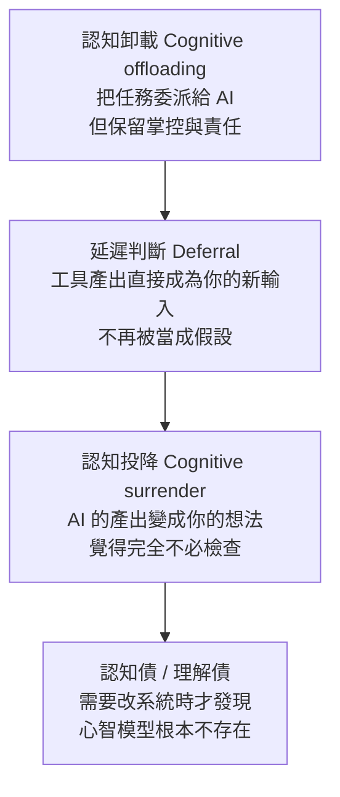

# 當 Agent 代勞時,如何保持批判性思考:Addy Osmani 的認知投降、驗證與當責

> 整理自 Addy Osmani 在 X 的長文貼文(`https://x.com/addyosmani/status/2117512471930167377`)的**繁中全文翻譯**(使用者貼入,譯者為社群轉貼者)。
>
> **來源性質與限制(請先讀):**
> - 我**讀不到 X 原貼文**(抓取回 HTTP 402),也**沒有找到這篇文章在 addyosmani.com 上的對應原文**。以下內容的論點取自使用者貼入的譯文;其中引用的概念,我另外去讀了他部落格上的三篇原文來核對(見〈核實紀錄〉)。
> - 譯文開頭的評論(誰接手誰的位置、「Addy 現為 Anthropic 技術團隊成員負責 Claude Code」)是轉貼者的話,不是原文。就我查到的報導,Addy Osmani 於 2026 年 9 月宣布加入 Anthropic 做 Claude Code,但來源多為二手轉載,職稱未公布。
> - 立場:無業配、無導流。作者本人在 Anthropic 做 Claude Code,討論的又是 Claude Code 的使用方式,**有利益關係,請把「建議多用 Agent」視為其立場**——不過全文的主軸反而是「多用之外要主動把關」。

---

## 一句話總結

隨著模型變強、明顯錯誤變少,人最大的風險不是被 Agent 騙,而是**不知不覺停止自己判斷(認知投降)**;對策不是少用 Agent,而是 **在提問前先有假設、事前定義何謂「已驗證」、讀它替你做的決定、把意圖寫清楚、並守住「簽名負責」這條線**——「可以卸載工作與大部分的審計,但無法卸載當責。」

---

## 1. 問題:預設沒有任何機制逼你思考

過去提問到回答之間的空檔,是人思考與品味發生的地方;現在縮成幾秒。而且模型越好,**顯著錯誤比例越低,多數產出「寫得極佳且基本正確」,讓人覺得沒必要回頭細看**。即使同時跑多個 Agent,審視產出的仍只有你一雙眼睛。

## 2. 光譜:卸載、延遲、投降

- 漂移是漸進的:上一份答案讀得仔細,下一份隨便翻,再下一份只掃骨幹,直到有人針對某一行發問,你連借助 Agent 都解釋不出來。
- 不是要求維持完整心智模型(大型程式碼庫做不到)。Claude Code 團隊的做法是**按需重建理解**:要懂某一塊,就請 Claude 解釋那一塊。你只需要清楚知道**自己缺乏哪些理解**。
- **判準:** 低風險事盡量委派(例:錄課時三家評價相近的飯店挑一家);投資、給孩子的職涯建議、決定做什麼功能、哪些變更影響哪些用戶、版本是否安全——這些別卸載思考。**「在犯錯成本低的地方交給 AI,在他人必須為後果買單的地方保留自己的思考。」**

## 3. 六個自問(新版 5W1H)

| 自問 | 做法 |
|---|---|
| 提問前,我有假設嗎? | 先記下你認為答案可能是什麼;完全沒頭緒就請模型做「盲點審視」(借 Thariq Shihipar 的說法),找出未知的未知 |
| 我是請它幫我思考,還是把思考卸載給它? | 兩者皆可,但要知道自己在做哪一種 |
| 要證明結論是錯的,需要什麼條件? | 去查驗。模型對自己信心的評估,不如你跑一次測試 |
| 我聽過反方意見嗎? | 對開放性問題,讓多個模型從對立面辯駁,再形成自己的觀點 |
| 在必須維護這成果的人面前,我敢打包票嗎? | 「具備負責能力」的標準線,程式碼與任何交付物都適用 |
| 我不再練習什麼了? | 放掉可以,但要是有意識的決定 |

## 4. 驗證也會被「投降」

- 給 Agent 自我驗證工具(端到端測試、屬性測試、實際操作應用),它能在你過目前改完、驗證、重試。這呼應 Boris Cherny 的「給 Claude 驗證自身工作的方法」。
- 但**綠燈只代表驗證了某個特定屬性**:測試若與功能犯同樣的錯照樣通過;Agent 寫測試成本極低,滿螢幕綠燈也可能漏抓壞掉的功能。
- 做法:
  - **事前定義何謂「已驗證」**——事後你總會合理化任何結果。
  - 終點線要具體有形:通過的測試、截圖、日誌、追蹤記錄。
  - 收到完工通知時,**先看執行的指令與輸出,再看摘要**。
  - 把「獨立上下文子 Agent 的合理性檢查」內建到循環,別靠想起才做;結束時固定再問一句「我有漏掉什麼嗎?」(作者說用前沿模型做完複雜功能後這樣問,常再列出兩三點遺漏)。
  - 原則(來自 Claude Code 團隊的 code review 分享):**說不出自動檢查會漏掉什麼,就該要求人工審查,而不是草草批准。**
  - 程式碼之外一樣:Agent 綜整五十通客戶訪談,抽查幾份原始文件;檢查建議依賴的關鍵數據與計算邏輯。

## 5. 真正留心產出

600 行 PR 只看架構、測試全綠就批准——你審的只是「早就預期會看到的內容」,而交易邊界的順序調整、被悄悄反轉的預設值就在中間。對策:

1. **把 diff 當成不是 AI 寫的來讀**,並跳出 diff 看 Agent 替你做了哪些決定(預設值、排除範圍、需求衝突時重新解讀了哪個)。要求它**列出所做的決策與假設**,因為一切順利的摘要裡不會有這些。
2. **自我測驗:** 隨機挑幾行問「這是什麼意思」;文件就關掉憑記憶寫核心論點。進階版:長 session 後請 Claude 寫變更報告並附測驗,**測驗滿分才合併**。
3. **用 Agent 守護注意力:** 例如開源專案用 Agent 篩 PR、標記違反規範之處,縮小範圍後自己再判斷「是否以正確方式解決正確問題」。
4. **協調稅(orchestration tax):** Agent 生成的成果與你安心署名的成果之間的差距。累積量超過你的處理速度時,再開新 session 沒用——收緊檢查標準以減少對你的依賴,或放慢腳步。**產出超出你能擔保的範圍時,你不是在審查,是在碰運氣。**

## 6. 好輸入才有好輸出:意圖債

- 人的心智模型沒消失,只是從中間移到**前端(任務描述與上下文)與後端(審視產出)**。
- 含糊的要求過去會被人反問;Agent 常不會攔你,而是自動補完交回「看似完整」的成品。作者稱這種存在於非你親手寫的產物裡、隱含的目標、限制與底層邏輯為**意圖債(intent debt)——沒人能替你償還,意圖必須源自你**。
- 做法:
  - 先用自己的話寫簡報:目標受眾、範疇之外、完成的定義。第二輪修正仍不對就停止微調、重寫 prompt。
  - 區分「委派」與「協同」(Andy Clark):協同是 prompt 磨礪產出、產出再磨礪下一個 prompt;**結束 session 時心智模型更深,就是成功**。概念不清時可請 Agent 對你提問。
  - 小心 Agent 把上一個 Agent 的摘要帶進上下文,第三個 Agent 根本沒讀過原文件。
  - 為輸出建立自己的標準:精緻度已不是品質指標;**連自己都不好意思署名的就不發布**。未達標時把原因記進共用設定檔、hook 或測試,避免重蹈覆轍——這是品味累積的方式。

## 7. 「模型之後會比我更會檢查」

作者承認檢測能力方面多半沒錯、也主張把更多檢測推給 Agent,但:**終究要有人為發布的成果負責**;該信任 Agent 到什麼程度本身是主觀判斷;模型會出錯的地方一直在變。他引用 Anthropic 內部對工程師與研究員的研究所稱的「**監督悖論**」:監督 Claude 所需的程式碼技能,可能因過度依賴 AI 而退化。無法交給模型的是:你在構建什麼、為什麼值得做、影響誰、願意做什麼妥協。

## 8. 日常實踐(挑適合的做)

| 頻率 | 做法 |
|---|---|
| 每週 | 不靠 Agent 親手寫點程式碼,或做一件「忘了會很慘」的實務(校準練習,無關道德) |
| 每月 | 列出已不再親力親為的事,決定哪些可以放手;自問「如果 AI 不存在,我會多不知所措?」 |
| 隨時 | 遇到超出理解的東西就學,不只丟給 AI 一句解釋;驗證要排進工作清單才會真的做 |

### 應用案例

> 你請 Agent 把支付模組的重試邏輯改成指數退避,它回報「完成,全部測試通過」。**照本篇做:** ①提問前先寫下預期(「應該只改 retry 區塊,冪等鍵不能動」);②完成後**先看它跑的指令與輸出**,而不是摘要;③問它「你替我做了哪些決定與假設?」,發現它把最大重試次數從 3 預設成 10;④問「綠燈沒證明什麼?」,補上「重送是否仍冪等」的測試;⑤最後問「我有漏掉什麼嗎?」。你能在同事面前解釋這 600 行的每個決定,才簽核。

## 9. 帶走的八條

保持自覺;誠實面對自己在光譜的位置(連借助 Agent 都解釋不出來,就是放棄了主導權);帶著假設出發;綠色勾選只代表一件事(查了什麼、漏了什麼);先看證據再看摘要;讀出它替你做的決定;雕琢 prompt(反映你對問題的理解);設標準並守住(不願署名就不發布)。作者建議的起手式:**提問前寫下預期結果;Agent 完成後,寫下一件它沒檢查的事。**

---

## 核實紀錄(2026-11-05 查證)

**已核實(對照 Addy Osmani 部落格原文)**
- 「認知卸載 vs 認知投降」:[Cognitive Surrender](https://addyosmani.com/blog/cognitive-surrender/)(2026-05-05):卸載是交付機制但仍判斷結果是否合理;投降是停止形成自己的看法、AI 產出變成你的產出。引用華頓商學院 Shaw 與 Nave 的三個實驗(1,372 人),AI 答錯時 **73% 的受試者接受錯誤答案**;並稱認知投降是「理解債」累積的機制。
- 「Andy Clark 的委派 vs 協同」「提問前先形成預期」「請模型反駁自己」「不靠 AI 定期寫程式」均出現在該文。
- 「意圖債」:[The Intent Debt](https://addyosmani.com/blog/intent-debt/)(2026-06-05)。定義為「外部化的理由、目標、限制缺失或流失」,存在於產物而非程式碼或人;**「Agent 可以靠讀程式碼重建理解,但無法生成意圖」**;借用 Margaret-Anne Storey 的「三重債務模型」(技術債、認知債、意圖債彼此獨立);他把認知債稱作「理解債(comprehension debt)」。
- 「協調稅」:[The Orchestration Tax](https://addyosmani.com/blog/orchestration-tax/)(2026-05-24)。定義與「結構性差距」說法吻合;並提出「平行 Agent 數量應等於你能認真 code review 的數量」「批次審查」。
- 華頓論文:Shaw 與 Nave 的 *Thinking—Fast, Slow, and Artificial* 確為 SSRN 預印本([papers.ssrn.com/abstract=6097646](https://papers.ssrn.com/abstract=6097646));另有評論指出其樣本、複現性、方法學有爭議(來源為二手彙整,**證據強度請保守看待**)。

**需修正 / 注意**
- 譯文說「理解債(Comprehension debt)是 Jeremy Twei 提出的詞彙」。Addy 在〈The Intent Debt〉裡的說法是**他自己一直把認知債稱作理解債**,並未提到 Jeremy Twei;且文章也未說誰最早創造「認知債」。此歸屬我**無法核實**,請勿當成定論。
- 譯文的「延遲判斷(Deferral)」這一階:Addy 的〈Cognitive Surrender〉原文**沒有出現這個詞**,是本篇(較新、我找不到原文的長文)才有的三段式。
- 「Anthropic 內部研究稱之為監督悖論」:〈Cognitive Surrender〉原文有引用 Anthropic 技能形成研究(用 AI 生成程式碼同時學習的工程師,理解測驗低 17%),**「paradox of supervision」這個詞與引文我沒有逐字核到**。

**未能核實**
- 本篇全文的原始出處(X 貼文內容與是否有部落格版本)。
- Boris Cherny、Thariq Shihipar、Storey 等被點名者的原話,僅憑譯文轉述。
- 「用前沿模型問『我有漏掉什麼嗎?』總能再列出兩三點」是作者個人經驗,非對照實驗。

## 來源

- Addy Osmani(X 貼文,本機譯文由使用者提供;原貼文無法抓取):https://x.com/addyosmani/status/2117512471930167377
- Addy Osmani 部落格(用於核對概念):[Cognitive Surrender](https://addyosmani.com/blog/cognitive-surrender/) ;[The Intent Debt](https://addyosmani.com/blog/intent-debt/) ;[The Orchestration Tax](https://addyosmani.com/blog/orchestration-tax/)
- Shaw & Nave〈Thinking—Fast, Slow, and Artificial〉:https://papers.ssrn.com/abstract=6097646
- 加入 Anthropic 的報導(二手):https://runtimewire.com/article/addy-osmani-joins-anthropic-claude-code-developer-experience

相關閱讀:[[claude-code-team-code-review-seven-layers]](文中引用的 code review 原則)、[[agent-verification-before-scale-lauren-tan-reaction]](先給 Agent 驗證手段再談規模)、[[llmentalist-effect-cold-reading-and-verifiers]](流暢的輸出為何讓人放鬆警戒)。
