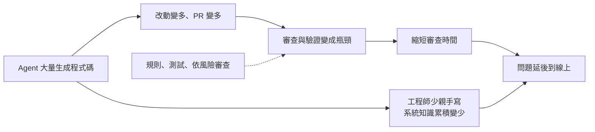

# AI 寫代碼越快,系統越脆?Merz「脆弱代碼庫」與四項研究核實(Why QQ)

> 來源:Why QQ(為什么叫QQ)影片〈AI 就像…〉`sI_hz1p423M`(官方 zh-Hans 字幕,帶時間),再對照 Merz 原文、兩篇 arXiv 論文、Empirical Software Engineering 論文與 DORA 2025 報告。
> 影片本身沒有業配或自家產品推廣。時間點連結皆提前 10 秒,例如 [0:36 起](https://www.youtube.com/watch?v=sI_hz1p423M&t=26s)。

## 一、一句話結論

作者 Merz 的主張是:Coding Agent 讓「寫」變便宜,但「讀懂、驗證、維護」的成本沒降,團隊若不重做驗證流程,系統會變脆。影片的態度偏中性,最後給五項工程做法,並提醒研究證據有限,不能直接推到所有團隊。

## 二、影片內容整理(含時間)

| 時間 | 重點 |
|---|---|
| [0:00](https://www.youtube.com/watch?v=sI_hz1p423M&t=0s) | Hacker News 一篇文章引發六百多條評論;作者 Evan X. Merz 在離開 Meta 前至少 90% 代碼由 AI 生成,但產出沒有翻倍,更沒有 10 倍 |
| [0:45](https://www.youtube.com/watch?v=sI_hz1p423M&t=35s) | 「能跑一次」不等於可靠;訂單系統加優惠券、訂閱支付,每次改動都碰舊邏輯,脆弱系統的影響範圍不清 |
| [1:30](https://www.youtube.com/watch?v=sI_hz1p423M&t=80s) | 例子:滑鼠懸停樣式用 JavaScript 事件監聽,其實 CSS `:hover` 就夠;複雜互動仍可能需要 JS,不能一概視為錯 |
| [2:14](https://www.youtube.com/watch?v=sI_hz1p423M&t=124s) | AI 容易生成大量測試(例如每個 getter 都測),但付款後斷線重複下單、並行修改競態這類問題測不到;Agent 同時寫實作與測試會共享同一個誤解 |
| [3:15](https://www.youtube.com/watch?v=sI_hz1p423M&t=185s) | 較有效:從業務規則獨立建立驗證依據,寫成屬性測試,再用變異測試檢查測試會不會抓到錯 |
| [3:37](https://www.youtube.com/watch?v=sI_hz1p423M&t=217s) | AI 為了遵守 DRY 把偶然相似的功能硬併成抽象;反過來也可能為第一個告警寫幾百行專用碼。沒有永遠正確的抽象數量 |
| [4:17](https://www.youtube.com/watch?v=sI_hz1p423M&t=257s) | Agent 讀得多不等於掌握長期設計意圖;性能事故、老客戶相容分支若沒寫進文件,Agent 就會誤判 |
| [5:03](https://www.youtube.com/watch?v=sI_hz1p423M&t=303s) | 工程師親手寫與除錯時累積的系統知識,可能因只審查不親手而變少 |
| [5:47](https://www.youtube.com/watch?v=sI_hz1p423M&t=337s) | 每天 5 個 PR 變幾十個:要嘛排隊,要嘛縮短審查時間而把問題推到線上;瓶頸從「產出」變成「驗證與整合吞吐」 |
| [6:30](https://www.youtube.com/watch?v=sI_hz1p423M&t=380s) | 《Needle in the Repo》;六千多個倉庫的 AI 提交研究;兩階段實驗;DORA |
| [10:07](https://www.youtube.com/watch?v=sI_hz1p423M&t=607s) | 五項建議(見第四節) |

## 三、逐項核實

| 影片說法 | 結果 |
|---|---|
| Merz 在 Meta 時至少 90% 代碼由 AI 生成、AI 沒讓產出翻倍 | ✅ 原文摘要一致(原文 <https://evanxmerz.com/post/ai-usage-generates-a-fragile-codebase/>,日期 2026-11-07);我透過第三方彙整頁讀到摘要,未直接讀到原文全文,影片中的「悬停」例子在該摘要中沒有出現,未能核實 |
| HN 六百多條評論 | ❌ 未能核實:搜尋結果有聚合站標示該串約 73 則留言,與影片的「六百多」差很大,可能影片指的是另一個串或不同統計;HN 原頁未讀到 |
| 《Needle in the Repo》測 23 種模型與 Agent 配置 | ✅ arXiv 2603.27745 摘要:23 個配置 |
| 483 個結果中 64 個通過全部功能測試卻沒過結構檢查,佔 13.3% | ✅ 同摘要 |
| 依賴控制與職責拆分最難 | ✅ 摘要:依賴控制 4.3%、職責拆分 15.2% |
| 六千二百多個倉庫、三十多萬次 AI 提交、約四十八萬個問題 | ⚠️ 需修正小數:arXiv 2603.28592 摘要為 **6,299** 個倉庫、**302.6k** 次提交、**484,366** 個問題,影片的「六千二百多」略低 |
| 絕大多數是代碼異味 | ✅ 摘要:89.3% 的問題是 code smell |
| **24.2% 的問題到觀察結束仍存在** | ❌ 摘要寫 **22.7%**;24.2% 在摘要找不到,可能出自論文內文其他口徑,**我沒讀到全文,未能核實** |
| 兩階段實驗:使用 AI 完成任務時間中位數縮短 30.7%;第二階段沒有顯著差異 | ✅ 論文是 Borg 等人的 Echoes of AI(arXiv 2507.00788,後刊於 Empirical Software Engineering);Phase 1 中位數 30.7%、Phase 2 無顯著差異。⚠️ 預印本 v1 曾寫「後續演進略快、CodeHealth 略高」,後續版本與期刊版改為「未偵測到系統性差異」,以期刊版為準 |
| DORA 2025:AI 使用與吞吐量、交付不穩定性都正相關,AI 像放大器 | ✅ DORA 官方文章與報告摘要一致;「下游系統沒跟上」的解釋出自 Honeycomb 等廠商解讀,不是報告結論 |

⚠️ 以上多數是搜尋與論文摘要層級的核實,論文方法細節(例如 Needle in the Repo 的案例語言)未逐章讀;公開版據專案頁為 21 個 C++ 案例,影片講「專門設計的診斷基準」與此一致。

## 四、影片的五項建議(可直接當團隊檢查表)

1. 修改前先寫清需求邊界與「必須保持不變的行為」。
2. 把模組職責、依賴方向與架構約束放進倉庫,讓 Agent 讀得到、檢查得到。
3. 要求最小必要改動;新增抽象、依賴、跨模組修改都要說明理由。
4. 功能測試、異常場景、靜態檢查與必要的變異測試進 CI,不只靠 Agent 自己寫的測試。
5. 依風險分級審查:樣式小改可簡單,支付、權限、資料遷移與核心狀態管理要嚴。

## 五、應用案例

1. **付款重送**:先用業務規則寫出「同一張訂單重複送出只能扣款一次」,當作獨立於 Agent 實作的屬性測試,而不是讓 Agent 看完自己的實作再生測試。
2. **架構約束檔**:在倉庫放一份簡短說明「模組 A 不得依賴模組 B」,並在 CI 用依賴檢查工具驗證,對應 Needle in the Repo 裡最弱的依賴控制。
3. **PR 分流**:改動只有樣式的 PR 走快速通道;碰資料庫、權限的 PR 必須有第二位審查者並附回滾方案。
4. **三個月後的指標**:除了合併 PR 數,多看「新需求平均改動檔案數」是否變多,拿來偵測脆弱化。

## 六、我的判讀

- 影片把「AI 寫的代碼不一定更差」(Echoes of AI 的 null 結果)與「通過功能測試不代表可維護」(Needle in the Repo)並列,這是合理的平衡;兩者研究設計不同,不能互相抵銷。
- 影片已自己註明:靜態分析問題不等於線上故障、診斷基準不能推算實際缺陷率。引用那兩個數字時要帶這個限制。
- DORA 的相關性不是因果,「AI 放大既有流程品質」是報告的詮釋。

## 相關筆記

- [[git-for-ai-agents-rubicon-pando-continuity-scion-why-qq]] — 同頻道,AI 寫太快時 Git 與版本控制要怎麼補
- [[ai-native-sdlc-landing-checklist]] — AI 原生開發流程的導入檢查表,可對應第四節
- [[addy-osmani-critical-thinking-when-agents-do-the-work]] — Agent 做事時人類要保留的判斷
- [[claude-code-team-code-review-seven-layers]] — 把審查分層,對應「依風險審查」
- [[llm-evals-how-to-know-ai-works]] — 測試與評測怎麼證明東西有效,而不只是通過

## 來源

- Why QQ 影片 `sI_hz1p423M`:https://www.youtube.com/watch?v=sI_hz1p423M (官方 zh-Hans 字幕,帶時間)
- Evan X. Merz〈AI usage generates a fragile codebase〉:https://evanxmerz.com/post/ai-usage-generates-a-fragile-codebase/ (經第三方彙整頁讀到摘要:https://ai-tldr.dev/releases/evanxmerz-ai-fragile-codebase/)
- Needle in the Repo:https://arxiv.org/abs/2603.27745 (專案頁 https://www.cs.ucr.edu/~qzhang/nitr.html)
- Debt Behind the AI Boom:https://arxiv.org/abs/2603.28592
- Echoes of AI(Empirical Software Engineering 期刊版):https://link.springer.com/article/10.1007/s10664-026-10889-1 ;預印本 https://arxiv.org/abs/2507.00788
- DORA 2025 報告:https://services.google.com/fh/files/misc/2025_state_of_ai_assisted_software_development.pdf ;官方說明 https://dora.dev/insights/dora-2025-year-in-review/
