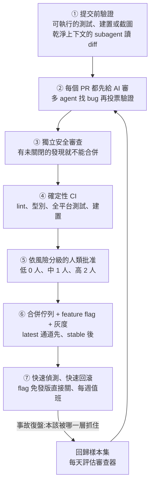

# Claude Code 團隊怎麼做 code review:七層流水線,PR 翻倍、回滾降四成

> 整理自 YouTube 頻道 **Why QQ**〈[AI 写了九成代码,回滚率反降四成](https://www.youtube.com/watch?v=-snid-l-rOA)〉(2026-10-19,約 10 分鐘,官方 zh-Hans 字幕)。
>
> ⭐ 影片是 Anthropic 工程部落格〈[How the Claude Code team does code review](https://claude.dev/blog/solving-code-review-at-anthropic/)〉(2026-10-15,作者 Addy Osmani、Morgan Westlee Lunt、Qing Wang)的導讀。**片中數字已逐項比對原文**,見第七節。
>
> ⚠️ 所有成效數字都是 **Anthropic 內部統計、自報**,沒有外部驗證。立場:影片與說明欄沒有業配。

---

## 一句話總結

> ⭐⭐⭐ **寫程式變便宜之後,稀缺的是人的判斷力。** 審查的問題從「有沒有人讀過這段程式碼」變成「**這個變更可能出什麼事、哪一道檢查最適合抓住它**」。七層檢查疊起來,才撐得起「PR 翻倍、回滾降四成」;沒有任何單一模型或審查工具能單獨做到。

---

## 一、背景:瓶頸換了位置

| 數字(原文) | 範圍 |
|---|---|
| Claude 寫了約 **90%** 的 Claude Code 程式碼 | Claude Code 產品 |
| 6 月到 9 月,合併 PR **增加一倍以上**;需要回滾的比例**下降超過 40%** | Claude Code 的獨立 repo |
| 每天落地的變更:5 月約 **2,500**,9 月超過 **30,000** | Anthropic monorepo |

> ⚠️ 影片特別提醒(也是原文的口徑):**monorepo 的變更量**和 **Claude Code repo 的 PR / 回滾數字**是兩個範圍,不要混用。

一天三萬處變更,靠人逐行讀 diff 已經不可能。

---

## 二、七層流水線



### ① 提交前驗證

- 派任務給 Claude 時,附上**可執行的驗證手段**(測試、建置、可比對的截圖)。Claude 必須展示執行結果,不能只說「做完了」。
- Boris Cherny 的判斷:給 agent 自我驗證的途徑,可能是最重要的一件事,讓最終結果好上**兩到三倍**。
- 提交前再用**全新上下文的 subagent** 讀 diff。寫程式的上下文容易自我合理化。

### ② AI 審查每個 PR

- 對著整個 repo 讀 diff,檢查三件事:改動有沒有解決它聲稱的問題、和系統其他部分合不合、會不會弄壞別處。
- **多個 agent 並行找 bug,另一組 agent 對每個候選發現投票驗證**,票數夠才發成評論。純風格、純清理的意見直接丟掉。
- 依嚴重度標成 **Important / Nit / Pre-existing**。Pre-existing 表示 bug 早就在程式碼裡,不算到這個 PR 作者頭上。
- 上線初期,拿到實質審查意見的內部 PR 從 **16% 升到 54%**。⚠️ 這是**評論覆蓋率**,不是缺陷檢出率。

### 規則寫在兩個檔案

| 檔案 | 誰寫 | 內容 |
|---|---|---|
| `CLAUDE.md` | 專案 | 專案是什麼:技術棧、慣例、目標、不做什麼。每次審查都會載入,大 repo 要寫短,細節用連結 |
| `REVIEW.md` | 程式碼負責人 | 這塊程式碼**什麼算出事**。篇幅短、描述失敗長什麼樣、限制次要意見數量、列出要跳過的路徑、每條發現都要附檔案與行號 |

原文例子:對文件來說,出事是**說謊**;對設定檔來說,出事是**路由錯誤**。

### ③④ 安全審查與確定性檢查

- 安全審查獨立運行。**任何一條安全發現沒關掉,PR 就合不進去**;可以關,但要寫理由(誤報就是這樣清掉的)。
- lint、型別檢查、全平台測試、建置。一個典型 CLI repo 的 PR,在人看之前可能已經過了幾十項檢查。
- PR 範本兩個問題值得抄:**這個改動怎麼測的?出事怎麼撤回?** Claude 可以幫忙填,簽字確認的是人。

### ⑤ 依風險分級的人類批准

| 風險 | 範例 | 人類批准 |
|---|---|---|
| 低 | 文件、文案、僅內部使用的功能、藏在 flag 後的新增改動 | 自動審查與安全檢查全綠後,**不需要** |
| 中 | 一般產品變更,以及快取、自動更新器、系統提示詞等敏感區域 | 1 人 |
| 高 | 風險最高的程式碼,加上一小批固定要兩人的路徑 | 2 人 |

硬約束:
- 檔位由**變更內容**決定,不是作者職位。
- 只有 repo 可信名單上的作者能走低風險路徑。
- **agent 的批准永遠不能頂替人的名額。**
- 有新 commit 進來,之前的批准作廢重來。

### ⑥⑦ 合併佇列、灰度與回滾

- 合併佇列把變更和最新主幹組合後**重跑全部檢查**,防止兩個各自通過的 PR 合起來把主幹弄壞。
- 新功能先藏在 feature flag 後給員工用;公開版本先走 latest 通道,stable 在後。
- flag 可以不發版直接關掉;每週有值班輪替。
- 事故復盤只問一個問題:**這本該被哪一層抓住?**
- ⚠️ 原文坦承:**還沒有**依事故率自動收緊審批條件的熔斷機制,團隊希望在更多程式碼走向零人審之前補上。

---

## 三、失敗史:AI 作者 vs AI 審查者的無限迴圈

- 有個 CLI PR **一夜之間經歷五十多輪**審查與修復,最後由作者手動叫停。
- 事後用 `git blame` 查審查者反覆標記的程式碼:約 **59%** 在審查者第一輪看的時候就已經存在。後面幾十輪不是在找新 bug,而是每輪翻出幾個舊毛病。
- 團隊自己也有責任:每多跑一輪總能抓到點東西,就默認多跑幾輪。**發現更多問題和更快交付可用程式碼,是兩回事。**

### 四個修法與成效

1. **三輪上限**:第三輪還不收斂,審查者不再挑刺,改要求作者退一步重新考慮方案。
2. **增量複審**:頭幾輪之後只看新增的 diff。
3. **按 bug 類別修**:發現一類問題就一次修掉所有實例。
4. **去重**:發過的發現不再重複出現。

| 指標 | 之前 | 之後 |
|---|---|---|
| 一輪就通過 | 65% | **78%** |
| 需要五輪以上 | 8.9% | **1.5%** |
| 平均通過輪數 | 2.08 | **1.32** |

> 給 AI 的迴圈設終止條件,是設計者的責任。

---

## 四、審查器怎麼變好:事故變成考題

- 收集過去引發事故的 PR,連同修復與回滾紀錄,請熟悉程式碼的工程師逐一確認 bug 與位置,做成**回歸樣本集**,審查器每天對著跑。
- 每次改審查器的提示詞、工具或模型,都拿這個集合打分,**分數上升才保留**。
- 評估不只看召回率,還看錯誤評論數、修復輪數、人類審批時間、回滾與事故。

### 噪音的價格翻倍

人類作者看到無聊意見,兩秒滑過去;**agent 作者看到意見會真的去改**:多一個 commit、多一輪審查、多花一份 token。所以他們:
- 依收到評論的人的反應分類:修了 / 說錯了 / 故意的 / 無所謂。
- 拿已知乾淨的 PR 去跑審查器,數它會報多少條可能誘導有害修改的意見。
- 優先序寫明:先抓真 bug,再減少審查輪數。

---

## 五、機器讀了大部分程式碼,人做什麼

原文列五件:
1. **決定該不該做**:方向、品味、範圍。
2. **審高風險程式碼**:帳單、自動更新器、CI workflow。
3. **審會被照抄的架構決策。**
4. **讀證據**:測試輸出、跑了什麼命令回傳什麼、截圖、審查者的發現。說不出檢查會漏什麼,就別快速點批准。
5. **為結果負責**:誰合進去誰負責,不管字是誰打的。

另外,審查有個隱藏功能是讓團隊理解程式碼。他們的回答:沒人需要完整的腦內模型。想懂某塊程式碼,就讓 Claude 替這一小塊寫一份講解,幾分鐘生成、反映今天的樣子。逐行讀一個改文案的 PR 幾乎學不到東西。

---

## 六、應用案例

### 案例 1:小團隊的最小可行版

不需要七層全上。先做三件事:
```text
1. PR 範本加兩題:「怎麼測的?」「出事怎麼撤?」
2. 寫一份 REVIEW.md:列出這個 repo「什麼算出事」與要跳過的路徑,
   規定每條意見要附 檔案:行號
3. AI 審查設三輪上限;第三輪不收斂就停,回頭檢討方案
```

### 案例 2:把風險分級寫成路徑規則

```text
低風險(AI 全綠即可合):docs/**、*.md、flag 後的新增檔
中風險(1 人):src/**
高風險(2 人):billing/**、.github/workflows/**、updater/**
```
可以用 GitHub CODEOWNERS 加上 branch protection 實作人數規則;重點是**檔位跟著路徑走,不跟著作者走**,而且 agent 的 approve 不算人頭。

### 案例 3:事故復盤直接變成評估資料

每次復盤後,把「該被哪一層抓住」那個 PR 加進回歸樣本集。下次換模型或改審查提示詞,先跑樣本集,分數掉了就不上。這和本庫 [[llm-evals-how-to-know-ai-works]] 的評估方法是同一套邏輯。

### 案例 4:和 pstack 對照

[[pstack-poteto-mode-cursor-plugin]] 的 `prove-it-works` 與 `interrogate`(多家模型互審),對應的就是本文第 ① 層與第 ② 層。兩邊的共同結論:**證據優先、審查要有終止條件**。

---

## 七、核實(對照 Anthropic 原文)

| 項目 | 影片 | 原文 | 判定 |
|---|---|---|---|
| Claude 寫的比例 | 約九成 | 「about 90 percent of Claude Code's own code」 | ✅ |
| PR 合併量、回滾比例 | 翻一倍多、降 40% 以上 | 「more than doubled」「fell by more than 40 percent」(6–9 月) | ✅ |
| monorepo 每日變更 | 2,500 到 30,000 以上 | 5 月約 2,500,9 月超過 30,000 | ✅ |
| 實質審查覆蓋率 | 16% 到 54% | 同 | ✅ |
| 五十多輪、59% | 同 | 同 | ✅ |
| 收斂成效 | 65 到 78%、8.9 到 1.5%、2.08 到 1.32 | 同 | ✅ |
| 風險三檔 | 0 / 1 / 2 人 | 同,範例一致 | ✅ |
| 熔斷機制 | 還沒有 | 「We don't yet have circuit breakers」 | ✅ |
| 層數 | 七層 | 正文七節;圖說寫「六層檢查,回滾墊在底下」 | ✅ 兩種算法一致 |

補充:
- 二手報導常引用的「誤報率低於 1%」出自 2026-03 Code Review 產品上線時的說法,**這篇原文沒有給誤報率數字**,只描述了量測方法。
- 「90%」是 Claude Code 這個產品的比例。Anthropic 全公司的口徑不同,不要外推。
- 所有成效都是 Anthropic 自報,而且 6–9 月同期還有模型升級等其他變因,不能把回滾下降全歸功於審查流程。
- 相關:[[claude-code-team-how-they-work]] §4(團隊訪談中 code review 怎麼演化成 workflows)、[[ai-native-sdlc-landing-checklist]]。

---

## 來源

- Why QQ〈AI 写了九成代码,回滚率反降四成〉:https://www.youtube.com/watch?v=-snid-l-rOA(官方 zh-Hans 字幕)
- Anthropic(claude.dev 部落格)〈How the Claude Code team does code review〉,2026-10-15:https://claude.dev/blog/solving-code-review-at-anthropic/
