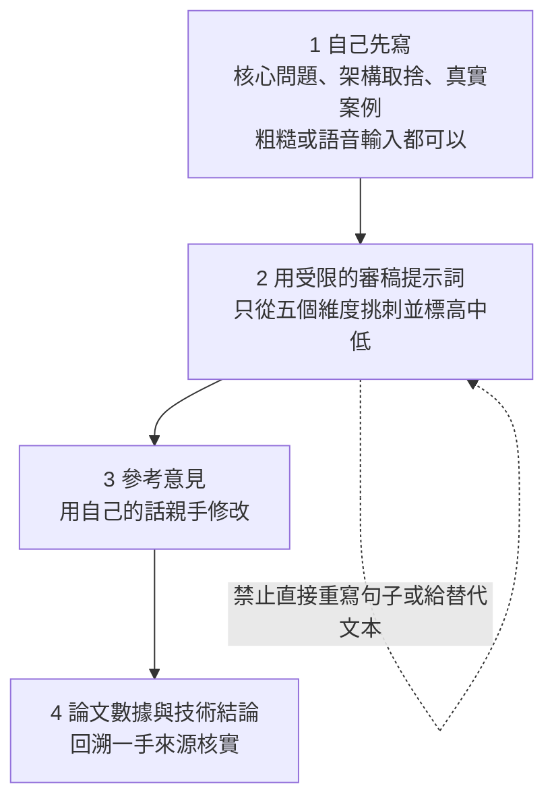

# Martin Fowler〈LLM Voice〉:AI 文字的恐怖谷,與工程師該怎麼寫文件

> 整理自 YouTube「Why QQ(為什麼叫 QQ)」〈语法全对,却难读?Martin Fowler 揭示AI文字的阻力〉(2026-11-01,約 11 分鐘,影片 ID `TbeJwwp-YE4`,官方 zh-Hans 字幕)。
>
> **立場聲明:** 影片沒有業配或導購。筆記以 Fowler 原文為主軸,影片補充的研究與 AI 審稿流程分開標示出處;影片的第一、二、三節引用的是 Fowler 原文,**第四節的「AI 審稿四步」是影片作者自己的建議,不是 Fowler 的主張**。

---

## 一句話總結

Fowler 的核心不是「AI 文字有哪些破綻」,而是:**對 LLM 腔的反應是人的反應(文字的恐怖谷),不是檢測工具能解決的;所以作者不該讓 LLM 寫初稿,因為一旦有了初稿,腔調很難洗掉,而且「寫」本身就是你釐清思考的方式。**

---

## 1. Fowler 原文(2026-10-29)的重點

已逐段對照原文 <https://martinfowler.com/bliki/LLM-Voice.html>:

| 論點 | 原文怎麼說 |
|---|---|
| 現象 | 讀貼文時漸漸覺得在讀 LLM 輸出,閱讀慾望萎縮,甚至到反感;常見破綻他說「不是破折號,而是 load-bearing tapestries 這類詞」 |
| 檢測工具 | 對準確度存疑,更重要的是**「抓重點錯了」**:反應是人的反應,等你想用工具時已經太晚;就算工具說沒有 LLM,感受也不會消失 |
| 對自己的懷疑 | 語言會演變,抱怨「年輕人的用語」本身就是老化的徵兆;他自己會對「adopting a new sales motion」這類說法皺眉,但這些也出自人嘴,是世代差而非碳基/矽基差 |
| 作者守則 | **不要讓 LLM 寫初稿**(即使事後人工編輯也很難去除腔調);連「接受改寫建議」都危險;LLM 做大綱結構「可能可以,但僅限大綱」;**正文由作者自己填** |
| 揭露政策 | 在他的網站上,用 AI 協助寫作的人**應該揭露**(通常寫在致謝),理由是透明,也讓讀者學到有用的用法。他自己不用 AI 產生文字或結構,**唯一的用途是當搜尋工具,並回到來源核實** |
| 習慣 | **Say Your Writing**:先在腦中把話說出來再寫下,然後編輯 |
| 為什麼 | 寫作是思考的工具;把寫作交出去,也會把思考與理解交出去 |
| 例外 | Jim Highsmith(因帕金森氏症需借助 LLM 寫作);翻譯(同事母語非英語,但他仍寧願讀「真人笨拙的文字」);對官方的制式信函、或沒人會讀的報告;文末附註「我沒有以任何方式使用 AI 或 LLM 寫這篇」 |
| 腳註 | 有一例首稿全由 LLM 產生、成品卻沒察覺 LLM 腔,但**需要大型媒體的專業編輯**才清理乾淨 |

### 應用案例

- 寫技術設計文件或事故復盤時,先自己把「問題、取捨、真實案例」寫成粗稿(口述轉文字也行),再用工具檢查,而不是讓模型起稿再改。
- 團隊用 AI 協助寫作時,在文件致謝註明用了什麼、用在哪一步,方便讀者校準信任(Fowler 網站的政策)。

---

## 2. 影片補充的研究(影片說法 vs 我查到的)

影片把 Fowler 的直覺接到三組研究。下表是我的核實:

| 影片說法 | 核實 |
|---|---|
| 2026-10-21 紐大與德州大學奧斯汀分校預印本:比較「9 個前沿與近前沿模型」與人類文本,五類結構更常見 | 預印本確實存在:**arXiv 2610.29162〈Why is AI-generated language so hard to understand?〉**,作者 Thomas Hikaru Clark(NYU)、Matias B. Martin、Kyle Mahowald(UT Austin)。測量項目包括低可預測 n-gram、長句法依賴、名詞堆疊、名詞轉動詞、無生命主語配有生命動詞、縮減的賓語關係子句。**「9 個模型」有出入**:有二手整理稱是 14 個 LLM,未能從原文確認數量 |
| 在 Qwen 2.5-1.5B 加長度懲罰 RL 後句法變緊繃 | 與論文「以長度懲罰微調的概念驗證」吻合(細節未直讀) |
| Opus 5.5 在 21 項閱讀困難指標中 19 項比 Opus 5 改善 | **未能核實**,需讀原論文 |
| 該研究顯示讀者理解成本變高 | **要小心:**有二手評論指出論文測的是文本的句法特徵,**並沒有實測讀者理解**(不是讓人讀文章再測理解的實驗)。影片的「阅读疲劳有扎实的心理语言学依据」屬於推論 |
| Nature Human Behaviour 2026:88 萬篇文本、3 項子研究,模型潤色後群體寫作複雜度變異下降 21%–50%;約 87% 改寫與原稿語義相似度 > 0.95 | **大致核實**:論文為 Sourati 等人〈The shrinking landscape of linguistic diversity in the age of large language models〉(DOI 10.1038/s41562-026-02550-0)。注意 **0.95 是門檻不是平均值**,且改寫用的是 GPT-3.5、Llama 3 70B、Gemini Pro,**不是 2026 年的最新模型** |
| 824,634 集播客、73.7 萬小時、496 人預註冊實驗,口語中 delve 等詞變多 | **未能核實**(未找到來源,引用前請回到原論文) |
| ACL 2025 研究反例:2018 vs 2024 英語新聞詞彙多樣性並未明顯下降 | 該類研究存在(ACL 2025 Findings 有相關的人類與 LLM 語言模式對照論文),具體是哪一篇 **未能核實** |
| Hacker News 580+ 分、300+ 留言 | 未能核實 |

> 影片「LLM Voice 四個特徵」(把小問題包裝得宏大、愛轉折拔高與金句收尾、句式節奏雷同、同義反復與提示詞痕跡)是**影片依社群回饋歸納的閱讀體驗,不是 Fowler 原文的清單,也不是演算法標準**——影片自己也這樣聲明。

---

## 3. 一個值得記下的反差

AI 文字在**宏觀**上常常車輪話連篇(有效觀點稀薄),在**微觀句法**上卻又過度壓縮(名詞堆疊、長依賴)。「冗長」與「高密度」並存,雙重拉高閱讀成本。這是影片綜合研究的觀察,屬於合理推論,不是已被實驗直接證明的結論。

---

## 4. 影片作者建議:把 AI 從代筆改成審稿人(⚠️非 Fowler 主張)

審稿的五個維度:觀點清晰度、邏輯跳躍、事實來源、冗餘鋪墊、讀者流失點;最後讓模型指出你「最值得保留的三個個人表達特點」。

**我的補充(非影片內容):** 這流程與 Fowler 的守則並不完全一致——Fowler 連「讓 LLM 提供改寫建議」都認為危險,他自己甚至不用 AI 做結構;影片版本是折衷(模型只審不寫)。要不要採用,取決於你對「錨定效應」的風險容忍度。

### 應用案例

- 寫完故障復盤後,把全文丟給審稿提示詞,只看它列出的「邏輯跳躍」與「缺來源」清單,自己決定怎麼補。
- 週報或 RFC 用語音先說一遍再寫,對應 Fowler 的 Say Your Writing。

---

## 5. 與本庫其他筆記的關係

- 規格與設計文件的撰寫責任:[[spec-driven-development-landscape-2026]](Agent 時代由誰寫規格、誰負責)。
- 「生成程式碼不等於吃透系統」同一思路:[[claude-code-team-code-review-seven-layers]](人類仍須把關的層次)。

## 來源

- Martin Fowler〈LLM Voice〉(2026-10-29)原文:https://martinfowler.com/bliki/LLM-Voice.html
- Why QQ〈语法全对,却难读?Martin Fowler 揭示AI文字的阻力〉:https://www.youtube.com/watch?v=TbeJwwp-YE4 (官方 zh-Hans 字幕)
- 預印本 arXiv 2610.29162:https://www.emergentmind.com/papers/2610.29162 ;二手整理 https://braindetox.kr/en/posts/ai_generated_text_hard_to_understand_paper.html
- Nature Human Behaviour(Sourati 等):https://www.natureasia.com/en/info/press-releases/detail/9427 (新聞稿,論文本文未直讀)
- ACL 2025 Findings 相關研究:https://aclanthology.org/2025.findings-acl.120/ (是否為影片所指的那篇未能確認)

> 備註:本篇的預印本與 Nature 論文數字來自搜尋摘要與新聞稿,**沒有直接讀到論文全文**;引用具體數字前請回到原論文。
