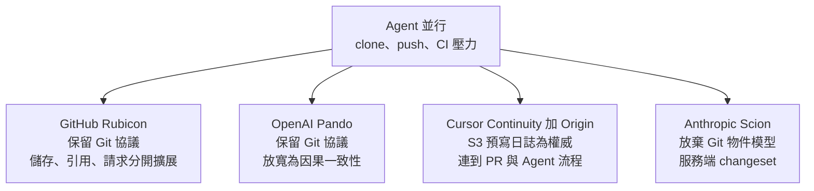

# AI 寫代碼太快,Git 先扛不住?GitHub Rubicon、OpenAI Pando、Cursor Continuity 與 Origin、Anthropic Scion 四條路線(Why QQ)

> **來源影片:** 〈AI 写代码太快,Git 先扛不住了?GitHub、OpenAI、Anthropic、Cursor,正在重新设计版本管理〉Why QQ(為什麼叫QQ),2026-11-09 上傳,8 分 37 秒([n86Np5hjXg4](https://youtu.be/n86Np5hjXg4))。
> **整理方式:** 取官方 zh-Hans 字幕(時間點取自 `[m:ss]`,連結提前 10 秒);說明欄列出的四家官方文章逐篇讀內文(GitHub 工程部落格、Anthropic 研究文章、OpenAI 文章用 curl 取得、Cursor 部落格與三頁 Origin 文件),逐項標「已核實 / 需補充 / 未能核實」。
> **利益揭露:** 說明欄只列官方文章與 hashtag,沒有業配或自家產品。**注意被評的四家都是自報數據:**GitHub、OpenAI、Anthropic、Cursor 的數字都來自各家自己的內部測試或生產環境。

## 一、一句話結論

多個 AI Agent 同時 clone、開分支、push、觸發 CI 時,壓力不在「Git 這個格式」,而在**伺服器端:引用(ref)更新要協調、重複 clone 要重複傳輸、pack 要整理**。四家的答案各不同:**GitHub 保留 Git 協議,把儲存拆成三塊獨立擴展;OpenAI 放寬跨分支一致性;Cursor 把權威狀態放在 S3 預寫日誌;Anthropic 乾脆放棄 Git 物件模型,改成服務端 changeset。**對一般團隊,今天能做的仍是 Git Worktree 加好任務邊界與驗證。

## 二、Git 為什麼會在 Agent 面前吃力

影片先講基礎([從 0:22 開始](https://youtu.be/n86Np5hjXg4?t=22)):Git 物件有 Blob、Tree、Commit、Tag,以內容雜湊識別,歷史是有向無環圖;分支只是指向某個 Commit 的引用,Commit 建立後不可變,而**引用會移動**([0:35]–[0:58])。一次 push 分兩步:客戶端把伺服器缺的物件打成 Packfile 傳上去,再請求更新分支引用,伺服器檢查完整性與引用舊值([1:04]–[1:17])。

關鍵例子([1:19]–[1:32]):兩個 Agent 都從 C0 改 main,A 先更新到 C1,B 就不能直接用 C2 覆蓋,必須重新同步。**要協調的是可變的引用,不是物件。**Agent 並行後壓力出現在五處([1:49]–[2:04]):工作目錄與共享資源、重複 clone/fetch、高頻 push 競爭引用、pack 數量增加整理成本、每次提交又觸發 CI 與其他 Agent 讀取。

**Git Worktree(普通團隊現在就能用,[從 1:57 開始](https://youtu.be/n86Np5hjXg4?t=117)):** 一個本地倉庫多個獨立工作目錄,各檢出不同分支。但共用底層物件庫,也不自動隔離資料庫、通訊埠與建置快取;兩個 Agent 改同一函式時仍會合併衝突([2:07]–[2:36])。(Worktree 這幾點是影片說法加上我對 Git 設計的理解,**官方 worktree 文件頁我未逐頁讀,標未逐項核實**。)這與 [[claude-code-team-code-review-seven-layers]] 談的「先把驗證關卡做好」同向。

## 三、四家路線與逐項核實

### 1. GitHub Rubicon([從 2:29 開始](https://youtu.be/n86Np5hjXg4?t=149))

| 影片說法 | 官方文章(GitHub 工程部落格,2026-11-05) | 結論 |
|---|---|---|
| Git Pack 等物件放 Azure Blob Storage([2:45]) | 物件、packs、索引、讀取加速器放 Azure Blob;引用檢查點也存在這,但不是權威狀態 | ✅ |
| Virtual Replicas 處理請求和快取([2:48]) | 一組可拋棄的運算,本機磁碟只是可重建的快取 | ✅ |
| 分支引用與 Pack Manifest 交給 Ref-CAS,條件更新([2:51]) | Ref-CAS 是複製式日誌服務,每次更新是 compare-and-swap、多數決提交,**不持有也不驗證物件資料** | ✅ |
| 背景 Compaction Workers 整理 pack([3:01]) | 背景節點以 lease 認領分片、分層合併,發佈前驗證物件相同 | ✅ |
| 5000 個並行 Agent、單倉庫每秒 7200 次 push、特定壓力測試不代表所有倉庫([3:12]–[3:21]) | 原文:「5,000 concurrent agents … 7,200 pushes per second」 | ✅ 數字對;**但文章沒有延遲數字、硬體或倉庫特徵**,「低延遲」未量化 |
| 影片沒講 | 目前是**有限私有預覽,明年初擴大**;最忙的倉庫目前每秒最多數十次寫入,7200 是內部測試而非實際負載;Ref-CAS「每秒數萬次操作」是設計層級說法 | 補充 |

**限制([3:34]–[3:37]):** Ref-CAS 能減少無關分支間的競爭,但**同一個引用上的衝突仍在**。

### 2. OpenAI Pando([從 3:33 開始](https://youtu.be/n86Np5hjXg4?t=213))

| 影片說法 | 官方文章(OpenAI,2026-11-02) | 結論 |
|---|---|---|
| 因果一致性:保證單一分支更新順序,同時讀多分支不保證同一時間點([3:48]–[3:57]) | 「serializability for updates to individual refs」,讀多個分支「cannot assume … a single point in time」;Pando 不提供所有引用的時間點狀態,也不提供 clone/fetch 內的引用更新順序 | ✅ |
| Push 的 pack 當不可變資料,fetch 用 Packfile URI 與區域快取([4:01]–[4:09]) | pack 存成 blob store 的不可變 blob;伺服器回傳 packfile URI,客戶端經 Express 服務從區域快取下載 | ✅ |
| 後台把小 pack 合併成層級結構([4:19]) | 「cover」填滿後由 compaction worker 合成單一 packfile,同時當作 fetch 協商的 skip list | ✅ |
| 中位 push 延遲顯著下降;每天近 1 PB 分發([4:23]–[4:28]) | 「cut median push latency by nearly 5x」(另一處寫「nearly 80%」,兩者一致);「nearly a petabyte of Git data per day」 | ✅ 影片的「顯著」可具體化為近 5 倍 |
| 1 PB 不是新增程式碼量([4:30]) | 是分發量,且文章寫「只需少數 CPU 核心」就能服務,單小時曾送出 57 TB、超過 99% 來自本機快取 | ✅ 影片提醒正確 |
| 影片沒講 | 預設只公告指定的 trunk 分支當基底,連續推同一分支或疊分支時客戶端要重送 trunk 之外的內容;monorepo 中位 pack 小於 20 KiB、99 分位小於 3 MiB | 補充(代價) |

### 3. Cursor Continuity 與 Origin([從 4:36 開始](https://youtu.be/n86Np5hjXg4?t=276))

| 影片說法 | 官方資料 | 結論 |
|---|---|---|
| S3 預寫日誌是權威記錄,NVMe 上普通 Git 倉庫負責讀取與計算,副本用 Gossip 知道變化再追進度([4:53]–[5:08]) | Cursor 部落格(2026-08-18,Vicent Martí):push 先持久化到 S3 WAL,再經索引與條件更新發布;副本是可重建的暖快取;UDP gossip 可遺失無妨;讀取用 ETag 條件 GET | ✅ |
| 影片沒講 | 實測:最多 100 個副本、讀取線性擴展;Cursor 單一倉庫 push 吞吐:S3 Standard 最高每秒 120 次,S3 Express One Zone 超過 300 次 | 補充 |
| Continuity 是底層、Origin 是代碼托管與協作產品([5:18]) | Origin 文件:Git 平台,可建倉庫、push/pull、**從 GitHub 鏡像**、瀏覽搜尋、開與合併 PR | ✅ |
| 鏡像模式 GitHub 仍是權威([5:26]) | 文件:「GitHub stays the source of truth and Origin is the mirror」 | ✅ |
| Repository、PR、Review、Cloud Agents、Automations、Apps 放同一平台([5:32]) | 文件導覽列同時列出 Cloud Agents、Automations、Apps、Code Tours | ✅ |
| Code Tours 按邏輯組織 PR 變更並生成解釋([5:38]) | 文件:讀 diff、把相關變更分組、在程式碼旁解釋;每個 Origin PR 都有導覽;**GitHub 鏡像倉庫的 PR 除「重點標示」外都可用** | ✅ |
| CloneKit 用預建快照與增量取物件,減少 CI 重複 clone([5:44]) | 文件:`origin repo clone-fast` 下載預建的 clone kit(倉庫打包快照),再只抓 kit 建立後新增的物件 | ✅ |
| 仍是 Early Beta,鏡像與原生有差異([6:08]–[6:13]) | 文件:「currently released in early beta」 | ✅ |

另注意:**Cursor 部落格全文沒有提 Origin 的鏡像、Code Tours、CloneKit**,這些功能我是從 Origin 文件核實,不是部落格。

### 4. Anthropic Scion([從 6:10 開始](https://youtu.be/n86Np5hjXg4?t=370))

| 影片說法 | 官方文章(Anthropic,2026-10-13,10-15 更新) | 結論 |
|---|---|---|
| 內部 monorepo 歷史接近 100GB、壓縮工作副本超過 25GB、每天約 2500 萬次 CI Checkout([6:22]–[6:28]) | 同:歷史近 100GB、壓縮副本超過 25GB、每天約 2500 萬次 CI checkout(**不含**開發環境、Agent 沙箱與研究工作) | ✅ |
| Changeset 為核心變更單位,記錄相對父版本變化的檔案與內容位置([6:36]–[6:41]) | 預寫日誌中的 changeset,列出相對第一個父版本變動的檔案,以內容定址指向檔案內容,**而非指向 tree** | ✅ |
| Commit/Merge/Rebase/Diff/Blame 多在服務端([6:44]) | 同,透過 API 暴露,許多工作不需本地倉庫 | ✅ |
| 客戶端按需取得檔案([6:48]–[6:55]) | 從根 tree 起只要求缺的 tree 與 blob,不用 packfile;各層快取命中率超過 99% | ✅ |
| CPU 與記憶體大幅下降、CI CPU 約節省 25%([7:00]–[7:04]) | 基礎設施 CPU 與記憶體比先前 git mirror 少約 **200 倍**;CI 與研究 checkout 由分鐘降到秒;CI CPU 容量 +25% | ✅ 且影片的「大幅」可具體化為約 200 倍 |
| 目前是內部系統([7:19]) | 作者明說「by no means a suitable replacement for git for general use」,Anthropic 想分享的是可被 Git 平台採用的想法(服務端 RPC、可組合的稀疏與淺層功能) | ✅ |
| 影片沒講 | 估計若天真地 fetch,每天會有超過 600 PB 的 Git 流量;合併的變更從 2026-05 每天約 2,500 件升到 9 月超過 30,000 件;七人團隊用五個月把 monorepo 從 Git 遷出,連同 Antique 審查工具一併重做 | 補充(Agent 讓變更量暴增的直接證據) |

## 四、四家比較與影片結論

影片([7:23]–[7:56]):四家都重視**計算與儲存解耦、減少全局協調、按需讀取與後台維護**;差別在版本模型與一致性取捨。

| | GitHub Rubicon | OpenAI Pando | Cursor Continuity | Anthropic Scion |
|---|---|---|---|---|
| 對 Git 協議 | 保留 | 保留 | 保留 | 不相容(內部用) |
| 一致性 | 引用以 CAS 協調,仍是全倉庫一致 | 放寬為因果一致性 | S3 WAL 為權威 | 變更日誌 |
| 取捨 | 同一引用衝突仍在 | 跨分支讀不保證同一時間點 | 平台綁定 Origin(Early Beta) | 放棄離線完整副本,要重建審查、搜尋、權限、CI |
| 目前狀態 | 有限私有預覽 | 內部生產 | Origin Early Beta | 內部系統 |

**影片自己的提醒([8:09]–[8:27])值得記住:**一般團隊先用 Worktree、分支保護、CI 與審查;更大的挑戰在任務規劃、語意衝突、測試覆蓋與品質。「代碼可以並行生成,交付仍需要可靠的協調與驗證。」

## 五、批判與限制

1. **四家都是自報數據。**7200 pushes/s、近 5 倍、約 200 倍、25% 都是各家內部測試或生產,條件不同,**不能互相比大小**(例如 GitHub 是「同一倉庫 5000 Agent」壓力測試,OpenAI 是 monorepo 生產延遲)。
2. **影片沒有把 GitHub 的「有限私有預覽」說出口**,容易讓人以為已可使用;Scion 與 Pando 也是公司內部系統。
3. **「Git 扛不住」是各家工程文章共同的敘述,不是獨立研究。**且四家本身就是 Agent 的重度使用者,工作負載特殊(超大 monorepo)。小團隊不一定遇得到。
4. 關聯:[[agit-version-control-for-agent-sessions]] 談的是另一層(Agent 會話的版本控制),與本篇的伺服器端儲存不同層。

## 六、應用案例

- **十個人的團隊同時開三個 Agent:** 不需要換平台。用 `git worktree add ../login-agent feature/login` 為每個 Agent 開獨立目錄,每個 worktree 另設獨立的資料庫與通訊埠,並用分支保護加 CI 擋下語意衝突。
- **CI 常因 clone 大倉庫變慢:** 先用淺層或稀疏 clone;如果在 Cursor Origin 鏡像 GitHub,可評估 CloneKit 的 `origin repo clone-fast`(Early Beta,要自己驗證)。
- **評估要不要自建 Git 服務:** 先量你的瓶頸在 push 引用競爭還是 clone 傳輸;若是後者,Pando 的「重用 pack」思路比一致性模型更值得先借鏡。

## 來源

- 影片:[Why QQ n86Np5hjXg4](https://youtu.be/n86Np5hjXg4)(官方 zh-Hans 字幕)
- [GitHub:Inside GitHub's new Git storage architecture](https://github.blog/engineering/architecture-optimization/inside-githubs-new-git-storage-architecture/)
- [OpenAI:Scaling Git at OpenAI](https://openai.com/index/scaling-git-at-openai/)
- [Anthropic:Redesigning source control at Anthropic](https://www.anthropic.com/research/redesigning-source-control)
- [Cursor:Git at any scale](https://cursor.com/blog/git-at-any-scale)
- [Cursor Origin 文件](https://cursor.com/docs/origin)、[Code Tours](https://cursor.com/docs/origin/code-tours)、[CloneKit](https://cursor.com/docs/origin/clonekit-ci)
- [Git Worktree 官方文件](https://git-scm.com/docs/git-worktree)
