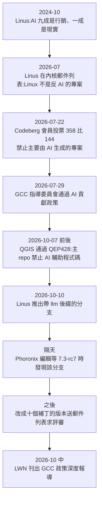
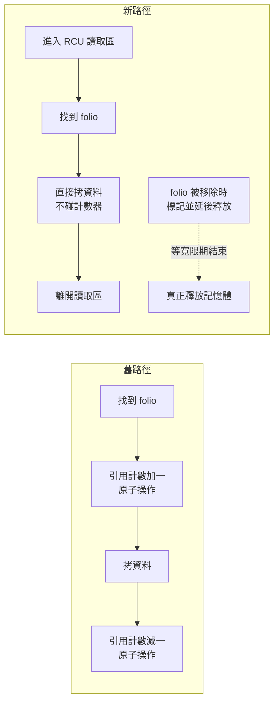
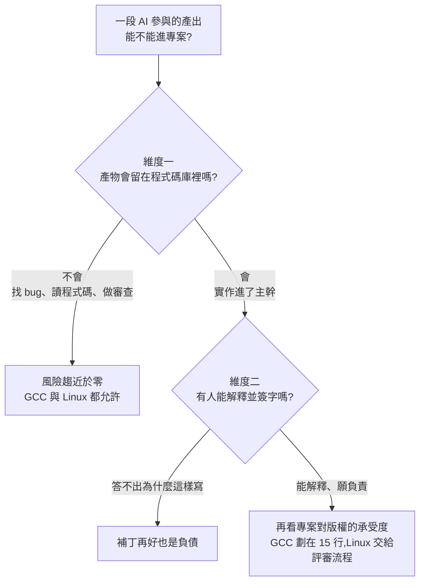

# Linus 用 Claude Code 寫內核補丁、GCC 劃下 15 行紅線:AI 寫的程式碼能不能進專案,看兩個維度

> 整理自 YouTube 頻道 **Why QQ(為什麼叫 QQ)**〈[Linux之父也有AI写内核，GCC设置15行红线](https://www.youtube.com/watch?v=xqP_4umh55I)〉(2026-10-17,約 9.7 分鐘,官方 zh-Hans 字幕)。
>
> **核實狀態:**
> - **已核對:** Phoronix、GCC 郵件列表的政策公告原文、Codeberg 與 QGIS 的報導。
> - **可信:** 補丁的技術做法與筆電上的數字。
> - **未能找到原始出處:** 「Threadripper 23 倍」「Jeff Law 實測約兩成有用」「OpenJDK 零容忍」三項。詳見 §6。
>
> **狀態提醒:** 截至 2026-10-18,**Linus 的補丁仍在評審、尚未合併進主線**。
>
> **整理日期:** 2026-10-18

---

## TL;DR

1. **同一個十月,兩個最老牌的開源專案擺出看似相反的姿勢。**
   - Linus Torvalds 推了一個叫 `noref-filemap-read-with-llm` 的分支,補丁信寫明程式碼、測試程式、問題清單審查和信的初稿都由 **Claude Code 在他指揮下完成**。
   - GCC 指導委員會則通過政策:**有法律意義的貢獻(約 15 行以上),只要含有或源自 LLM 生成內容,一律拒收**,人工改寫過也一樣。
2. **補丁解決的問題:** 多執行緒讀同一個檔案時,每次讀取都要對頁快取裡 folio 的引用計數做原子加減。這條快取行在核心之間來回彈,筆電八執行緒小讀取時,它占了跨核快取爭用的 99.92%。
   - **解法:** 用 RCU 延遲釋放,讓讀取路徑**完全不碰引用計數**。
   - **效果:** 筆電八執行緒吞吐約 1,000 萬次/秒升到 3,000 萬次以上。
   - **代價:** 單執行緒小讀取反而變慢。
3. **評審沒有因為是 AI 寫的就放水。** Kiryl Shutsemau 揪出一個競態,Matthew Wilcox 質疑旗標設計,流程跟任何人寫的補丁一樣。社群的說法是「AI 寫程式碼,人來背鍋」。
4. **作者的判斷:矛盾只存在於標題裡。** 兩邊都接受 AI 當工具,也都要求「一定要有人能解釋並簽字」。分歧只在一點:**GCC 背後是 GPL 的版權鏈條**,機器生成物的版權地位未定,他們賭不起。
5. **可複用的框架:** AI 參與的程式碼能不能進專案,看兩個維度:**產物會不會留在程式碼庫裡**、**有沒有人能解釋並簽字**。

---

## 1. 時間線

三個月裡,這位 56 歲的程式設計師從「忽略 AI」走到「用 AI 改內核」。

---

## 2. 補丁改了什麼:讓競態「不可能發生」,而不是去偵測它

### 2.1 問題:一條被八個核心搶來搶去的快取行

- 程式每次讀檔,內核都要在**頁快取(page cache)**找到對應的 **folio**(可以粗略理解成一頁快取資料)。
- 找到後引用計數加一,讀完再減一。
- 單執行緒沒差;八個執行緒同時讀同一個檔案,八個 CPU 核就會反覆**原子修改同一個計數器**。
- 這個計數器住在同一條**快取行(cache line)**裡,快取行在核心之間來回彈,大量時間花在互相等待。
- Linus 的數據:筆電上八執行緒做 16 位元組小讀取時,這一條快取行占了**跨核快取爭用的 99.92%**。

這個問題 2024 年就由 Oracle 的 Matthew Wilcox 從客戶負載裡挖出來,兩年沒人修好。

### 2.2 舊做法與新做法

| | 舊的嘗試 | Linus 的做法 |
|---|---|---|
| 思路 | 先不拿引用,直接拷資料,拷完再校驗 | 不去偵測競態,**直接讓競態不可能發生** |
| 問題 | 校驗看不到的競態太多:頁被釋放、被重用、又被塞回原位 | 代價轉移到記憶體延後釋放 |
| 機制 | — | folio 從頁快取移除時打上 `PG_rcu_free` 標記,**記憶體先不還**,等 RCU 寬限期結束才真正釋放 |

**為什麼這樣就安全:** RCU 寬限期結束,代表所有正在讀的執行緒都已經離開臨界區。所以讀取路徑可以完全不碰引用計數,資料直接從頁拷到使用者緩衝區。

**安全閥:** 單一 CPU 上排隊等釋放的頁超過 **1,024** 個,就強制加速寬限期,避免記憶體堆積。

### 2.3 數字與代價

| 測試 | 前 | 後 | 備註 |
|---|---|---|---|
| 筆電八執行緒 16 位元組讀取 | 約 1,000 萬次/秒 | 3,000 萬次/秒以上 | 多家報導寫約 3,000–3,300 萬;報導指出是 Core i7-8565U 筆電 |
| 單次讀取的內核週期 | 約 2,950 | 約 725 | |
| 64 執行緒 Threadripper(第三版) | 1,330 萬 | 3.04 億(約 23 倍) | ❓ 未找到原始數字,見 §6 |

**兩個前提要記住:**

1. **這些都是合成基準。** 真實負載的收益會小得多。LWN 的轉述較保守:讀取密集的基準快了約一個數量級。
2. **補丁有代價。** 讀一個還沒映射的使用者頁時會多一次失敗的例外,**單執行緒小讀取反而慢了五成以上**。Linus 自己在信裡列了十條已知問題。

---

## 3. 評審:AI 寫程式碼,人來背鍋

這套程式碼大半出自 Claude Code,評審它的是人:

- **Kiryl Shutsemau 揪出一個競態:** folio 被替換、而檔案大小又恰好被擴展時,讀者可能拷出**從來沒被寫入過的資料**。Linus 認可後,建議把檔案大小的讀取提前。Kiryl 改進了補丁,後續的工作也交給了他。
- **Matthew Wilcox 質疑 `PG_rcu_free` 標記的設計**,提議改用頁類型;Linus 逐條反駁。
- **流程跟任何人寫的補丁一模一樣:** 沒人因為作者用了 AI 就降低標準,也沒人因此拒絕看程式碼。

**Linus 怎麼用這個工具:**
- 補丁信寫得很清楚:「在他的指揮下完成、測量在他的機器上跑」。方向和驗收標準是他定的,機器是執行者。
- **同一個週末的第二個例子:** Nils Ollrogge 回報了 `assoc_array` 函式庫的一個 bug,並提出修法,但 Linus 覺得程式碼太繞看不懂。他讓 LLM 把大函式拆開、寫使用者空間測試程式,結果不只重現原 bug,**還找出三個新 bug,四個都可以追溯到 2013 年最初的提交**。Phoronix 標題引 Linus 的話「Did What I Preach」。

> **作者的觀點:** 對維護者來說,LLM 最值錢的能力是**讀那些沒人願意讀的老程式碼**。

---

## 4. GCC 的 15 行紅線:版權邏輯

### 4.1 政策內容

政策於 2026-07-29 由指導委員會採納,依工作小組建議。

| 規則 | 內容 |
|---|---|
| **核心禁令** | 拒絕任何**有法律意義**、含有或源自 LLM 生成內容的貢獻 |
| **「有法律意義」的門檻** | 來自 GNU 維護者指南,約 **15 行**程式碼或文字;超過就涉及版權歸屬 |
| **人工改寫無效** | 把 LLM 輸出改一改再交,只要源自模型照樣拒收 |
| **允許的用途** | 用 LLM 讀程式碼、做研究、找 bug、回報問題、審查補丁,只要輸出不進貢獻本身 |
| **例外一:測試案例** | 有法律意義的測試案例,維護者可酌情接受 |
| **例外二:小改動** | 沒有法律意義的小改動,清楚標註後可接受 |
| **標註** | AI 輔助必須加 `Assisted-by:` 標籤。作者補充:`Signed-off-by` 這個法律簽名只能由人簽 |
| **復審** | 2027 年初 |

### 4.2 內部並非一片叫好

- **Richard Biener(2026-07-30 郵件列表):** 政策只站在法律理由上,沒處理他認為更嚴重的問題:**審查者被淹沒**和 **GCC 的長期可維護性**。他也認為,維護者想用 LLM 做原型的貢獻會落入灰色地帶,甚至被拒。
- **Jonathan Wakely 的回應:** 既然政策不允許這類貢獻,就不必浪費審查時間;想放寬政策的人,得先證明不會淹沒審查者、也不會產生沒人看得懂的程式碼。
- **影片引 LWN:** 老牌開發者 Jeff Law 實測用 LLM 輔助審查補丁,只有約兩成輸出真正有用(❓ 未找到原文)。

### 4.3 為什麼版權這麼要緊

作者用一個情境解釋:

1. 多年以後,一個 GPL 專案的大量程式碼由 AI 生成。
2. 有人 fork 它、改成私有授權。
3. 專案方去告,法官問:這些程式碼的版權歸誰?
4. 如果答案是**機器生成物不受版權保護**,GPL 這把保護傘就破了。

美國著作權局目前的立場確實是:著作權需要人類作者。支持 GCC 的人還補了一句:AI 公司自己都在訓練資料上吃過天價和解,專案方憑什麼相信他們說「沒問題」?

> **作者的總結:** GCC 管的不只是一個 repo,是半個自由軟體世界的地基。15 行這條線劃得保守,但**對一個輸不起的專案來說,保守就是理性**。

---

## 5. 判斷框架:兩個維度

- **Linus 和 GCC 的分歧只在維度一的劃線位置**;維度二兩邊完全一致。
- 這個框架也適用公司內部的程式碼庫,兩個問題照樣成立。

**光譜上的其他專案(作者整理):**
- **LLVM:** 走揭露加負責。
- **QGIS:** 2026-09-24 由 Nyall Dawson 提出 QEP428,10 月初通過。主 repo 全面禁止 LLM / agent 輔助的程式碼貢獻,事後發現會撤回並處分。理由是審查負擔:約 50 個標成 AI 輔助的 PR,約 40 個審完被直接關閉。
- **Codeberg:** 2026-07-22 會員投票 **358 比 144**(14 票棄權)通過。使用條款禁止分享主要由生成式 AI 寫成的專案,並承諾永不拿使用者程式碼訓練 AI。理由包括成本(SSD 從約 700 歐元漲到 3,700 歐元)與版權不明,但沒有定義技術門檻與執法方式。

> **一句話收尾(影片):** 工具可以沒有立場,提交紀錄必須有名字。

---

## 6. 數字核實總表

### 已核實

| 說法 | 結果 |
|---|---|
| 分支名 `noref-filemap-read-with-llm`,補丁信寫明由 Claude Code 在 Linus 指揮下完成 | Phoronix 與多家報導一致;Phoronix 的 Michael Larabel 是在等 Linux 7.3-rc7 時發現 |
| 筆電八執行緒約 1,000 萬升到 3,000 萬以上,週期約 2,950 降到 725 | 多家報導一致(約 990–1,040 萬升到 3,000–3,300 萬) |
| RCU 延遲釋放、讀取路徑不碰引用計數、per-CPU 門檻觸發加速寬限期 | 多家報導一致 |
| 單執行緒變慢、有已知問題 | 報導指出單執行緒未快取讀取變貴、至少一個測試案例變慢 |
| `assoc_array`:確認原 bug 並多找出三個、皆可追溯至 2013 年 | Phoronix 有專文 |
| GCC 政策:法律意義約 15 行、人工改寫無效、測試案例例外、`Assisted-by:`、2027 年初復審 | GCC 郵件列表公告與多家報導一致 |
| Richard Biener 批評政策迴避審查負擔與可維護性 | 郵件列表 2026-07-30 |
| Codeberg 358 比 144 | 正確(14 票棄權、7 月 22 日截止) |
| QGIS 禁止 AI 輔助貢獻 | 正確(QEP428) |

### 需留意

| 影片說法 | 補充 |
|---|---|
| 補丁提交日期 10-10 | 有報導寫最上層 commit 為 10-10、cover letter 送郵件列表為 10-12。兩者並不衝突 |
| 第三版、十個補丁 | 另有報導指 `rcu-free-v3` 分支(10-13,十個 commit,其中 8 個 Linus、2 個 Kiryl),**只對被反覆讀取的 folio 延遲釋放**,與最初版本的範圍不同 |
| `PG_rcu_free` 標記名稱 | 公開報導搜尋不到這個名稱,未能獨立確認 |

### 未能獨立核實

- **Threadripper 64 執行緒 1,330 萬到 3.04 億(約 23 倍):** 有報導指 `rcu-free-v3` 在 Threadripper 3970X 上測量,但沒看到這組數字。
- **Jeff Law「約兩成有用」:** 沒找到出處。
- **OpenJDK 零容忍:** 沒找到相關政策報導。
- **Linus 2026-07「Linux 不是反 AI 的專案,接受不了可以 fork 或離開」:** 只見於影片轉述。2024-10 的「九成行銷、一成現實」則是當年 Open Source Summit 的知名發言。

---

## 7. 應用案例

### 案例一:幫團隊寫 AI 程式碼政策

照兩個維度寫成三條規則:

1. **不進程式碼庫的用途全開放:** 讀程式碼、找 bug、審查、寫一次性腳本。
2. **進主幹的 AI 產出**必須加 `Assisted-by:`,提交者要能在 code review 時回答「為什麼這樣寫」;答不出就退件。
3. **對外發佈的 GPL / 客戶授權專案**,另請法務評估版權風險,決定要不要比照 GCC 設行數門檻。

### 案例二:像 Linus 一樣「指揮」AI 做效能優化

想優化一個熱點時,把角色分清楚:

- **你負責:** 定方向(「讀取路徑不要碰引用計數」)、定驗收標準(八執行緒吞吐、單執行緒不退步太多)、**在自己機器上量測**。
- **AI 負責:** 寫實作、寫測試程式、列出已知問題清單。
- 補丁說明要誠實列出代價,例如單執行緒慢了多少。

### 案例三:用 LLM 讀沒人敢碰的老程式碼

接手一段 2013 年寫的、沒人看得懂的模組,學 Linus 處理 `assoc_array` 的做法:

1. 先請 LLM 把大函式拆成小函式,**只為了可讀性,不改行為**。
2. 再請它寫使用者空間的測試程式重現已知 bug。
3. 測試程式常常會順便抓出別的潛伏 bug。

這屬於「不留在程式碼庫裡」的用途,風險低、收穫高。

### 案例四:評估合成基準的頭條數字

看到「快了 23 倍」先問三件事:

1. 是合成基準還是真實負載?
2. 測的是哪個版本的補丁、哪台機器?
3. 有沒有變慢的情境?

這次的答案是:合成基準、第三版、Threadripper;單執行緒小讀取慢了五成以上。

---

## 來源

- YouTube:[Linux之父也有AI写内核，GCC设置15行红线](https://www.youtube.com/watch?v=xqP_4umh55I)(Why QQ,2026-10-17,官方 zh-Hans 字幕)
- [Linus Torvalds "Did What I Preach", Used AI To Make Code Decipherable & Uncovered More Bugs(Phoronix)](https://phoronix.com/news/Linus-Torvalds-Assoc-Array)
- [Torvalds Page Cache Patches: Claude Code Use and Benchmarks(braindetox.kr,引用 Phoronix)](https://braindetox.kr/en/posts/torvalds_claude_code_page_cache_folio_patches_2026.html)
- [Linus Torvalds Credits Claude Code in Linux Page-Cache Patch Series(Let's Data Science)](https://letsdatascience.com/news/linus-torvalds-credits-claude-code-in-linux-page-cache-patch-eb6e08c2)
- [Linux Claude Code parallel read(XenoSpectrum)](https://xenospectrum.com/en/linux-claude-code-parallel-read/)
- [GCC AI Policy Announcement(GCC 郵件列表,2026-07)](https://gcc.gnu.org/pipermail/gcc/2026-July/248641.html)
- [Working Group for GCC AI Policy(GCC Wiki)](https://gcc.gnu.org/wiki/working-group-ai-policy)
- [GCC To Decline Any Significant Contributions Made Via AI/LLMs - Except For Test Cases(Phoronix)](https://phoronix.com/news/GCC-Declining-AI-Contributions)
- [What the GCC AI policy actually says, and the debate around it](https://lechynte.srht.site/blog/gcc-ai-policy.html)
- [Codeberg Has Drawn a Hard Line on Use of AI With Community Backing(It's FOSS)](https://itsfoss.com/news/codeberg-bans-ai-contributions/)
- [Codeberg has decided to ban predominantly AI-generated repositories after a community vote(AlternativeTo)](https://alternativeto.net/news/2026/7/codeberg-has-decided-to-ban-predominantly-ai-generated-repositories-after-a-community-vote/)
- [QGIS bans AI-assisted contributions to protect its maintainers(zeli.app)](https://zeli.app/story/50054751)
