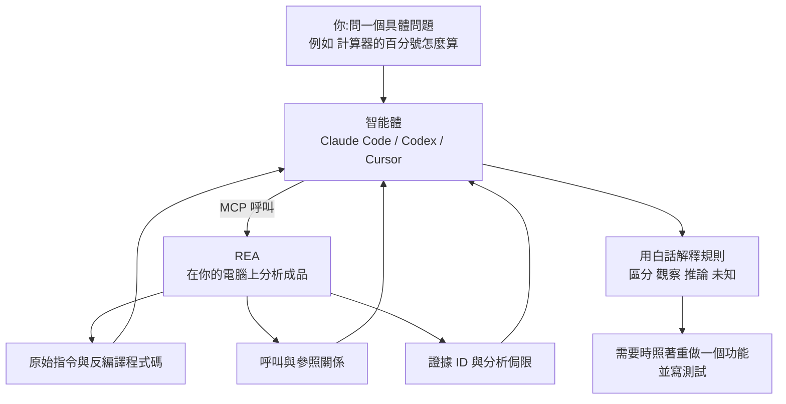

# REA:讓 Claude Code 帶著證據做逆向工程——分工、三類成品、四個案例與五個新手坑(YAHA學堂 + 原始碼)

**主題分類:** 科技 / 軟體工程 — AI 輔助逆向工程
**來源:** YouTube〈GitHub Trending爆火：Claude Code接入REA，小白也能做逆向 | AI逆向入门教程〉(YAHA學堂,2026-10-11,約 11.8 分;自動字幕連續被限流,逐字稿以 CPU faster-whisper 轉錄、非官方字幕)
**原始碼核實:** 已 `git clone --depth 1` [morluto/rea](https://github.com/morluto/rea)(MIT,本文查詢時約 10.2 萬 star,npm 套件 `rea-agents` 6.4.0,最後 commit 2026-10-12 `eaf88ac`),讀 README、內建 skill `.agents/skills/reverse-engineer-anything/SKILL.md`(version 39)、官網證據檔 `website/evidence/calculator-and-dino.md`、`guide-examples.md` 與入門練習的 `notes-electron` 範例原始碼
**整理日期:** 2026-10-12

> 📌 立場:本片未見業配或聯盟連結(片尾請觀眾按 YouTube 的 Hype 助推)。
> ⚖️ REA 只用於合法的研究、分析與重建;需要的授權與法律合規由使用者自己負責。對有 EULA 明文禁止逆向的軟體,請先確認再動手。
> 🔗 本庫 [[issue-134]] 有 REA 的專案速覽(支援目標總表、官方案例、安裝指令);本篇聚焦「怎麼用、怎麼驗、會踩什麼坑」。

---

## TL;DR

1. ⭐ **逆向工程** = 拿不到原始碼,直接從裝在電腦上的成品往回推,把一個功能搞懂到能講清楚、能改、或能自己重做一個。
2. ⭐⭐ **REA 改變的是分工**:REA 負責**把材料拿回來**(原始指令、反編譯程式碼、呼叫關係),**智能體負責解釋**(走哪個分支、算什麼、要重建該怎麼寫),**你只剩一件事:問一個具體的問題**。REA 透過 MCP 接到 Claude Code、Codex、Cursor 等智能體,也能不經智能體在終端機直接跑。
3. ⭐⭐⭐ **跟「直接問模型」的差別在證據**:直接問模型「計算器的百分號怎麼算」,它手上沒有這個程式的任何材料,只能憑印象答;REA 回傳的結論**帶著依據**(哪個位址的指令、哪個檔案哪一行、這次分析有哪些侷限),而且 skill 規定**觀察、推論、未知要分開講**,只讀檔案得出的結論**不能說成程式真的這樣跑過**。
4. ⭐ **一句口訣:原始碼完整用程式碼工具,結論要靠成品才找 REA。** REA 自帶的 skill 也寫明:分析完整的原始碼 repo 時不要用它。
5. ⭐⭐ **五個新手坑**:本地分析≠什麼都不外流;裝了 skill ≠ 能用;不是一上來就要裝 IDA / Ghidra;拿到答案就收工;只更新 CLI 忘了重跑 setup。

---

## 1. 開場題:為什麼 200 + 10% = 220?

Windows 計算器(標準模式):

| 輸入 | 結果 | 規則 |
|---|---|---|
| `200 + 10%` | **220** | 前面是加減號:10% 取**第一個數**的 10% ⇒ 200 × 10 ÷ 100 = 20,再 200 + 20 |
| `200 × 10%` | **20** | 前面是乘除號:10% 直接變成 0.1 ⇒ 200 × 0.1 |

同一個按鈕,跟著前面的運算子換規則——這種規則**介面上不會告訴你**。手工逆向至少要過三關:


> ✅ **原始碼核實(官網證據檔):** REA 分析的是已安裝 Windows Calculator 11.2508.4.0 的 `CalcViewModel.dll`,函式 `0x1801245d0` 的 `case 0x76`(百分號)把運算子欄位和 `0x5c`、`0x5b` 比較,兩條路徑都建構常數 100。對照 Microsoft 以 MIT 公開的原始碼:`IDC_DIV = 91`(`0x5b`)、`IDC_MUL = 92`(`0x5c`)、`IDC_PERCENT = 118`(`0x76`);乘除時用 `rat / 100`,其他運算子用 `rat * (m_lastVal / 100)`——與影片講的規則一致。
>
> ⚠️ **影片沒講、但很重要的一段:** 證據檔明寫這個 binary 是 stripped(沒有符號),**是先用一段本地指令掃描、靠運算子 ID 與常數 100 找出候選函式,再由 REA 產出完整的函式檔案**——「**函式的選定是分析者輔助的**」,影片示範的提示詞「**不是一次自主端到端發現的錄影**」。另外 Microsoft 的單元測試只被閱讀、沒有執行。所以這個案例證明的是「找到函式後,REA + 智能體能把規則講清楚並對上原始碼」,**不是**「丟一句話就能從零找到」。

---

## 2. REA 的分工與證據規則



**MCP 是什麼(影片的比喻):** 一個統一的插座,智能體透過它呼叫外部工具;支援本地 MCP 的智能體都能接。不想經過智能體也可以在終端機直接跑同一套分析流程。

**skill 裡寫死的證據紀律(✅ 原文):**
- 「Every conclusion must distinguish **observations, inferences, and unknowns**. Cite Evidence IDs, preserve limitations and incomplete coverage, and **never imply that static analysis observed execution**.」
- 範圍大的調查要先把需求拆成問題清單,每題註明需要哪種證據;結束前回頭逐題標「已回答 / 部分回答 / 未解決」,**有題目沒解完就不能說調查完成**。
- 執行期觀察(真的把目標跑起來)只在靜態證據回答不了時才用,而且只能做請求裡宣告的目標與動作。

> 對使用者的好處(影片):答案出錯時,你能**順著證據一路找回去**,用不著在「信」和「不信」之間硬選。

---

## 3. 什麼時候該用:口訣與三類成品

**判斷標準:** 你要下的結論,靠的是**已經發出來的成品**,還是**你手上完整的原始碼**?
- 完整原始碼 ⇒ 用一般的程式碼工具(REA skill 原文:「For ordinary analysis of a complete source repository, use normal repository tools and do not run REA」)。
- 成品(安裝包、編譯好的程式、打包好的應用、正在跑的網頁)⇒ 才輪到 REA。

**怎麼問:** 官方建議從**一個具體的按鈕、檔案或行為**問起。大任務也能做(照著一個網站重做、從老遊戲的程式還原玩法),但最好拆成一個個具體問題。

| 成品類型 | 例子 | 需要什麼 |
|---|---|---|
| 編譯好的原生程式 | `.exe`、動態函式庫 | 深入分析要接一個分析引擎:**Hopper、Ghidra 或 IDA 擇一**(能用哪個看你的系統與檔案) |
| Electron 桌面應用 | Notion 桌面版(網頁技術外面包一層殼) | **直接讀檔案,不用啟動它、也不用裝分析引擎**,只要 Node.js + npm |
| 網頁 | 正在跑的頁面 | 一個 Chrome 系瀏覽器,就能看頁面結構、正在跑的腳本與網路請求 |

> ⚠️ **只讀檔案的分析不會執行程式;要觀察「跑起來」的行為,就會真的用你自己帳號的權限去執行或操作目標。** 這兩種模式的風險不同。

---

## 4. 四個案例:每個都要「讀到真的在跑的東西 + 再核對一次」

### 4.1 Chrome 小恐龍為什麼越跑越快(網頁)

REA 查的是一個從 Chromium 移植出來的**網頁版**(wayou/t-rex-runner),把頁面實際在跑的腳本拿回來,規則一看就清楚:**初速 6,每次沒撞到障礙的更新加 0.001,速度低於 13 就一直加。**

有意思的是後面的核對——在受控的瀏覽器環境裡直接呼叫原遊戲的更新函式:

| 更新次數 | 速度 |
|---|---|
| 0 | 6 |
| 1,000 | 7.000 |
| 4,000 | 10.000 |
| 7,000 | 13.000 |
| 10,000 | **13.001** |

**為什麼會比 13 多一點?** 因為程式是**先判斷、再加**:最後一次判斷時還沒到 13(浮點數累加差一點點),通過判斷後再加 0.001 就超過了。這種細節**光靠猜是猜不出來的**,得讀到真正在跑的程式碼,再實際跑一遍核對。

> ✅ **原始碼核實:** 設定值 `ACCELERATION: 0.001`、`MAX_SPEED: 13`、`SPEED: 6`;更新分支是「沒碰撞且速度低於門檻就加速」。📌 **補充:** 證據檔寫明這個核對**是 REA 被動檢查之後,另外用 Playwright 控制器呼叫 `Runner.update()` 做的**(關掉後續排程與障礙物生成),**不是 REA 本身執行的**;REA 也不會選取 `chrome://dino/`,目標是 HTTP 版網頁。重建時刻意**保留**這個「超過一點點」的行為,沒有加上限截斷。

### 4.2 DX-Ball:偽程式碼說沒算,原始指令說算了(原生程式)

一個開源專案在用 C 重寫 1996 年的 Windows 老遊戲 DX-Ball,其中一步要弄清**磚塊被打中時,聲音怎麼依位置分到左右聲道**。

- 反編譯器推出的**偽程式碼**顯示這個函式沒有輸入、裡面只呼叫了一個型別轉換——只看這層,你會以為它什麼都沒算。
- 但 REA 在同一個結果裡**也給了原始指令**:指令明明讀進一個整數,還做了幾次帶小數的運算。**就是這個對不上的地方,讓智能體知道還得接著查。**
- 智能體順著呼叫者找到輸入是什麼,再從程式檔依位址讀出幾個常數,最後寫出一個很短的 C 函式。
- 過了兩道檢查:**與原程式比對 3,205 組輸入,回傳值全部對上**;用當年的編譯器編出來,**這個函式的 63 個位元組與原程式完全一致**。

> 要帶走的是:**偽程式碼是反編譯器推出來的,可能漏東西;有原始指令對照,才查得出它漏在哪。**

### 4.3 Notion 的複製功能:Electron 的 IPC 鏈怎麼追

Electron 應用的難點不一樣:一個功能常常拆在**頁面腳本、preload、後台主程序**好幾處,靠程序間訊息(IPC)串起來。例如 Notion 複製文字時,頁面呼叫的寫剪貼簿方法只是包裝,**真正寫入在主程序那頭**。REA 先在壓縮過的程式碼裡標出入口檔案與 IPC 關係,智能體再一層層解開。

### 4.4 入門練習:6 個檔案的筆記小應用(✅ 已讀範例原始碼)

官方的 first-investigation 練習是一個只有 6 個檔案的 Electron 筆記應用(`csv.js`、`index.html`、`main.js`、`package.json`、`preload.js`、`renderer.js`),有一個「匯出筆記」按鈕:

1. **先問:** 匯出的檔案寫到哪?有哪幾欄?
   - 答案:**下載資料夾裡的 `notes.csv`**,兩欄 `id`、`title`(`main.js` 用 `app.getPath("downloads")` 組路徑,`csv.js` 的 `toCsv` 產生內容)。
2. **再讓它預測:** 標題裡本身帶逗號和引號會變成什麼?
3. **真的跑一遍格式化函式,看預測對不對:**

```csv
id,title
1,"Hello, ""REA"""
```

> 官方證據檔記錄:輸入 `[{ id: 1, title: 'Hello, "REA"' }]` 跑 `toCsv` 得到上面的結果。📌 注意它**只驗證了格式化**;「寫到下載資料夾」仍是從 `main.js` 讀出來的結論,**沒有真的啟動 Electron app 觀察到完整的「按鈕到檔案」路徑**——這正是第 2 節「不能把靜態結論說成跑過」的實例。

---

## 5. 新手最容易踩的五個坑

| # | 坑 | 正確理解 |
|---|---|---|
| 1 | **「工具在本地跑,就什麼都不會出去」** | REA 確實在你電腦上分析,但**分析結果會交給智能體,智能體背後的模型服務商有自己的資料政策**。公司內部程式拿去分析前先想清楚這一層(README FAQ 原文也這樣寫) |
| 2 | **以為裝了 skill 就能用** | REA 的 skill 只是一份給智能體的**調查說明書**(skill 原文:「Installing this skill supplies instructions; it does not register the REA MCP server」)。真正幹活的 MCP 服務要靠官方 `setup` 接上:它會**先列出要改的設定、備份舊設定,你同意才動手**;裝完**重啟智能體**。還看不到工具就用官方指令查註冊狀態,註冊正常仍沒有就去看智能體那邊的連線錯誤,**別一遍遍重裝** |
| 3 | **以為一上來就得裝好 IDA 或 Ghidra** | 只有**原生程式的深入分析**才需要分析引擎;JavaScript 與 .NET 的靜態檢查用不著 |
| 4 | **拿到答案就收工** | 前面的案例都和原程式的結果比過(恐龍、DX-Ball);計算器碰巧有 Microsoft 公開的原始碼可對答案。你自己用也一樣:**讓智能體給出檔案與行號,再出一個小預測去驗證** |
| 5 | **版本** | REA 更新很快、修復頻繁,碰到問題**先更新**。⚠️ 智能體那邊登記的是**固定版本**,光更新 CLI 不夠,要**重跑一次 setup、再重啟智能體**,新版本才生效 |

```bash
# 需要 Node.js 22.19+ / 24.11+ / 26+ 與 npm
npx rea-agents setup                 # 首次:選智能體、審核變更、套用;完成後重啟智能體
npx rea-agents@latest setup          # 更新:用 npx 的人要重跑 setup 才會換版本
rea update                           # 若是 npm install --global 安裝的 CLI

# 不經智能體,直接分析一個解開的 Electron 應用 / ASAR
npx -y rea-agents@latest analyze-javascript-application /absolute/path/to/app --json
```

> 📌 **補充(skill 原文):** setup **不會**替你安裝或升級無關的軟體(Node.js、npm、Homebrew、Java、Ghidra、IDA、JADX、Binwalk、Unblob 都不會);若使用者只說「我的 app」沒給名稱或路徑,skill 要求智能體**先問是哪個 app**,不能自己挑範例 app 代替。

---

## 6. 應用案例

### 案例一:搞懂自家舊系統的一個怪規則(原始碼遺失)

公司有一個十年前外包的 Windows 報價工具,原始碼找不到了,業務發現「折扣 + 稅」的算法在某些情況下跟 Excel 對不上:
1. 確認這是**你們有權分析的成品**(公司自有軟體),且分析結果送進的模型服務符合公司資料政策(坑 1)。
2. 跑 `npx rea-agents setup` 接上 Claude Code,並準備一個 Ghidra(原生程式需要分析引擎,坑 3)。
3. 問具體問題:「報價工具在『折扣後含稅』按鈕的計算邏輯是什麼?給我位址、偽程式碼與原始指令,並標出哪些是推論。」
4. 拿到規則後,**出 5 組你知道答案的輸入**讓智能體預測,再到原程式上實際輸入比對(坑 4);全部對上才把規則寫進新系統的單元測試。

### 案例二:學別人的 Electron App 怎麼做某個體驗

想做一個「複製時自動帶出處連結」的功能,好奇某個筆記軟體怎麼做:
1. 找到安裝目錄裡的 `app.asar`,用 `analyze-javascript-application` 先看模組與 IPC 關係(不用啟動 App、不用分析引擎)。
2. 請智能體追「渲染程序的剪貼簿 API → preload → IPC → 主程序」整條鏈(同 4.3 Notion 案例),**只摘要機制、不複製對方程式碼**。
3. 用自己的話重寫一版,並把「觀察到的行為」與「自己的設計選擇」分開記錄(skill 收尾段的要求)。

### 案例三:團隊導入 REA 的檢查清單

- [ ] 寫下哪些軟體**可以**分析(自有軟體、開源成品、授權允許的),哪些不行(EULA 禁止逆向的第三方商業軟體)。
- [ ] 確認智能體背後的模型服務資料政策,機密程式改用符合規範的部署(坑 1)。
- [ ] 版本更新流程寫成兩步:`npx rea-agents@latest setup` + 重啟智能體(坑 5)。
- [ ] 所有逆向結論在 PR 或文件裡附證據 ID,並標「觀察 / 推論 / 未知」。

---

## 7. 核實總表

| 類別 | 項目 |
|---|---|
| ✅ 已核實 | 計算器規則與運算子 ID(對照 Microsoft MIT 原始碼);小恐龍參數 6 / 0.001 / 13 與 1,000 / 4,000 / 10,000 次更新的速度;DX-Ball 3,205 組比對與 63 位元組一致;Electron 靜態分析不需分析引擎;原生深入分析用 Hopper / Ghidra / IDA;入門練習 6 個檔案、輸出到下載資料夾的 `notes.csv`、兩欄 `id,title`;setup 先列變更、備份、同意才套用、裝完重啟;更新後需重跑 setup;本地分析但結果會送到模型服務商 |
| 📌 補充 | 計算器案例的**函式選定是分析者輔助的**,示範提示詞不是自主端到端發現的錄影;小恐龍的速度核對是 **REA 之外另用 Playwright** 做的;入門練習只驗證了 CSV 格式化,匯出位置仍是靜態結論;skill 明文規定完整原始碼不要用 REA、不能把靜態分析說成觀察到執行 |
| ⚠️ 版本提醒 | 官網證據檔用的是 `rea-agents` **4.1.0**(2026-10-07~09 錄製),本文查詢時 npm 已是 **6.4.0**;工具清單以連上的 MCP server 實際提供的為準(skill 原文也這樣要求) |

---

## 來源

- [YouTube:GitHub Trending爆火：Claude Code接入REA，小白也能做逆向 | AI逆向入门教程(YAHA學堂,2026-10-11)](https://www.youtube.com/watch?v=o8Ca8Y9LG_0)(自動字幕被限流,逐字稿以 CPU faster-whisper 轉錄、非官方字幕;已還原專有名詞:「Rea / Rei / 瑞」→ REA、「分枫 / 分枂引擎」→ 分析引擎、「GDI / Gidera」→ Ghidra、「Dexpo / DXBall」→ DX-Ball、「伟代码」→ 偽程式碼、「绘编」→ 組合語言、「mcps」→ MCP)
- [morluto/rea GitHub repo](https://github.com/morluto/rea)
- [REA 內建 skill:reverse-engineer-anything/SKILL.md](https://github.com/morluto/rea/blob/main/.agents/skills/reverse-engineer-anything/SKILL.md)
- [REA 官網證據檔:Calculator and dinosaur beginner examples](https://github.com/morluto/rea/blob/main/website/evidence/calculator-and-dino.md)
- [REA 官網證據檔:Guide example evidence(Notes 範例與 first-investigation 格式化核對)](https://github.com/morluto/rea/blob/main/website/evidence/guide-examples.md)
- [REA 官網](https://rea.tools/) · [入門練習 first investigation](https://rea.tools/first-investigation/) · [案例集](https://rea.tools/showcase/)
- [Microsoft Calculator 原始碼:百分號分支(scifunc.cpp)](https://github.com/microsoft/calculator/blob/d125246a4e19842ce1332e6c7839cf0e110027d8/src/CalcManager/CEngine/scifunc.cpp#L98-L111)
- [wayou/t-rex-runner:速度設定](https://github.com/wayou/t-rex-runner/blob/5455bfa408ec6b707c7300ff194b7390733a766d/index.js#L106-L135)

📎 相關筆記:[[issue-134]](GitHub 週報收錄 REA)、[[claude-code-mods-explained]](同為擴充 Claude Code 能力,但 mod 跑在行程內、MCP 在行程外)
