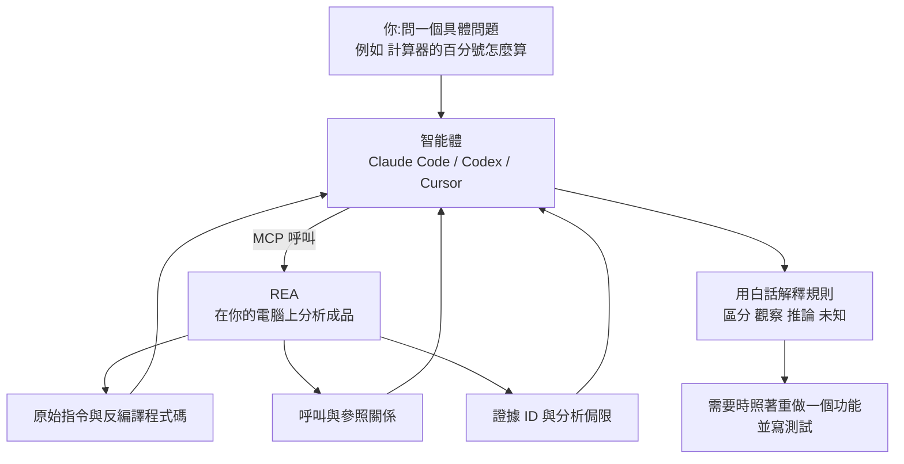
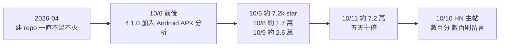
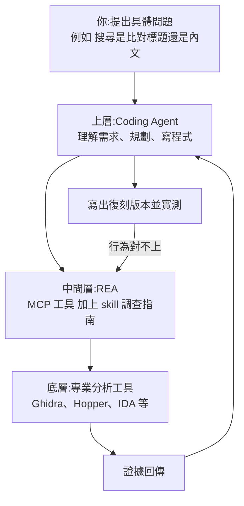

# REA:讓 Claude Code 帶著證據做逆向工程——分工、三類成品、四個案例與五個新手坑(YAHA學堂 + 原始碼)

**主題分類:** 科技 / 軟體工程 — AI 輔助逆向工程
**來源:** YouTube〈GitHub Trending爆火：Claude Code接入REA，小白也能做逆向 | AI逆向入门教程〉(YAHA學堂,2026-10-11,約 11.8 分;自動字幕連續被限流,逐字稿以 CPU faster-whisper 轉錄、非官方字幕)
**原始碼核實:** 已 `git clone --depth 1` [morluto/rea](https://github.com/morluto/rea)(MIT,本文查詢時約 10.2 萬 star,npm 套件 `rea-agents` 6.4.0,最後 commit 2026-10-12 `eaf88ac`),讀 README、內建 skill `.agents/skills/reverse-engineer-anything/SKILL.md`(version 39)、官網證據檔 `website/evidence/calculator-and-dino.md`、`guide-examples.md` 與入門練習的 `notes-electron` 範例原始碼
**增補來源(§8):** YouTube〈五天七万星：逆向工程被 AI 重写了〉(Why QQ,2026-10-12,約 9.7 分;官方 zh-Hans 字幕),數字已對照 6.4.0 原始碼、CHANGELOG 與 HN 公開 API
**增補來源(§9):** YouTube〈REA 到底在紅什麼？原理、實測，以及我的看法〉(Gary Chen,2026-10-15,約 13.4 分;官方 zh-TW 字幕;作者導流自家 Skool 付費社群,本文不轉述付費素材)
**整理日期:** 2026-10-12(2026-10-13 增補 §8、2026-10-16 增補 §9)

> 📌 立場:本片未見業配或聯盟連結(片尾請觀眾按 YouTube 的 Hype 助推)。
> ⚖️ REA 只用於合法的研究、分析與重建;需要的授權與法律合規由使用者自己負責。對有 EULA 明文禁止逆向的軟體,請先確認再動手。
> 🔗 本庫 [[issue-134]] 有 REA 的專案速覽(支援目標總表、官方案例、安裝指令);本篇聚焦「怎麼用、怎麼驗、會踩什麼坑」。

---

## TL;DR

1. ⭐ **逆向工程** = 拿不到原始碼,直接從裝在電腦上的成品往回推,把一個功能搞懂到能講清楚、能改、或能自己重做一個。
2. ⭐⭐ **REA 改變的是分工**:REA 負責**把材料拿回來**(原始指令、反編譯程式碼、呼叫關係),**智能體負責解釋**(走哪個分支、算什麼、要重建該怎麼寫),**你只剩一件事:問一個具體的問題**。REA 透過 MCP 接到 Claude Code、Codex、Cursor 等智能體,也能不經智能體在終端機直接跑。
3. ⭐⭐⭐ **跟「直接問模型」的差別在證據**:直接問模型「計算器的百分號怎麼算」,它手上沒有這個程式的任何材料,只能憑印象答;REA 回傳的結論**帶著依據**(哪個位址的指令、哪個檔案哪一行、這次分析有哪些侷限),而且 skill 規定**觀察、推論、未知要分開講**,只讀檔案得出的結論**不能說成程式真的這樣跑過**。
4. ⭐ **一句口訣:原始碼完整用程式碼工具,結論要靠成品才找 REA。** REA 自帶的 skill 也寫明:分析完整的原始碼 repo 時不要用它。
5. ⭐⭐ **五個新手坑**:本地分析≠什麼都不外流;裝了 skill ≠ 能用;不是一上來就要裝 IDA / Ghidra;拿到答案就收工;只更新 CLI 忘了重跑 setup。

---

## 1. 開場題:為什麼 200 + 10% = 220?

Windows 計算器(標準模式):

| 輸入 | 結果 | 規則 |
|---|---|---|
| `200 + 10%` | **220** | 前面是加減號:10% 取**第一個數**的 10% ⇒ 200 × 10 ÷ 100 = 20,再 200 + 20 |
| `200 × 10%` | **20** | 前面是乘除號:10% 直接變成 0.1 ⇒ 200 × 0.1 |

同一個按鈕,跟著前面的運算子換規則——這種規則**介面上不會告訴你**。手工逆向至少要過三關:


> ✅ **原始碼核實(官網證據檔):** REA 分析的是已安裝 Windows Calculator 11.2508.4.0 的 `CalcViewModel.dll`,函式 `0x1801245d0` 的 `case 0x76`(百分號)把運算子欄位和 `0x5c`、`0x5b` 比較,兩條路徑都建構常數 100。對照 Microsoft 以 MIT 公開的原始碼:`IDC_DIV = 91`(`0x5b`)、`IDC_MUL = 92`(`0x5c`)、`IDC_PERCENT = 118`(`0x76`);乘除時用 `rat / 100`,其他運算子用 `rat * (m_lastVal / 100)`——與影片講的規則一致。
>
> ⚠️ **影片沒講、但很重要的一段:** 證據檔明寫這個 binary 是 stripped(沒有符號),**是先用一段本地指令掃描、靠運算子 ID 與常數 100 找出候選函式,再由 REA 產出完整的函式檔案**——「**函式的選定是分析者輔助的**」,影片示範的提示詞「**不是一次自主端到端發現的錄影**」。另外 Microsoft 的單元測試只被閱讀、沒有執行。所以這個案例證明的是「找到函式後,REA + 智能體能把規則講清楚並對上原始碼」,**不是**「丟一句話就能從零找到」。

---

## 2. REA 的分工與證據規則



**MCP 是什麼(影片的比喻):** 一個統一的插座,智能體透過它呼叫外部工具;支援本地 MCP 的智能體都能接。不想經過智能體也可以在終端機直接跑同一套分析流程。

**skill 裡寫死的證據紀律(✅ 原文):**
- 「Every conclusion must distinguish **observations, inferences, and unknowns**. Cite Evidence IDs, preserve limitations and incomplete coverage, and **never imply that static analysis observed execution**.」
- 範圍大的調查要先把需求拆成問題清單,每題註明需要哪種證據;結束前回頭逐題標「已回答 / 部分回答 / 未解決」,**有題目沒解完就不能說調查完成**。
- 執行期觀察(真的把目標跑起來)只在靜態證據回答不了時才用,而且只能做請求裡宣告的目標與動作。

> 對使用者的好處(影片):答案出錯時,你能**順著證據一路找回去**,用不著在「信」和「不信」之間硬選。

---

## 3. 什麼時候該用:口訣與三類成品

**判斷標準:** 你要下的結論,靠的是**已經發出來的成品**,還是**你手上完整的原始碼**?
- 完整原始碼 ⇒ 用一般的程式碼工具(REA skill 原文:「For ordinary analysis of a complete source repository, use normal repository tools and do not run REA」)。
- 成品(安裝包、編譯好的程式、打包好的應用、正在跑的網頁)⇒ 才輪到 REA。

**怎麼問:** 官方建議從**一個具體的按鈕、檔案或行為**問起。大任務也能做(照著一個網站重做、從老遊戲的程式還原玩法),但最好拆成一個個具體問題。

| 成品類型 | 例子 | 需要什麼 |
|---|---|---|
| 編譯好的原生程式 | `.exe`、動態函式庫 | 深入分析要接一個分析引擎:**Hopper、Ghidra 或 IDA 擇一**(能用哪個看你的系統與檔案) |
| Electron 桌面應用 | Notion 桌面版(網頁技術外面包一層殼) | **直接讀檔案,不用啟動它、也不用裝分析引擎**,只要 Node.js + npm |
| 網頁 | 正在跑的頁面 | 一個 Chrome 系瀏覽器,就能看頁面結構、正在跑的腳本與網路請求 |

> ⚠️ **只讀檔案的分析不會執行程式;要觀察「跑起來」的行為,就會真的用你自己帳號的權限去執行或操作目標。** 這兩種模式的風險不同。

---

## 4. 四個案例:每個都要「讀到真的在跑的東西 + 再核對一次」

### 4.1 Chrome 小恐龍為什麼越跑越快(網頁)

REA 查的是一個從 Chromium 移植出來的**網頁版**(wayou/t-rex-runner),把頁面實際在跑的腳本拿回來,規則一看就清楚:**初速 6,每次沒撞到障礙的更新加 0.001,速度低於 13 就一直加。**

有意思的是後面的核對——在受控的瀏覽器環境裡直接呼叫原遊戲的更新函式:

| 更新次數 | 速度 |
|---|---|
| 0 | 6 |
| 1,000 | 7.000 |
| 4,000 | 10.000 |
| 7,000 | 13.000 |
| 10,000 | **13.001** |

**為什麼會比 13 多一點?** 因為程式是**先判斷、再加**:最後一次判斷時還沒到 13(浮點數累加差一點點),通過判斷後再加 0.001 就超過了。這種細節**光靠猜是猜不出來的**,得讀到真正在跑的程式碼,再實際跑一遍核對。

> ✅ **原始碼核實:** 設定值 `ACCELERATION: 0.001`、`MAX_SPEED: 13`、`SPEED: 6`;更新分支是「沒碰撞且速度低於門檻就加速」。📌 **補充:** 證據檔寫明這個核對**是 REA 被動檢查之後,另外用 Playwright 控制器呼叫 `Runner.update()` 做的**(關掉後續排程與障礙物生成),**不是 REA 本身執行的**;REA 也不會選取 `chrome://dino/`,目標是 HTTP 版網頁。重建時刻意**保留**這個「超過一點點」的行為,沒有加上限截斷。

### 4.2 DX-Ball:偽程式碼說沒算,原始指令說算了(原生程式)

一個開源專案在用 C 重寫 1996 年的 Windows 老遊戲 DX-Ball,其中一步要弄清**磚塊被打中時,聲音怎麼依位置分到左右聲道**。

- 反編譯器推出的**偽程式碼**顯示這個函式沒有輸入、裡面只呼叫了一個型別轉換——只看這層,你會以為它什麼都沒算。
- 但 REA 在同一個結果裡**也給了原始指令**:指令明明讀進一個整數,還做了幾次帶小數的運算。**就是這個對不上的地方,讓智能體知道還得接著查。**
- 智能體順著呼叫者找到輸入是什麼,再從程式檔依位址讀出幾個常數,最後寫出一個很短的 C 函式。
- 過了兩道檢查:**與原程式比對 3,205 組輸入,回傳值全部對上**;用當年的編譯器編出來,**這個函式的 63 個位元組與原程式完全一致**。

> 要帶走的是:**偽程式碼是反編譯器推出來的,可能漏東西;有原始指令對照,才查得出它漏在哪。**

### 4.3 Notion 的複製功能:Electron 的 IPC 鏈怎麼追

Electron 應用的難點不一樣:一個功能常常拆在**頁面腳本、preload、後台主程序**好幾處,靠程序間訊息(IPC)串起來。例如 Notion 複製文字時,頁面呼叫的寫剪貼簿方法只是包裝,**真正寫入在主程序那頭**。REA 先在壓縮過的程式碼裡標出入口檔案與 IPC 關係,智能體再一層層解開。

### 4.4 入門練習:6 個檔案的筆記小應用(✅ 已讀範例原始碼)

官方的 first-investigation 練習是一個只有 6 個檔案的 Electron 筆記應用(`csv.js`、`index.html`、`main.js`、`package.json`、`preload.js`、`renderer.js`),有一個「匯出筆記」按鈕:

1. **先問:** 匯出的檔案寫到哪?有哪幾欄?
   - 答案:**下載資料夾裡的 `notes.csv`**,兩欄 `id`、`title`(`main.js` 用 `app.getPath("downloads")` 組路徑,`csv.js` 的 `toCsv` 產生內容)。
2. **再讓它預測:** 標題裡本身帶逗號和引號會變成什麼?
3. **真的跑一遍格式化函式,看預測對不對:**

```csv
id,title
1,"Hello, ""REA"""
```

> 官方證據檔記錄:輸入 `[{ id: 1, title: 'Hello, "REA"' }]` 跑 `toCsv` 得到上面的結果。📌 注意它**只驗證了格式化**;「寫到下載資料夾」仍是從 `main.js` 讀出來的結論,**沒有真的啟動 Electron app 觀察到完整的「按鈕到檔案」路徑**——這正是第 2 節「不能把靜態結論說成跑過」的實例。

---

## 5. 新手最容易踩的五個坑

| # | 坑 | 正確理解 |
|---|---|---|
| 1 | **「工具在本地跑,就什麼都不會出去」** | REA 確實在你電腦上分析,但**分析結果會交給智能體,智能體背後的模型服務商有自己的資料政策**。公司內部程式拿去分析前先想清楚這一層(README FAQ 原文也這樣寫) |
| 2 | **以為裝了 skill 就能用** | REA 的 skill 只是一份給智能體的**調查說明書**(skill 原文:「Installing this skill supplies instructions; it does not register the REA MCP server」)。真正幹活的 MCP 服務要靠官方 `setup` 接上:它會**先列出要改的設定、備份舊設定,你同意才動手**;裝完**重啟智能體**。還看不到工具就用官方指令查註冊狀態,註冊正常仍沒有就去看智能體那邊的連線錯誤,**別一遍遍重裝** |
| 3 | **以為一上來就得裝好 IDA 或 Ghidra** | 只有**原生程式的深入分析**才需要分析引擎;JavaScript 與 .NET 的靜態檢查用不著 |
| 4 | **拿到答案就收工** | 前面的案例都和原程式的結果比過(恐龍、DX-Ball);計算器碰巧有 Microsoft 公開的原始碼可對答案。你自己用也一樣:**讓智能體給出檔案與行號,再出一個小預測去驗證** |
| 5 | **版本** | REA 更新很快、修復頻繁,碰到問題**先更新**。⚠️ 智能體那邊登記的是**固定版本**,光更新 CLI 不夠,要**重跑一次 setup、再重啟智能體**,新版本才生效 |

```bash
# 需要 Node.js 22.19+ / 24.11+ / 26+ 與 npm
npx rea-agents setup                 # 首次:選智能體、審核變更、套用;完成後重啟智能體
npx rea-agents@latest setup          # 更新:用 npx 的人要重跑 setup 才會換版本
rea update                           # 若是 npm install --global 安裝的 CLI

# 不經智能體,直接分析一個解開的 Electron 應用 / ASAR
npx -y rea-agents@latest analyze-javascript-application /absolute/path/to/app --json
```

> 📌 **補充(skill 原文):** setup **不會**替你安裝或升級無關的軟體(Node.js、npm、Homebrew、Java、Ghidra、IDA、JADX、Binwalk、Unblob 都不會);若使用者只說「我的 app」沒給名稱或路徑,skill 要求智能體**先問是哪個 app**,不能自己挑範例 app 代替。

---

## 6. 應用案例

### 案例一:搞懂自家舊系統的一個怪規則(原始碼遺失)

公司有一個十年前外包的 Windows 報價工具,原始碼找不到了,業務發現「折扣 + 稅」的算法在某些情況下跟 Excel 對不上:
1. 確認這是**你們有權分析的成品**(公司自有軟體),且分析結果送進的模型服務符合公司資料政策(坑 1)。
2. 跑 `npx rea-agents setup` 接上 Claude Code,並準備一個 Ghidra(原生程式需要分析引擎,坑 3)。
3. 問具體問題:「報價工具在『折扣後含稅』按鈕的計算邏輯是什麼?給我位址、偽程式碼與原始指令,並標出哪些是推論。」
4. 拿到規則後,**出 5 組你知道答案的輸入**讓智能體預測,再到原程式上實際輸入比對(坑 4);全部對上才把規則寫進新系統的單元測試。

### 案例二:學別人的 Electron App 怎麼做某個體驗

想做一個「複製時自動帶出處連結」的功能,好奇某個筆記軟體怎麼做:
1. 找到安裝目錄裡的 `app.asar`,用 `analyze-javascript-application` 先看模組與 IPC 關係(不用啟動 App、不用分析引擎)。
2. 請智能體追「渲染程序的剪貼簿 API → preload → IPC → 主程序」整條鏈(同 4.3 Notion 案例),**只摘要機制、不複製對方程式碼**。
3. 用自己的話重寫一版,並把「觀察到的行為」與「自己的設計選擇」分開記錄(skill 收尾段的要求)。

### 案例三:團隊導入 REA 的檢查清單

- [ ] 寫下哪些軟體**可以**分析(自有軟體、開源成品、授權允許的),哪些不行(EULA 禁止逆向的第三方商業軟體)。
- [ ] 確認智能體背後的模型服務資料政策,機密程式改用符合規範的部署(坑 1)。
- [ ] 版本更新流程寫成兩步:`npx rea-agents@latest setup` + 重啟智能體(坑 5)。
- [ ] 所有逆向結論在 PR 或文件裡附證據 ID,並標「觀察 / 推論 / 未知」。

---

## 7. 核實總表

| 類別 | 項目 |
|---|---|
| ✅ 已核實 | 計算器規則與運算子 ID(對照 Microsoft MIT 原始碼);小恐龍參數 6 / 0.001 / 13 與 1,000 / 4,000 / 10,000 次更新的速度;DX-Ball 3,205 組比對與 63 位元組一致;Electron 靜態分析不需分析引擎;原生深入分析用 Hopper / Ghidra / IDA;入門練習 6 個檔案、輸出到下載資料夾的 `notes.csv`、兩欄 `id,title`;setup 先列變更、備份、同意才套用、裝完重啟;更新後需重跑 setup;本地分析但結果會送到模型服務商 |
| 📌 補充 | 計算器案例的**函式選定是分析者輔助的**,示範提示詞不是自主端到端發現的錄影;小恐龍的速度核對是 **REA 之外另用 Playwright** 做的;入門練習只驗證了 CSV 格式化,匯出位置仍是靜態結論;skill 明文規定完整原始碼不要用 REA、不能把靜態分析說成觀察到執行 |
| ⚠️ 版本提醒 | 官網證據檔用的是 `rea-agents` **4.1.0**(2026-10-07~09 錄製),本文查詢時 npm 已是 **6.4.0**;工具清單以連上的 MCP server 實際提供的為準(skill 原文也這樣要求) |

---

## 8. 增補:爆紅一週、工程設計、門檻與 HN 三條爭論(Why QQ)

> 來源:Why QQ〈五天七万星：逆向工程被 AI 重写了〉(2026-10-12,約 9.7 分;官方 zh-Hans 字幕)。作者自述通讀 v6.3.0 原始碼並讀完 HN 主帖留言。📌 立場:本片未見業配或付費推廣。本節數字已用本文 clone 的 6.4.0 與 HN 公開 API 交叉核對。

### 8.1 爆紅的時間線



- 版本狂飆:作者 clone 時是 6.3.0,**四天內連跳兩個大版本**,10/11 單日就有幾十次提交。
- 作者 morluto:HN 有人認出他是 RepoPrompt 社群的老手,給 Triton、Qwen Code 等專案提過修復(影片轉述,本文未查證)。

> 📌 **查核:** CHANGELOG 顯示 **4.1.0 發布於 10/6**(影片說 10/7;內容是以 headless JADX 整合 Android APK 靜態分析),5.0.0 是 10/7、6.0.0 是 10/8、6.1.0~6.3.0 都在 10/9、**6.4.0 在 10/11**——「一天一個大版本」屬實。HN 主帖(標題「REA – Reverse Engineer Anything」,10/10 發出)本文查詢時為 **783 分、329 則留言**,影片錄製時的 694 分 / 302 則是較早的快照,兩者不矛盾。逐日 star 數本文未找到可回溯的一手資料;本文查詢時(10/12)約 10.2 萬 star。

### 8.2 它是中間層,不是反編譯器

REA **自己一個反編譯器都沒寫**:一頭用 MCP 接 Claude Code / Codex / Cursor,另一頭把 Ghidra、Hopper、IDA 等專業引擎包成 provider;`bridge/` 資料夾裡就是各家引擎的橋接程式(Python 的 Hopper 橋、Ghidra 與 JADX 橋、mitmproxy 抓包腳本、pwndbg / pwntools 等)。工具名稱都是逆向工程師的日常動作:`open_binary`、`search_strings`、`batch_decompile`。

**選引擎的兩條原則(影片稱來自一份架構決策記錄):確定性選擇、永不靜默回退**——Ghidra 掛了就直接報錯,絕不偷偷換一個引擎、塞給你一份來路不明的結果。

> ✅ **原始碼核實:** `docs/cli.md` 寫明:只有一個可用 provider 支援目標時自動選它;**多個都支援就要你明確指定**(`--provider hopper` 或 `REA_ANALYSIS_PROVIDER`,MCP 用 `open_binary` 的 `provider_id`);選定後**綁定在 session 上直到明確切換或關閉**;「**Provider failures are returned with their original reason**」,有歧義時回 `ambiguous` 錯誤並列出候選。精神與影片一致;影片提到的那份「架構決策記錄」本文在 repo 中未找到對應檔名。
>
> 📌 **規模數字(版本不同,不直接比):** 影片說 v6.3.0 的 `src/` 約 27.7 萬行、548 個測試檔、24 個 provider、139 個 MCP 工具、89 個 CLI 命令。本文 clone 的 **6.4.0** 實測 `src/` 非測試 TypeScript 約 25.4 萬行(含測試約 34.8 萬行)、`*.test.ts` 加 `tests/` 共約 1,000 個檔;工具目錄是建置時才產生(`npm run docs:generate`),官方明說以執行中 server 的 `binary_session` 為準,**139 / 24 / 89 本文未獨立計數**。

### 8.3 真正的核心:證據系統與「重建義務帳本」

- **Evidence:** Agent 每呼叫一次工具,回傳的不只是結果,還有**這條結論從哪來**——哪個產物、哪個引擎與版本、信心多高、侷限在哪。原始碼嚴格區分 **observed** 與 **inference**:它不會直接說「這個函式負責搜尋」,而是記下「發現了 `search` 字串 → 函式 A 引用了它 → 所以**推斷** A 可能構造了搜尋請求」。為什麼費這個勁?**因為大模型最擅長看著字串猜功能,而且猜得特別像真的**——REA 整個設計都在防這件事(對照本文第 2 節的 skill 原文)。
- **重建義務帳本(reconstruction obligation ledger):** 你說要複刻某個功能,REA 會把這次複刻**欠下的帳一筆筆列出來**——這個行為有證據嗎?驗證用的測試案例夠不夠?驗證工具的權威性和原始觀察對不對等?**帳不清零,複刻不算完。**

> ✅ **原始碼核實(`docs/reconstruction-obligation-ledgers.md`):** MCP 工具 `build_reconstruction_obligation_ledger` / CLI `rea build-reconstruction-obligation-ledger`,把已驗證的 Evidence 轉成**確定性的重建主張清單**,而且「**conservative by design**」:靜態應用圖的事實只會產生**候選**義務,**不證明執行期行為**;一筆必要義務要關閉,必須同時有唯一負責人、需要的 parser / schema / 型別、**每一個**必要的測試案例,以及一個**權威性與原始觀察相當、且結果出現在證據包裡的驗證器**。矛盾、重複定義、殘留未知、缺少依賴或權威性不足,都會讓帳保持未結或失敗;空請求回傳 `unknown`,「**沒有證據永遠不算結清**」。

這套設計正面回應了 HN 上點讚最高的質疑:「**我直接叫 Claude 自己裝個 Ghidra 不就好了?**」——可以,但那是**自由發揮**,模型想到哪查到哪;REA 給的是**可追溯的流程**,每一步有記錄、每個結論有出處。

### 8.4 門檻沒有宣傳的那麼低

| 項目 | 影片說法 | 查核 |
|---|---|---|
| 原生分析 | 依賴 Ghidra 或 Hopper;Ghidra 免費,但**大型 binary 冷啟動最長要 330 秒** | ✅ `docs/installation.md`:provider 啟動期限**預設 330,000 ms**,可用 `REA_GHIDRA_STARTUP_TIMEOUT_MS` / `REA_HOPPER_STARTUP_TIMEOUT_MS` 調整(這是逾時上限,不是每次都要等這麼久) |
| 授權費 | Hopper 個人版 99 美元、IDA 一年 365 美元起 | ❓ 本文未核實,以各家官網為準 |
| Windows | Ghidra 支援仍屬實驗性質 | ✅ README 連結的文件就叫「experimental Windows Ghidra support」 |
| Node.js | 22.19 以上 | ✅ README:22.x(≥22.19)、24.x(≥24.11)或 26+ |
| 穩定度 | 開著的 issue 過百,集中在引擎連線與路徑處理;6.3.0 就有好幾條 breaking change | 📌 版本確實一天一跳;本文第 5 節「坑 5:更新後要重跑 setup」就是這個現實的對策 |

### 8.5 HN 三條爭論(社群討論,非研究結論)

> ⚠️ 以下是 HN 留言與中文社群的意見整理,屬**自述與觀點**,沒有樣本代表性。

1. **安全:** 安裝方式是把一條指令貼給 Agent 讓它自己裝——有人嘲諷這是「`curl | bash` 的進化版」,信任鏈又拉長一截。(本文第 5 節提到 setup 會先列出變更、備份、經同意才套用,可部分緩解,但仍要信任 npm 套件本身。)
2. **價值:** 這比 Claude 自由發揮強在哪?支持派說是工作流程與證據;反對派說這就是「vibe 逆向」;也有人擔心一百多個工具會把 context window 撐爆(影片說目前靠懶載入勉強壓住)。
3. **版權(吵最兇):** 有人直言「用 LLM 複刻閉源軟體不算淨室開發(clean room),這是 IP 洗白」,底下從 Adobe 克隆一路吵到軟體專利、再吵到智慧財產體系要不要完。

**實際用途(影片轉述):** 逆向老遊戲替開源復刻補完實作;中文社群挖 App 隱藏功能、查可疑軟體有沒有後門、學大廠的程式思路;X 上有人半小時用 SwiftUI 複刻一個付費風扇控制軟體,轉發區一片「付費軟體要完了」。

**對「微信、支付寶、抖音慘遭毒手」這類標題,影片說只對一半:** 客戶端層面確實能分析得七七八八,**但這些產品的核心邏輯在伺服器端**,本地把客戶端翻個底朝天,也碰不到別人的帳戶和餘額。

**法律邊界(影片的整理,非法律意見):** 為學習研究做逆向,多數司法管轄區都容忍(影片稱中國法律也明確允許合法複製品的所有人研究軟體的設計思想);**把逆向來的程式碼改一改發布賺錢是侵權;順著分析結果去攻擊別人的伺服器是犯罪。** 工具無罪,用途定罪。

### 8.6 作者的判斷與方法論

- **可能挨罵的觀點:** REA 這類工具真正衝擊的是**閉源軟體的護城河邏輯**——以前閉源是「你看不見我怎麼做」,現在變成「你看得見,但法律上不讓你抄」。客戶端程式碼藏不住了;作者判斷這**對小公司是好事、對靠資訊差吃飯的大廠是壞事**,軟體業接下來拼的是**伺服器端能力、資料與生態**。(作者個人預測,請自行判斷。)
- **看任何 Agent 工具的三件事:**

| 看什麼 | 問題 | REA 的答案 |
|---|---|---|
| 工具面 | 它給模型暴露了多少**真實能力**? | 一百多個工具,從二進位到網頁 |
| 證據鏈 | 結論能不能**追溯回原始產物**?(玩具與工程的分水嶺) | Evidence + observed / inference 分帳 + 重建義務帳本 |
| 工作流指令 | 有沒有把**專家經驗編碼**進去? | 安裝時附一份調查 skill,教 Agent 先搜字串、再找交叉引用、最後看偽程式碼 |

- **看得見的趨勢:** 模型廠商在收緊(HN 有人抱怨請模型做逆向分析常被拒,措辭稍不對就觸發攔截);圍繞 Ghidra 的 MCP server 今年冒出五六個;**大廠法務不會一直沉默,淨室開發與 IP 洗白的邊界遲早要打幾場官司才會清楚。**
- **作者建議:** 趁窗口期**用你自己的 App 練手**,感受 Agent 帶著證據鏈做調查是什麼體驗。

### 8.7 應用案例:用「三看」評估團隊要不要導入一個新的 Agent 工具

團隊在評估三個「讓 Agent 做 X」的開源工具時,與其比 star 數,不如逐項打分:
1. **工具面:** 列出它實際暴露的工具與需要的外部依賴(像 REA 原生分析要 Ghidra / Hopper / IDA、啟動逾時預設 330 秒)——能力多寡與部署成本一起看。
2. **證據鏈:** 拿一個你已知答案的小問題測試(類似本文第 4.4 節的入門練習),看它的結論**能不能指回具體檔案、位址或請求**,有沒有把「推論」和「觀察」分開。
3. **工作流指令:** 打開它附的 skill / 指引,看是不是把資深工程師的調查順序寫進去了,還是只有一句「請幫我分析」。
4. **再加一項穩定度:** 看 CHANGELOG 的 breaking change 頻率;像 REA 這種一天一個大版本的,正式專案要鎖版本、排定升級窗口。

---

## 9. 增補:新手視角的三層架構、一次「復刻 Mac 備忘錄」實測,與護城河之問(Gary Chen)

> 來源:Gary Chen〈REA 到底在紅什麼？原理、實測，以及我的看法〉(2026-10-15,約 13.4 分;官方 zh-TW 字幕)。
> 📌 **立場揭露:** 說明欄第一行導流作者的 Skool 付費社群(「完整文章與提示詞模板」),本節**不轉述付費素材**,只整理影片公開內容。

前八節已經把 REA 的分工、證據規則、原始碼與 HN 爭論講透;本片價值在於**用完全不懂逆向的人也能聽懂的比喻**重講一次,加上一次刻意挑簡單目標的實測,以及作者對「軟體護城河」的判斷。

### 9.1 ⭐ 電風扇比喻:你能拆多深,取決於三件事

> 手上一台電風扇、沒有設計圖:可以按按鈕觀察怎麼切轉速,也可以拆外殼看馬達怎麼接線。**能拆多深,取決於你拿到什麼成品、手上有什麼工具、以及有沒有辦法驗證自己的推測。**

這三件事剛好對應 REA 的三個關鍵:**目標類型**(網頁 / Electron / 原生執行檔,§3)、**分析引擎**(Ghidra、Hopper、IDA 等 provider,§8.2)、**證據與驗證**(§2、§8.3)。

### 9.2 ⭐⭐ 三層架構與「工具 vs. 方法」



> ⭐⭐ **「工具提供的是能力,skill 提供的是做事的方法,兩者必須互相搭配才有用。」**——skill 像一份「調查破案指南」,告訴 Agent 怎麼有系統地展開調查、整理證據、處理未知程式碼。這與 §8.6 Why QQ 的「三看」第三項(工作流指令)是同一個觀點。

不同目標的研究方式(影片整理,與 §3 一致):

| 目標 | 主要看什麼 |
|---|---|
| 網頁應用 | DOM 結構、載入的 JavaScript、Network 請求 |
| JavaScript / Electron 桌面應用 | 模組之間的呼叫關係 |
| macOS / Windows 原生執行檔 | 必須動用反編譯工具 |

### 9.3 ⭐⭐⭐ 核心價值:把「幫我做一個搜尋」升級成「照這些已驗證的規則做」

影片舉筆記軟體的搜尋為例:截圖只看得出搜尋框擺哪裡;**比對標題還是內文?有沒有分詞或前處理?排序權重怎麼算?** 這些只能靠「一邊用不同測試內容操作原版、觀察真實反應,一邊翻反編譯線索交叉比對」。

> ⭐⭐⭐ **需求從空泛的「請幫我做一個搜尋」,進化成「請依照這些我們已經驗證過的底層規則,做出一模一樣的搜尋功能」——REA 讓 AI 在動手寫程式之前,不再只是憑空瞎猜。**
> 作者也提醒:挖不挖得出來、挖出來 AI 懂不懂,**仍取決於目標的複雜度、底層工具鏈與模型能力**。

### 9.4 ⭐⭐ 實測:一句話復刻 Mac 備忘錄

- **安裝:** 作者的做法是把 repo 連結丟給 Agent 請它自己裝(正式指令與門檻見 §5、§8.4)。
- **指令:** 「用 REA 逆向出一個 MacBook 的備忘錄,但我只需要筆記功能,不需要 iCloud、雲端同步或多人協作。」⭐ **注意這句話主動劃掉了範圍**——呼應 §9.6「要清楚自己的需求邊界」。
- **過程:** REA 先讀 Apple 備忘錄的基本資訊(應用程式識別資訊、宣告支援的檔案類型等),整個過程不長。作者坦言**不確定是逆向分析失敗,還是這東西本來就太簡單**。
- **成品:** 一個原生 SwiftUI 的 Mac App,三欄配置(資料夾 / 筆記列表 / 編輯區);新增、切換保留內容、釘選、資料夾建立與移動(數量正確增減)、搜尋、刪除與復原都能用。

> ⚠️ **這個實測的證明力有限,作者自己也這麼說:** 刻意挑了簡單目標,只為演示用法;而且備忘錄這種大家都熟的 App,**模型本來就知道它大概長怎樣**,成品好不好不一定歸功於 REA 挖到的證據。影片也沒有展示 REA 產出的證據檔——這正是 §4 一再強調的「要讀到真的在跑的東西 + 再核對一次」還沒做到的地方。

### 9.5 ⚠️⚠️ 邊界:伺服器那一半拿不到

> 本機上的檔案和程式可以盡情分析;但很多服務的核心邏輯在**遠端伺服器**上。你抓得到網路請求、看得到回傳結果,**不等於拿到了伺服器背後的程式碼**。

例子:畫面上做出兩個「看起來同步」的筆記介面不難,但**斷線時快取怎麼處理、兩台裝置同時改同一行字怎麼解衝突**,都需要額外的後端設計與嚴格測試。

**有裝 vs. 沒裝 REA 差多少?** 作者轉述「有人拿同一個指令做過對照:沒裝 REA 的那組先做完,裝了 REA 的那組比較慢,但結果明顯更好」。⚠️ **影片沒給出處,本文未查得該對照的原始紀錄,僅供參考。** 作者的解釋是:REA 讓 Agent 跟隨一套調查流程與框架,而沒裝時 Claude Code / Codex 只能靠自己的 research 能力和訓練知識。作者也預測,這類被市場驗證的需求(他類比 Jev,見 [[system-one-models-jev-calibrated-decisions]]),**大廠很快會在 Codex 或 Claude Code 內建類似的逆向 skill 或 plugin**(屬作者推測)。

### 9.6 ⭐⭐⭐ 爆紅的兩個啟示

1. **工具存在 ≠ 一般人用得起來。** 「這些逆向工具十年前就有了」沒錯,但多數人下載了 Ghidra 也不知道從哪看起。Agent 接管了這段專業翻譯過程:你直接問具體問題、隨時追問,讓 AI 把組合語言或函式線索用白話解釋。⭐ **衡量工具只看一件事:它讓哪些原本做不到的事做得到、讓哪些痛苦的工作變得容易上手——是不是全新發明從來不是唯一依據。**
2. **表達能力不足時,具體的參考物更重要。** 「幫我做一個好用的筆記軟體」裡的「好用」有上百種答案,中間千萬個細節全由 AI 腦補。指著 Apple 備忘錄說「保留這個互動」,就能消滅猜測空間。⚠️ 但參考物**不能替你決定所有事**:喜歡原版的搜尋,不代表需要原版每一種附件支援;**沒有需求邊界就會被參考物牽著鼻子走,多做一堆用不到的功能。**

### 9.7 ⭐⭐ 護城河會消失嗎:作者的判斷

| 會被衝擊的 | 不容易被複製的 |
|---|---|
| 功能單一、需求明確的小型工具軟體;使用者自己請 AI 刻一個已經是實際選項 | 承載百萬用戶的穩定雲端同步架構 |
| 純粹靠「功能本身」建立的壁壘 | 使用者多年沉澱的資料資產與使用習慣 |
| | 版本升級後舊資料的向下相容、故障時的即時客服、團隊權限控管與多人協作 |

> ⭐⭐⭐ **「從想法到可用雛形的距離被大幅拉近了,但雛形能不能經得起考驗、長久運作,最終還是回到軟體工程與產品的本質。」**
> 對個人:一個工具只要乾淨俐落解決眼前的痛點就是最猛的,不需要討好全世界;要包裝成商業產品賣給大眾,才是穩定性、維護成本與長期營運的硬仗。

### 9.8 應用案例:「參考物 + 劃範圍」寫需求,不只用在逆向

作者把同一個思維延伸到非程式工作,這裡整理成可直接套用的模板:

| 情境 | 空泛版 | 參考物 + 劃範圍版 |
|---|---|---|
| 復刻工具 | 幫我做一個好用的筆記 App | 參考 Apple 備忘錄的三欄配置與搜尋行為;**不要** iCloud、同步、協作;先驗證新增、切換、搜尋三條流程 |
| 寫企劃報告 | 幫我寫一份企劃 | 附上一份你認為結構最好的範本;明說哪些章節必備、數據比較的邏輯、結論需要什麼證據支撐 |
| 補官方不做的小功能 | 幫我加一個批次匯出 | 先請 Agent 研究現有軟體怎麼存資料(在授權範圍內),再做一個只為自己需求打造的版本 |

⭐ **作者的建議起手式:** 挑一個你平常就極度熟悉的產品,用 REA 做一個「雙胞胎」——熟悉,才看得出它哪裡做對、哪裡在猜。目標越聚焦、越具體越好(名字雖叫 Reverse Engineer Anything)。

### 9.9 核實狀態

| 說法 | 結果 |
|---|---|
| REA = MCP + skill,接到 Ghidra、Hopper、IDA 等工具 | ✅ 與 §2、§8.2 原始碼一致 |
| 打雪仗(Ski or Die)用 Rust 重做 | ✅ [tuunanet/rea-ski-or-die-reconstruction](https://github.com/tuunanet/rea-ski-or-die-reconstruction) 存在:1990 年 MS-DOS 遊戲的 Snowball War 小遊戲,以 Rust + SDL2 從零重建;本文查詢時(10-16)0 star、未標授權 |
| 魂斗羅第一關網頁版 | 🟡 出自 **rea.run**——⚠️ 該站自述為「**community guide**」(社群指南,真相來源仍在 GitHub),**不是官方網站**(官方 homepage 為 rea.tools);案例頁自述 80%、70% 完成度屬「會話自評」,且該站撰文時沒有重跑 ROM |
| 有裝 vs. 沒裝 REA 的對照 | ⚠️ 影片轉述、**未附出處,本文查無** |
| 大廠會內建類似逆向 skill | ⚠️ 作者推測 |
| 熱度 | 📌 本文 10-16 查詢 morluto/rea 約 **26.9 萬 star**(§8 的 10-12 為約 10.2 萬) |

---

## 來源

- [YouTube:GitHub Trending爆火：Claude Code接入REA，小白也能做逆向 | AI逆向入门教程(YAHA學堂,2026-10-11)](https://www.youtube.com/watch?v=o8Ca8Y9LG_0)(自動字幕被限流,逐字稿以 CPU faster-whisper 轉錄、非官方字幕;已還原專有名詞:「Rea / Rei / 瑞」→ REA、「分枫 / 分枂引擎」→ 分析引擎、「GDI / Gidera」→ Ghidra、「Dexpo / DXBall」→ DX-Ball、「伟代码」→ 偽程式碼、「绘编」→ 組合語言、「mcps」→ MCP)
- [morluto/rea GitHub repo](https://github.com/morluto/rea)
- [YouTube:五天七万星：逆向工程被 AI 重写了(Why QQ,2026-10-12)](https://www.youtube.com/watch?v=hLIX_1AyL_Q)(官方 zh-Hans 字幕)
- [YouTube:REA 到底在紅什麼？原理、實測，以及我的看法(Gary Chen,2026-10-15)](https://www.youtube.com/watch?v=r1jHxwwg5tk)(官方 zh-TW 字幕)
- [tuunanet/rea-ski-or-die-reconstruction(打雪仗 Rust 重建)](https://github.com/tuunanet/rea-ski-or-die-reconstruction) · [rea.run 社群站:魂斗羅網頁復刻案例(非官方)](https://rea.run/zh/showcase/contra-notion-rea-lab/)
- [Hacker News 主帖:REA – Reverse Engineer Anything(2026-10-10)](https://news.ycombinator.com/item?id=50028275)
- [REA docs:Reconstruction obligation ledgers](https://github.com/morluto/rea/blob/main/docs/reconstruction-obligation-ledgers.md) · [CLI 與 provider 選擇](https://github.com/morluto/rea/blob/main/docs/cli.md) · [CHANGELOG](https://github.com/morluto/rea/blob/main/CHANGELOG.md)
- [REA 內建 skill:reverse-engineer-anything/SKILL.md](https://github.com/morluto/rea/blob/main/.agents/skills/reverse-engineer-anything/SKILL.md)
- [REA 官網證據檔:Calculator and dinosaur beginner examples](https://github.com/morluto/rea/blob/main/website/evidence/calculator-and-dino.md)
- [REA 官網證據檔:Guide example evidence(Notes 範例與 first-investigation 格式化核對)](https://github.com/morluto/rea/blob/main/website/evidence/guide-examples.md)
- [REA 官網](https://rea.tools/) · [入門練習 first investigation](https://rea.tools/first-investigation/) · [案例集](https://rea.tools/showcase/)
- [Microsoft Calculator 原始碼:百分號分支(scifunc.cpp)](https://github.com/microsoft/calculator/blob/d125246a4e19842ce1332e6c7839cf0e110027d8/src/CalcManager/CEngine/scifunc.cpp#L98-L111)
- [wayou/t-rex-runner:速度設定](https://github.com/wayou/t-rex-runner/blob/5455bfa408ec6b707c7300ff194b7390733a766d/index.js#L106-L135)

📎 相關筆記:[[issue-134]](GitHub 週報收錄 REA)、[[claude-code-mods-explained]](同為擴充 Claude Code 能力,但 mod 跑在行程內、MCP 在行程外)
