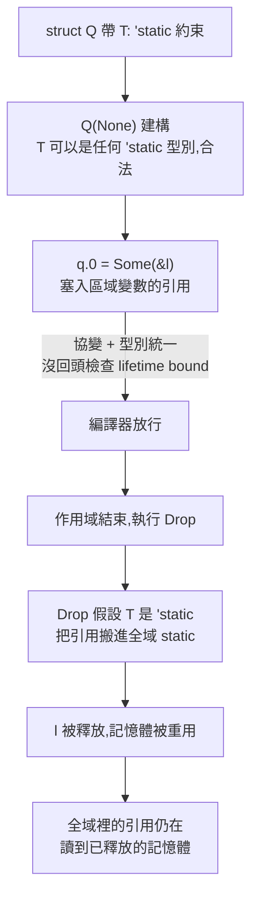

# 編譯通過 ≠ 記憶體安全:Rust issue #164250——借用檢查器裡住了約 11 年的 soundness 洞(Why QQ + issue 原文)

**主題分類:** 科技 / 軟體工程 — 程式語言安全、型別系統
**來源:** YouTube〈Rust编译通过内存照样不安全，解读11年漏洞〉(Why QQ,2026-10-16,約 9.2 分;官方 zh-Hans 字幕)
**一手核實:** 以 GitHub API 讀 [rust-lang/rust#164250](https://github.com/rust-lang/rust/issues/164250) 原文、標籤與全部留言,以及修復 [PR #164277](https://github.com/rust-lang/rust/pull/164277) 的狀態(本文查詢時間 2026-10-17)
**整理日期:** 2026-10-17

> 📌 立場:本片未見業配。影片自述素材為 issue 原文、維護者 lcnr 的定級備註、HN 與 Reddit 討論、daily.dev 的情緒統計,以及 importstatic 部落格的二十多個變體實測。
> ⚠️ HN / Reddit / daily.dev 的部分屬**社群討論與情緒統計**,是自述與觀點,沒有樣本代表性。

---

## TL;DR

1. ⭐⭐ **一段完全沒有 `unsafe` 的 safe Rust 程式碼,編譯通過,執行時讀到已釋放的堆疊記憶體**;開 AddressSanitizer 會報 `stack-use-after-scope`。
2. ⭐⭐⭐ **原理一句話:結構體對 `T` 是協變的,欄位賦值時的型別統一沒有回頭檢查 `T` 身上的 lifetime bound**——大門(建構子)焊死了,窗戶(公開欄位直接寫入)沒關;再由一個**故意惡意的 `Drop`** 把短命引用偷出去。
3. ⭐ **定級 P-high 而非 P-critical 的理由**(lcnr):若是新 bug,本該是 P-critical;但它 11 年沒被發現,不可能很容易撞上,而且要利用它必須寫一個**故意惡意的 `Drop`**,意外造成記憶體不安全的可能性很低。
4. ⭐⭐ **今天就能做的三件事**:自查「帶 lifetime bound + 實作 `Drop` + 公開欄位」的型別並把欄位私有化;把 **Miri** 加進測試;更新信任模型——**編譯通過只代表編譯器沒發現問題。**
5. ⚠️ 修復 PR #164277 **仍在評審中**,不等於已修好;issue 也**沒有 CVE 編號**,「CVSS 9.8」是帶節奏。

---

## 1. 事件經過(✅ 依 issue 原文與留言時間戳)

| 時間(UTC,2026-10-13) | 事件 |
|---|---|
| 08:45 | **jsnell** 開 issue〈struct's lifetime requirements can be bypassed via covariant field assignment〉,附完整重現與 Godbolt 連結;回報「目前 nightly 可重現,stable 至少回溯到 1.85.0」 |
| 09:09 | **theemathas** 給出約十行的最小重現 |
| 09:10 | rustbot 依 Zulip 討論先標 **P-critical** |
| 09:12 | theemathas:「我的版本從 **1.18.0(2017)** 起就能編譯——這之前怎麼可能沒人發現?」 |
| 09:21–09:25 | **lcnr** 給出不依賴 `static` 的版本,並貼出 Godbolt:「**unsound since 1.4**」 |
| 09:25 | rustbot 改標 **P-high** |
| 09:26 | theemathas 也貼出能從 **1.4.0(2015)** 編譯的版本 |
| 09:32–10:15 | **maxdexh** 給出會段錯誤 / 印出已釋放記憶體的閉包變體,並提出猜想:**型別統一普遍不檢查型別的 lifetime bound**,舉例用陣列統一 + `mem::swap`、不需欄位賦值也能觸發 |
| 13:33 | mueddib 在 stable **1.99.0** 與 nightly **1.101.0** 上重現陣列統一版本,Miri 報 dangling reference(use-after-free) |
| 13:39 | 版主 apiraino **鎖定 issue**,防止灌水 |
| 18:48 | **Li-Zheng-Rong** 開修復 PR #164277〈require MIR local types to be well-formed〉 |

> 📌 **補正影片的兩處細節:**
> - 影片說「theemathas 追到 1.18、maxdexh 給出能編到 1.4 的版本」——實際上**最先宣布「since 1.4」的是維護者 lcnr 本人**,theemathas 隨後也貼了 1.4 版本;maxdexh 貼的是另一個 1.4 起可用的閉包變體。
> - 影片只提「lcnr 定級 P-high」;留言紀錄顯示 **rustbot 先依 Zulip 討論標了 P-critical,約 15 分鐘後改為 P-high**。
> - ✅ 影片對 maxdexh 猜想的提醒正確:那是**留言區的猜想,維護者沒有背書**。

**「約 11 年」怎麼算:** 三個重現的下限不同——原始報告確認到 1.85.0、theemathas 的版本到 1.18.0(2017)、lcnr 與 theemathas 的版本到 1.4(2015)。影片只說「大約 11 年」,這個保守說法是對的;lcnr 的置頂說明也寫「it's 11 years old」。

---

## 2. ⭐⭐⭐ 原理:協變欄位賦值 + 惡意 `Drop`

issue 原文的重現程式(✅ 原文):

```rust
use std::sync::Mutex;
static KEPT: Mutex<Vec<Box<dyn std::any::Any + Send>>> = Mutex::new(Vec::new());
struct Q<T: 'static + Send>(Option<T>);
impl<T: 'static + Send> Drop for Q<T> {
    fn drop(&mut self) { if let Some(t) = self.0.take() { KEPT.lock().unwrap().push(Box::new(t)); } }
}
fn main() {
    {
        let l = String::from("hello world, this is long enough");
        let mut q = Q(None);
        q.0 = Some(&l);
    }
    let _z = String::from("XXXXXXXXXXXXXXXXXXXXXXXXXXXXXXXX");
    let k = KEPT.lock().unwrap();
    println!("{}", k[0].downcast_ref::<&'static String>().unwrap());
}
```

預期:程式不被接受。實際:編譯通過,印出 `XXXX…`(後來重用同一塊記憶體的內容)。



| 步驟 | 為什麼編譯器沒擋 |
|---|---|
| `Q(None)` | `T` 完全可以是某個 `'static` 型別,沒理由拒絕 |
| `q.0 = Some(&l)` | ⭐ **本該被拒**(區域引用不滿足 `'static`),但結構體對 `T` 協變,欄位賦值時的型別統一沒有回頭檢查 `T` 的 lifetime bound |
| `Drop::drop` | `Drop` 有權假設 `T: 'static`;編譯器也強制 `Drop` 的簽名與結構體的 bound 一致,所以把引用搬進全域 static 全程綠燈 |

> ⭐ 影片的提醒:真實世界裡這種程式碼可以**看不出惡意**——例如一個 `Batch` 型別在解構時把緩衝區「刷到背景執行緒」,看起來是很正常的寫法。theemathas 那個「`Drop` 裡開執行緒、一秒後印出引用」的版本(✅ 留言原文)就是這種樣子。

---

## 3. ⭐⭐ 哪些寫法會觸發、哪些不會(第三方實測)

影片引用 importstatic 部落格的實測(🟡 本文未讀該部落格原文):issue 裡的五個重現加上作者自己的變體,共二十多個程式,**從 1.49 到 1.99 全部編譯通過**,2015 / 2021 / 2024 三個 edition 全過,連 nightly 上的 Polonius 與新一代 trait solver 也照收。

| 寫法 | 結果(影片轉述實測) |
|---|---|
| ⭐ **公開欄位 + 直接寫欄位**,值活到作用域結束自動解構 | ❌ 唯一能鑽過去的組合 |
| 欄位改私有,透過方法 push | ✅ 編譯器報 `E0597` 拒絕 |
| 整體賦值 | ✅ 拒絕 |
| 加型別標註 | ✅ 拒絕 |
| 手動呼叫 `drop` | ✅ 拒絕 |
| 包一層 `Box` | ✅ 拒絕 |

- 能讀到死記憶體的變體,**Miri 全部報出懸垂引用**(✅ issue 留言中 mueddib 也在 nightly Miri 上看到 use-after-free 的 UB 報告)。
- 閉包變體更兇,每次執行直接段錯誤(✅ maxdexh 留言寫「segfaults/prints freed memory」)。

> ⚠️ maxdexh 的「陣列統一 + `mem::swap`」版本**不需要欄位賦值**,所以「只有公開欄位會中」是 importstatic 那批變體的結論;若 maxdexh 的猜想成立,觸發面會更寬。兩者並陳,不做定論。

---

## 4. ⭐⭐⭐ 定級的邏輯:可達性優先於理論深度

lcnr 在 issue 頂部的置頂說明(✅ 原文要點):

> - Rust 的型別系統本意就是防止記憶體不安全,團隊非常嚴肅看待;正在推動**下一代 trait solver**、**region constraint 重做**,以及更廣的 **Project Zero**(清理所有型別系統 unsoundness)。
> - 這個 bug 是 `P-high`,**不論有沒有人在實際環境中撞到,它本來都會是 `P-critical`**;之所以「只有 `P-high`」,是因為它已經 11 年——**11 年沒被發現的 bug,不可能真的那麼容易撞上**。
> - 看起來容易觸發,但要利用它**需要一個故意惡意的 `Drop` 實作**,意外造成記憶體不安全的可能性很低(very likely 沒發生過)。

> ⭐⭐ 影片的評語值得帶走:**定級依據是洞在真實世界的可達性,「11 年零目擊」本身就是證據,理論深度反而排在後面——不淡化,也不渲染。**

---

## 5. 兩種流行解讀都該丟掉

| 解讀 | 為什麼是誤讀 |
|---|---|
| 「Rust 塌了,記憶體安全是行銷話術」 | 觸發需要「公開欄位 + 直接賦值 + 惡意 `Drop`」的組合;普通業務程式碼幾乎不可能誤踩 |
| 「小事一樁,不用管」 | safe Rust 能在編譯器眼皮底下產生懸垂引用,動搖的是信任根基;若你的行程裡跑**不可信的 Rust 程式碼**(第三方外掛、使用者上傳的 crate),**借用檢查器從來不是安全邊界**,該沙箱還得沙箱 |

社群反應(⚠️ 社群統計與留言,非研究):影片引 daily.dev 統計 15% 正面、35% 中立、50% 質疑;HN 分成「Rust 社區天天拿記憶體安全踩別人」與「軟體本來就有 bug,難道回去寫 C」兩派;有做過 variance 相關 lint 的人說 variance 幾乎沒人手寫,所以這裡的 bug 能躺十年沒人測;也有人提醒又髒又罕見的洞一旦公開就會被盯上。

---

## 6. 修復進度與兩個提醒

| 項目 | 狀態(✅ 2026-10-17 查詢) |
|---|---|
| issue #164250 | open;標籤含 `I-unsound`、`P-high`、`A-borrow-checker`、`A-variance`、`T-types` 等;已被版主鎖定 |
| PR #164277 | open,`S-waiting-on-review`;**指派給 lcnr**;描述只有「Fixes #164250 / sound again :)」;思路是**要求 MIR 局部變數的型別必須 well-formed** |
| CVE | ⚠️ issue 裡**沒有 CVE 編號**;P-high 是 Rust 內部優先級標籤,跟 CVSS 是兩回事——「CVSS 9.8」的說法是帶節奏 |
| 其他未修的洞 | 📌 影片說 Rust repo 還掛著「一百多個」`I-unsound` issue;✅ 本文以 GitHub 搜尋 API 查得 **146 個 open 的 `I-unsound` issue** |

> ⚠️ **PR 存在,跟「修復合入 → 隨工具鏈發布」之間還隔好幾步;別看到 PR 號就當修好了。**

---

## 7. 應用案例

### 案例一:今天就跑的自查清單

```text
1. 搜尋同時符合三個條件的型別:
   - 泛型參數或 lifetime 帶 bound(如 T: 'static、'a: 'b)
   - 實作了 Drop,且 Drop 的行為依賴這個 bound(例如把資料搬到全域、送到其他執行緒)
   - 欄位是 pub(外部可以直接 q.0 = ...)
2. 有的話:欄位私有化,改由建構子或方法寫入(這一個改動就能把靜默的 use-after-free 變回編譯錯誤 E0597)
3. 在 CI 加一個 Miri job,跑 unsafe 程式碼與複雜生命週期的測試:
   cargo +nightly miri test
```

### 案例二:更新團隊的信任模型(分層防禦)


- 寫進團隊規範的措辭:「**編譯通過代表編譯器沒發現問題**」,而不是「編譯通過等於安全」。
- 平台若允許使用者上傳 Rust 外掛:**不要把借用檢查器當安全邊界**,外掛一律跑在沙箱(WASM、獨立行程或容器)裡。

### 案例三:用 lcnr 的邏輯幫自己的漏洞定級

把「理論上多嚴重」和「現實中多容易撞到」分開評:
- 需要攻擊者**刻意寫出**特定程式碼才能觸發 ⇒ 降一級,但若系統會執行不可信程式碼,另外升級隔離。
- 存在多年零目擊 ⇒ 可視為「不易誤觸」的證據,但**公開之後**要假設會有人瞄準。

---

## 8. 核實總表

| 說法 | 結果 |
|---|---|
| 10-13 jsnell 提交 issue 164250,safe Rust 讀到已釋放記憶體、ASan 報 stack-use-after-scope | ✅ issue 原文 |
| nightly 可重現,stable 至少到 1.85.0 | ✅ 原文 |
| theemathas 變體追到 1.18.0 | ✅ 留言 |
| 「maxdexh 給出能編到 1.4 的版本」 | 🟡 **部分需修正**:最先宣布 since 1.4 的是 lcnr,theemathas 也貼了 1.4 版本;maxdexh 的是另一個 1.4 起的閉包變體 |
| maxdexh 猜想「型別統一普遍不檢查 lifetime bound」,維護者未背書 | ✅ 留言 |
| lcnr 定級 P-high 的理由 | ✅ 置頂原文;📌 補充:rustbot 先標 P-critical 再改 P-high |
| 全程不到 24 小時 | ✅ issue 08:45 開、修復 PR 18:48 開,同日 |
| PR 164277 由 Li-Zheng-Rong 提交、讓 MIR 局部型別滿足 well-formed、評審中 | ✅ 指派給 lcnr |
| 無 CVE 編號 | ✅ issue 內未見 |
| 一百多個 I-unsound issue | ✅ 查得 146 個 open |
| importstatic 二十多個變體、1.49–1.99 全過、私有欄位等寫法被拒 | 🟡 本文未讀該部落格原文 |
| daily.dev 15% / 35% / 50% | 🟡 未獨立核實 |
| Reddit 帖六百多分、HN 數百則留言 | 🟡 未獨立核實 |

---

## 來源

- [YouTube:Rust编译通过内存照样不安全，解读11年漏洞(Why QQ,2026-10-16)](https://www.youtube.com/watch?v=IDGXr9VFyQw)(官方 zh-Hans 字幕)
- [rust-lang/rust issue #164250:struct's lifetime requirements can be bypassed via covariant field assignment](https://github.com/rust-lang/rust/issues/164250)
- [rust-lang/rust PR #164277:require MIR local types to be well-formed](https://github.com/rust-lang/rust/pull/164277)
- [Rust Project Goals 2026:next-generation trait solver](https://goals.rust-lang.org/2026/next-solver.html) · [next-gen region constraints](https://goals.rust-lang.org/2026/next-gen-region-constraints.html) · [Project Zero roadmap](https://goals.rust-lang.org/2026/roadmap-project-zero.html)
- [Miri(Rust 未定義行為偵測工具)](https://github.com/rust-lang/miri)
- [GitHub 搜尋:rust-lang/rust 中 open 的 I-unsound issue](https://github.com/rust-lang/rust/issues?q=is%3Aissue+is%3Aopen+label%3AI-unsound)

📎 相關筆記:[[cpp-evolution-complexity-ai-era]](C++ 的複雜度與安全演進,可對照「語言保證」與「實際邊界」)
