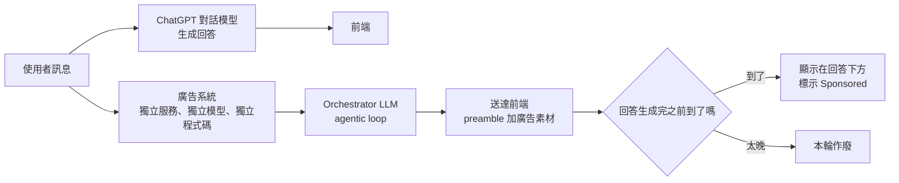
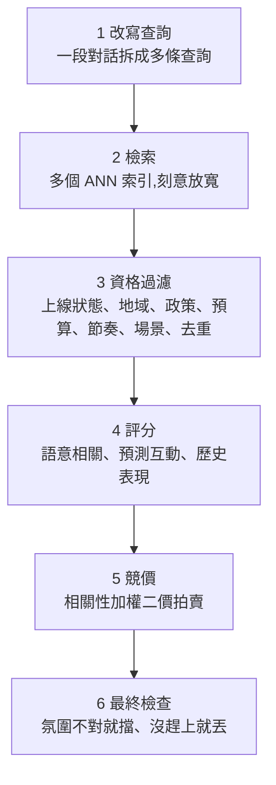

# ChatGPT 廣告栈拆解:LLM 當編排者、確定性系統管錢、超時就丟

> 整理自 YouTube 頻道 **Why QQ(為什麼叫 QQ)**〈[OpenAI 公开了广告栈，藏起了公式](https://www.youtube.com/watch?v=LlQgkvNRS9s)〉(2026-10-23,約 10 分鐘,官方簡中字幕)。
>
> ✅ **已讀原文對照**:OpenAI 工程部落格〈How we built ChatGPT's novel ad stack for user trust and relevance〉(2026-10-21,Ritendra Datta、Karthik Gopalratnam)。影片描述的架構與原文大致一致;**89 國、30 天資料保留、敏感話題不出廣告、Sponsored Agents、圖像廣告**這幾點**不在這篇工程文章裡**,影片說來自官方幫助文件,本筆記未能直接讀到該頁(HTTP 403),列為未核實,見第八節。

---

## 一句話總結

對話裡沒有「搜尋一個關鍵詞」這種乾淨事件,意圖是一輪輪長出來的。OpenAI 的解法是**有狀態的廣告會話 + 一個經過後訓練的 LLM orchestrator 在 agentic loop 裡呼叫廣告工具**,但**出價、定價、預算這些跟錢有關的環節交給確定性的競價系統**;廣告和回答走兩套獨立服務,**回答先生成完、廣告沒趕到就直接作廢**。

---

## 一、為什麼不能沿用搜尋廣告的架構

傳統廣告系統圍繞「明確事件」建:使用者搜尋一個詞、打開一個網頁,系統收到一次請求,然後檢索、排序、競價、展示。

對話產品沒有這種事件。使用者帶著目標進來(規劃旅行、挑商用軟體、布置新家),一輪一輪聊,意圖慢慢成形,還可能轉彎。原文列出把每則訊息當獨立請求的四個風險:

1. 把使用者目標過度簡化而誤讀。
2. 太早啟動廣告流程,真正需求還沒浮現。
3. 廣告擋住使用者正在做的事。
4. 每次請求一變就重跑整個流程,浪費成本。

所以他們**從頭建一套廣告栈**。

---

## 二、整體架構:兩條平行鏈路

原文的三個關鍵設計決策:

| 設計 | 內容 |
|---|---|
| **有狀態的廣告會話** | 跨輪次、**也跨多個對話**記住並更新資訊,跟著對話走 |
| **後訓練 LLM + 工具呼叫架構** | 解讀對話脈絡與意圖,再選擇、排序、送出廣告 |
| **廣告與回答分離** | 在自己的服務裡跑,不影響回答,維持 ChatGPT 中立的口吻 |

**分離的實際好處**:ChatGPT 對廣告系統**零依賴**,廣告服務掛了或變慢,回答照常。而且**「不回傳廣告」是正常、成功的結果**,只有對使用者和廣告主都明顯有價值時才放廣告。

---

## 三、Orchestrator:LLM 做判斷、確定性系統管錢

Orchestrator 是一個定製、經後訓練的前沿 LLM,在 agentic loop 裡反覆決定何時呼叫哪個工具。原文列的工具類別:檢索(retrieval)、排序(預測互動)、相關性評估、競價。

**分工很明確**:

| Orchestrator 負責 | 競價系統負責 |
|---|---|
| 理解對話、生成查詢 | 競價入場門檻(相關性與價值的最低線) |
| 呼叫工具、篩候選 | 預算節奏(pacing) |
| **提名**哪些候選夠格進入競價 | 出價與競價特徵計算 |
| 最終上下文是否合適的判斷 | 品質調整排序、定價、最終選擇 |

原文原話:**orchestrator 不直接決定送出哪一則廣告,也不定價。**影片評論:「讓 LLM 做需要理解力的判斷,讓確定性系統管錢。管錢的環節,永遠別讓生成模型直接碰。」

### Orchestrator 要處理的難點

原文點出增量接收對話造成的歧義:要分辨**當下意圖和過期脈絡**、理解對前面訊息的指涉、**辨認使用者只是在假設**,以及**不要把每次提到產品都當成想買**。

---

## 四、逐級收窄的漏斗

### 1. 改寫查詢

原文的例子(影片照用):

1. 「兩天的優勝美地行程要排什麼?」
2. 「下週會冷嗎?」
3. 「某品牌有什麼新產品線?」

三句字面上沒有共同詞,關鍵詞匹配會失靈。系統可能把它表示成兩條查詢:`[適合健行旅行的鞋]` 和 `[該品牌適合旅行的新產品線]`。**多條查詢保留意圖的不同面向**(例如旅行規劃裡交通、住宿、活動是不同需求),而且 orchestrator 會**反覆迭代**這些表示,直到在庫存裡找到真正有價值的廣告。

### 2. 檢索

- 查詢編碼成語意向量,走 **ANN(近似最近鄰)**搜尋。ANN 求快、求「夠好」,召回階段本來就要寬。
- **不只一種索引**。原文舉例:**商品 feed 廣告的索引在檢索時會感知商品評論的正負面**;沒有評論的一般廣告就沒有這個限制。
- 不同檢索策略拉回的候選進同一個池子,在相同的投放限制下競爭。

### 3. 資格過濾

任何一項不過就出局:素材與 campaign 是否上線、投放地域、政策限制、預算是否還有、**節奏(這個時段該不該花錢)**、場景相容性(這則廣告適合哪類對話)、同一廣告主與 campaign 的去重。

### 4. 評分

語意相關性、預測互動(被看到、被點、轉換)、歷史表現。這一步把候選池縮小,但**仍不決定最終廣告**。

### 5. 競價

- 幫助文件說法:**相關性加權的二價拍賣**。
  - **二價**:贏家支付的價格參考次高出價,不必付自己的出價上限。
  - **相關性加權**:出價只是因子之一。**出價低但高度相關的廣告,可以贏過出價高但匹配差的。**
- **入場門檻**:相關性和價值沒達到最低線,連競價桌都上不去。影片:「錢多,在這裡買不到通行證。」
- ⚠️ **完整定價公式沒有公開**(影片標題「藏起了公式」指的就是這個)。

### 6. 最終檢查:贏了競價也可能不展示

| 關卡 | 內容 |
|---|---|
| **氛圍不對** | 即使對話已通過 integrity models(判斷何時適合放廣告的模型)、廣告本身也合規,orchestrator 覺得放在這段對話裡不恰當,就擋下 |
| **沒趕上** | ChatGPT 準備好回答了、廣告還沒準備好 ⇒ 廣告請求逾時、不送出。**不會為了等廣告拖慢回答** |

---

## 五、Delivery 和 Impression 是兩件事

- **Server-side delivery**:廣告送到前端。
- **Impression**:使用者真正看到。

前端收到的是一個 bundle:**廣告素材**(標題、描述、連結、CTA)加上一段**模型生成的 preamble**(簡短、中立地說明這則廣告和對話的關聯)。⭐ **這點影片沒提**:原文特別說 preamble 和素材分開,目的是保留廣告主的原話,同時維持 ChatGPT 中立的口吻。

bundle 若在回答生成完之前到達,就顯示在回答下方、標示 sponsored;太晚就這輪不顯示。

> ⚠️ **原文本身的用詞有點不一致**:前段說送到前端就算 server-side delivery、但「仍可能不顯示」;後段又說「被選中的廣告要在 ChatGPT 核可並顯示、且 delivery 被確認後才算 delivery」。可以理解為「伺服器端送出」和「確認送達並顯示」兩個層次,讀原文時要留意。

---

## 六、Log、評估與自我改進

**細粒度 log**,記下每個環節的結果,例如:

- 這一輪不適合投廣告。
- 廣告會話啟動了,但沒發出檢索。
- 檢索沒有候選。
- 有候選,但沒通過 hydration 或資格檢查。
- 廣告送出,之後有互動。

原文:改善「機會偵測」和改善「檢索」「候選品質」「競價參與」「送達可靠度」需要的證據都不一樣,所以要能把每個環節孤立出來改。

**模型評估模型**:用最強、推理最深的模型觀察並評判系統結果,再訓練後訓練的 LLM。所以 orchestration 或檢索可以用**更小、更便宜的模型**,由最強的模型收集回饋去訓練它們。

**人類回饋**:使用者的點擊與隱藏、問卷、廣告主透過 Ads Manager 的回饋。原文說這比模型的觀察回饋**更能決定方向**:「模型也許能理解意圖,但品味是人塑造的。」

**Codex**:原文說 Codex 是「根本性的力量倍增器」,團隊從一開始就把開發流程建在 Codex 上,為它建了安全出貨的護欄,也接了資料基礎設施的 plugin 來縮短「發現問題到上線改善」的迴圈。

---

## 七、影片的評論:架構隔離 ≠ 長期中立

影片把兩個常被混在一起的命題拆開:

| 命題 | 公開資料能證明嗎 |
|---|---|
| 廣告模型不在回答生成的路徑上(**系統層面解耦**) | ✅ 有具體工程設計支撐(獨立服務、獨立模型、獨立程式碼、零依賴) |
| 廣告收入不會影響未來的產品決策、推薦體驗與功能優先級(**產品層面長期中立**) | ❌ 一張架構圖回答不了,**目前也沒有獨立第三方審計背書** |

影片結論:「把這兩個命題混在一起,無論往哪邊下結論,都不嚴謹。」

**隱私也要拆成兩件事**:

- ✅ **對話不會給廣告商**:廣告主拿到的是彙總的瀏覽量、點擊量。
- ⚠️ **但對話會用在廣告匹配**:當前對話的脈絡**始終**參與選廣告;開啟廣告個人化的話,過往對話中的非敏感資訊也會納入(原文:「available nonsensitive information about the user's past conversations」)。

---

## 八、核實與補正

**✅ 與原文一致:**

- 發布日期 2026-10-21、**上線不到 200 天年化營收運行率 10 億美元**、**累計超過 10 萬家廣告主**。
- 優勝美地三句對話與兩條改寫查詢的例子。
- 工具類別、商品 feed 索引感知評論、七類資格過濾、三類評分、orchestrator 只提名不定價、競價的入場門檻與 pacing。
- 兩道最終關卡、「不回傳廣告是成功結果」、零依賴、細粒度 log 的五個例子、強模型評估訓練小模型、Codex。
- 幫助文件「Ads in ChatGPT: The Basics」寫的是 **relevance-weighted, second-price auction**(經搜尋摘要確認;另外記載 Plus、Pro、Business 方案與未滿 18 歲帳號不顯示廣告)。

**⭐ 原文有、影片沒講:**

- 模型生成的 **preamble** 與廣告素材分開送(見第五節)。
- 原文的第一個例子其實是「怎麼訓練跑步比賽」,幾輪後才問到鞋;優勝美地是第二個例子。
- 人類回饋被明確放在模型回饋之上。

**⚠️ 未能核實(不在工程文章中):**

- 「同一天覆蓋擴到 89 國」(影片說明欄稱新增 26 國後達 89 國)。
- 「廣告資料最長保留 30 天」、「健康、心理健康、政治等敏感話題附近不出廣告,臨時聊天也不出」、「付費廣告不代表 OpenAI 認可」。影片說來自官方幫助文件,本筆記抓取該頁時被擋(403),**沒有讀到原文**。
- 「9 月測試 Sponsored Agents、10 月在圖像生成中測試多圖視覺廣告」。工程文章只說未來會實驗「讓使用者透過廣告直接和商家對話」等更動態的格式,沒有給日期。
- 「10 億是 2026 年 8 月公布」:工程文章沒寫公布日期。

---

## 九、應用案例

### 案例 1:任何「非同步任務掛到主流程」的場景都能套「選中 ≠ 生效 + 超時丟棄」

情境:電商結帳頁要顯示「推薦加購商品」,推薦服務有時慢。

| 做法 | 結果 |
|---|---|
| 等推薦服務回來才渲染結帳頁 | 推薦一慢,結帳就慢,直接掉單 |
| ✅ 結帳頁先渲染,推薦平行跑;結帳按鈕可點之前沒回來就不顯示 | 結帳體驗不受推薦服務影響;推薦服務掛掉也不影響主流程 |
| ✅ 推薦回來後再做一次「這時候還適合放嗎」的檢查(例如使用者已經在輸入付款資料就不插入) | 對應原文的「氛圍不對就擋」 |

同時 log 要分開記「推薦選中了」和「推薦真的顯示了」,否則看到的轉換率分母是錯的。

### 案例 2:LLM agent 涉及金錢時的分工

情境:做一個幫使用者訂機票的 agent。

- **交給 LLM**:理解「下個月想去東京、預算有限、不要紅眼航班」,生成多條搜尋條件,篩掉不合條件的班次,**提名** 3 個候選。
- **交給確定性系統**:實際報價、匯率換算、信用卡扣款、退改規則計算。
- **不要做的**:讓 LLM 直接輸出「這張票 NT$12,345」並據此扣款。數字算錯、或被 prompt injection 誘導改價,都是直接的金錢損失。

這就是 OpenAI 廣告栈「orchestrator 只提名、不定價」的同一個原則。

### 案例 3:用「漏斗每一級都記 log」來除錯推薦系統

情境:廣告(或推薦)填充率突然掉了一半。

按原文的 log 分類逐級查:

1. 「這一輪不適合投廣告」的比例變高? ⇒ 可能是 integrity model 改版變嚴格。
2. 「會話啟動但沒發出檢索」變多? ⇒ orchestrator 判斷意圖的門檻變了。
3. 「檢索沒有候選」變多? ⇒ 索引更新失敗或 embedding 模型換版。
4. 「有候選但沒通過資格檢查」變多? ⇒ 大量 campaign 預算用完或節奏設定錯。
5. 前面都正常、但 impression 掉了? ⇒ 廣告服務變慢,逾時被丟棄的比例上升。

沒有分級 log,就只能看到「填充率掉了」而不知道是哪一級的問題。

---

## 相關筆記

- [[openai-devday-2026-dots-sol-codex]]:OpenAI 同期產品線與 Codex。
- [[codex-as-a-platform-open-agent-harness]]:Codex 作為開發加速器的工程落地。
- [[llm-evals-how-to-know-ai-works]]:「強模型評估、訓練小模型」背後的評估方法。

---

## 來源

- YouTube:Why QQ〈OpenAI 公开了广告栈，藏起了公式〉 https://www.youtube.com/watch?v=LlQgkvNRS9s (2026-10-23,官方簡中字幕)
- OpenAI,〈How we built ChatGPT's novel ad stack for user trust and relevance〉(2026-10-21): https://openai.com/index/building-chatgpt-ad-stack/
- OpenAI Help Center,〈Ads in ChatGPT: The Basics〉: https://help.openai.com/en/articles/20001207-ads-in-chatgpt-the-basics (本次抓取 403,內容經搜尋摘要轉述)
