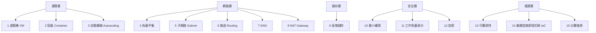
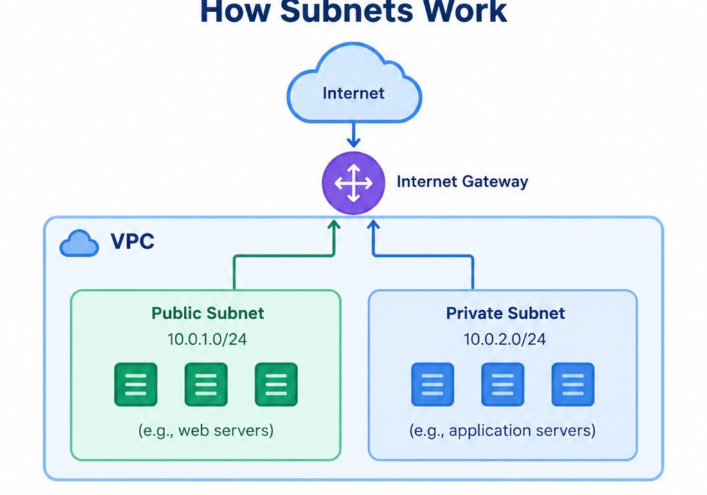
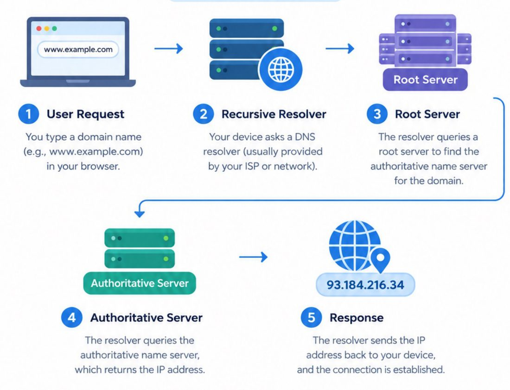
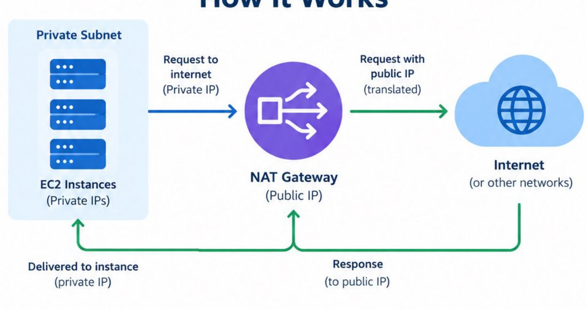
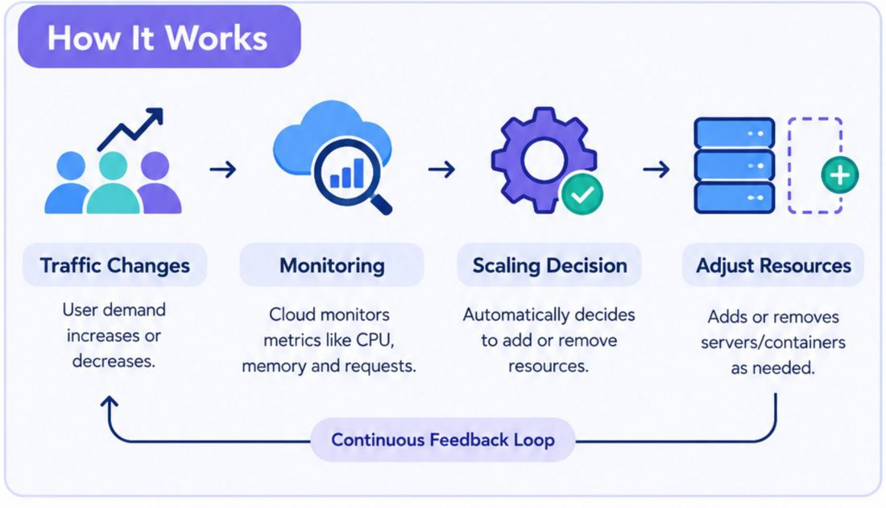
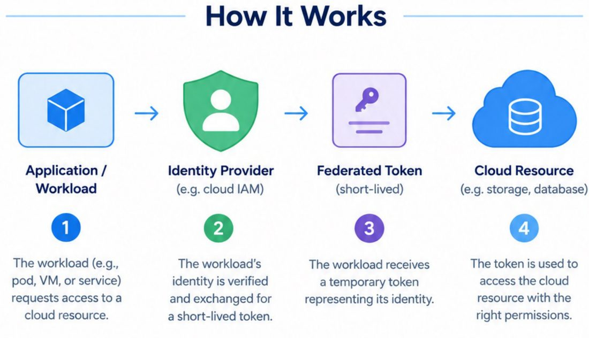
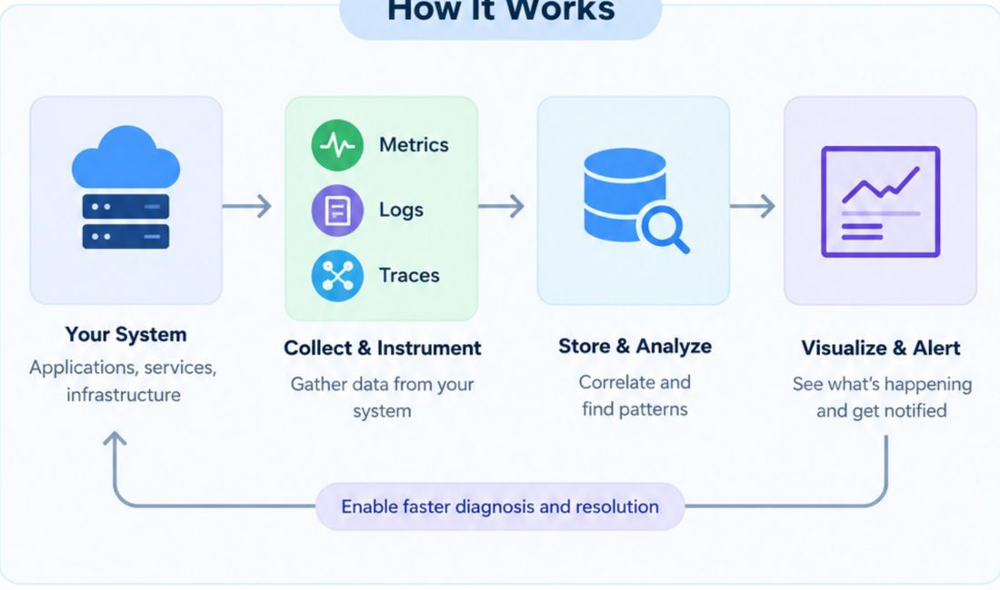

# 雲端工程 15 個基礎概念(含 AWS / GCP 官方文件查證)

> 資料型態:使用者提供的輪播式 PDF(15 頁,每頁一個概念,**無文字層**,內容由逐頁看圖轉寫)。
> ⚠️ **作者自我宣傳揭露**:素材來自社群引流型帳號 Anjana「AI & Tech」(@aiwithanju),屬 AI 生成風格資訊圖輪播(整體為入門級摘要),本筆記只整理其中的知識本身,不轉述任何課程或付費導購內容。
> ⚠️ 原稿以 AWS 名詞為主(EC2、Elastic IP 等),概念本身跨雲通用。

## 15 個概念總覽

## 逐項整理

| # | 概念 | 一句話定義(原稿) | 補充 / 對照 |
|---|---|---|---|
| 1 | 虛擬機 VM | 跑在實體伺服器上的軟體電腦,各有自己的 OS 與應用;由 Hypervisor 切分硬體 | 隔離強、可跑不同 OS;代價是每台都帶完整 OS,較重 |
| 2 | 容器 | 把應用與相依打包成輕量、可攜單元,**共用主機 OS 核心** | 啟動秒級;隔離程度弱於 VM(共用 kernel) |
| 3 | 自動擴縮 | 依需求自動增減伺服器/容器數量 | 監控指標 → 決策 → 調整資源的回饋迴圈 |
| 4 | 負載平衡 | 把流量分散到多台伺服器,避免單點過載 | 同時帶來高可用(某台掛了仍可服務) |
| 5 | 子網路 | VPC 內較小的邏輯網路,分群資源並控管流量 | 例:公有子網 10.0.1.0/24 放 Web、私有子網 10.0.2.0/24 放應用 |
| 6 | 路由 | 在服務、應用與資源間導引網路流量 | 依路徑、健康度、負載、位置等規則決定目的地 |
| 7 | DNS | 把網域名稱轉成 IP 的分散式系統 | 流程:使用者 → 遞迴解析器 → 根伺服器 → 權威伺服器 → 回傳 IP |
| 8 | NAT Gateway | 讓私有網路資源以公有 IP 對外連線,同時隱藏私有 IP | 只允許由內向外發起的連線 |
| 9 | 區塊儲存 | 以固定大小區塊存資料,可掛到 VM | 低延遲、可隨時掛載/卸載;常用於 OS 碟與資料庫碟 |
| 10 | 最小權限 | 只給完成任務所需的最小權限 | 例:允許 Read/Write,拒絕 Delete/Admin |
| 11 | 工作負載身分 | 應用不靠靜態憑證即可向雲端資源驗證 | 以身分提供者換發短效 token |
| 12 | 加密 | 以金鑰把資料轉成不可讀格式 | 原稿圖示為「同一把金鑰加解密」;實務上傳輸中常見非對稱握手 + 對稱加密 |
| 13 | 可觀測性 | 以指標、日誌、追蹤理解系統內部狀態 | 收集 → 儲存分析 → 視覺化與告警 |
| 14 | IaC | 用程式碼(Terraform、CloudFormation)定義並管理基礎設施 | 放進 Git 版控,工具負責建立/更新/刪除 |
| 15 | 災難復原 | 中斷或災害後還原系統、資料與應用 | 故障切換到備援 → 還原服務 → 營運繼續 |

## 重點圖(取自原稿的架構/流程區塊)

出處:`15 Essential Cloud Engineering Concepts for Beginners.pdf` 第 5 頁。重點:公有子網放對外 Web、私有子網放內部應用,兩者都在同一 VPC。原稿圖中私有子網也畫了指向 Internet Gateway 的箭頭,容易誤導——私有子網要對外須經 NAT(見下),不是直接掛 IGW。

出處:同檔第 7 頁。重點:5 步驟;原稿省略了 TLD 伺服器那一層(實際為 根 → TLD → 權威),且遞迴解析器會快取結果。

出處:同檔第 8 頁。重點:私有 IP 請求 → NAT 轉成公有 IP → 回應再轉回私有 IP。

出處:同檔第 3 頁。重點:流量變化 → 監控 → 決策 → 調整,持續迴圈。

出處:同檔第 11 頁。重點:工作負載 → 身分提供者驗證 → 短效聯合 token → 存取雲端資源,沒有靜態金鑰可外洩。

出處:同檔第 13 頁。重點:三種訊號(指標、日誌、追蹤)進入儲存分析,再視覺化與告警。

## 應用案例:一個三層網站怎麼把 15 個概念串起來

1. 網址解析靠 **DNS** 指向負載平衡器的位址。
2. **負載平衡器**把請求分給多台跑在**容器**(或 VM)上的 Web 服務,放在**公有子網**。
3. 應用服務與資料庫放**私有子網**;私有機器要下載套件,走 **NAT Gateway** 出去。
4. 流量高峰由 **Autoscaling** 增加容器數量;資料庫用**區塊儲存**,並做快照備份。
5. 服務對 S3 之類資源用 **工作負載身分**(角色),不放金鑰;權限依**最小權限**縮到只讀特定 bucket,資料靜態與傳輸中**加密**。
6. 所有環境以 **IaC**(Terraform)宣告,放 Git;異常看**可觀測性**儀表板與告警;另一區域保有備援,滿足**災難復原**目標。

## 延伸閱讀與深度補充(查證紀錄)

| 項目 | 結論 | 依據(實際讀過) |
|---|---|---|
| NAT gateway 定義:私有子網實例可連外、外部無法主動連入 | **已核實** | AWS VPC 文件:連線必須由 VPC 內發起;公有 NAT 需置於公有子網並綁 Elastic IP,路由到 Internet Gateway |
| 原稿只談公有 NAT | **需補充** | 文件另有「私有 NAT gateway」,用於連其他 VPC 或地端(經 Transit/Virtual Private Gateway),不能綁 Elastic IP;私有 NAT 流量若導向 IGW 會被丟棄 |
| 自動擴縮依指標調整數量 | **已核實** | EC2 Auto Scaling 文件:以 Auto Scaling group 設定最小/期望/最大;例如最小 4、期望 6、最大 12;依 scaling policy 增減,並做健康檢查替換、跨可用區平衡、可與 ELB 整合 |
| 最小權限 | **已核實** | AWS IAM 最佳實務:僅授予完成任務所需權限(指定動作、資源、條件);可先從 AWS 受管政策起步再縮小,並用 IAM Access Analyzer 依 CloudTrail 活動產生最小權限政策 |
| 工作負載用短效憑證而非靜態金鑰 | **已核實** | AWS 文件:工作負載應用 IAM 角色的臨時憑證;雲外工作負載可用 IAM Roles Anywhere、`AssumeRoleWithWebIdentity` 等。GCP Workload Identity Federation 文件:依 OAuth 2.0 token exchange,向 STS 換發聯合 token,再換短效 access token,避免維護服務帳戶金鑰 |
| 可觀測性三訊號 | **已核實** | OpenTelemetry 文件:logs(有時間戳的訊息)、metrics(時間窗聚合的數值)、traces(單一請求跨服務的路徑,由 span 組成)。定義重點是「能從外部提出新問題而不必知道內部」,比原稿「理解內部狀態」稍精確 |
| 災難復原 | **部分核實** | AWS Well-Architected 文件定義兩個關鍵指標:**RTO**(可接受的最長中斷時間)與 **RPO**(可接受的最長資料遺失時間窗)。原稿完全沒提這兩個指標,這是 DR 設計的核心;文件在讀到的段落未列出備援策略分級(備份還原、pilot light、warm standby、multi-site),此處**未能由讀到的內容核實** |
| 容器「共用主機核心」、VM 由 Hypervisor 管理 | **未能核實(未讀官方頁)** | 屬廣泛共識,本次未逐字查官方文件 |
| DNS 流程、IaC、區塊儲存、加密細節 | **未能核實(未讀官方頁)** | 同上;DNS 缺 TLD 層是依一般常識指出,非本次讀文件所得 |

## 原稿的簡化與需注意之處

- 「Key Benefits」皆為通則式好處,沒有成本、取捨(例如 NAT Gateway 要按時數與流量計費、容器隔離較弱)。
- 加密頁僅畫「同一把金鑰」的對稱流程,未區分傳輸中與靜態加密、金鑰管理(KMS)。
- DR 頁沒有 RTO / RPO、也沒有「演練」,實務上沒演練過的備援常不可用。

## 來源

- 使用者提供的本機素材批次 `new/ai-guide/`(2026-11-07 收件),檔案:`15 Essential Cloud Engineering Concepts for Beginners.pdf`(作者 Anjana「AI & Tech」@aiwithanju 的社群引流型素材,無文字層,逐頁看圖轉寫)
- AWS VPC NAT gateways:https://docs.aws.amazon.com/vpc/latest/userguide/vpc-nat-gateway.html
- AWS Well-Architected 可靠性支柱,DR 目標(RTO/RPO):https://docs.aws.amazon.com/wellarchitected/latest/reliability-pillar/disaster-recovery-dr-objectives.html
- Amazon EC2 Auto Scaling:https://docs.aws.amazon.com/autoscaling/ec2/userguide/what-is-amazon-ec2-auto-scaling.html
- AWS IAM 最佳實務:https://docs.aws.amazon.com/IAM/latest/UserGuide/best-practices.html
- Google Cloud Workload Identity Federation:https://docs.cloud.google.com/iam/docs/workload-identity-federation
- OpenTelemetry Observability primer:https://opentelemetry.io/docs/concepts/observability-primer/
