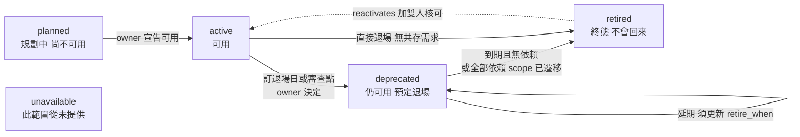

# 部門級 Knowledge Database 架構研究:第三輪(單向進化與新舊共存:作用域 + 生命週期)

> 同一個 Sonnet 5.5 子 agent 延續前兩輪沙盒([REPORT.md](./REPORT.md)、[REPORT-2.md](./REPORT-2.md))。沙盒新增 `sim3/`(`kb3.py`、`build_designs.py`、`run_q.py`、`update_test.py`、`attacks3.py`)與 `logs3/`,不進版控。
> 實驗規模:Haiku(`claude-haiku-5-5 --effort low`)共 81 次、花費 US$0.385、最多 5 個平行;其中 22 次作廢(§3.4),有效 59 次,沒有任何拒絕。
> **全域限制**:24 條 claim、12 個作用域格子、單次取樣、虛構資料、自評,**不可外推到真實規模**。證據分級:C = WebFetch 小模型摘要;D = 只看搜尋摘要;未能核實 = 沒讀到。本輪沒有任何來源逐字讀完。

## 問題

知識的演進有兩種形態:**(a) 單向進化**(新方案取代舊的,舊的不會再回來);**(b) 新舊共存**(新舊同時有效,依 project / 平台 / 分支而定)。使用者的觀察:直接更新是錯的(抹掉仍有效的舊版);各專案各存一份副本又不通用,且沒有控制會冗餘(像公司現在的 OneNote KB)。

## 1. 一頁摘要

三種設計對照:**只靠 supersedes**(D1)會把仍然成立的事實標成「已取代」;**依專案各存副本**(D2)答案能對但近乎全部重複;**作用域 claim + 生命週期 + 概念單一身分**(D3,建議)重複最少、答案最少猶豫,但仍有 1 題真實誤讀。

### 1.1 建議的最小模型

**核心想法**:一個概念只有一個 canonical 身分;每條 claim 說「這個 variant 在這個作用域是什麼生命週期」;使用者問的是某個作用域格子的狀態,答案由推導得出,不是由人複製出來。

| 欄位(每條 claim) | 說明 |
|---|---|
| `concept`、`variant` | 例如 ipc/v1、logger/mutex、budget/per_cycle |
| `lifecycle` | `planned`、`active`、`deprecated`、`retired`、`unavailable` |
| `scope` | 三個維度:project、platform、branch;沒寫的維度代表「全部」 |
| `value` | 數值型 variant 用,例如 250µs |
| `retire_when` | 日期或條件(**日期只存一處**) |
| `review_by` | 審查點日期 |
| `supersedes` | 只用於「完全相同 scope 或更寬 scope」的明確取代 |
| `reactivates` | 預設為假;終態重啟需要它加雙人核可 |

**關係只留兩個**:`supersedes`,以及 `(concept, variant)` 隱含的 variant-of。不建議再加 `applies-when`、`branches-from`、`coexists-with`、`deprecated-for`、`retired-when`:適用條件由 `scope` 表達;**共存是推導出來的現象**(同一格有兩個 variant 都沒退場);退場時間是欄位不是關係。

**推導規則**:對每個格子,每個 variant 取「適用的 claim 中**具體度最高者**」(被限制的維度越多越具體),同具體度才比生效日。具體度優先是實驗中被迫加進去的(§3.3 bug 1)。

**生命週期狀態機**



**共存或進化的判斷準則**
1. 問:「還有沒有一個**有負責人、有退場條件**的 scope 仍需要舊版?」有 → 舊版以較窄 scope 的 `deprecated` 或 `active` 共存,**必須帶 `retire_when` 或 `review_by`**;沒有 → 在最寬 scope 把舊版標 `retired`,單向進化,不能再回來。
2. 共存要收斂成單向取代的時機:最後一個依賴 scope 遷移完成;`retire_when` 到期且負責人沒延期;例外 scope 已無人認領。
3. 實驗實例:QA 預定 2027-02-28 退場,實際 2027-02-07 提前遷移完成,共存 claim 被一條 `retired` 加 `supersedes` 收斂。

### 1.2 三種設計的實驗證據(14 題、同一批事件)

| 設計 | 實質正確 | 答案帶「無法確認、建議確認」的比例 | 錯誤型態 |
|---|---|---|---|
| D1 只靠 supersedes(搜尋仍顯示被取代者) | 14/14(扣掉 3 個正則誤判後) | **10/14** | 標籤說「已取代」但事實仍成立;答案能對,但全在猶豫 |
| D1c(同上但搜尋隱藏被取代者) | **2/8** | — | 6/8 回答「查不到」;只有 logger 這種純進化題答對 |
| D2 依專案各存副本 | 14/14 | 9/14 | 無錯,但資料大量重複 |
| D2m(LTS logger 頁漏改) | 2/2 | — | 漏改頁與其他 4 處矛盾,Haiku 看出矛盾並靠多數決答對 |
| **D3 作用域 claim(建議)** | **13/14** | **4/14** | 1 題真實誤讀(Q1) |

**冗餘度(W0–W6)**:D1 3–12 條 claim、0% 近似重複(但資訊被抹掉);D2 11–12 頁、18–28 行、**83%–100%** 的行在別頁有近似孿生行;D3 7–24 條 claim、**0%**。
**更新成本(W1–W6 平均)**:D1 約 1.5 個新檔;D2 約 **4.0 頁**被改動;D3 約 2.8 條新 claim。

## 2. 研究調查

| 做法 | 讀取程度 | 學到什麼 | 適不適合團隊 KB |
|---|---|---|---|
| Kubernetes API 棄用政策 | C(頁面截斷) | alpha/beta/GA 三軌;API 元素只能靠提升版本號移除;beta 棄用後仍須服務 9 個月或 3 個 minor release;preferred 版本在新舊都支援之前不能前進;棄用端點要回 Warning | **借概念**:明確階段、**棄用必須有最短支持期**、共存期間主動提示;不照搬版本軌道 |
| Wikidata 排名與限定詞 | C | normal/preferred/deprecated 三種 rank;**歷史上正確的值不該標 deprecated,應加 start/end time 限定詞**;deprecated 專指已知有誤的值 | **借觀念**:「時間有效」與「值對不對」是兩個軸。⚠️ **命名陷阱**:Wikidata 的 deprecated = 錯誤,我們的 deprecated = 正在退場 |
| Docusaurus 版本化 | C | `docs:version` 把整個 docs 資料夾複製一份;建議活躍版本約 10 個以內;官方列出不該版本化的情況 | **D2 的同款問題**,工具自己也建議少版本化 |
| Backstage `spec.lifecycle` | C | `experimental`/`production`/`deprecated` 加 owner 關係 | 生命週期是單一欄位掛在實體上,**沒有 scope**;借 owner 與 lifecycle 命名,解不了共存 |
| SemVer | C | 棄用須在 minor 版標示;MAJOR 代表不相容 | 只定義版本號怎麼增加;借「棄用先於移除」 |
| kustomize base + overlay | C | 共用 base 不動,變異只寫在 overlay 的差異裡 | **最貼近 D3**:不複製,只寫差異 |
| 產品線 feature model(FODA) | D | 以特性加 requires/excludes 約束描述變異 | 學術味重、配置空間爆炸;只借「維度」概念 |
| 版本文件失控與腐爛 | D(廠商部落格) | 每版是 fork,修正不會自動帶到別版;過期版本悄悄累積;建議訂 EOL 與封存 | 與 D2 的觀察一致;來源多為行銷,**其中的百分比不採用** |
| RDF named graph、Debian、Nix 並存版本、Wikidata 限定詞細節、完整 K8s 政策 | 未能核實 | — | 結論不依賴它們 |

**調查結論**:(1) 現成做法大多只有「版本」**或**「生命週期」其中一軸,很少把「適用於誰」與「生命週期」放進同一個可推導模型;(2) 文件版本化工具全部選擇複製,並自承成本;(3) kustomize 的「基底加差異」是最適合團隊 KB 的類比;(4) 沒找到成熟的「適用範圍加生命週期」現成開源工具,D3 是自建的最小原型。

## 3. 實驗

### 3.1 設計
- **劇本(虛構)**:3 專案(Vision、Audio、QA)× 2 平台(Linux、Windows)× 2 分支(main、LTS 3.x)= 12 格;一個基線加 6 週事件。
- **四種情境**:共存(Audio 已遷到 IPC v2,Vision 仍用 v1 期限 2027-06-30、W4 延到 2027-09-30);按分支共存(LTS 不回植 v2,維持 v1 至 EOL 2028-03-31);按平台共存(Windows 沒有 v2,tooling 用 v1 shim,W6 訂審查點 2027-12-31);單向進化(logger 從 mutex 換成 ring buffer,main 在 W3、LTS 在 W5 完成,mutex 終態退役);另有看似共存實為應收斂(QA 的 v1 提前退場)。預算也有分支與專案差異(main 250µs、LTS 200µs、Audio hard-RT 120µs)。
- **三種設計**:D1(每事件一條 claim 取代同主題上一條)、D2(12 頁,由 D3 推導結果渲染,代表「完美更新、沒有漏改」的 OneNote 式副本)、D3(24 條作用域 claim 加 `resolve`)。
- **14 題**(含 3 題缺 scope:Q5、Q10、Q16);gold 是執行前寫好的正則。

### 3.2 結果
- 正則共誤判 5 次(3 次把 claim 引用當錯誤斷言;1 次 D3 的 Q8 答案提到歷史說明;1 次 D1c 的 Q2 實際答「查不到」卻被 `must` 判命中,方向是高估,已扣除);**所有被標錯的答案都人工逐條讀過**。
- **D3 唯一真失誤(Q1)**:Haiku 跑了 `resolve --project vision`,輸出明明有 `S-17 2027-09-30`,答案卻寫「沒有 Vision 專屬的 v1 退場日期」。這是 LLM 讀取錯誤,不是資料錯誤;樣本 1/14,不能說會重現。
- **D1 的真實問題是「標籤說謊」**:舊 claim 其實還成立,卻被標成 `SUPERSEDED by D1-07`,而那一條說的是別的事(例:LTS 規則被「Vision 退場日延後」取代)。10/14 個答案都在猶豫;之所以還能答對,是因為搜尋把被取代者也顯示出來。
- **D1c 是「靜默失憶」**:像許多 RAG 管線那樣排除被取代者,8 題中 6 題「查不到」。不會誤導,但沒有用。純進化的 logger 題(Q8、Q9)2/2 答對——**supersede-only 對 (a) 型態是對的,對 (b) 型態不夠**。
- **D2**:所有答案都能對,但 5/14 題 Haiku 是橫跨多頁拼出來;漏改的 LTS 頁與其他 4 處矛盾,Haiku 發現並用多數決答對。冗餘的雙面效果:能交叉驗證,也製造衝突;若漏改的是唯一一頁就會錯(此情境沒測)。

**更新成本實測**(各 1 次,非統計)

| 事件 | D2 | D3 |
|---|---|---|
| X1:main 上 mutex logger 退場 | 改 3 頁(LTS 頁沒被動,正確),10 輪 | 2 條 claim、6 輪,12 格全對 |
| X2:Audio 在 Linux main 遷移 | 改 1 頁(正確),10 輪(第一次因工具配置衝突失敗) | 1 條 claim、6 輪,12 格全對(只寫 audio/linux/main 一格,沒誤傷 Windows 或 LTS) |

**缺 scope 時的處理**(Q16「現在該用 v1 還是 v2」,D3):中性 prompt → 列各情境表;加規則「缺資訊就反問」→ 先反問(缺專案、平台、分支)**同時仍附完整情境表**;加規則「不要反問」→ 直接列表並對每列建議。三種都答對。`-p` 無頭模式無法等待回覆,所以「反問加列表」是實際可行折衷。

### 3.3 實驗中發現並修掉的四個設計 bug
1. **按日期後寫覆蓋會答錯**:Vision 的 v1 期限(跨平台、跨分支)覆蓋了 LTS 的 v1 退場日,Vision 在 LTS 被答成 2027-09-30。→ 改成**具體度優先**,同具體度才比日期;修完後 Vision 在 LTS 顯示 2028-03-31。
2. **同一事實寫在兩處會不一致**:Vision 遷移期限同時寫在「v1 deprecated」與「v2 planned」兩條,W4 延期只改前者。→ **日期只存一處**。
3. **全域終態 claim 會鎖死未來更新**:A2 攻擊(全域 retire v1)通過後,連 Windows tooling 要把 v1 標回 active 的合法更新都被擋。→ 只檢查「目前由 retired 勝出」的格子。
4. **仍未解決的歧義**:Windows + LTS 格子兩條同具體度 claim 結論不同,`lint` 報 `AMBIGUOUS-INTERSECTION`,正確要求人寫一條明確 claim;劇本沒針對它設計。

### 3.4 失敗與意外
- **22 次呼叫作廢**:D1c 建置 bug,對空 KB 查詢,Haiku 全部誠實回「查不到」;已刪除並重建,只重跑 8 題。有效 59 次。
- X2 的 D2 第一次:prompt 沒給 Bash 工具,但 AGENTS.md 要求用 `kb3.py search`,Haiku 因此什麼也沒改就停了(寧可不繞過規定)。補「請改用 Read/Grep」後成功。工具設定的坑,不是模型品質。
- X1 的 D2 評分正則太嚴(人工確認 3 頁更新正確);X2 的 D3 gold 把 W1 的 Vision 變更也算進去,事件文字只寫 Audio 變,改用正確真值重算 12 格全對。

### 3.5 攻擊面(scope 欄位,D3,腳本化)

| 攻擊 | 結果 | 偵測 |
|---|---|---|
| A1 重啟已退場的 mutex logger(scope=vision) | **閘門擋下** | 閘門 |
| A2 全域 retire v1,想抹掉 Vision、LTS、Windows 例外 | **閘門擋下**(要求明確 `--supersedes`);review 顯示 **0/12 格會變**(具體度優先讓較窄例外不被覆蓋) | 閘門 + 具體度規則 |
| A3 同 scope 覆蓋 Vision 例外 | **閘門擋下**,要求 `--supersedes S-17`;review 顯示 1/12 格會變 | 閘門 + review 差異 |
| A4 用縮窄 scope 的版本「取代」S-16 | **閘門擋下**(supersedes 目標 scope 比新 claim 寬,縮窄須原 scope 負責人同意) | 閘門 |
| A5 偷放 vision 專屬預算 500µs | **閘門通過**;review 顯示 4/12 格會變;之後 `lint` 報 `AMBIGUOUS-INTERSECTION` | review 差異 + lint |
| A6 灌 8 條同 scope 同結論近似重複 | 閘門通過;`lint` 報 `DUP-CANDIDATE`,36 組近似重複配對 | lint |

**重要限制**:A2、A3 的攻擊者補上 `--supersedes` 就能通過閘門,此時只剩 review 差異與「scope 負責人共同核可」,**後者沒有實作**。這些是腳本化決定性案例,沒讓 Haiku 當紅隊。D1、D2 沒有 scope 欄位,攻擊方式是整頁改寫或用 supersedes 抹掉,沒有爆炸半徑顯示,未逐一測。

### 3.6 外推限制
- 24 條 claim、12 格、單次取樣。D1、D2 是依規則構造:D1 是「事件only 取代同主題」的稻草人,D2 是「沒有漏改的完美副本」的上界。
- **沒測**「謹慎編輯把整頁現況改寫」(合併式單頁改寫)這個更強的對手:可能比我的 D1 好很多,代價是每次更新要重讀重寫整頁、改寫時可能引入錯誤。
- Haiku low 能輕易讀完幾十條 claim 的小 KB,所以 D1、D2 的實質錯誤率偏低;規模變大時「標籤說謊」會更嚴重,這只是推論,沒驗證。

## 4. 對既有架構的修訂建議

| 層 | 修改 |
|---|---|
| claim 檔案 | 加 `concept`、`variant`、`lifecycle`、`scope`、`value`、`retire_when`、`review_by`;`supersedes` 只用於同 scope 或更寬 scope 的明確取代 |
| 推導層 | status 從「被誰取代」改為「**每個格子的勝出 claim**」:具體度優先,同具體度比生效日 |
| 閘門 | 新增:lifecycle 與 scope 值合法;終態格子不得重啟;同 scope 已有結論不同的 claim 必須用 `supersedes`;`supersedes` 的新 claim scope 不得比舊的窄 |
| review | 顯示「若核可,哪些格子的結論會變」的差異;例外類 claim 需該 scope 負責人共同核可(**未實作**) |
| lint | `AMBIGUOUS-INTERSECTION`、`DUP-CANDIDATE`、`CONFLICT`、`NO-EXIT`(deprecated 缺退場資訊)、`OVERDUE`(退場日已過仍非 retired)、建議再加 `SHADOWED`(claim 在任何格子都不是勝出者) |
| 矛盾偵測 | 不同 scope 不算矛盾;**同具體度、scope 不同、在某格重疊、結論不同**才算,要求人寫一條明確 claim |
| 查詢 | 提供 `resolve(concept, project?, platform?, branch?)`;缺維度時把格子按結果分組,**先列情境表,再反問缺什麼** |
| write-skew | 同時進來的兩條 claim,若 scope 重疊且具體度相同,靜默以日期排序是危險的,應由 lint 擋下或排隊審核 |

**claim 範例**(Vision 在 Linux main 的 v1 並存,W4 延期後)
```yaml
id: S-17
concept: ipc
variant: v1
lifecycle: deprecated
scope: {project: [vision], platform: [linux], branch: [main]}
retire_when: 2027-09-30      # 日期只存在這一處
review_by: null
statement: Vision 仍使用 IPC v1,退場日延到 2027-09-30
valid_from: 2027-01-31
supersedes: [S-10]           # 同 scope 的明確取代
source: weekly-meeting
```

## 5. 需要使用者決策的點與最不確定的三件事

**需要決策**
1. 維度要幾個、哪些?(用了 project / platform / branch;客戶、產品線是否要加?維度越多,格子數越爆炸,`resolve` 輸出越長)
2. 具體度優先是否符合直覺?「Windows + LTS」這類同具體度重疊,一律要求人寫明確 claim,還是預設 LTS 優先?
3. 例外 scope 的負責人是誰?閘門目前只能要求明確 supersedes,真正把關需要 scope 負責人共同核可。
4. 共存的最長期限是否有政策?目前只用 `lint` 對過期 `retire_when` 報警,沒有強制。
5. `deprecated` 與 Wikidata 的 deprecated rank(錯誤值)撞名,要不要改叫 `sunsetting`?
6. 缺 scope 時預設行為:一律「反問並列表」,還是只列表?

**最不確定的三件事**
1. **規模外推**:24 條 claim 讓 Haiku 看得完整個 KB,三種設計的正確率因此接近;D1 的「標籤說謊」與 D3 的 `resolve` 優勢在數百條時是否放大,沒驗證。
2. **D3 的唯一失誤是否重現**:Q1 是 LLM 讀 `resolve` 輸出時漏看一行,單次樣本;可能偶發,也可能是「情境表太長」的系統性問題。
3. **D1、D2 是構造的**:真實 OneNote / Confluence 有漏改、有人整頁改寫,可能更好也可能更糟;沒測「謹慎編輯的單頁改寫」。

## 6. 簡報頁文字

**新舊並存,不是新取代舊**:知識的演進有兩種——單向進化(新方案取代舊的,舊的不回來)與新舊共存(舊版在某專案、平台、分支仍有效)。只靠「新取代舊」會把仍有效的舊版標成已取代;各專案各存一份副本又讓資料氾濫。建議:每個概念只有一個 canonical 身分,每條 claim 說「這個版本在這個作用域是什麼生命週期」,作用域用專案、平台、分支三個維度;查詢時由系統推導某個格子的答案,不由人複製。判斷準則:還有沒有一個有負責人、有退場條件的範圍仍需要舊版?有就共存並訂退場日,沒有就標退場且不再回來。

**關鍵數字**:副本近似重複率 83%–100% vs 作用域 claim 0%;答案帶「無法確認」的比例 作用域 4/14、只靠取代 10/14、副本 9/14;只靠取代且隱藏舊 claim 時 8 題中 6 題「查不到」;六種攻擊中閘門直接擋下 4 種,其餘 2 種由差異檢視與 lint 發現;規模只有 24 條 claim、單次取樣,不可外推。
