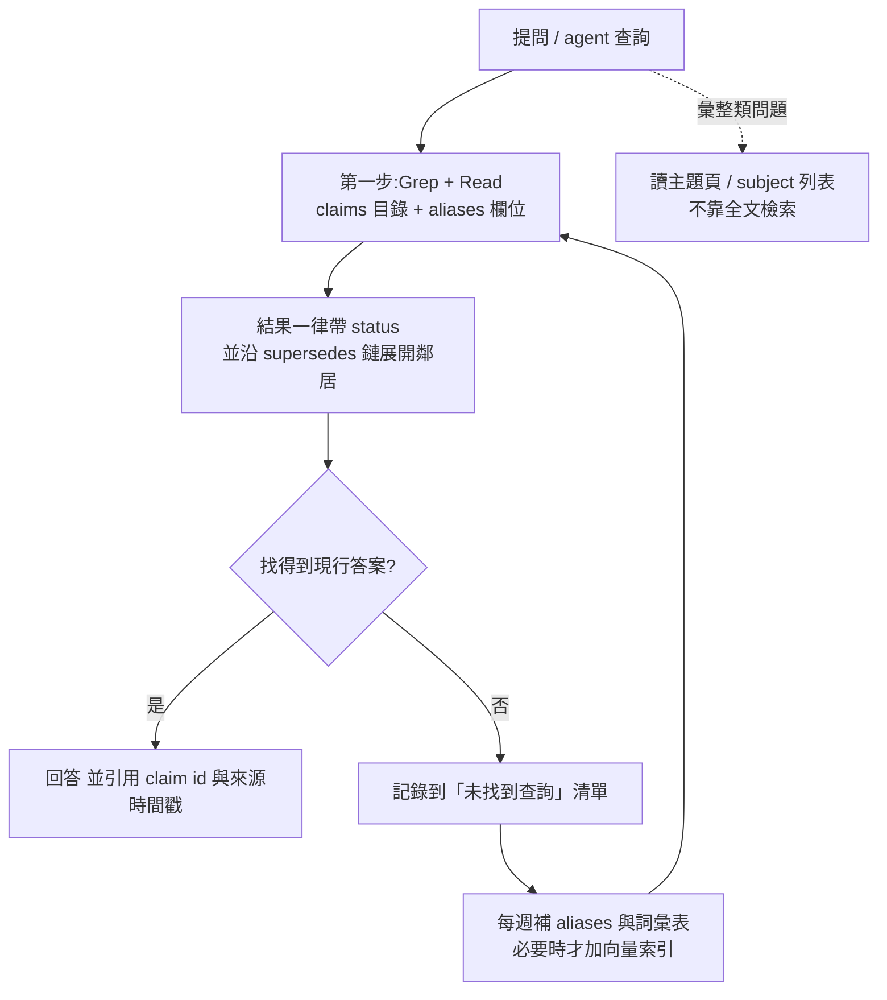

# 部門級 Knowledge Database 架構研究:第四輪(把「grep / 向量 / 混合檢索」知識套進 Team KB 並模擬)

> 延續 [REPORT.md](./REPORT.md)、[REPORT-2.md](./REPORT-2.md)、[REPORT-3.md](./REPORT-3.md)。本輪輸入是知識庫裡的檢索筆記:[grep vs 向量(PwC 論文,含 §7 IBM 檢索金字塔、§8 原文核對)](../../knowledge/technology/ai-agents/memory-retrieval/grep-vs-vector-agentic-search.md)。
> 目的:使用者明後天要在公司開始建立 workflow,先用沙盒模擬「檢索層該怎麼配」,少走冤枉路。
> 程式與結果在 [`lab4/`](./lab4/)(只含程式、別名、查詢擴充、彙總表;逐題 logs 與 3,000 單元語料在 `data/` 不進版控)。路徑寫死在沙盒,重跑需改 `SB`、`REPO`。
> **全域限制(先看):** 虛構資料;查詢 43 題、agent 16 題,單次取樣;gold 與干擾語料都是我(Sonnet 5.5)寫的;干擾是模板產生,不是真實文件;最大規模 3,080 單元(不是數萬);嵌入模型只有 bge-small-zh(小模型);agent 是 Haiku `--effort low`。**任何差距小於約 0.1(離線)或 2 題(agent)都視為噪聲。**

## 1. 一頁結論

1. **規模會吃掉小樣本的好結果。** 同一批 43 題、同樣的方法,hit@5 在 80 單元約 0.85–0.9,在 380 單元約 0.5–0.65,在 3,080 單元約 0.45–0.5。REPORT 1–3 的 30 條 claim 實驗不能直接代表真實部門 KB。
2. **最划算的改進是「入庫時加別名 + 查詢時擴字」,不是上向量資料庫。** 3,080 單元下:BM25 約 0.47;單加 aliases 約 0.56;單加查詢擴充約 0.51–0.60;**兩者都加約 0.77**。詞彙落差題(換說法的問法)從 0.33 升到 0.92。
3. **混合檢索(BM25 + bge-small 向量,RRF)沒有贏過單用 BM25**:L 規模 0.42–0.47 對 0.47,加了別名與查詢擴充後同為 0.74–0.77。本輪沒有看到向量的可量測優勢(`vec+alias` 與 `bm25+alias` 同為 0.56),不值得第一天就建;更強的嵌入模型沒測。
4. **過期 claim 的處理方式差很多,而且「隱藏」是錯的。** 11 題「新舊同詞或舊前提」:原排序只取得現行 claim 2/11;隱藏過期 4/11;降權 4/11;**原排序 + 沿 `supersedes` 鏈展開鄰居 8/11**。這和 REPORT-3 的 D1c「靜默失憶」同方向,現在有檢索層的證據。
5. **agent 自己會補償檢索缺陷,但要付出輪數。** 3,080 單元、16 題:只給 Grep/Glob/Read(A、B)**16/16**,平均 12.5 輪、US$0.22;混合檢索 CLI 單用(C)12/16、9 輪;CLI + Grep(E、F)14–15/16、約 9 輪、US$0.115(約一半)。**單靠 CLI 的失敗主要是「同詞彙的別組 claim 把前 8 名擠滿」**。
6. **彙整類問題(「RT 路徑有哪些禁止事項」)是共同弱點。** 離線 recall@8 只有 0.1–0.5;agent 組只有 A、B(全檔 grep)達標,CLI 組 4 組全失敗。依 `subject` 展開在 M4(IPC 全部決定)從 0.17 到 1.00(4 題的個案)。這類問題要靠主題頁 / facet,不是更好的全文檢索。
7. **英文查詢打中文 claim 仍弱**(E 類 0.4–0.6),別名中的英文詞不夠;需要雙語詞彙表。

## 2. 把論文與 IBM 影片的知識對應到 Team KB

| 來源的發現 | 在 Team KB 裡的對應 | 本輪怎麼測 |
|---|---|---|
| inline grep 在逐字片段型問題強(PwC) | claim 是短而精確的句子,L1 層很適合 grep | 離線 grep 對照、agent A/B |
| harness 與交付路徑和檢索器同等重要(PwC) | 我們的 harness = AGENTS.md + 工具;結果印出 vs 寫檔 | agent C(inline)vs D(寫檔) |
| 詞彙落差才是向量的存在理由(IBM) | claim 用工程師的詞,提問者用口語、英文、別組用語 | G、E 類;aliases 與查詢擴充 |
| 金字塔:不檢索 → grep → 索引 → 專用庫(IBM) | 先檔案 + grep,再依失敗資料往上爬 | 規模 S/M/L 與模式比較 |
| 論文的 Chronos 「grep」其實含向量種子(§8) | 我們的「grep 組」也不能偷偷含別的訊號 | 實驗中避免;並抓到自己的偏差(見 §6) |
| 論文:結論只限逐字片段型任務 | 彙整、歷史、現況題不是逐字片段 | N、S、M、H 類 |

## 3. 實驗設計

**語料(三種規模)** 真實 seed:30 條 claim + 12 場會議共 50 句逐字稿(來自前三輪沙盒)。
- S:僅 seed(80 單元)。
- M:+300 條「同詞彙」干擾 claim(12 個虛構模組 × 12 種句型:預算、不得使用 mutex、deprecated、平台 tier……,25% 標為已取代)。
- L:+1,500 條干擾 claim + 1,500 行知識庫雜訊文字(合計 3,080)。

**43 題(執行前寫定 gold)** L 字面 8、G 詞彙落差 12、N 現況 6、S 舊前提 5、M 彙整 4、E 英文 5、H 歷史 3。

**方法**
- `grep`:單次字面,以命中的不同 token 數排序(無 idf)。
- `bm25`(單字 + 雙字)、`bm25b`(僅雙字)、`bm25j`(jieba)。
- `vec`:bge-small-zh-v1.5(fastembed)。
- `hyb`:BM25 + 向量 RRF。
- `+alias`:入庫時由 Haiku 為每條 claim 產 6–12 個別名(口語、同義、中英互換),**別名產生時沒看到題目**;干擾 claim 用規則式同義詞補別名。
- `+qx`:每題由 Haiku 擴成 8–15 個關鍵詞(**沒給 KB 內容**)。

**agent 實驗** Haiku low,16 題(G1 G2 G5 G6 G7 G8 G11 N1 N2 N5 S1 S2 S4 M1 E1 E4),3,080 單元存成檔案:
- A:claim 檔(含 status、superseded_by)+ Grep/Glob/Read。
- B:A + claim 的 `aliases:` 欄位。
- C:B + `kbsearch.py`(混合檢索,印出 status 與取代鏈鄰居),只給 CLI 與 Read。
- D:同 C,但結果寫檔、只印路徑(file-based)。
- E:C + Grep/Glob/Read(Claude Code 的真實配置)。
- F:E + 把「只差模組名的同型 claim」折疊成一列並註明另有幾條(模擬 REPORT-3 的作用域模型)。

評分:答案必須命中預先寫好的事實與 claim id 的正則;M1 要求引用 5 個 gold id 中至少 4 個。

## 4. 結果

### 4.1 離線檢索:規模與方法(hit@5 / MRR,43 題)

| 方法 | S(80) | M(380) | L(3,080) |
|---|---|---|---|
| grep(單次字面) | 0.86 / 0.57 | 0.63 / 0.38 | 0.37 / 0.28 |
| bm25 | 0.88 / 0.61 | 0.53 / 0.40 | 0.47 / 0.33 |
| vec(bge-small-zh) | 0.84 / 0.59 | 0.67 / 0.52 | 0.49 / 0.42 |
| hyb(BM25+向量) | 0.91 / 0.62 | 0.53 / 0.45 | 0.47 / 0.40 |
| bm25 + alias | 0.95 / 0.74 | 0.65 / 0.52 | 0.56 / 0.45 |
| bm25 + qx | 0.77 / 0.63 | 0.49 / 0.46 | 0.51 / 0.41 |
| vec + alias | 0.95 / 0.73 | 0.70 / 0.58 | 0.56 / 0.45 |
| **bm25 + alias + qx** | **1.00 / 0.78** | **0.74 / 0.70** | **0.77 / 0.66** |
| **hyb + alias + qx** | **1.00 / 0.80** | **0.81 / 0.73** | **0.77 / 0.69** |

完整表(含 bm25b、jieba、各題型欄位)見 [`lab4/summary.md`](./lab4/summary.md)。

**題型拆解(L 規模,hit@5)**

| 題型 | 基線 bm25 | + alias | + qx | + alias + qx |
|---|---|---|---|---|
| L 字面 | 0.50 | 0.62 | 0.38 | **1.00** |
| G 詞彙落差 | 0.33 | 0.67 | 0.67 | **0.92** |
| E 英文 | 0.40 | 0.40 | 0.20 | 0.60 |
| H 歷史 | 1.00 | 0.33 | 0.33 | 1.00 |

- **別名與查詢擴充互補**:別名補「文件端沒寫到的說法」,查詢擴充補「問者端的說法」;一起用才把字面題也救回來(干擾多時,單字面比對被同句型干擾 claim 淹沒,擴字後的多個詞能鎖定唯一 claim)。
- **單獨用 `+qx` 有副作用**:H 類從 1.00 掉到 0.33、E 類掉到 0.20。看了擴充內容:沒有 KB 脈絡的 LLM 會漂移(例如把 `RT thread` 擴成「討論串、留言串」)。**正式做法是讓 agent 在迴圈內、看過 KB 結果後再改寫查詢,不是在檢索前單獨擴字。**
- 向量沒有穩定贏:`vec` 與 `bm25` 在 L 同為 0.47–0.49;配對比較 `hyb` vs `bm25` 各贏 4 題(L 規模)。
- 分詞(單字+雙字 / 僅雙字 / jieba)差異在噪聲內。

### 4.2 過期 claim 策略(L 規模,N 6 題 + S 5 題,取 top5)

| 策略 | 取得現行 claim | 其中 N(現況) | 其中 S(舊前提) | 看得到被取代版本(可警示) |
|---|---|---|---|---|
| P0 原排序 | 2/11 | 2/6 | 0/5 | 6/11 |
| P1 隱藏過期 | 4/11 | 3/6 | 1/5 | 0/11 |
| P2 過期降權(×0.5) | 4/11 | 3/6 | 1/5 | 0/11 |
| **P3 原排序 + 展開 supersedes 鄰居** | **8/11** | 4/6 | **4/5** | 8/11 |

舊前提題(「預算是 200µs 對嗎」)檢索一定先撈到過期 claim;隱藏它就找不到現行答案,**只有沿取代鏈走過去才拿得到 `CL-0026`**。未解的 3 題(N5、N6、S5)都是同一現行 claim 的措辭離問句太遠。

### 4.3 agent 實驗(16 題,3,080 單元)

| 條件 | 工具 | 答對 | 平均輪數 | 花費 |
|---|---|---|---|---|
| A | Grep/Glob/Read | **16/16** | 12.8 | US$0.220 |
| B | A + aliases 欄位 | **16/16** | 12.4 | US$0.214 |
| C | CLI(inline)+ Read | 12/16 | 9.0 | US$0.150 |
| D | CLI(寫檔)+ Read | 15/16 | 9.4 | US$0.122 |
| E | CLI + Grep/Glob/Read | 14/16(其中 1 題是只引用會議號未引 claim id,實質答對,**實質 15/16**) | 9.5 | US$0.116 |
| F | E + 同型 claim 折疊 | 15/16 | 8.8 | US$0.113 |

- **失敗全部集中在 M1(彙整)與 C 組**:C 的 G5(互斥鎖)、G7、E1 三題失敗,看答案原文都是「前 8 名被 net、ui、sensor 等別組的同型 claim 佔滿」,agent 從別組 claim 拼出結論,沒看到 framework 的總則。M1 在 C、D、E、F 都沒湊齊 4 個 gold id,只有 A、B(逐檔 grep)達標。
- **A 與 B 沒有差別**(16/16 對 16/16):在這個規模 agent 自己改寫 grep 詞就能補上詞彙落差,aliases 的價值要在更大規模或較弱模型才會顯現(**沒測**)。
- **A/B 的代價是輪數與成本**:12.5 輪對約 9 輪,成本約 2 倍;且每輪讀檔會吃上下文。3 千單元 OK,數萬單元沒測,論文的實驗二顯示規模變大時行為不單調。
- **交付路徑(inline vs 寫檔):C 12/16 對 D 15/16,但 3 題差距在噪聲範圍,無法下結論**。我不採用「寫檔較好」這個結論。
- 折疊(F)對 E:14→15,且輪數、成本略降,**單看分數是噪聲,但方向與成本一致**,視為「值得做、不保證」。

### 4.4 其他單項測試

- **覆蓋率係數(coordination factor)**:BM25 乘上「命中不同查詢詞比例」,L 規模 0.47→0.49,無實質效果。
- **依 subject 展開(4 題彙整)**:M4 recall 0.17→1.00;M3 已是 1.00;M1 維持 0.60;M2 0.17→0.33。只是個案,表示「彙整題要靠主題頁 / facet」,不是證明。

## 5. 對 Team KB 設計的修訂(明後天可直接照做)

**第一天**
1. **檢索先用 Grep + Read,不要先建向量庫。** claim 一條一檔、frontmatter 放 `status`、`superseded_by`、`supersedes`、`source`;3 千單元內 agent 組 16/16。
2. **claim 加 `aliases:` 欄位**(入庫抽取時由 LLM 產 6–12 個口語、同義、中英互換詞,人審核時順便看):離線證據最強(L 規模 +0.1,與查詢擴充合用 +0.3);**要有中英雙語**(英文查詢仍弱)。
3. **搜尋工具的輸出規格(最重要)**:顯示 `status`、**永遠不要隱藏過期 claim**、自動附上取代鏈鄰居、同型 claim 折疊並註明還有幾條。若用 Claude Code 內建 Grep,就在 AGENTS.md 寫:「找到 claim 後必須檢查 `superseded_by`,並 grep 該 id 找取代者」(此段規則**本輪沒單獨測**,是由 P3 結果推得的設計)。
4. **AGENTS.md 寫三條行為規則**:①至少用 3 種說法查(中文、英文、口語);②答案要附 claim id、日期、現行與否;③找不到就說找不到。
5. **彙整類問題走主題頁**:L2 的 topics/*.md 與 subject 列表(REPORT-1 已有),不要期待全文檢索湊齊清單。

**第一週**
6. **建自己的 30–50 題題庫**(用同事真的問過的問題,gold 先寫),每週跑一次 hit@5(`lab4/` 的流程可改寫);**記錄所有「未找到」**,用來擴 aliases 與詞彙表。
7. **只有在「別名補完仍有大量落差題」時才加向量索引**;先用既有資料庫的向量欄位(IBM 金字塔第三層),且要在你們的語料上實測,**本輪的小嵌入模型沒贏過 BM25,更強的模型沒測**。

**不要做**
- 不要把 supersede 過的 claim 排除在搜尋外(P1 只拿到 4/11)。
- 不要在檢索前用沒有 KB 脈絡的 LLM 單獨擴字(H、E 類會變差);讓 agent 在迴圈內改寫。
- 不要用「依專案各存一份」去避免同型 claim 淹沒結果;用作用域欄位(REPORT-3),讓同型 claim 只佔一列。

## 6. 方法學自查(我犯過的錯與沒辦法排除的偏差)

- **同分排序偏差(已修):** 第一次跑 grep 組得到 hit@5 0.70,看起來勝過 BM25。原因是同分時穩定排序偏袒排在前面的 seed claim;把單元順序打散後降到 0.37。**上面所有數字都是修正後。** 教訓:任何「命中數排序」的結果都要隨機化同分順序,真實的 `grep` 以檔名排序也會有這種隱性偏差。
- **折疊功能的程式 bug(已修):** 第一次 F 組的折疊沒有生效(字串裡混入不可見的退格字元,正則失效);發現後停掉重跑,F 組結果只用修好後的。
- **題目與 claim 都是我寫的:** G 類改說法有刻意設計;真實使用者的說法分佈可能更廣,也可能更貼近 claim。
- **干擾是模板:** 同句型重複率高,對「同詞彙淹沒」是壓力測試,但沒有真實文件的長尾與語意干擾;`+alias` 對干擾也用規則式別名,和 seed 的 LLM 別名品質不同。
- **別名與查詢擴充都用 Haiku**,agent 也是 Haiku;同家族模型可能互相補得比跨家族好。
- **agent 評分用正則**:E 組有一題實質答對卻因沒引用 claim id 被判錯;C 組的失敗我逐一讀了答案原文(確為被別組 claim 擠掉)。
- **沒測:** 數萬單元、更強的嵌入模型、reranker、真實文件(PDF、投影片、會議逐字稿的長段落切塊)、多人同時查詢、地端小模型當 agent。

## 7. 仍需要使用者決定的點

1. **claim 的別名由誰審?** 建議入庫抽取時自動產、審核者順手看一眼;若要求每條人工審,吞吐量會掉。
2. **「找不到」清單放哪、誰每週維護?** 這是檢索品質的回饋迴圈,沒人維護就會停滯。
3. **是否接受 agent 輪數 ×1.4 換更高的查全率**(A/B 對 CLI 組)?公司若對成本敏感,CLI + 折疊(F)較省。
4. **公司能用哪種 agent(內部模型 / Claude Code 類)?** 本輪結果是 Haiku low + Claude Code 式工具;換平台要重測。
5. REPORT-3 §5 的六個決策仍然有效,本輪沒有改變其中任何一項。

### 7.1 決策紀錄(2026-11-08,使用者拍板)

| 決策 | 結論 |
|---|---|
| REPORT-3 §5-1 scope 維度 | 維持三個:project / platform / branch,真有需要再加客戶或產品線 |
| REPORT-3 §5-2 同具體度衝突 | 一律要有人寫明確 claim(例如補一條「Windows + LTS」),不預設 LTS 優先 |
| REPORT-3 §5-6 缺 scope | agent 反問並列出各情況 |
| REPORT-4 §7-1 別名 | 入庫時 LLM 自動產生,審核者順手看一眼,不逐條人工審 |
| REPORT-4 §7-2 「找不到」清單 | 每週指定一人輪值維護 |
| REPORT-4 §7-3 成本 | 接受 agent 輪數 ×1.4 換更高查全率 |
| REPORT-4 §7-4 平台 | Claude Code 類 agent,與本輪實驗平台相同,結果可直接套用 |

REPORT-3 §5 的其餘項(例外 scope 負責人、共存最長期限、`deprecated` 改名 `sunsetting`)尚未決定。

## 8. 來源與核實

- 論文與 IBM 影片的細節見 [grep vs 向量筆記](../../knowledge/technology/ai-agents/memory-retrieval/grep-vs-vector-agentic-search.md);論文數字已對 [arXiv:2605.15184](https://arxiv.org/html/2605.15184v1) 原文核對(§8)。
- 嵌入模型:[BAAI/bge-small-zh-v1.5](https://huggingface.co/BAAI/bge-small-zh-v1.5)(經 fastembed 的 ONNX 版本,讀取程度:只使用,未讀模型卡)。
- 實驗規模:離線檢索 43 題 × 約 30 種設定 × 3 種規模(無 LLM 成本);Haiku 擴充 44 次(US$0.04);agent 共 96 次(A–F 各 16 題,含 E、F 重跑一次,US$約 0.9)。
