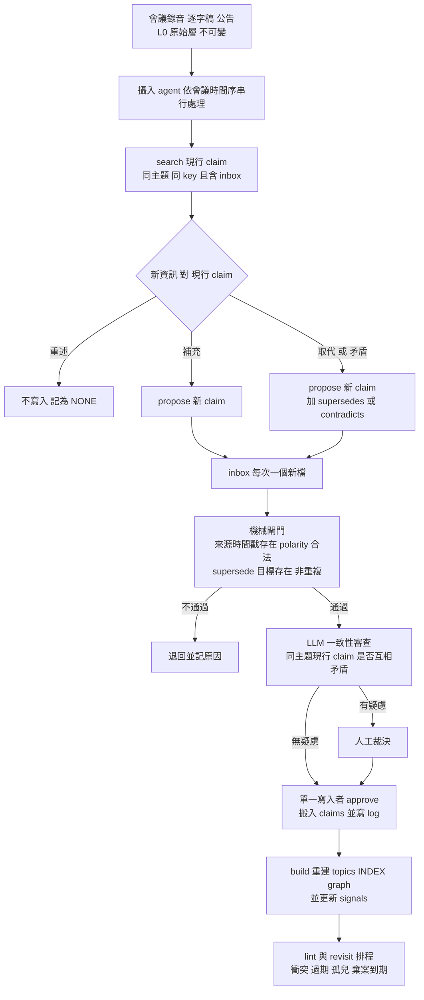
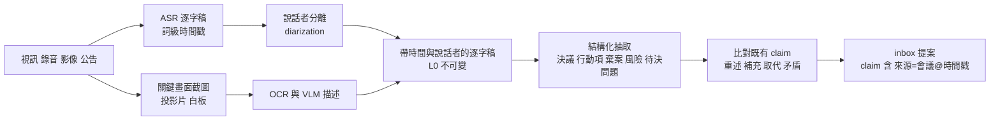
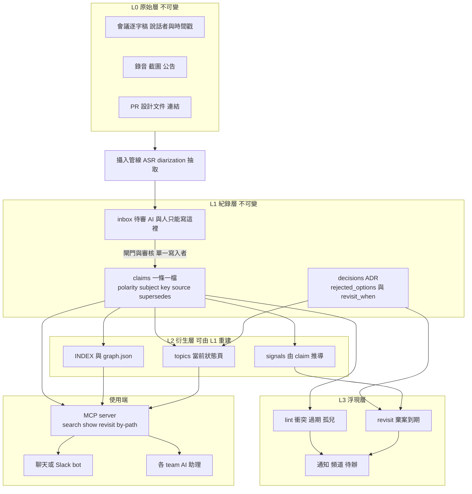

# 部門級 Knowledge Database 架構研究

> 研究日期:2026-11-07。由 Sonnet 5.5 子 agent 執行,沙盒實驗以 headless Haiku 模擬多人並行讀寫。
> 範圍:Q1 知識演進、Q2 棄案、Q3 檢索/圖譜/否定句、Q4 並行讀寫、Q5 會議攝入、Q6 大型程式庫連動、Q7 易用性。
> 證據分級:**[A]** 讀原始碼(clone 後讀所引關鍵檔,非全 repo);**[B]** 讀 README/文件節選;**[C]** WebFetch 小模型摘要(未讀全文);**[D]** 只看搜尋結果摘要;**[E]** 本沙盒實測;**未能核實**。
> 聲明:本報告沒有任何來源達到「逐字讀完」,來源逐一標註見 §8。沙盒與完整 logs 在 `data/sandbox/`(不進版控)。

## 1. 一頁摘要

建議架構是三層加一層浮現。檢索先用「全文索引、型別化連結、LLM 判讀」,不要一開始就上 GraphRAG 或圖資料庫。

| 層 | 內容 | 可變性 | 誰寫 |
|---|---|---|---|
| L0 原始層 | 錄音、逐字稿(`[mm:ss]` 加說話者)、截圖、公告、PR 與設計文件連結 | 不可變,只新增 | 攝入管線 |
| L1 紀錄層 | 原子 claim(一條一檔)、ADR(含棄案與重評條件)、會議紀錄 | 建立後不可變;更動只能新增一筆並以 `supersedes` 指向舊筆 | AI 提案,人審核 |
| L2 衍生層 | 主題現況頁、INDEX、graph.json | 可整頁覆寫,但必須能由 L1 重建與稽核 | 腳本或 LLM 重建,人不直接改 |
| L3 浮現層 | 重評條件掃描、衝突、過期、孤兒 lint | 報表 | 排程 |

**十個關鍵結論**
1. **重建是支點**:claim 不可變,狀態由 `supersedes` 邊推導。沙盒 30 多條 claim、多 agent 並行寫入,0 覆蓋、0 重複檔。[E]
2. **推導不等於正確**:M14/M15 的 write-skew(兩個 agent 同時攝入,看不到彼此 inbox)通過了所有結構 lint,現況頁同時列出兩條矛盾的有效 claim。[E] 解法是攝入依會議時間序串行,加批次後的 LLM 一致性審查。
3. **棄案是一等公民**:ADR 的 considered options 只有文字,不能被浮現。需要分類碼 `rejected_because` 和機器可判斷的 `revisit_when`。但 `signals.json` 沒人更新就會誤判(`schedule_pressure` 仍是 high,實際 M13 已解除),訊號必須由 claim 衍生。[E]
4. **否定句**:embedding 與 BM25 都不區分極性(數據見 Q3)。對策是原子 claim、`polarity`、`status`,最後交給 LLM。
5. **必要與過度**:BM25、frontmatter 型別化連結、LLM 判讀、輕量 lint 是必要的。向量加 rerank 是第二階段。GraphRAG 社群摘要、圖資料庫、自動實體圖譜在幾萬份文件、問題多為「現況、歷史、限制」時是過度設計。
6. **對照實驗**:小語料上,只有 grep 的對照組答案品質接近處理組(8 題都大致答對、都有引用)。差異只在輪數(5.5 對 8.9)和靜默過期錯誤(對照組 2 題把已被推翻的 220µs 當最新預算)。這個規模拉不開差距,不能外推。[E]
7. **寫入**:Edit 工具的樂觀鎖讓 3 個 agent 共編單頁全數成功且正確,比 claim 管線好。[E] 但它依賴工具行為、無法稽核、無法重建。建議人與 AI 一律只寫 inbox,由單一寫入者(CI 或 bot)審核併入。
8. **出處閘門**:每條 claim 必附 `會議@時間戳`,approve 時機械驗證該時間戳存在。擋得住瞎編出處,擋不住出處真實但詮釋錯誤,後者靠人抽審和一致性審查。
9. **ADR 狀態**必須是推導欄位,或在 lint 中強制檢查。[E]
10. **地端**:BM25、本地嵌入、WhisperX、pyannote community-1 皆可離線。LLM 判讀層若不能出公司,小模型能否勝任語意矛盾審查未能核實。

**最不確定的三件事**
1. 規模外推:語料只有 16 場會議、單次取樣、自己評分,數萬份文件時的表現與語意矛盾審查的準確率、成本完全沒驗證。
2. LLM 判讀層能否地端:內部小模型行不行、ASR 同音錯字有多少進到 claim,沒量。
3. 寫入模型取捨:Edit 樂觀鎖單檔共編在實驗中贏了 claim 管線;`Write` 整檔覆寫、跨機器 git、更大規模都沒測,「inbox 加單一寫入者」是否值得其複雜度只有設計論證。

## 2. 逐題調查與結論

### Q1 知識的演進模型

| 模型 | 機制 | 優點 | 缺點與本情境問題 | 證據 |
|---|---|---|---|---|
| ADR(Nygard) | 一決策一檔、編號不重用、舊決策標 superseded 並指向新者,不刪除 | 保留脈絡、好稽核、小檔易讀 | 只管決策,不管規則與事實;`status` 靠人手改 | [C] |
| MADR 4.0 | 加 Considered Options、Pros and Cons、Consequences、Confirmation、More Information;frontmatter 有 status/date/decision-makers 等,status 範例含 `superseded by ADR-0123` | 結構現成、工具多 | 沒有結構化的 revisit 條件(只在自由文字);選項無機器可讀棄因 | [A] 模板全文;[C] |
| adr-tools | `adr new -s 12 標題` 建新 ADR 並把第 12 號標為被取代 | supersede 的最小作法 | 需要編號,多人同時建會撞號;log4brains 明說不編號以避免 git merge 問題 | [B] |
| Event sourcing | 事件序列,現況即重播 | 稽核與重建天然成立 | 知識的事件粒度要自己設計 | 未能核實 |
| Bitemporal | 兩條時間軸:actual time 與 record time,追溯修正不覆蓋只追加 | 能答「當時以為什麼」與「實際是什麼」 | 查詢要兩個日期、儲存與教育成本高;Fowler 建議能避免追溯修正就避免 | [C] |
| Zep/Graphiti | 邊(事實)帶 `valid_at`、`invalid_at`、`created_at`、`expired_at`;新邊矛盾時由 LLM 判定,舊邊 `invalid_at` 設為新邊 `valid_at` | 把 bitemporal 做成圖,LLM 判矛盾 | 要圖 DB;每次寫入多次 LLM 呼叫 | [A] edges.py 等;[C] 論文 |
| Mem0 | 抽事實後由 LLM 決定 ADD/UPDATE/DELETE/NONE | 簡單 | UPDATE 與 DELETE 是覆寫,歷史不保留,不適合需稽核的團隊知識 | [A] prompts.py |
| Wiki 版本史 | 每頁一份,靠頁面歷史 | 零學習成本 | 歷史難查,讀者只看最新版,易腐爛 | [D] |
| Zettelkasten | 原子筆記加連結 | 原子化與連結思想與 claim 相同 | 無時效與狀態概念 | 未能核實 |
| docs-as-code | 文件放程式碼 repo、PR 審核、CI | 版本、審核、與程式碼同生命週期 | 錄音與會議沒有入口 | [B] TechDocs |
| Karpathy LLM-wiki | 三層(不可變 raw / LLM 擁有的 wiki / schema);ingest、query、lint;`index.md` 加附加式 `log.md` | 分層與本設計一致,lint 概念現成 | 個人尺度;wiki 頁可覆寫,沒有 claim 級不可變層;多人與多 AI 並行不在其範圍 | [C] |

**Graphiti 原始碼的三個啟示**[A]
- 矛盾判定交給 LLM,prompt 刻意保守:`NEVER mark facts as contradicted unless the new fact explicitly makes the old fact false`。它明文禁止僅憑日期較新或「有新進展」就判矛盾(`prompts/dedupe_edges.py`)。所以「是否取代」是語意判斷,機械規則不夠。
- 失效是標記不是刪除:`resolve_edge_contradictions` 只設 `invalid_at` 與 `expired_at`。
- 未來式陳述特別處理:「will/plans to」的 `valid_at` 取陳述當下,截止日不算 `invalid_at`(`temporal_edge_utils.py`)。會議紀錄常有「預計 2027-03 移除」,沙盒雛形把日期放在 statement 文字,沒處理這個坑。

**建議混合模型**

| 資料 | 模型 | 理由 |
|---|---|---|
| 逐字稿、錄音、截圖 | 不可變 L0,只新增 | 稽核根據 |
| 原子 claim | 一條一檔、不可變、`supersedes` 指向舊筆,`status`/`valid_to` 推導 | 免衝突、重建簡單 |
| 重大決策 | MADR 擴充版 ADR | 保留人類可讀脈絡 |
| 主題現況頁 | 衍生(`build` 產出,頁首標 GENERATED),可整頁覆寫 | 讀者要的是現在是什麼 |
| 人寫的設計說明 | 單檔加 changelog(PR) | 敘事文件不適合拆 claim |

**雙時間**:claim 上只放 `valid_from`(世界時間,通常取會議日)和 `recorded`(入庫日),`valid_to` 推導。不建議全面雙時間查詢。

**保證現況頁可重建與稽核**:(1) 頁首寫生成指令與來源 claim id;(2) CI 重跑 `build` 並 diff,不同就失敗;(3) 每個有效條目帶 `claim id` 與 `來源@時間戳`;(4) 禁止人工直改衍生頁。沙盒 `kb.py build` 已做 (1)(3) 和衍生頁的 GENERATED 標記,(2) 的 CI diff 與 pre-commit 強制檢查都沒做。[E]

**風險**:推導只看 `supersedes` 邊,而邊是 AI 提案的。AI 漏標邊,就會有該被取代卻仍有效的 claim(見 §5.3)。

### Q2 棄案不被遺忘

| 做法 | 對棄案的處理 | 缺口 | 證據 |
|---|---|---|---|
| ADR/MADR | Considered Options、Pros and Cons、Consequences;More Information 可寫 revisit 時機 | 重評條件是自由文字,不可掃描;棄因不可分類 | [A] |
| Rust RFC 模板 | 「Rationale and alternatives」(考慮過什麼其他設計、為何不選)、「Unresolved questions」、「Future possibilities」 | 同樣是文字;但把替代方案列為必填段是好制度 | [C] |
| Python PEP | PEP 12 確認有 `Superseded-By` 標頭 | `Rejected Ideas` 段未能在 PEP 12 頁面核實 | 未能核實 |
| log4brains | ADR 當 docs-as-code、時間軸、可搜尋;README 列「Decision backlog」為 Coming soon | 無重評提醒 | [B] |
| Backstage TechDocs | 文件跟程式碼走;roadmap Someday 有 Trust Score 與自動文件維護通知 | 尚未實作,且是文件新舊度,不是棄案 | [B] |
| Chesterton's fence / pre-mortem / revisit date | 概念 | 沒讀到可引用來源 | 未能核實 |

搜尋範圍內沒有找到「ADR 棄案、機器可判斷重評條件、主動浮現」的現成開源工具,不代表不存在。這是需要自建的最小件。

**建議欄位**(沙盒已實作,`technical_merit` 與 `owner` 為建議新增)[E]
```yaml
rejected_options:
  - title: lock-free SPSC ring buffer logger
    rejected_on: 2026-02-17
    rejected_because: [schedule, toolchain-gcc9-no-atomic-wait]   # 分類碼
    technical_merit: better-long-term    # 區分「差」與「趕」(建議新增)
    source: M03@07:40
    revisit_when:                         # 任一成立即浮現
      - signal: toolchain.gcc>=12
      - signal: schedule_pressure==relieved
      - signal: rt_threads>4
      - on: 2027-01-01                    # 日期型,防止永遠沒人看
    owner: alice                          # 建議新增
```

**浮現機制**
1. 訊號由 claim 衍生,不是手改檔。沙盒版手改 `signals.json`,M13 的「時程壓力解除」沒人更新,`revisit` 少報一個條件,查詢 agent 還自己指出矛盾。[E]
2. 每次 approve 後和每日排程跑 `revisit`,輸出 `REVISIT-NOW` 並貼到頻道、建待辦。
3. 即使 ADR 已被取代也要掃。最有價值的棄案(ring buffer logger)掛在已被取代的 ADR-0004 上,只掃 accepted ADR 就會漏。[E]
4. 查詢命中某主題時順帶浮現。沙盒 Q8 處理組自發做到,正確列出 ADR-0003 的 `pool_requests>=2` 已成立。

**沙盒結果**:M13 攝入前,`revisit` 輸出 3 項 REVISIT-NOW(pool allocator;ring buffer logger 的 gcc≥12 與 rt_threads>4 成立、時程未成立;logger 加 memory pool),符合預期。Q4 兩組都答對「為何沒選」和「條件已變」。[E]

**風險**:`revisit_when` 寫得太模糊(「需求變了」)就無法機器判斷,要靠 ingest 時由 AI 轉成訊號式、人審核。

### Q3 連結、knowledge graph、檢索與否定句

| 方案 | 做什麼 | 對本情境 | 成本 | 證據 |
|---|---|---|---|---|
| (a) BM25 | 詞頻檢索 | 精確詞(`ipc_call`、錯誤碼、版本號)強;不懂同義;不分極性 | 極低,毫秒級 | [E] |
| (b) 向量 RAG | 嵌入相似度 | 同義與跨語言強;不分極性;精確代號弱 | 中 | [E] |
| (c) 混合加 rerank | BM25 加向量加 rerank | Anthropic 報告 top-20 檢索失敗率 5.7%、嵌入加上下文 3.7%、再加 BM25 2.9%、再加 rerank 1.9%;並說知識庫小於約 200k token 可直接塞 prompt | rerank 增延遲;上下文化約 US$1.02/百萬文件 token(雲端價) | [C] |
| (d1) 微軟 GraphRAG | 實體圖、社群、預生成社群摘要 | 針對全域主題綜述;點查詢價值低;README 警告索引昂貴 | 高 | [C] 論文;[B] |
| (d2) LightRAG | 圖加向量雙層檢索,支援增量更新與刪除,可選 reranker(README 稱約增 1–2 秒) | 較輕,仍靠 LLM 抽取 | 中高 | [B];[C] |
| (d3) HippoRAG 2 | 圖加 PageRank 聯想檢索,有 `index` 與 `delete` | 多跳題;無時效與取代語意 | 中 | [B] |
| (d4) Graphiti/Zep | 時序圖。論文 LongMemEval_S:Zep 63.8%/71.2% 對全上下文 55.4%/60.2%,延遲 3.2s/2.6s 對 31.3s/28.9s | 對話記憶 benchmark,非團隊文件;作者自承 DMR 太小 | 高 | [C];[A] |
| (d5) Cognee | 定位 Company Brain;無 LLM 時用本地 GLiNER 抽取與本地嵌入;`remember/forget` | 地端選項有意思;時效處理未能核實 | 中 | [B] |
| (d6) Mem0 | 抽事實加 ADD/UPDATE/DELETE | 覆寫式,個人與對話記憶 | 低中 | [A];[C] |
| (d7) Letta | 有狀態 agent 平台 | 抓到的 README 未涵蓋 memory block,細節未能核實 | | [C] |
| (e) LLM-wiki | LLM 維護 markdown、index、wikilink | gist 稱中等規模不需 embedding RAG;第三方警告 stale index 比沒有更糟 | 低 | [C];[D] |
| (f) frontmatter 加型別化連結 | `supersedes/contradicts/relates/decided-in/sourced-from` 寫在檔案 | 最便宜的圖,git 可 diff,免圖 DB | 低 | [E] |

**否定問題實測**[E](`neg_embed_test.py`,BGE-small-zh-v1.5,fastembed/ONNX/CPU)

| A 句 | B 句(同主題、相反極性或不同範圍) | cos(A,B) | 無關句 cos |
|---|---|---|---|
| RT 路徑不得使用 mutex logger | RT 路徑採用 mutex 保護的 logger | 0.829 | 0.589 |
| 初始化完成後不得再 dlopen plugin | plugin 只允許在初始化階段以 dlopen 載入 | 0.826 | 0.387 |
| RT 路徑不得使用 shared_ptr | 非 RT 的設定路徑可以使用 shared_ptr | 0.822 | 0.422 |
| Windows 不支援 RT 功能,IPC v2 的 Windows 版本取消 | IPC v2 先支援 Linux,Windows 之後再做 | 0.796 | 0.458 |

查詢「RT 路徑可以使用 mutex logger 嗎」的排序:「不得使用」0.911 > 「採用 mutex 保護的 logger」0.849 > 「可以使用 lock-free ring buffer logger」0.783 > 無關 0.471。BM25 對「不要用 mutex logger」與「可以用 mutex logger」兩種查詢的前幾名都同時含現行禁止 claim(CL-0011)與已被取代的採用 claim(CL-0009)。

文獻:NevIR(EACL 2024)摘要稱多數檢索模型在僅差一個否定的文件對上表現與隨機相近或更差,cross-encoder 稍好。[D] 只看到搜尋摘要,未開啟論文。

**是好是壞**
- 對召回是好事:問「我可以用 X 嗎」,最該看到的往往正是「禁止 X」。
- 對直接取 top-1 是壞事:相似度高不等於同意。上例 top-1 是否定句,而「採用」那句是已被推翻的舊版。
- 真正的危險是極性、時效、範圍的組合。沙盒裡「初始化可用 exceptions」和「RT 不可用 exceptions」同時有效,是範圍不同,不是矛盾。兩組 agent 都處理對了。

**建議設計**(由便宜到貴)
1. 原子 claim:一條只說一件事,範圍寫進句子。
2. `polarity` 欄位,檢索結果一律顯示 `[要/POS]`、`[禁止/NEG]` 與 `current` / `SUPERSEDED by`。沙盒 16 次查詢無一把否定句讀反。[E]
3. 型別化邊,檢索後沿邊展開一跳,把被取代的鏈一起交給 LLM。
4. 最後由 LLM 判讀,Graphiti 的做法也是如此。
5. 寫入時做矛盾偵測:新 claim 入庫前取同主題的現行 claim,讓 LLM 判 duplicate、contradicts、supersedes。沙盒缺這一步,導致 M14/M15 write-skew。NLI 模型可作第一道篩,中文技術句上的表現未能核實。

**部門規模下哪層必要**(估計,非實測)

| 層 | 判斷 |
|---|---|
| BM25 全文索引 | 必要 |
| frontmatter、型別化邊、推導狀態 | 必要 |
| LLM 判讀與 lint 審查 | 必要 |
| 向量檢索加 rerank | 第二階段 |
| GraphRAG / LightRAG / HippoRAG | 除非有跨整個語料的主題綜述需求,否則過度設計 |
| Graphiti 式時序圖 DB | 第一年過度設計;claim 到十萬級且需多跳關係查詢再評估 |

**風險**:嵌入實測只有 4 組句對、1 個小模型,不能代表大模型或 cross-encoder。NevIR 數字未親自驗證。

### Q4 多人加多 AI 並行讀寫

| 機制 | 效果 | 限制 | 證據 |
|---|---|---|---|
| git 分支加 PR | 人類審核、可回溯 | 每條 claim 一個 PR 太重,AI 高頻寫入會淹沒審核者 | 一般做法 |
| file-per-fact 加隨機 ID | 不同人不改同一檔,無 merge 衝突 | 需 `supersedes` 補更新語意;檔案多 | [E];[B] log4brains |
| append-only | 不覆蓋歷史 | 讀取要折疊 | [E] |
| 單一寫入者加鎖 | 序列化決策點 | 審核才是瓶頸,不是鎖 | [E] |
| 樂觀鎖(Edit 的「檔案被改過」拒絕) | 防 lost update | 僅同工具同機;`Write` 整檔覆寫未測 | [E] |
| CRDT | 無鎖合併文字 | 對語意矛盾沒幫助 | 未能核實 |
| worktree | 每個 agent 一份副本 | 是隔離,不是合併 | 一般做法 |
| 單一現況頁加 LLM 讀最新再改 | 小規模最簡單,實驗中最準 | 無稽核、無法重建 | [E] |

**流程**



**審核分級**

| claim 類型 | 審核 |
|---|---|
| 純事實且來源逐字相符(例:支援矩陣新增一列) | 自動通過加事後抽審 |
| 規則、政策、決策、`supersedes` 既有規則 | 必須由 subject owner 人審 |
| 觸及 hard real-time 預算與介面契約 | 必須人審,建議雙人 |
| AI 推論(非逐字) | 標 `confidence: inferred`,查詢時顯示警示,不進現況頁 |

**幻覺寫入的防線**
1. 每條 claim 必附 `source=M<nn>@mm:ss`,approve 驗證會議與時間戳存在。偽造時間戳 3/3 被拒。[E]
2. 逐字稿該時間戳的原句與 claim 做句級對應檢查。沙盒未做,只驗證存在。
3. 標 `author: ai:<id>` 或人,查詢時可過濾未經人審者。
4. 來源可信度標記:ASR 逐字稿可能有同音錯字、公告、他人轉述。
5. 定期 lint。[E] 沙盒 `lint` 已能報 CONFLICT、FORK、ORPHAN-MEETING、PENDING、缺 revisit。

**沙盒並行結果**[E]
- 4 個 Haiku 攝入 agent 同時寫 inbox:7 個新檔,0 覆蓋、0 重複。另用 8 個 `propose` 行程同時啟動,8 檔全在。
- 2 個 `approve` 同時跑:一個取得鎖,另一個回報 `LOCKED`,最終 claims 數為 45(30 加 7 加 8,另 3 件無效提案留在 inbox)。
- **write-skew**:M14 與 M15 的 agent 各自 search 時,對方提案還在 inbox。M15 agent 把「維持 250µs」視為對 CL-0026 的重述而未寫入,另寫了「220 提案被棄」和「Audio 預算 250µs」兩條。兩條現行互相矛盾,`lint` 卻報 OK(沒有同 key 衝突)。
- 對照:3 個 agent 共編 `framework-status.md`,2 次被 Edit 拒絕、重讀後成功,最終頁內容完整且正確。

**風險**:審核疲勞(AI 每天產生幾十條 claim);規則型 claim 必須有 owner 排班。

### Q5 多模態會議素材攝入



| 環節 | 工具 | 事實 |
|---|---|---|
| ASR 加詞級對齊加 diarization | WhisperX | README:large-v2 約 70x 即時、wav2vec2 詞級時間戳、用 pyannote-audio 做說話者標籤 [B] |
| diarization | pyannote.audio | `community-1` 可本地執行(需在 HF 同意條款並用 token 下載);`precision-2` 是雲端付費。README 表列 community-1 的 DER:AMI 17.0、DIHARD3 20.2、CALLHOME 26.7、VoxConverse 11.2 [C] |
| 中文 ASR | 本倉庫 CLAUDE.md 的既有經驗:SenseVoice-Small、faster-whisper large-v3-turbo int8 加 initial_prompt | 取自使用者自己實測,本研究未重測 |
| 畫面 | 時間點截圖讀圖校正專有名詞 | `video-transcript-verify` 流程已驗證;OCR/VLM 選型未能核實 |
| 抽取 | LLM 抽決議、行動項、棄案、風險 | 沙盒 4 次 Haiku 攝入:claim 語意正確,能引用時間戳並主動「決定不寫」重述項;但漏掉 signals 更新,M15 漏寫關鍵 claim [E] |

**回溯到哪場會議哪個時間點**:逐字稿固定 `[mm:ss] 說話者: 句子`,檔頭有 `recording:` 連結;claim 的 `source: M05@05:10`;答案把它轉成影片連結(提前 10 秒)。approve 驗證時間戳存在(已做);驗證原句內容與 claim 相似(未做)。時間只能來自逐字稿時間戳,不能由 LLM 估。

**機敏性與地端**
- 全程可地端:WhisperX、faster-whisper、SenseVoice 本機跑;pyannote community-1 本地推論;嵌入用本地小模型;BM25 無需模型。
- LLM 抽取與判讀層是主要外送風險。若不可外送要用內部模型,小模型能否勝任語意矛盾審查未能核實。
- 權限:L0 逐字稿依會議保密等級分區(ACL);索引與 claim 繼承來源等級;跨 team 預設只開放政策、支援矩陣、公開決策類 claim。
- 說話者標籤屬個資與管理議題,是否寫入 claim 需公司決策。

**風險**:ASR 同音錯字會變成看似有出處的錯 claim;多人搶話或遠端會議下 diarization 品質下降(CALLHOME DER 26.7%)。

### Q6 大型程式庫與 framework team 需求

| 需求 | 做法 | 驗證 |
|---|---|---|
| 介面契約、支援矩陣、效能預算、統一政策 | 都表達成 claim,`subject` 分類;預算類用 `key`(例 `rt.budget.per_cycle`)讓取代與衝突可機械偵測 | [E] 預算題最需注意 |
| 與程式碼連動 | claim 與 ADR 的 `refs:` 放 repo 路徑 glob、符號、PR;`by-path` 由路徑反查 claim | [E] 已實作,未測於真實 repo |
| 知識所有權 | 仿 CODEOWNERS:`owners.yml` 把 subject 對應到 owner team;PR 動到 `refs` 命中路徑時 CI 提醒 owner 檢查 claim 是否過期。Backstage 描述檔有 `spec.owner`,文件指 owner 也可取自附近 CODEOWNERS | [B];CI 提醒為設計建議,未測 |
| 需求追溯 | claim 到 ADR(`decided-in`)到 PR/commit;ADR 的 Confirmation 欄寫如何驗證遵守 | [A] |
| 其他 team 自然語言查 | 答案固定格式:結論(可、不可、有條件、未決、有衝突)、範圍、出處與日期、是否已取代、重評中方案 | [E] |
| 效能政策不被繞過 | 最重要的規則(RT 禁 malloc 和 mutex)同時要有自動化檢查,KB 負責「為何」與「例外登記」 | 設計建議 |

**例子**(沙盒 Q8):Vision team 問「RT 路徑可以動態配置嗎?」處理組答不可(CL-0006,M02@04:10)。相關的 pool allocator 已由 CL-0029 取代 CL-0008,M12@02:20 條件成立,排 Q1 2027 評估、未決。回答區分「禁止」和「擱置」,並指出 ADR-0003 文字未更新。[E]

**風險**:路徑 glob 與符號會隨重構失效,需要 lint「refs 指向不存在路徑」(未做)。

### Q7 通用性與易用性

| 介面 | 評估 | 建議 |
|---|---|---|
| 聊天式 | 無專業知識也能問 | 主要入口 |
| MCP server | MCP 是連接 AI 應用與外部資料、工具的開放標準,Claude、ChatGPT、VS Code、Cursor 等都支援 [C] | 把 `search/show/revisit/by-path` 包成 MCP 工具,各 team 的 AI 助理共用同一份 KB |
| Slack/Teams bot | 觸及面最大 | 第二階段,後端同一 MCP 或 HTTP |
| 靜態站 | 瀏覽、分享連結 | 衍生物,非主介面 |

**答案必備格式**(處理組規則,實測 8 題全做到)[E]:先結論;每條附 claim id、`會議@時間戳`、有效日期;引用到已被取代者要明說並給現行版本;衝突不自己挑;KB 沒有的明說沒有、不推論。

**分類**:小而穩定的 `subject`(10–30 個,有 owner)加自由 tag,定期合併同義 tag。沙盒用 13 個 subject 足以支撐全部查詢。Haiku 曾自創 key 和 subject,所以需要 subject/key 註冊表。

**其他 team 設計 feature 時帶入觀念**:開設計文件時讓 AI 對 KB 跑一輪 `search`,列出相關限制、被取代的舊觀念、擱置方案。這是 Q6 的延伸,本研究未實測。

## 3. 整體架構



**目錄與格式**(沙盒實際格式)
```
team-kb/
  AGENTS.md              # schema:給 AI 與人的規則
  raw/meetings/M05-2026-04-07-jitter-incident.md   # [mm:ss] 說話者: 句子
  claims/CL-0011.md      # 不可變
  decisions/ADR-0004.md  # 含 rejected_options
  inbox/                 # 待審,每次一個新檔
  topics/logging.md      # GENERATED,勿手改
  INDEX.md  graph.json  log.md  state/signals.json
```
```markdown
---
id: CL-0011
subject: logging
key: ""
kind: rule
polarity: negative            # 否定句不靠文字判斷
statement: RT 路徑不得使用 mutex logger(ADR-0004 作廢)
valid_from: 2026-04-07
recorded: 2026-04-07
source: M05@05:10             # 會議@時間戳,approve 時驗證存在
supersedes: [CL-0009]         # status/valid_to 由此推導
refs: [src/framework/log/*]
author: ai:haiku-u1
---
```

## 4. 多人加多 AI 日常流程

| 階段 | 動作 | 責任 | 頻率 |
|---|---|---|---|
| 攝入 | 錄音到逐字稿入 L0;AI 依會議日期順序逐場抽 claim 寫 inbox,同時抽 signal 變動 | 攝入 bot | 每場會議後 |
| 審核 | 機械閘門、LLM 一致性審查、owner 人審(規則類)、單一寫入者 approve | subject owner | 每日批次 |
| 併入 | `build` 重建現況頁、INDEX、graph;`revisit` 掃棄案 | bot | 每次 approve |
| 查詢 | 經 MCP:search、展開 supersede 鏈、LLM 依標記判讀、附出處回答 | 任何人或 AI | 隨時 |
| 回寫 | 查詢中發現過期或缺漏就 `propose`,不直接改 | 任何人或 AI | 隨時 |
| 健康檢查 | `lint`:衝突、分岔、孤兒會議、inbox 積壓、棄案缺條件、refs 失效、ADR 狀態與 claim 不一致;每週 LLM 一致性審查 | bot 加 owner | 每日、每週 |

## 5. 沙盒實驗

### 5.1 設計
- 虛構 framework team:12 場舊會議(M01–M12)對應 30 條已核准 claim、4 份 ADR;4 場新會議(M13–M16)待攝入。刻意埋入介面變更(IPC v1 到 v2、v1 deprecated 並延後移除)、效能預算(200 到 250,再被提案 220,再被推翻)、因趕時程被棄的方案(ring buffer logger、pool allocator)、被推翻的決策(mutex logger)、反義陳述(RT 不可、初始化可用 exceptions;RT 不可、設定路徑可用 shared_ptr;plugin 初始化後不可 dlopen、初始化可;RT 路徑絕對不可 dlopen)。
- 處理組是 `kb/`(claims、topics、ADR、腳本、AGENTS.md);對照組是 `kb_control/`(同樣 16 份逐字稿,agent 只能 Read/Grep/Glob)。
- Haiku 共 26 次呼叫(1 次煙霧測試加 25 次實驗,上限 30),最多 4 平行,`claude -p --model haiku --output-format json`。工作目錄複製到 `%TEMP%\kbsim`,避免讀到上層 repo 的 CLAUDE.md。Haiku 沒有因內容拒絕;權限拒絕 3 次。

### 5.2 指標結果

| 指標 | 結果 | logs |
|---|---|---|
| (a) 並行衝突、覆蓋、重複 | 4 agent 攝入加補跑 1 次:7 個 inbox 檔,0 覆蓋、0 重複;8 行程並行 propose 8 檔全在;雙 approve 一個被鎖擋下。但出現語意層 write-skew(M14/M15),結構 lint 沒報 | `p1_ingest_*`、`p4_consistency_review` |
| (a') 共編單檔 | 3 agent 同編一頁,2 次被「已被修改」拒絕,重讀後成功,最終正確 | `p2_naive_*` |
| (b) 反義問題 | 處理組與對照組各 8 題均未把否定句讀反;範圍(RT 與初始化/設定)都正確。BM25 與嵌入都同時撈到正反兩面 | `p3_*_q1..q3`、`neg_embed_bge-small-zh.txt` |
| (c) 棄案題 | 兩組皆答出:因時程與 gcc 9 缺 atomic wait、非技術差;三個重評條件現況;M13 已決定啟動。處理組另指出 signals.json 過時、ADR-0007 過期、pool allocator 也到期。對照組另指出 M02/M03 表面矛盾 | `p3_*_q4` |
| (d) 現況頁與歷史一致 | M13 後 logging、ipc 頁正確。rt-budget 頁同時列 220µs 與「維持 250µs」兩條現行;ADR-0007 未隨 claim 更新 | `run_state/topics/rt-budget.md` |
| (e) 出處、日期、取代警示 | 處理組 8/8 附 claim id 與時間戳、日期、取代標示;對照組 8/8 附時間戳與日期。對照組 Q2、Q8 把 220µs 當最新預算且未警示;Q8 把 ring buffer 的重評條件說成方案 C 的。Q5 兩組都選擇回報矛盾、不挑 | `p3_*` |
| (f) 耗時與輪數 | 處理組平均 5.5 輪對對照組 8.9 輪;牆鐘 24.1s 對 21.8s(4 平行);成本 US$0.057 對 0.055。索引減少輪數,沒減少延遲 | `summary.tsv` |
| 閘門 | 偽造時間戳、不存在的 supersede 目標、逐字重複,3/3 被拒(腳本直跑,非 Haiku) | |
| 一致性審查員 | 抓到 CL-8a87 對 CL-428f 的預算矛盾,正確判斷應採 250µs(引 M15@02:30 原文);抓到 ADR-0007 過期。但它的 `propose` 被權限擋下,沒有實際寫入 | `p4_consistency_review.answer.txt` |

### 5.3 失敗與意外
1. **write-skew**(最重要):並行攝入看不到彼此 inbox。
2. **訊號手工維護失靈**:M13 的「時程壓力解除」沒有 claim 承載。攝入 agent 說 signals 在它的寫入範圍外。
3. **ADR 狀態不跟 claim 走**:3 個查詢 agent 與審查員都獨立發現 ADR-0007 過期。
4. **權限拒絕 3/26**:Haiku 常把 `; echo ...; ls` 串在允許的指令後,被 `Bash(python scripts/kb.py:*)` 擋下(M16 首次攝入、一次 Q2 查詢、審查員的 propose)。補救是 prompt 加「只執行單一指令」。真實部署的 agent 權限規則要寫對。
5. **M15 agent 詮釋偏差**:它把「維持 250µs」視為對 CL-0026 的重述(當時合理),卻漏了這是在推翻同時進行的 M14 提案。
6. Haiku 的 `kind` 和 `polarity` 抽查全對,但曾自創 key(`audio.dsp.budget`)和 subject(`rt-dynamic-loading`),需要註冊表。

### 5.4 外推限制
- 語料極小(16 場、約 80 句),對照組的 grep 加全讀沒有壓力。不能推論 10^4–10^5 份文件下的表現,那個規模對照組一定崩潰或得靠索引,而索引品質在大規模未驗證。
- 只測了 Haiku;更強模型可能更少犯 write-skew,更弱的地端模型可能更差。
- 25 次實驗呼叫、單次取樣、無統計顯著性;自己評分,無盲評。
- 虛構資料由 agent 自己寫,答案單純;真實會議的口語、離題、指代不清、ASR 錯字沒涵蓋。
- Edit 樂觀鎖結論只適用於 Claude Code 的 Edit、同機、3 位寫者;`Write` 整檔覆寫與跨機器未測。
- 嵌入實測只有 1 個小型中文模型、4 組句對。

## 6. 分階段導入路線與成本

成本是量級估計,非實測;人力以一位熟悉的工程師計。

| 階段 | 目標 | 內容 | 估計 |
|---|---|---|---|
| 0(1–2 週) | 驗證價值,不建系統 | 選一個子領域(RT 預算加 logging 政策);把近 10–20 場會議抽成 claim;用 grep 加聊天回答真實同事的問題;記錄答錯與過期案例 | 約 1–2 人週 |
| 1 MVP(2–4 週) | 最小可行 | 固定三種檔案(逐字稿、claim、ADR 含棄案欄位);`propose`、閘門、`approve`;`build` 現況頁;`lint`;MCP 包 `search/show`;BM25;攝入串行、一致性審查每日一次;owner 制度 | 約 3–5 人週 |
| 2(1–2 個月) | 規模與棄案浮現 | 訊號由 claim 推導加 `revisit` 排程與通知;ADR 狀態改推導;`refs` 與 PR/CODEOWNERS 連動;WhisperX 加 pyannote 地端攝入 | 約 6–10 人週 |
| 3(視需求) | 檢索升級 | 本地嵌入、混合檢索、rerank(僅在 BM25 召回不足時);跨 team 開放加 ACL | 10^5 份 × 約千 token 約 10^8 token 的嵌入量,屬估算未測 |
| 晚點或不做 | | GraphRAG/LightRAG 全域摘要、圖資料庫、Graphiti | 僅在出現跨語料主題綜述需求時 |

LLM 日常成本:沙盒 Haiku 每次呼叫約 US$0.005–0.015。一般會議每場估計低於 US$0.1(雲端),地端則是算力成本。這是外推估計,未實測。

## 7. 風險與開放問題(需要使用者或公司決策)
1. **資料可否送外部 LLM**:決定整條管線的 LLM 層。若不行,是否有內部模型?本研究無法回答。
2. **誰是 subject owner、審核誰排班**:沒有 owner,規則型 claim 一定堆在 inbox,wiki 腐爛的質性主因之一。[D]
3. **說話者姓名可否入 claim**:個資與績效疑慮。建議 claim 只記角色與會議時間戳,姓名留在 L0。
4. **ADR 是否強制含棄案與重評條件**:文化與流程問題,建議用 PR 模板(Rust RFC 的替代方案必填段為先例)。
5. **跨 team 開放範圍**:哪些 subject 可被其他 team 查詢,逐字稿是否永遠不開放。
6. **hard real-time 相關回答的責任**:AI 答「可不可以」是否要免責聲明或必須人審,錯誤的後果由誰承擔。
7. **既有素材(OneNote、舊報告)遷移**:建議不全遷,被查詢到時才攝入。

**未能解決的技術風險**:(a) 語意矛盾審查在大量 claim 下的準確率與成本;(b) refs 隨重構失效;(c) ASR 錯字進入 claim 的比率;(d) 多 team 的 subject/key 命名發散。

## 8. 參考來源與讀取程度

**[A] 讀原始碼(本機 clone,讀所列檔案,非全 repo)**
- https://github.com/getzep/graphiti :讀 `graphiti_core/edges.py`(EntityEdge 欄位)、`utils/maintenance/temporal_edge_utils.py`、`utils/maintenance/edge_operations.py` 的 `resolve_edge_contradictions`、`prompts/dedupe_edges.py`。README(881 行)只確認長度,未讀全文。
- https://github.com/mem0ai/mem0 :讀 `mem0/configs/prompts.py` 的 `DEFAULT_UPDATE_MEMORY_PROMPT` 前段,其餘未讀。
- https://github.com/adr/madr :讀 `template/adr-template.md` 全文。

**[B] 讀 README 或文件節選**
- https://github.com/npryce/adr-tools :只讀 `src/adr-new` 的 usage 註解。
- https://github.com/thomvaill/log4brains :README 前段。
- https://github.com/OSU-NLP-Group/HippoRAG :README 前 120 行加 grep `index`/`delete`/增量。
- https://github.com/HKUDS/LightRAG :README grep 節選。
- https://github.com/topoteretes/cognee :README 約第 60–110 行。
- https://github.com/microsoft/graphrag :README 與 `docs/index.md` grep。
- https://github.com/m-bain/whisperX :README grep 節選。
- https://github.com/backstage/backstage :`docs/features/techdocs/README.md` 前 60 行;`descriptor-format.md` 的 owner/CODEOWNERS 段落 grep。

**[C] WebFetch 摘要(小模型摘要,未讀全文)**
- https://gist.github.com/karpathy/442a6bf555914893e9891c11519de94f (摘要自稱無法逐字重現,末 838 字元未讀)
- https://arxiv.org/abs/2501.13956 (實際取自 https://ar5iv.labs.arxiv.org/html/2501.13956 的摘要,直接 PDF 無法解析)
- https://adr.github.io/madr/ 、https://adr.github.io/ (摘要稱後者未談 revisit/supersede)
- https://www.cognitect.com/blog/2011/11/15/documenting-architecture-decisions
- https://www.anthropic.com/news/contextual-retrieval
- https://arxiv.org/abs/2404.16130 、https://arxiv.org/abs/2504.19413 、https://arxiv.org/abs/2410.05779 (皆僅摘要頁;Mem0 摘要未提 ADD/UPDATE/DELETE,該機制取自 [A] 原始碼)
- https://raw.githubusercontent.com/rust-lang/rfcs/master/0000-template.md
- https://raw.githubusercontent.com/python/peps/main/peps/pep-0012.rst (未見 Rejected Ideas 段)
- https://raw.githubusercontent.com/pyannote/pyannote-audio/develop/README.md
- https://raw.githubusercontent.com/letta-ai/letta/main/README.md (未涵蓋 memory block 概念)
- https://martinfowler.com/articles/bitemporal-history.html
- https://modelcontextprotocol.io/docs/getting-started/intro

**[D] 只看搜尋結果摘要(未開原文)**
- NevIR:https://arxiv.org/abs/2305.07614 (EACL 2024)
- 內部 wiki 失敗文章:https://www.guidejar.com/solutions/internal-wiki 、https://jmoiron.net/blog/wikis-and-false-promise-documentation 、https://dev.to/lorina_b/documentation-doesnt-scale-heres-what-we-learned-from-organizations-that-made-it-work-2l3g 、https://www.apqc.org/blog/3-biggest-problems-facing-internal-wikis 。多為廠商部落格,所引統計(如 20–30% 連結失效、47.2% 過時)無法追溯原始研究,本報告不採用任何數字,只採質性結論:無人負責、只增不刪、失信後不再使用、貢獻集中少數人。
- Karpathy LLM-wiki 第三方整理:https://zby.github.io/commonplace/sources/karpathy-llm-wiki.ingest/ 、https://blog.starmorph.com/blog/karpathy-llm-wiki-knowledge-base-guide (「stale index 比沒有 index 更糟」出自此類評論,非 Karpathy 本人)。

**未能核實**:event sourcing 細節、Zettelkasten、CRDT、Chesterton's fence、pre-mortem、NLI 在中文技術句的矛盾偵測表現、OCR/VLM 選型、Backstage 的 ADR 外掛、Cognee 與 Letta 的時效處理。

**[E] 本研究實測資料**:`research/team-kb-architecture/data/sandbox/`(不進版控),內含 `README.md`、`scripts_src/kb.py`、`make_scenario.py`、`run_agents.py`、`neg_embed_test.py` 與 `logs/`(25 組 Haiku 任務的 prompt、JSON、答案、`summary.tsv`、最終 claims/topics/naive 頁)。
